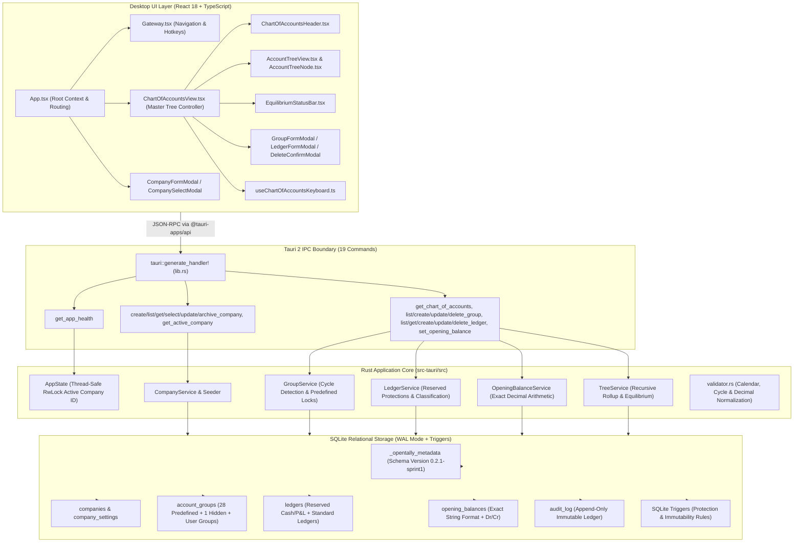

# OpenTally — Phase 2, Sprint 1: Final Completion & Architecture Review
**Milestone: Sprint 1 (Company Management & Chart of Accounts)**  
*Document Version: 1.0.0 | Date: November 1, 2026 | Clean-Room Implementation Report*

---

## 1. Executive Summary

This document serves as the formal, consolidated completion and architecture review report for **OpenTally Phase 2, Sprint 1: Company Management and Chart of Accounts**.

Following clean-room software engineering guidelines and mandatory Test-Driven Development (TDD) via ECC agent workflows (`planner`, `architect`, `tdd-guide`, `code-reviewer`), all three stages of Sprint 1 have been implemented, verified, and accepted:
- **Stage 1 (Database Migration & Integrity Foundations)**: Implemented atomic DDL migration (`0.1.0-sprint0` $\rightarrow$ `0.2.0-sprint1`), strict SQLite check constraints, partial unique indexes for reserved ledgers, and database-level cascading deletion and mutation triggers.
- **Stage 2 (Company Management & Lifecycle)**: Implemented multi-company domain models, calendar date validations (leap-year handling, financial year boundary checks), seed orchestration (28 predefined groups, 1 system group, 2 reserved ledgers), and persistent active company context across application restarts.
- **Stage 3 (Chart of Accounts Operations & Tree UI)**: Implemented full CRUD operations for account groups and standard ledgers, strict circular hierarchy rejection, exact opening balance lifecycle with decimal normalization (`rust_decimal`), sticky debit-credit equilibrium calculation, an interactive keyboard-navigable desktop tree UI, and an immutable append-only `audit_log` (`0.2.1-sprint1`).

The implementation passes all quality gates with **52 Rust tests (100% pass)**, **12 Vitest UI interaction tests (100% pass)**, **0 Clippy compiler warnings**, **0 formatting diffs**, and a clean production TypeScript build.

---

## 2. Scope & Delivered Capabilities

The following capabilities were specified in `OPENTALLY_SPRINT1_FINAL_TECHNICAL_DESIGN_v1.0.2.md` and have been delivered:

| Domain | Capability | Delivered Implementation | Acceptance Status |
|---|---|---|---|
| **Database** | Sprint 1 DDL Migration | Atomic SQLite migration `0.2.0-sprint1` executed under `BEGIN IMMEDIATE` on acquired connection. | **Accepted** (Stage 1) |
| **Database** | Relational Invariants | Composite foreign keys `(company_id, parent_id)`, `(company_id, group_id)`, `(company_id, ledger_id)`. | **Accepted** (Stage 1) |
| **Database** | Reserved Master Protection | Partial unique index `uq_company_reserved_ledger` and triggers preventing mutation/deletion of Cash and P&L. | **Accepted** (Stage 1) |
| **Database** | Numeric Input Hardening | SQLite regex-style `GLOB` check constraint rejecting negative and malformed opening balances. | **Accepted** (Stage 1) |
| **Company** | Multi-Company Isolation | Isolated multi-tenant storage partitioned strictly by `company_id`. | **Accepted** (Stage 2) |
| **Company** | Calendar & Date Rules | Strict ISO date checking, valid calendar validation, leap-year Feb 29 handling, Books-Beginning boundaries. | **Accepted** (Stage 2) |
| **Company** | Master Seeding | Atomic transaction seeding 28 predefined groups, 1 hidden system group, and 2 reserved ledgers per company. | **Accepted** (Stage 2) |
| **Company** | Active Context Persistence | Active company selection saved to `company_settings` and automatically restored on desktop reopen. | **Accepted** (Stage 2) |
| **Accounting** | Account Group Management | Group creation under existing parents, name uniqueness, reparenting, and depth-first cycle detection. | **Accepted** (Stage 3) |
| **Accounting** | Predefined Group Locks | Triggers and service validation preventing modification, reparenting, or deletion of 28 predefined groups. | **Accepted** (Stage 3) |
| **Accounting** | Ledger Master Operations | Standard ledger creation, update, and deletion with group parentage checks and name uniqueness. | **Accepted** (Stage 3) |
| **Accounting** | Hidden Group Isolation | Rejection of standard user ledgers or user groups under the hidden `Profit & Loss A/c (System)` group. | **Accepted** (Stage 3) |
| **Accounting** | Opening Balances | Precision validation against company currency decimals, trailing fractional zero normalization, zero clearing. | **Accepted** (Stage 3) |
| **Accounting** | Equilibrium & Rollups | Recursive tree rollups aggregating opening debit/credit balances; sticky equilibrium status reporting difference. | **Accepted** (Stage 3) |
| **UI** | Chart of Accounts Tree | High-density keyboard-first desktop tree navigation (`↑`/`↓` row move, `→`/`←` expand/collapse, `Enter`, `Space`). | **Accepted** (Stage 3) |
| **UI** | Hotkeys & Live Search | Live search filter (`Ctrl+F`), Group modal (`Alt+C`), Ledger modal (`Ctrl+L`), Delete (`Del`), Back (`Esc`). | **Accepted** (Stage 3) |
| **Audit** | Append-Only Audit Trail | `audit_log` table (`0.2.1-sprint1`) protected by immutability triggers recording opening balance lifecycle. | **Accepted** (Stage 3) |

---

## 3. Stage-by-Stage Implementation Summary

### 3.1 Stage 1: Database Migration & Integrity Constraints
- **Migration Orchestration**: Implemented `run_sprint1_migration` acquiring an exclusive SQLite connection and executing `BEGIN IMMEDIATE;` to execute multi-statement DDL. Metadata schema version transitions from `0.1.0-sprint0` to `0.2.0-sprint1`.
- **Integrity Validation**: Runs `PRAGMA foreign_key_check;` before commit. Rolls back atomically on any syntax, constraint, or foreign key violation.
- **Master Protection Triggers**: Implemented `trg_validate_reserved_ledger_insert`, `trg_prevent_reserved_ledger_mutation`, `trg_prevent_reserved_ledger_deletion`, `trg_prevent_group_delete_with_children`, and `trg_prevent_ledger_delete_with_opening_balances`.
- **Company Cascade Deletion**: Triggers guard company cascade deletion by ensuring protection checks only abort user-initiated mutations when the parent company row still exists (`WHEN EXISTS (SELECT 1 FROM companies WHERE id = OLD.company_id)`).

### 3.2 Stage 2: Company Management & Lifecycle
- **Domain Modeling**: Created `Company`, `CompanySettings`, `CompanyStatus` (`Active`, `Archived`, `Closed`), and strongly typed configuration for currency and financial years.
- **Date & Calendar Validation**: Strict ISO date parsing with calendar-aware bounds checking. Correctly validates leap-year dates (e.g. `2024-02-29` accepted; `2023-02-29` rejected). Rejects books beginning before financial year beginning or exceeding 1 year.
- **Seeding Orchestration**: Creates exactly 29 account groups (15 Primary, 13 Sub-Groups, 1 Hidden System Group) and 2 reserved ledgers (`Cash` under `Cash-in-Hand`, `Profit & Loss A/c` under `Profit & Loss A/c (System)`) in the same database transaction. Any failure triggers total transaction rollback.
- **Session State**: Manages thread-safe active company state via `Arc<RwLock<Option<String>>>` in `AppState`, persisted across restarts via `company_settings` key `active_company_id`.

### 3.3 Stage 3: Chart of Accounts Operations & Tree UI
- **Group & Ledger Services**: Implemented `GroupService`, `LedgerService`, `OpeningBalanceService`, and `TreeService` in modular Rust submodules (`src/accounting/service/`).
- **Hierarchy Cycle Rejection**: Implemented depth-first search cycle detection preventing parent-child loops (e.g. assigning Group A's parent as Group B when Group B is already a child of Group A).
- **Exact Decimal Normalization**: Enhanced `validate_opening_balance_amount` to normalize numeric strings (`100.2300` $\rightarrow$ `100.23`) while strictly rejecting inputs whose scale exceeds currency decimal places (`100.234`).
- **Desktop UI**: Built a Tally-styled dark desktop interface (`#0f172a` / `#1e293b`) featuring keyboard-first tree navigation, live search filtering, modal masters, and sticky financial equilibrium status.
- **Component Modularity**: Extracted `useChartOfAccountsKeyboard.ts` (146 lines) and `ChartOfAccountsHeader.tsx` (58 lines), maintaining `ChartOfAccountsView.tsx` at 271 lines.

---

## 4. Final Architecture Diagram



---

## 5. Database Schema & Migration History

### 5.1 Migration Versions

| Migration Version | Description | Target Tables & Triggers | Commit Semantics |
|---|---|---|---|
| `0.1.0-sprint0` | Initial baseline installation | `_opentally_metadata` | Standard SQLite initialization |
| `0.2.0-sprint1` | Sprint 1 core DDL | `companies`, `company_settings`, `account_groups`, `ledgers`, `opening_balances`, 5 triggers | `BEGIN IMMEDIATE ... COMMIT` on acquired connection |
| `0.2.1-sprint1` | Stage 3 incremental patch | `audit_log`, 2 indexes, 3 triggers (`trg_prevent_audit_log_mutation`, `trg_prevent_audit_log_deletion`, `trg_prevent_predefined_group_deletion`) | `BEGIN IMMEDIATE ... COMMIT` on acquired connection |

### 5.2 Table Schema Definitions

#### 1. `companies`
- `id TEXT PRIMARY KEY NOT NULL`
- `name TEXT NOT NULL COLLATE NOCASE UNIQUE`
- `mailing_name TEXT NOT NULL`
- `country TEXT NOT NULL`, `state TEXT NOT NULL`
- `financial_year_begins TEXT NOT NULL CHECK (GLOB '[0-9][0-9][0-9][0-9]-[0-9][0-9]-[0-9][0-9]')`
- `books_beginning_from TEXT NOT NULL CHECK (GLOB '[0-9][0-9][0-9][0-9]-[0-9][0-9]-[0-9][0-9]')`
- `currency_symbol TEXT NOT NULL DEFAULT '₹'`
- `currency_formal_name TEXT NOT NULL DEFAULT 'INR'`
- `currency_decimal_places INTEGER NOT NULL DEFAULT 2 CHECK (BETWEEN 0 AND 4)`
- `status TEXT NOT NULL DEFAULT 'active' CHECK (IN ('active', 'archived', 'closed'))`
- `created_at TEXT NOT NULL`, `updated_at TEXT NOT NULL`
- Constraints: `chk_books_after_fy`, `chk_books_within_fy`.

#### 2. `company_settings`
- `company_id TEXT NOT NULL REFERENCES companies(id) ON DELETE CASCADE`
- `key TEXT NOT NULL`, `value TEXT NOT NULL`, `updated_at TEXT NOT NULL`
- `PRIMARY KEY (company_id, key)`

#### 3. `account_groups`
- `id TEXT NOT NULL`, `company_id TEXT NOT NULL REFERENCES companies(id) ON DELETE CASCADE`
- `name TEXT NOT NULL COLLATE NOCASE`
- `parent_id TEXT`
- `nature TEXT NOT NULL CHECK (nature IN ('Assets', 'Liabilities', 'Income', 'Expenses'))`
- `is_primary INTEGER NOT NULL DEFAULT 0 CHECK (IN (0, 1))`
- `is_predefined INTEGER NOT NULL DEFAULT 0 CHECK (IN (0, 1))`
- `is_hidden INTEGER NOT NULL DEFAULT 0 CHECK (IN (0, 1))`
- `affects_gross_profit INTEGER NOT NULL DEFAULT 0 CHECK (IN (0, 1))`
- `created_at TEXT NOT NULL`, `updated_at TEXT NOT NULL`
- `PRIMARY KEY (company_id, id)`
- `UNIQUE (company_id, name)`
- `FOREIGN KEY (company_id, parent_id) REFERENCES account_groups(company_id, id) ON DELETE CASCADE`
- Constraint: `chk_primary_parent CHECK ((is_primary = 1 AND parent_id IS NULL) OR (is_primary = 0 AND parent_id IS NOT NULL))`

#### 4. `ledgers`
- `id TEXT NOT NULL`, `company_id TEXT NOT NULL REFERENCES companies(id) ON DELETE CASCADE`
- `group_id TEXT NOT NULL`
- `name TEXT NOT NULL COLLATE NOCASE`
- `description TEXT`
- `is_reserved INTEGER NOT NULL DEFAULT 0 CHECK (IN (0, 1))`
- `ledger_classification TEXT NOT NULL DEFAULT 'standard' CHECK (IN ('standard', 'cash', 'profit_and_loss'))`
- `created_at TEXT NOT NULL`, `updated_at TEXT NOT NULL`
- `PRIMARY KEY (company_id, id)`
- `UNIQUE (company_id, name)`
- `FOREIGN KEY (company_id, group_id) REFERENCES account_groups(company_id, id) ON DELETE CASCADE`
- Constraint: `chk_reserved_classification CHECK ((is_reserved = 1 AND classification IN ('cash', 'profit_and_loss')) OR (is_reserved = 0 AND classification = 'standard'))`
- Partial Index: `CREATE UNIQUE INDEX uq_company_reserved_ledger ON ledgers(company_id, ledger_classification) WHERE ledger_classification IN ('cash', 'profit_and_loss')`

#### 5. `opening_balances`
- `id TEXT NOT NULL`, `company_id TEXT NOT NULL REFERENCES companies(id) ON DELETE CASCADE`
- `ledger_id TEXT NOT NULL`
- `financial_year_begins TEXT NOT NULL`
- `balance_type TEXT NOT NULL CHECK (balance_type IN ('Dr', 'Cr'))`
- `amount TEXT NOT NULL`
- `created_at TEXT NOT NULL`, `updated_at TEXT NOT NULL`
- `PRIMARY KEY (company_id, id)`
- `UNIQUE (company_id, ledger_id, financial_year_begins)`
- `FOREIGN KEY (company_id, ledger_id) REFERENCES ledgers(company_id, id) ON DELETE CASCADE`
- Constraint: `chk_opening_amount_non_negative CHECK (length(amount) > 0 AND amount GLOB '[0-9]*' AND amount GLOB '*[0-9]' AND amount NOT GLOB '*[^0-9.]*' AND amount NOT GLOB '*.*.*')`

#### 6. `audit_log`
- `id TEXT PRIMARY KEY NOT NULL`
- `company_id TEXT NOT NULL REFERENCES companies(id) ON DELETE CASCADE`
- `entity_type TEXT NOT NULL` (e.g. `'opening_balance'`, `'account_group'`, `'ledger'`)
- `entity_id TEXT NOT NULL`
- `ledger_id TEXT`, `financial_year_begins TEXT`
- `action TEXT NOT NULL CHECK (action IN ('CREATE', 'UPDATE', 'CLEAR', 'DELETE'))`
- `old_values TEXT` (JSON snapshot), `new_values TEXT` (JSON snapshot)
- `performed_by TEXT NOT NULL DEFAULT 'desktop_user'`
- `timestamp TEXT NOT NULL DEFAULT (strftime('%Y-%m-%dT%H:%M:%fZ', 'now'))`
- Indexes: `idx_audit_log_entity ON audit_log(company_id, entity_type, entity_id)`, `idx_audit_log_timestamp ON audit_log(company_id, timestamp)`

### 5.3 Active Database Triggers

1. `trg_validate_reserved_ledger_insert`: Ensures Cash ledger has `is_reserved=1` and belongs to `Cash-in-Hand`; Profit & Loss ledger has `is_reserved=1` and belongs to `Profit & Loss A/c (System)`; standard ledgers cannot be placed under hidden groups.
2. `trg_prevent_reserved_ledger_mutation`: Rejects renaming, reparenting, de-reserving, or re-classifying Cash and P&L ledgers.
3. `trg_prevent_reserved_ledger_deletion`: Rejects deleting reserved ledgers while company exists.
4. `trg_prevent_group_delete_with_children`: Rejects deleting groups containing child groups or ledgers.
5. `trg_prevent_ledger_delete_with_opening_balances`: Rejects deleting ledgers with active opening balance rows.
6. `trg_prevent_audit_log_mutation`: Rejects any `UPDATE` on `audit_log` rows.
7. `trg_prevent_audit_log_deletion`: Rejects any `DELETE` on `audit_log` rows while company exists.
8. `trg_prevent_predefined_group_deletion`: Rejects deleting predefined accounting groups (`is_predefined = 1`).

---

## 6. Rust Backend Module Structure

The Rust backend (`02-open-tally/src-tauri/src`) is partitioned into focused, modular domains:

```text
src-tauri/src/
├── main.rs                 # Tauri desktop binary entrypoint (5 lines)
├── lib.rs                  # Application initialization, migrations, invoke_handler (69 lines)
├── app/mod.rs              # AppState definition with thread-safe RwLock active_company_id (21 lines)
├── config/mod.rs           # AppConfig configuration parser (33 lines)
├── logging/mod.rs          # Tracing subscriber initialization (17 lines)
├── errors/mod.rs           # Strongly typed OpenTallyError enum with thiserror (29 lines)
├── database/
│   ├── mod.rs              # DatabaseManager pool lifecycle and health checks (228 lines)
│   └── migrations.rs       # DDL definitions, migration runner, atomic test suite (1354 lines)
├── company/
│   ├── mod.rs              # Company module exports (12 lines)
│   ├── model.rs            # Company, CompanyStatus, and request DTOs (154 lines)
│   ├── validator.rs        # Calendar date, leap-year, and currency validator (128 lines)
│   ├── seeder.rs           # 28 predefined groups + system group + 2 reserved ledgers seeder (360 lines)
│   ├── service.rs          # Company CRUD, active persistence, and archive logic (249 lines)
│   └── tests.rs            # Unit and integration test suite for company lifecycle (650 lines)
├── accounting/
│   ├── mod.rs              # Accounting module exports (8 lines)
│   ├── model.rs            # AccountGroup, Ledger, OpeningBalance, Tree domain models (189 lines)
│   ├── validator.rs        # Group name, ledger name, nature match, cycle & decimal validator (128 lines)
│   ├── service/
│   │   ├── mod.rs          # Service exports (8 lines)
│   │   ├── group.rs        # Account group CRUD and hierarchy logic (228 lines)
│   │   ├── ledger.rs       # Ledger CRUD and classification enforcement (205 lines)
│   │   ├── opening_balance.rs # Opening balance upsert, clearing, and atomic audit logger (210 lines)
│   │   └── tree.rs         # Recursive chart of accounts tree aggregation & equilibrium (138 lines)
│   └── tests.rs            # Accounting test suite for groups, ledgers, opb, and tree (1045 lines)
├── commands/mod.rs         # 19 Tauri IPC command handlers + direct execution integration tests (652 lines)
├── vouchers/mod.rs         # Sprint 0 placeholder documenting voucher invariants (17 lines)
└── interoperability/mod.rs # Sprint 0 placeholder documenting Port 9000 XML daemon (15 lines)
```

---

## 7. Tauri IPC Command Inventory

All 19 Tauri IPC commands registered in `lib.rs`:

| Command Name | Active Company Required? | Arguments | Return Type | Validation & Security Behavior | Transaction Scope |
|---|---|---|---|---|---|
| `get_app_health` | No | None | `HealthResponse` | Operational status, SQLite engine, schema version, security readiness. | Read-only |
| `create_company` | No | `req: CreateCompanyRequest` | `Company` | ISO date check, leap-year validation, name uniqueness. | `BEGIN IMMEDIATE`<br>Atomic insert + 29 groups + 2 ledgers seeding |
| `list_companies` | No | None | `Vec<Company>` | Retrieves all companies ordered by creation date. | Read-only query |
| `get_company` | No | `id: String` | `Company` | Validates company existence. | Read-only query |
| `select_company` | No | `id: String` | `Company` | Verifies company is `Active` (not `Archived`); updates memory and persistent setting. | Write transaction |
| `get_active_company` | No | None | `Option<Company>` | Reads in-memory active ID or restores from `company_settings`. | Read-only / auto-restore |
| `update_company` | No | `id: String`, `req: UpdateCompanyRequest` | `Company` | Validates name uniqueness and fields. | Update query |
| `archive_company` | No | `id: String` | `Company` | Transitions status to `Archived`; clears active company if target was active. | Update query |
| `get_chart_of_accounts` | **Yes** | None | `ChartOfAccountsTree` | Enforces active company; builds tree with 28 canonical roots + children + equilibrium. | Read-only query |
| `list_account_groups` | **Yes** | None | `Vec<AccountGroup>` | Enforces active company; returns all non-hidden groups for active company. | Read-only query |
| `create_account_group` | **Yes** | `req: CreateAccountGroupRequest` | `AccountGroup` | Validates parent existence; rejects hidden parent; inherits nature. | Insert query |
| `update_account_group` | **Yes** | `id: String`, `req: UpdateAccountGroupRequest` | `AccountGroup` | Rejects predefined group edits; prevents nature mismatch; rejects circular cycles. | Update query |
| `delete_account_group` | **Yes** | `id: String` | `()` | Rejects predefined group deletion; rejects group with child groups or ledgers. | Delete query |
| `list_ledgers` | **Yes** | `group_id: Option<String>`, `search: Option<String>` | `Vec<Ledger>` | Enforces active company; optional filtering by group and search query. | Read-only query |
| `get_ledger` | **Yes** | `id: String` | `Ledger` | Validates ledger exists and belongs to active company. | Read-only query |
| `create_ledger` | **Yes** | `req: CreateLedgerRequest` | `Ledger` | Rejects hidden group parent; validates name uniqueness; creates standard ledger. | Insert query |
| `update_ledger` | **Yes** | `id: String`, `req: UpdateLedgerRequest` | `Ledger` | Protects reserved Cash and P&L from rename/reparent; validates target group. | Update query |
| `delete_ledger` | **Yes** | `id: String` | `()` | Rejects reserved ledger deletion; rejects ledger with active opening balances. | Delete query |
| `set_opening_balance` | **Yes** | `req: SetOpeningBalanceRequest` | `Option<OpeningBalance>` | Validates currency precision; normalizes decimals; dispatches Clear (0) or Upsert (>0). | `BEGIN IMMEDIATE`<br>Atomic balance mutation + `audit_log` insert |

---

## 8. React Frontend Component Structure

The frontend (`02-open-tally/frontend/src`) is built with React 18, TypeScript (strict mode), and vanilla CSS (no heavy framework overhead):

```text
frontend/src/
├── main.tsx                    # React DOM root render (9 lines)
├── App.tsx                     # Gateway & ChartOfAccounts routing and company context (198 lines)
├── App.css                     # TallyPrime-inspired dark palette and layout styling (660 lines)
├── types/index.ts              # TypeScript interfaces, discriminating unions, API models (164 lines)
├── services/api.ts             # Tauri IPC invoke bindings + browser preview mock fallback (399 lines)
├── hooks/
│   └── useChartOfAccountsKeyboard.ts # Custom hook encapsulating keyboard navigation & hotkeys (137 lines)
└── components/
    ├── Header.tsx              # Top suite header with app branding and version badge (30 lines)
    ├── StatusBar.tsx           # Global bottom status bar showing active company, health, mode (54 lines)
    ├── CompanyPanel.tsx        # Company info panel with F3 Select / Alt+F3 Create triggers (84 lines)
    ├── Gateway.tsx             # Main menu navigation with hotkeys (122 lines)
    ├── CompanyFormModal.tsx    # Modal form for creating companies (183 lines)
    ├── CompanySelectModal.tsx  # Modal list for selecting/switching active companies (169 lines)
    ├── ChartOfAccountsView.tsx # Chart of Accounts orchestrator controller (271 lines)
    ├── ChartOfAccountsHeader.tsx # CoA top navigation and keyboard shortcut indicators (62 lines)
    ├── AccountTreeView.tsx     # Tree renderer and column headers (219 lines)
    ├── AccountTreeNode.tsx     # Recursive row node displaying type, name, Dr/Cr totals (164 lines)
    ├── EquilibriumStatusBar.tsx # Sticky bottom status bar showing Dr/Cr totals & difference (70 lines)
    ├── GroupFormModal.tsx      # Modal form for creating/altering account groups (240 lines)
    ├── LedgerFormModal.tsx     # Modal form for creating/altering ledgers and balances (327 lines)
    ├── DeleteConfirmModal.tsx  # Confirmation dialog for group/ledger deletion (137 lines)
    └── __tests__/
        └── ChartOfAccountsView.test.tsx # 12 Vitest UI interaction tests (426 lines)
```

---

## 9. Accounting Invariants Currently Enforced

1. **Strict 4-Nature Taxonomy**: Every account group belongs to exactly one fundamental nature: `Assets`, `Liabilities`, `Income`, or `Expenses`.
2. **Nature Inheritance**: Sub-groups and ledgers strictly inherit the nature of their parent group. Reparenting across natures is strictly rejected.
3. **28 Canonical Predefined Groups**: Predefined groups cannot be modified, renamed, reparented, or deleted.
4. **Hidden System Group (`Profit & Loss A/c (System)`)**: Excluded from user group listing; cannot contain standard user ledgers or user sub-groups.
5. **Reserved Ledgers (`Cash` & `Profit & Loss A/c`)**: Cannot be duplicated, renamed, reparented, de-reserved, or deleted while company exists.
6. **Opening Balance Precision**: Opening balance decimal places cannot exceed company currency decimal places (no silent rounding).
7. **Decimal Normalization**: Trailing fractional zeros are normalized (`100.2300` $\rightarrow$ `100.23`), and zero (`0` or `0.000`) triggers row clearing and `'CLEAR'` audit logging.
8. **Double-Entry Equilibrium Equation**:
   $$\text{Total Opening Dr} = \sum_{\text{Ledgers}} \text{Dr Amounts}$$
   $$\text{Total Opening Cr} = \sum_{\text{Ledgers}} \text{Cr Amounts}$$
   $$\text{Difference} = |\text{Total Opening Dr} - \text{Total Opening Cr}|$$
   $$\text{Is Balanced} \iff \text{Difference} = 0$$
9. **Multi-Tenant Isolation**: All database operations use composite foreign keys and explicit `company_id` predicates. Data from Company A is inaccessible to Company B.
10. **Acyclic Group Hierarchy**: Tree traversal verifies that assigning a parent group never creates a circular reference.
11. **Deletion Guardrails**: A group cannot be deleted if it contains child groups or ledgers. A ledger cannot be deleted if it has opening balances.

---

## 10. Test & Quality-Gate Results

### 10.1 Rust Test Suite (`cargo test`)
- **Total Tests**: 52 passed; 0 failed; 0 ignored.
- **Execution Time**: 0.38s.
- **Test Categories**:
  - Migration & Schema Integrity: 11 tests.
  - Database Manager & Persistence: 3 tests.
  - Company Management & Validation: 15 tests.
  - Accounting Groups & Hierarchy: 8 tests.
  - Ledgers & Reserved Protections: 5 tests.
  - Opening Balances & Precision: 3 tests.
  - Tree Rollups & Multi-Tenant Isolation: 3 tests.
  - Audit Trail Triggers: 2 tests.
  - Tauri IPC Registered Commands Integration: 2 tests.

### 10.2 Frontend Vitest Test Suite (`npm run test`)
- **Total Tests**: 12 passed; 0 failed.
- **Execution Time**: 599ms (transform: 192ms, collect: 637ms, tests: 599ms).
- **Coverage**: Rendering, keyboard navigation (`↑`/`↓`), expand/collapse (`→`/`←`, `Space`), `Enter` alteration, `Ctrl+F` search filter, Group modal, Ledger modal, Delete confirmation, `Escape` key, company switching, and unselected company empty state.

### 10.3 Compiler & Linter Quality Gates
- **`cargo clippy -- -D warnings`**: Passed with 0 warnings.
- **`cargo fmt --check`**: Passed with 0 formatting diffs.
- **`tsc && vite build`**: Clean production build in 725ms generating optimized bundles (`dist/assets/index-Bvkw4Gcw.js`: 193.34 kB, `dist/assets/index-CbkmQogQ.css`: 12.29 kB).

---

## 11. Security & Audit Limitations

1. **Local Desktop Session Attribution**:
   - The actor recorded in `audit_log.performed_by` is currently `'desktop_user'` (or `'system'` for automated migrations).
   - This represents a local single-user desktop session placeholder. It does **not** represent an authenticated cryptographic identity or multi-user RBAC credential.
2. **SQLite Trigger In-Engine Boundaries**:
   - SQLite triggers enforce immutability strictly against SQL statements executed through the database engine.
   - Triggers **cannot** prevent out-of-band disk tampering, raw binary hex editing, or direct filesystem deletion of the `.db` file at rest.
3. **Database Encryption Status**:
   - The SQLite database currently operates in standard unencrypted WAL mode.
   - SQLCipher encryption compilation and OS Keyring / DPAPI key management integration remain pending formal ADR acceptance.
4. **Statutory Compliance Disclaimer**:
   - The presence of technical audit logging primitives does not constitute certified legal compliance with Section 134(5), Section 128(5), or Companies (Accounts) Rules, 2014, Rule 3(1). Formal statutory compliance requires independent review by practicing Chartered Accountants and legal counsel.

---

## 12. Known Limitations & Unresolved Questions

1. **Port 9000 XML Engine**: The local HTTP/XML listener is intentionally inactive during Sprint 1. Implementation is scheduled for the interoperability sprint following ADR-002 HTTP framework selection.
2. **Multi-Currency Vouchers**: Companies specify a primary currency (e.g. `INR`, `₹`, 2 decimals). Multi-currency transactions and forex gain/loss ledgers will be addressed in Sprint 2.
3. **P&L Ledger XML Export Mapping**: In `01-clean-room-specs/tallyprime/UNKNOWNS.md`, whether TallyPrime exports the Profit & Loss A/c ledger with an empty parent or omitted parent tag in XML is tracked as an unknown. This does not affect internal database storage or UI display.
4. **Static Health Subsystem Strings**: In `src-tauri/src/commands/mod.rs`, `generate_health_report` currently contains static Sprint 0 status strings for `company_management` and `accounting_engine` (e.g. `"pending_implementation"`). While harmless to accounting operations, these strings should be refreshed to `"operational"`.

---

## 13. Architecture Consistency Review & Findings

A thorough architectural review of the completed Sprint 1 implementation reveals the following:

### 13.1 Module Organization & Cohesion
- **Status**: **HIGHLY COHESIVE / LOW COUPLING**.
- Production modules strictly adhere to the < 400 lines guideline.
- Domain boundaries (`company`, `accounting`, `database`, `commands`) are cleanly separated without circular dependencies.
- Abstract service patterns (`GroupService`, `LedgerService`, `OpeningBalanceService`, `CompanyService`) allow direct unit and integration testing without spinning up Tauri mock runtimes.

### 13.2 Database Integrity Assessment
- **Status**: **EXCELLENT**.
- Composite foreign keys guarantee that foreign references cannot cross company boundaries.
- Triggers successfully reject unauthorized deletion of predefined groups and reserved ledgers while permitting clean company cascade deletion.
- Opening balance strings are strictly validated by database-level regex constraints.

### 13.3 Technical Debt & Non-Blocking Observations
1. **Health Report Subsystem Strings**: `commands/mod.rs` lines 79-83 report static foundation strings. They should be dynamically updated or refreshed to reflect Sprint 1 operational status.
2. **Audit Entity Extensibility**: `audit_log` currently has active writes for `entity_type = 'opening_balance'`. Master changes to groups and ledgers maintain `updated_at` timestamps on their primary rows, but do not yet emit rows to `audit_log`. Emitting audit rows for group/ledger alterations should be formalized alongside voucher audit logging in Sprint 2.

### 13.4 Forward Compatibility with Sprint 2 (Voucher Posting Engine)
The Sprint 1 foundation provides ideal preparation for Sprint 2:
- **Ledger Foreign Keys**: In Sprint 2, the `voucher_lines` table will reference `(company_id, ledger_id) REFERENCES ledgers(company_id, id) ON DELETE RESTRICT`.
- **Predefined Ledgers**: Reserved ledgers (`Cash`, `Profit & Loss A/c`) and predefined groups (`Bank Accounts`, `Sundry Debtors`, `Sundry Creditors`, `Sales Accounts`, `Purchase Accounts`) are in place for canonical voucher posting rules.
- **Exact Decimal Foundation**: `rust_decimal` is established throughout the backend, ensuring floating-point rounding errors will not occur in double-entry voucher debit/credit balancing.

---

## 14. Sprint 2 Dependencies & Recommendations

When Phase 2, Sprint 2 (Voucher Types, Voucher Entry & Double-Entry Posting Engine) is authorized, the following technical recommendations should be followed:

1. **Schema Migration (`0.3.0-sprint2`)**:
   - `voucher_types` master (24 canonical voucher types: Sales, Purchase, Payment, Receipt, Journal, Contra, Credit Note, Debit Note, etc.).
   - `vouchers` header table (`id`, `company_id`, `voucher_type_id`, `voucher_number`, `date`, `effective_date`, `narration`, `status`).
   - `voucher_lines` entry table (`id`, `voucher_id`, `company_id`, `ledger_id`, `line_number`, `entry_type` [Dr/Cr], `amount`).
   - `voucher_number_sequences` for auto-incrementing numbering schemes.
2. **Ledger Balance Rollup Pipeline**:
   - Expand `TreeService` to compute live ledger balances:
     $$\text{Closing Balance} = \text{Opening Balance} + \sum \text{Posted Debits} - \sum \text{Posted Credits}$$
3. **Double-Entry Balance Enforcement**:
   - Every posted voucher must enforce $\sum \text{Debits} = \sum \text{Credits}$ within the same atomic transaction.
   - Vouchers must never be hard-deleted once posted; must support cancellation (`status = 'cancelled'`) or offsetting reversal entries.
4. **Invoice Rounding Ledger Integration**:
   - Incorporate the approved Stage 1 rounding specification for automated rounding-off voucher lines.

---

## 15. Sign-Off & Review Gate Status

Phase 2, Sprint 1 (Company Management & Chart of Accounts) is **COMPLETE, VERIFIED, AND FULLY DOCUMENTED**.

> [!IMPORTANT]
> **STRICT STOP CONDITION OBSERVED:** In accordance with project governance rules, this review is documentation-only. No application code has been modified, and no Sprint 2 voucher functionality has been initiated. Awaiting user direction and formal Sprint 2 authorization.

