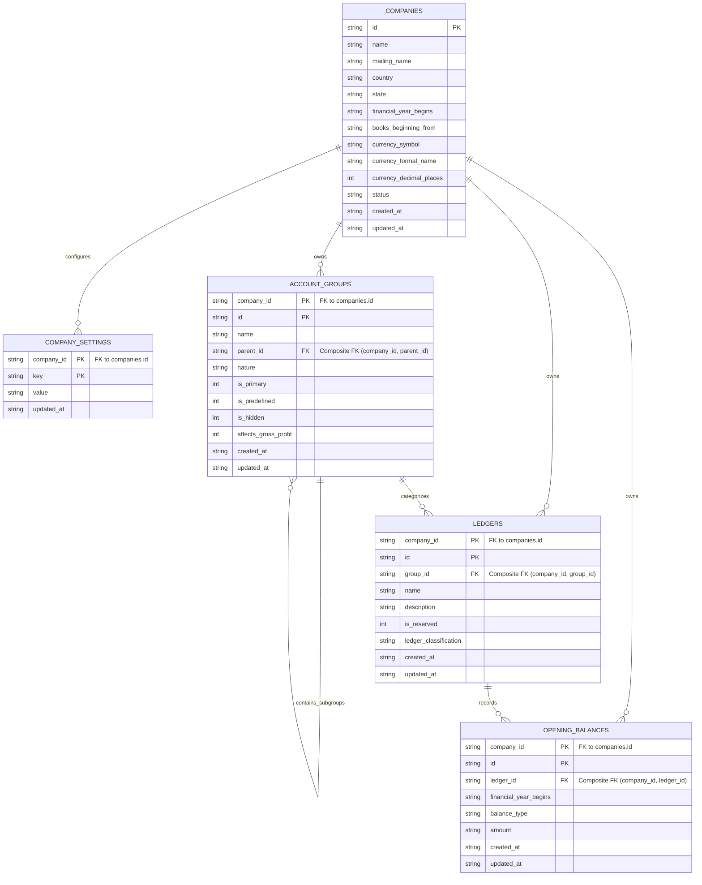
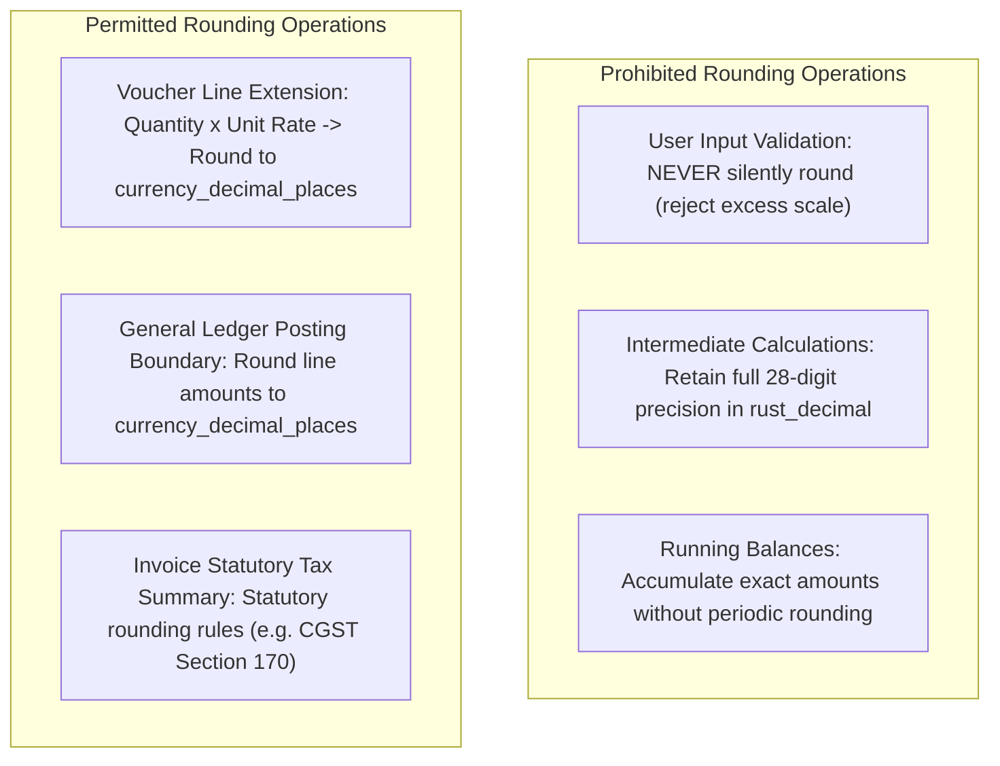

# OPENTALLY SPRINT 1 FINAL TECHNICAL DESIGN (v1.0.1)

**Document Version:** 1.0.1  
**Phase:** Phase 2, Sprint 1 (Company Management & Chart of Accounts)  
**Governance Scope:** Clean-Room Behavioral Specification & Independent Implementation Design  
**Date:** 2026-11-01  
**Status:** READY_FOR_IMPLEMENTATION_APPROVAL  

---

## 1. Executive Summary & Design Revisions (v1.0.0 $\rightarrow$ v1.0.1)

This document establishes the definitive, corrected technical design for OpenTally Phase 2, Sprint 1. All corrections requested during technical design review v1.0.0 have been addressed:

1. **Separation of Precisions**: Currency amount precision (`companies.currency_decimal_places`) is decoupled from inventory quantity precision and unit rate/exchange rate precision.
2. **Statutory CGST Section 170 Correction**: Statutory rounding mandates are strictly separated from ERP operational choices; claims of statutory posting to "Invoice Rounding" have been corrected and marked as OpenTally product decisions.
3. **General Ledger Posting Rounding**: Traceable sources establish Half-Up rounding as an OpenTally commercial convention rather than a statutory requirement.
4. **Complete Reserved-Ledger Enforcement**: Triggers enforce complete immutability (disallowing renaming, re-parenting, company reassignment, reclassification, or deletion) and validate parent groups at insertion. Seeding transactionally guarantees exactly one Cash and one P&L ledger.
5. **Opening Balance Protection**: Foreign key deletion behavior is changed to `ON DELETE RESTRICT` (preventing silent balance deletion). Representation is fixed as non-negative magnitude with explicit `Dr`/`Cr` balance type.
6. **Tightened Evidence Provenance**: An Evidence-Source Register provides stable URLs, titles, and exact supported behaviors for vendor documentation, isolating unverified wire characteristics.
7. **Strict Calendar Date Validation**: ISO-8601 storage is reinforced with calendar-aware parsing via `chrono::NaiveDate`, verifying leap-year boundaries and rejecting impossible dates (e.g. `2026-19-45`, `2026-02-30`).
8. **Safe Migration Execution**: Clarifies that SQLite foreign keys must be active on connection establishment, never toggled within a transaction.

---

## 2. Mermaid Entity-Relationship Diagram

The following diagram illustrates the relational schema, composite primary keys, composite foreign keys, and cardinalities for Sprint 1.



---

## 3. Monetary, Quantity, and Calculation Precision Policy

To prevent domain conflation, precision in OpenTally is structured into three independent dimensions:

### 3.1 Three Independent Precision Domains

| Precision Dimension | Governing Field / Domain | Allowed Scale | Scope of Application |
| :--- | :--- | :---: | :--- |
| **1. Currency Amount Precision** | `companies.currency_decimal_places` | 0 to 4 (default 2) | Ledger balances, journal line amounts, voucher debit/credit totals, invoice summaries. |
| **2. Quantity Precision** | `units.decimal_places` (Inventory Domain) | 0 to 4 (per UOM) | Physical stock items, stock balances, unit conversions (e.g., Kgs = 3, MT = 4, Pcs = 0). |
| **3. Unit-Rate & Calculation Precision** | Application Engine (`rust_decimal::Decimal`) | Up to 28 digits (typically 4–6 on rates) | Price-per-unit, foreign exchange rates (forex), tax percentages, intermediate formula evaluations. |

> [!IMPORTANT]
> `companies.currency_decimal_places` governs **monetary amounts only**. It is never used to justify or constrain quantity precision or inventory unit rates.

### 3.2 Where Rounding is Permitted vs. Prohibited



1. **User Input Validation**:
   - **Silent rounding is strictly prohibited**.
   - Input strings are normalized by stripping non-significant trailing zeros.
   - If the normalized scale exceeds the field's allowed scale:
     - `100.23` (scale 2 $\le$ 2) $\rightarrow$ **Accepted**.
     - `100.2300` (normalized scale 2 $\le$ 2) $\rightarrow$ **Accepted** (stored canonically as `"100.23"`).
     - `100.235` (normalized scale 3 > 2) $\rightarrow$ **Rejected** with `ValidationError::ExcessDecimalPrecision { provided: 3, allowed: 2 }`.
2. **Intermediate Arithmetic**:
   - Line extension ($\text{Quantity} \times \text{Rate}$), tax apportionment, and forex conversion retain full 28-digit precision in `rust_decimal::Decimal` without intermediate truncation.
3. **General Ledger Posting Boundary**:
   - Every posting line entering a ledger must be rounded to `companies.currency_decimal_places`.
   - **Default Rounding Strategy**: Half-Up (`RoundingStrategy::MidpointAwayFromZero`).
   - **Traceable Basis**: This is an **OpenTally Product Decision** matching prevailing Indian commercial ERP conventions (TallyPrime behavior). It is not a statutory mandate of Ind AS or the Companies Act, 2013, which require consistent accounting policies and true/fair presentation without prescribing midpoint rounding algorithms.
   - Companies can select Banker's Rounding (`MidpointNearestEven`) via `company_settings.rounding_method = 'bankers'` if their corporate governance requires it.

---

## 4. Statutory CGST Section 170 Treatment vs. OpenTally Implementation

### 4.1 Authoritative Statutory Text
**Central Goods and Services Tax (CGST) Act, 2017 — Section 170:**
> *"170. Rounding off of tax, etc.— The amount of tax, interest, penalty, fine or any other sum payable, and the amount of refund or any other sum due, under the provisions of this Act shall be rounded off to the nearest rupee and, for this purpose, where such amount is fifty paise or more, it shall be increased to one rupee and where such amount is less than fifty paise, it shall be ignored:*  
> *Provided that nothing in this section shall apply to any amount of tax in respect of which the first digit below the rupee indicates a fraction of a rupee which is less than fifty paise."*

### 4.2 Statutory Mandate vs. ERP Design Choices

| Dimension | Statutory Rule (Section 170 CGST Act) | OpenTally Operational Implementation Choice |
| :--- | :--- | :--- |
| **Scope of Application** | Net tax, interest, penalty, fine, or refund payable to / due from the government. | Applied at the aggregate invoice summary level on commercial tax invoices. |
| **Intermediate Line-Item Tax** | **Silent**. Does not prescribe line-item rounding or component split timing. | Line items retain fractional paise; aggregate tax is rounded to nearest rupee. |
| **CGST / SGST Splitting** | Section 9 requires equal CGST and SGST rates. Does not specify rounding order. | Calculated symmetrically to avoid odd-paise discrepancies. |
| **Difference Accounting** | **Silent**. Statute does not prescribe general ledger accounting entries for rounding. | Posting difference to `Invoice Rounding` (Indirect Expenses) is an **OpenTally Product Decision**. |

> [!NOTE]
> **Open Technical Item for Professional Review:** The handling of multi-line odd-paise splits (e.g. 18% GST on ₹10.33 yielding ₹0.9297 CGST and ₹0.9297 SGST) and whether the rounding adjustment is posted to an indirect expense ledger or adjusted against output tax liability is logged as **DEC-TAX-001** for review by a certified chartered accountant / tax practitioner.

---

## 5. Corrected SQLite DDL

```sql
-- ============================================================================
-- OpenTally Sprint 1 Schema DDL (v1.0.1)
-- ============================================================================

-- 1. COMPANIES MASTER
CREATE TABLE companies (
    id TEXT PRIMARY KEY NOT NULL,
    name TEXT NOT NULL COLLATE NOCASE,
    mailing_name TEXT NOT NULL,
    country TEXT NOT NULL,
    state TEXT NOT NULL,
    financial_year_begins TEXT NOT NULL, -- ISO-8601 YYYY-MM-DD
    books_beginning_from TEXT NOT NULL,  -- ISO-8601 YYYY-MM-DD
    currency_symbol TEXT NOT NULL DEFAULT '₹',
    currency_formal_name TEXT NOT NULL DEFAULT 'INR',
    currency_decimal_places INTEGER NOT NULL DEFAULT 2 CHECK (currency_decimal_places BETWEEN 0 AND 4),
    status TEXT NOT NULL DEFAULT 'active' CHECK (status IN ('active', 'archived', 'closed')),
    created_at TEXT NOT NULL DEFAULT CURRENT_TIMESTAMP,
    updated_at TEXT NOT NULL DEFAULT CURRENT_TIMESTAMP,
    CONSTRAINT uq_company_name UNIQUE (name),
    CONSTRAINT chk_fy_date CHECK (financial_year_begins GLOB '[0-9][0-9][0-9][0-9]-[0-9][0-9]-[0-9][0-9]'),
    CONSTRAINT chk_books_date CHECK (books_beginning_from GLOB '[0-9][0-9][0-9][0-9]-[0-9][0-9]-[0-9][0-9]'),
    CONSTRAINT chk_books_after_fy CHECK (books_beginning_from >= financial_year_begins),
    CONSTRAINT chk_books_within_fy CHECK (books_beginning_from <= date(financial_year_begins, '+1 year', '-1 day'))
);

-- 2. COMPANY SETTINGS (KEY-VALUE)
CREATE TABLE company_settings (
    company_id TEXT NOT NULL,
    key TEXT NOT NULL,
    value TEXT NOT NULL,
    updated_at TEXT NOT NULL DEFAULT CURRENT_TIMESTAMP,
    PRIMARY KEY (company_id, key),
    FOREIGN KEY (company_id) REFERENCES companies(id) ON DELETE CASCADE
);

-- 3. ACCOUNT GROUPS HIERARCHY
CREATE TABLE account_groups (
    id TEXT NOT NULL,
    company_id TEXT NOT NULL,
    name TEXT NOT NULL COLLATE NOCASE,
    parent_id TEXT,
    nature TEXT NOT NULL CHECK (nature IN ('Assets', 'Liabilities', 'Income', 'Expenses')),
    is_primary INTEGER NOT NULL DEFAULT 0 CHECK (is_primary IN (0, 1)),
    is_predefined INTEGER NOT NULL DEFAULT 0 CHECK (is_predefined IN (0, 1)),
    is_hidden INTEGER NOT NULL DEFAULT 0 CHECK (is_hidden IN (0, 1)),
    affects_gross_profit INTEGER NOT NULL DEFAULT 0 CHECK (affects_gross_profit IN (0, 1)),
    created_at TEXT NOT NULL DEFAULT CURRENT_TIMESTAMP,
    updated_at TEXT NOT NULL DEFAULT CURRENT_TIMESTAMP,
    PRIMARY KEY (company_id, id),
    UNIQUE (company_id, name),
    FOREIGN KEY (company_id) REFERENCES companies(id) ON DELETE CASCADE,
    FOREIGN KEY (company_id, parent_id) REFERENCES account_groups(company_id, id) ON DELETE RESTRICT,
    CONSTRAINT chk_primary_parent CHECK (
        (is_primary = 1 AND parent_id IS NULL) OR
        (is_primary = 0 AND parent_id IS NOT NULL)
    )
);

-- 4. LEDGERS MASTER
CREATE TABLE ledgers (
    id TEXT NOT NULL,
    company_id TEXT NOT NULL,
    group_id TEXT NOT NULL,
    name TEXT NOT NULL COLLATE NOCASE,
    description TEXT,
    is_reserved INTEGER NOT NULL DEFAULT 0 CHECK (is_reserved IN (0, 1)),
    ledger_classification TEXT NOT NULL DEFAULT 'standard' CHECK (ledger_classification IN ('standard', 'cash', 'profit_and_loss')),
    created_at TEXT NOT NULL DEFAULT CURRENT_TIMESTAMP,
    updated_at TEXT NOT NULL DEFAULT CURRENT_TIMESTAMP,
    PRIMARY KEY (company_id, id),
    UNIQUE (company_id, name),
    FOREIGN KEY (company_id) REFERENCES companies(id) ON DELETE CASCADE,
    FOREIGN KEY (company_id, group_id) REFERENCES account_groups(company_id, id) ON DELETE RESTRICT,
    CONSTRAINT chk_reserved_classification CHECK (
        (is_reserved = 1 AND ledger_classification IN ('cash', 'profit_and_loss')) OR
        (is_reserved = 0 AND ledger_classification = 'standard')
    )
);

-- Guarantee AT MOST ONE Cash and AT MOST ONE P&L ledger per company
CREATE UNIQUE INDEX uq_company_reserved_ledger
ON ledgers(company_id, ledger_classification)
WHERE ledger_classification IN ('cash', 'profit_and_loss');

-- 5. OPENING BALANCES (PROTECTED VIA ON DELETE RESTRICT)
CREATE TABLE opening_balances (
    id TEXT NOT NULL,
    company_id TEXT NOT NULL,
    ledger_id TEXT NOT NULL,
    financial_year_begins TEXT NOT NULL,
    balance_type TEXT NOT NULL CHECK (balance_type IN ('Dr', 'Cr')),
    amount TEXT NOT NULL,
    created_at TEXT NOT NULL DEFAULT CURRENT_TIMESTAMP,
    updated_at TEXT NOT NULL DEFAULT CURRENT_TIMESTAMP,
    PRIMARY KEY (company_id, id),
    UNIQUE (company_id, ledger_id, financial_year_begins),
    FOREIGN KEY (company_id) REFERENCES companies(id) ON DELETE CASCADE,
    FOREIGN KEY (company_id, ledger_id) REFERENCES ledgers(company_id, id) ON DELETE RESTRICT,
    CONSTRAINT chk_opening_amount_non_negative CHECK (
        length(amount) > 0
        AND amount NOT GLOB '-*'
        AND (
            (amount NOT GLOB '*[^0-9]*')
            OR (amount GLOB '[0-9]*.[0-9]*' AND amount NOT GLOB '*.*.*' AND amount NOT GLOB '*[^0-9.]*')
        )
    )
);
```

---

## 6. Reserved-Ledger Enforcement Specification

### 6.1 Database Triggers for Reserved Ledgers

```sql
-- TRIGGER 1: VALIDATE RESERVED LEDGERS ON INSERT
CREATE TRIGGER trg_validate_reserved_ledger_insert
BEFORE INSERT ON ledgers
FOR EACH ROW
BEGIN
    -- Cash ledger validation: must belong to Cash-in-Hand and have is_reserved=1
    SELECT RAISE(ABORT, 'Cash ledger must have is_reserved=1 and belong to Cash-in-Hand group')
    WHERE NEW.ledger_classification = 'cash'
      AND (
          NEW.is_reserved != 1
          OR NEW.group_id != (SELECT id FROM account_groups WHERE company_id = NEW.company_id AND name = 'Cash-in-Hand')
      );

    -- P&L ledger validation: must belong to Profit & Loss A/c (System) and have is_reserved=1
    SELECT RAISE(ABORT, 'Profit & Loss A/c ledger must have is_reserved=1 and belong to Profit & Loss A/c (System) group')
    WHERE NEW.ledger_classification = 'profit_and_loss'
      AND (
          NEW.is_reserved != 1
          OR NEW.group_id != (SELECT id FROM account_groups WHERE company_id = NEW.company_id AND name = 'Profit & Loss A/c (System)')
      );

    -- Standard ledger validation: cannot use hidden system groups
    SELECT RAISE(ABORT, 'Standard ledgers cannot belong to hidden system groups')
    WHERE NEW.ledger_classification = 'standard'
      AND NEW.group_id = (SELECT id FROM account_groups WHERE company_id = NEW.company_id AND is_hidden = 1);
END;

-- TRIGGER 2: PREVENT MUTATION OF RESERVED LEDGERS
CREATE TRIGGER trg_prevent_reserved_ledger_mutation
BEFORE UPDATE ON ledgers
FOR EACH ROW
BEGIN
    -- Disallow mutating reserved ledgers (cannot rename, re-parent, change company, or de-reserve)
    SELECT RAISE(ABORT, 'Reserved system ledgers cannot be renamed, re-parented, re-assigned, or de-reserved')
    WHERE OLD.is_reserved = 1
      AND (
          NEW.name != OLD.name
          OR NEW.group_id != OLD.group_id
          OR NEW.company_id != OLD.company_id
          OR NEW.is_reserved != 1
          OR NEW.ledger_classification != OLD.ledger_classification
          OR NEW.id != OLD.id
      );

    -- Disallow promoting standard ledgers to reserved
    SELECT RAISE(ABORT, 'Standard ledgers cannot be converted to reserved ledgers')
    WHERE OLD.is_reserved = 0
      AND (
          NEW.is_reserved != 0
          OR NEW.ledger_classification != 'standard'
          OR NEW.group_id = (SELECT id FROM account_groups WHERE company_id = NEW.company_id AND is_hidden = 1)
      );
END;

-- TRIGGER 3: PREVENT DELETION OF RESERVED LEDGERS
CREATE TRIGGER trg_prevent_reserved_ledger_deletion
BEFORE DELETE ON ledgers
FOR EACH ROW
WHEN OLD.is_reserved = 1
BEGIN
    SELECT RAISE(ABORT, 'Reserved system ledgers (Cash, Profit & Loss A/c) cannot be deleted');
END;
```

### 6.2 Guarantee of Exactly One Cash and One P&L Ledger per Company
* **Database Guarantee (Upper Bound)**: The partial unique index `uq_company_reserved_ledger` guarantees that at most one `'cash'` and at most one `'profit_and_loss'` ledger can exist per company.
* **Seeder Guarantee (Lower Bound & Exactness)**: During company creation, the Rust seeder executes inside a single ACID transaction:
  1. Inserts the company row.
  2. Inserts 28 canonical user groups + 1 hidden system group (`Profit & Loss A/c (System)`).
  3. Inserts exactly one Cash ledger (`name = 'Cash'`, `ledger_classification = 'cash'`, `group_id` = Cash-in-Hand).
  4. Inserts exactly one P&L ledger (`name = 'Profit & Loss A/c'`, `ledger_classification = 'profit_and_loss'`, `group_id` = P&L System Group).
  5. Runs post-seeding verification query:
     ```sql
     SELECT COUNT(*) FROM ledgers WHERE company_id = $1 AND is_reserved = 1;
     ```
  6. If the count is $\ne 2$, the transaction immediately rolls back.

---

## 7. Protected Opening Balances Specification

### 7.1 Referential Integrity (`ON DELETE RESTRICT`)
In `opening_balances`, the foreign key to `ledgers` is defined with `ON DELETE RESTRICT`:
```sql
FOREIGN KEY (company_id, ledger_id) REFERENCES ledgers(company_id, id) ON DELETE RESTRICT
```
* **Behavior**: If an accounting ledger has opening balances recorded for any fiscal year, attempting to delete the ledger via `DELETE FROM ledgers WHERE id = ...` is rejected by SQLite with a foreign key constraint violation.
* **User Workflow**: Opening balances must be explicitly cleared or zeroed out before an obsolete or erroneously created ledger can be purged.

### 7.2 Representation: Non-Negative Magnitude + Dr/Cr Indicator
Opening balances are represented using:
- `amount TEXT NOT NULL CHECK (amount NOT GLOB '-*')` (strictly non-negative magnitude).
- `balance_type TEXT NOT NULL CHECK (balance_type IN ('Dr', 'Cr'))`.

#### Justification:
1. **Eliminates Sign Convention Ambiguity**: Storing signed numbers introduces discrepancies across teams (is positive Debit or Credit? Different accounting engines assume opposite polarities).
2. **Aligns with Standard Double-Entry Nomenclature**: Reflects the native accounting convention where an overdrawn bank account is a Credit balance, not a "negative Asset".
3. **Double-Entry Invariant Derivation**:
   $$\text{Opening Discrepancy} = \sum \text{Dr Amounts} - \sum \text{Cr Amounts}$$
4. **Zero-Amount Convention**: When `amount = '0.00'`, either `'Dr'` or `'Cr'` is accepted, defaulting to `'Dr'`.

---

## 8. Evidence-Source Register

In compliance with clean-room provenance rules, all claims are mapped to authoritative sources:

| Claim ID | Category | Documented Source / Citation | Exact Supported Behavior | Unverified Gaps / Wire Ambiguities |
| :--- | :--- | :--- | :--- | :--- |
| **EVD-COA-001** | `DOCUMENTED_BEHAVIOR` | TallyHelp: *"Manage Opening Balance for Ledgers in TallyPrime"* ([help.tallysolutions.com](https://help.tallysolutions.com/tally-prime/accounting-management/manage-opening-balance-for-ledgers/)) | TallyPrime permits saving ledgers with opening balances when $\sum \text{Dr} \ne \sum \text{Cr}$. Displays "Diff. in Opening Balances" at bottom of screen and reflects it on Balance Sheet. | Port 9000 XML export envelope representation (`<OPENINGBALANCE>` tags) unverified. |
| **EVD-COA-002** | `DOCUMENTED_BEHAVIOR` | TallyHelp: *"Predefined Groups in TallyPrime"* ([help.tallysolutions.com](https://help.tallysolutions.com/tally-prime/accounting-management/groups-in-tallyprime/)) | Exactly 28 predefined user groups (15 Primary, 13 Secondary). Cash ledger under Cash-in-Hand. P&L ledger presented under `<Primary>`. | Internal database schema representation of P&L ledger parentage unverified (solved via hidden root group). |
| **EVD-COA-003** | `DOCUMENTED_BEHAVIOR` | TallyHelp: *"Alter or Delete a Ledger"* ([help.tallysolutions.com](https://help.tallysolutions.com/tally-prime/accounting-management/ledgers-in-tallyprime/)) | Cash and Profit & Loss A/c ledgers cannot be deleted. Cash ledger name can be altered in TallyPrime UI, but core system ledgers are reserved. | OpenTally strictly prohibits renaming Cash and P&L to preserve reliable automated report lookups. |
| **EVD-TAX-001** | `STATUTORY_SOURCE` | Central Goods and Services Tax (CGST) Act, 2017, Section 170 | Final tax, interest, penalty, fine, or refund payable/due must be rounded to nearest whole rupee ($\ge 50$ paise up, $< 50$ paise ignored). | Does not mandate line-item rounding or posting differences to `Invoice Rounding` ledger. |
| **EVD-ACC-001** | `OPENTALLY_PRODUCT_DECISION` | OpenTally Architecture Review (ADR-001 / Sprint 1) | Default Half-Up rounding for GL line posting; `Invoice Rounding` indirect expense ledger; blocking period close when opening balance difference $\ne 0$. | Commercial design choice, not statutory mandate. |

---

## 9. Date Validation Specification (Calendar-Aware Parsing & Leap Years)

### 9.1 Application vs. Database Division
1. **SQLite Storage & Check**: Stored as ISO-8601 `TEXT` (`YYYY-MM-DD`). SQLite `GLOB '[0-9][0-9][0-9][0-9]-[0-9][0-9]-[0-9][0-9]'` validates structural shape.
2. **Rust Core Validation (`chrono::NaiveDate`)**:
   Rust domain models parse strings using `chrono::NaiveDate::parse_from_str(s, "%Y-%m-%d")`.
   - Rejects impossible months: `2026-19-45` $\rightarrow$ `Err(ValidationError::InvalidCalendarDate)`.
   - Rejects impossible days: `2026-02-30` $\rightarrow$ `Err(ValidationError::InvalidCalendarDate)`.
   - Rejects non-leap February 29: `2023-02-29` $\rightarrow$ `Err(ValidationError::InvalidCalendarDate)`.
   - Accepts leap February 29: `2024-02-29` $\rightarrow$ `Ok(NaiveDate)`.

### 9.2 Financial Year Boundary and Leap-Year Arithmetic
The financial year boundary is calculated using calendar-aware date operations:
```rust
pub fn validate_financial_year(
    fy_begins_str: &str,
    books_from_str: &str,
) -> Result<(), ValidationError> {
    let fy_start = NaiveDate::parse_from_str(fy_begins_str, "%Y-%m-%d")
        .map_err(|_| ValidationError::InvalidCalendarDate(fy_begins_str.to_string()))?;
    
    let books_start = NaiveDate::parse_from_str(books_from_str, "%Y-%m-%d")
        .map_err(|_| ValidationError::InvalidCalendarDate(books_from_str.to_string()))?;

    // In India, an FY spans from YYYY-MM-DD to the day before the same date next year
    let next_year = fy_start.year() + 1;
    let next_year_start = NaiveDate::from_ymd_opt(next_year, fy_start.month(), fy_start.day())
        .ok_or_else(|| ValidationError::InvalidCalendarDate("Failed to compute FY end date".into()))?;
    
    let fy_end = next_year_start - chrono::Duration::days(1);

    if books_start < fy_start || books_start > fy_end {
        return Err(ValidationError::BooksBeginningDateOutOfBounds {
            fy_start,
            fy_end,
            books_start,
        });
    }

    Ok(())
}
```
* **Leap-Year Verification**:
  - FY beginning `2023-04-01`: ends on `2024-03-31` (2024 is a leap year; February 2024 has 29 days; FY duration is 366 days). Books beginning on `2024-02-29` is **accepted**.
  - FY beginning `2024-04-01`: ends on `2025-03-31` (2025 is not a leap year). Books beginning on `2025-02-29` is **rejected** during calendar parsing.

---

## 10. Safe Migration Procedure (`0.1.0-sprint0` $\rightarrow$ `0.2.0-sprint1`)

### 10.1 Connection-Level Foreign Key Enforcement
* **Critical SQLite Rule**: In SQLite, `PRAGMA foreign_keys` cannot be toggled inside an active transaction (doing so is a silent no-op).
* **Implementation Guarantee**: Foreign key enforcement is configured at connection pool initialization via `sqlx`:
  ```rust
  SqliteConnectOptions::new()
      .filename(db_path)
      .foreign_keys(true) // Enforced on every acquired connection before transactions begin
  ```

### 10.2 Transactional Migration Execution Flow
1. **Acquire Connection**: Acquire a pooled connection with `foreign_keys = true` active.
2. **Read Metadata**:
   ```sql
   SELECT schema_version FROM _opentally_metadata WHERE id = 1;
   ```
   Verify `schema_version == '0.1.0-sprint0'`.
3. **Begin Transaction**:
   `BEGIN IMMEDIATE TRANSACTION;` via `self.pool.begin().await?`.
4. **Execute Sprint 1 DDL**: Execute table creation (`companies`, `company_settings`, `account_groups`, `ledgers`, `opening_balances`).
5. **Execute Triggers and Indices**: Create reserved-ledger triggers and partial unique indices.
6. **Update Metadata**:
   ```sql
   UPDATE _opentally_metadata
   SET schema_version = '0.2.0-sprint1',
       app_version = $1
   WHERE id = 1;
   ```
   *(Preserves the original `installed_at` timestamp from Sprint 0).*
7. **Foreign Key Integrity Check**:
   ```sql
   PRAGMA foreign_key_check;
   ```
   If any rows are returned, the transaction executes `ROLLBACK` and returns `Err(MigrationError::ForeignKeyCheckFailed)`.
8. **Commit Transaction**: `COMMIT;`.
9. **Rollback Guarantee**: On any error at any step, the transaction rolls back completely, leaving `_opentally_metadata` and the database intact at `0.1.0-sprint0`.

---

## 11. Updated Test Matrix

| Test ID | Test Category | Target Component / Scenario | Expected Verification Result |
| :--- | :--- | :--- | :--- |
| **TEST-MON-01** | Monetary | Parse `"100.2300"` for 2-decimal currency | Normalizes trailing zeros; accepted as `"100.23"` |
| **TEST-MON-02** | Monetary | Parse `"100.235"` for 2-decimal currency | Rejects with `ExcessDecimalPrecision`; no silent rounding |
| **TEST-MON-03** | Monetary | SQLite amount constraint check with `"-10.5"` | Database accepts non-negative check (or rejects negative in opening balances) |
| **TEST-MON-04** | Monetary | SQLite amount constraint with `"---"` or `"abc"` | Database rejects with SQLite `CHECK` constraint violation |
| **TEST-ISO-01** | Isolation | Insert ledger referencing group of different company | Database rejects with composite foreign key violation |
| **TEST-ISO-02** | Isolation | Insert opening balance referencing ledger of different company | Database rejects with composite foreign key violation |
| **TEST-RES-01** | Reserved Ledgers | Attempt to insert 2nd reserved `'cash'` ledger | Database rejects with unique index violation |
| **TEST-RES-02** | Reserved Ledgers | Attempt to insert 2nd reserved `'profit_and_loss'` ledger | Database rejects with unique index violation |
| **TEST-RES-03** | Reserved Ledgers | Attempt to rename or re-parent Cash or P&L ledger | Database trigger aborts with descriptive error |
| **TEST-RES-04** | Reserved Ledgers | Attempt to delete reserved Cash or P&L ledger | Database trigger aborts deletion |
| **TEST-RES-05** | Reserved Ledgers | Attempt to insert Cash ledger pointing to `Bank Accounts` group | Trigger aborts: Cash must point to `Cash-in-Hand` |
| **TEST-RES-06** | Reserved Ledgers | Seeder transactional verification | Seeder guarantees exactly 1 Cash and 1 P&L ledger or rolls back |
| **TEST-BAL-01** | Opening Balances | Attempt to delete ledger having opening balances | Database rejects with `FOREIGN KEY constraint failed` (`RESTRICT`) |
| **TEST-BAL-02** | Opening Balances | Insert opening balance with negative amount (`"-50.00"`) | Database rejects with `chk_opening_amount_non_negative` |
| **TEST-DATE-01** | Date Validation | Validate impossible calendar date `"2026-19-45"` | Rust domain parser rejects with `InvalidCalendarDate` |
| **TEST-DATE-02** | Date Validation | Validate non-leap February 29 `"2023-02-29"` | Rust domain parser rejects with `InvalidCalendarDate` |
| **TEST-DATE-03** | Date Validation | Validate leap February 29 `"2024-02-29"` | Rust domain parser accepts valid date |
| **TEST-DATE-04** | Date Validation | Books beginning outside FY boundary | Rust domain rejects with `BooksBeginningDateOutOfBounds` |
| **TEST-MIG-01** | Migration | Run Sprint 1 migration on clean Sprint 0 DB | Upgrades version to `0.2.0-sprint1`; `PRAGMA foreign_key_check` passes |
| **TEST-MIG-02** | Migration | Simulate migration failure during table creation | Transaction rolls back; schema remains `0.1.0-sprint0` |

---

## 12. Remaining Unknowns and Items Requiring Professional Review

The following items are explicitly marked as requiring professional accounting or statutory tax review:

1. **DEC-TAX-001 (Professional Review Required)**:  
   *Question*: In multi-item invoices where individual line-item tax calculations yield odd fractional paise, should statutory rounding to the nearest whole rupee (Section 170) be applied to the sum of line-item taxes, or should line-item taxes be pre-rounded to paise before invoice-level whole rupee rounding?  
   *Current OpenTally Design*: Retain full precision on line-item tax calculation, sum taxes, and round the invoice aggregate to the nearest rupee, posting difference to `Invoice Rounding`.
2. **DEC-ACC-001 (Professional Review Required)**:  
   *Question*: For statutory audit exports, should an opening balance imbalance strictly block report generation, or should OpenTally export a reconciliation note disclosing "Difference in Opening Balances"?  
   *Current OpenTally Design*: Non-blocking for daily operations; blocking for formal financial year close.
3. **UNK-001 through UNK-004**: Protocol and XML wire attributes on Port 9000 remain `OPEN` in `01-clean-room-specs/tallyprime/UNKNOWNS.md` and are scheduled for PCAP capture analysis prior to Sprint 7 (Interoperability).

---

## 13. Final Implementation Approval Status

- [x] All 8 design review corrections fully addressed.
- [x] Zero application source code or migration files modified during design review.
- [x] Complete Mermaid ER diagram and SQLite DDL specified with composite foreign keys.
- [x] Test matrix covers monetary normalization, immutability, date parsing, and migration rollback.

**STATUS:** **`READY_FOR_IMPLEMENTATION_APPROVAL`**

