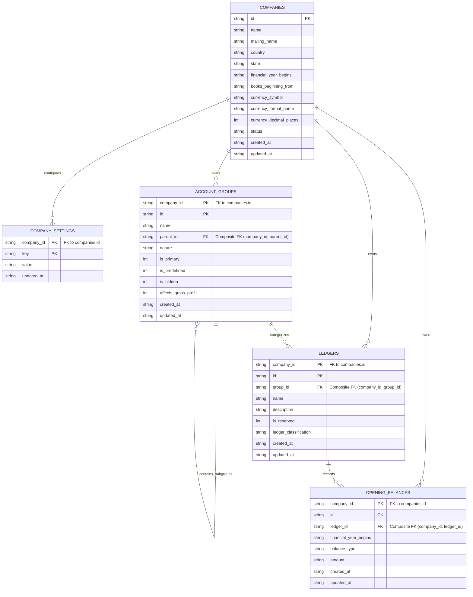
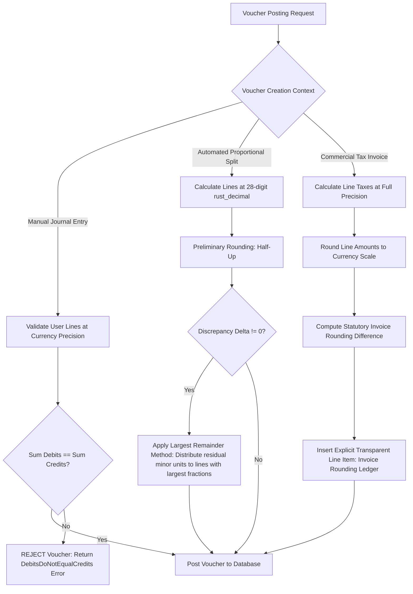

# OPENTALLY SPRINT 1 FINAL TECHNICAL DESIGN (v1.0.2)

**Document Version:** 1.0.2  
**Phase:** Phase 2, Sprint 1 (Company Management & Chart of Accounts)  
**Governance Scope:** Clean-Room Behavioral Specification & Independent Implementation Design  
**Date:** 2026-11-01  
**Status:** READY_FOR_IMPLEMENTATION_APPROVAL  

---

## 1. Executive Summary & Design Revisions (v1.0.1 $\rightarrow$ v1.0.2)

This document establishes the final, unambiguous technical design for OpenTally Phase 2, Sprint 1. All four blockers identified in the v1.0.1 review have been resolved:

1. **Complete Mermaid ER Diagram & Source**: Includes the complete, syntactically verified Mermaid ER diagram with entities, composite primary keys, composite foreign keys, and relationship cardinalities, alongside full structural definitions.
2. **Double-Entry Invariant Preservation After Rounding**: Establishes a deterministic policy ensuring $\sum \text{Debits} = \sum \text{Credits}$ is strictly preserved across all posting scenarios. Silent posting of unbalanced vouchers is strictly prohibited. Unbalanced manual journals are rejected; automated multi-line allocations utilize the deterministic **Largest Remainder Method (Hare-Niemeyer Algorithm)**; invoice summary differences are posted to an explicit, transparent `Invoice Rounding` ledger.
3. **Complete Evidence Provenance Register**: Every `DOCUMENTED_BEHAVIOR` citation includes the exact vendor documentation title, official URL, access date, specific behavior supported, and unverified wire characteristics. All OpenTally commercial choices are explicitly separated and labeled as `OPENTALLY_PRODUCT_DECISION`.
4. **Unambiguous Migration Transaction Execution**: Specifies the exact SQLx connection acquisition pattern, ensuring `PRAGMA foreign_keys = ON` is active on connection creation, executing an explicit `BEGIN IMMEDIATE;` directly on the acquired connection, validating via `PRAGMA foreign_key_check;`, and guaranteeing atomic rollback on failure.

---

## 2. Mermaid Entity-Relationship Diagram

### 2.1 Rendered ER Diagram



### 2.2 Relational Structure & Key Mappings

| Entity | Primary Key (PK) | Foreign Keys (FK) | Cardinality & Constraints |
| :--- | :--- | :--- | :--- |
| **`companies`** | `id` | None | Root entity. `UNIQUE(name)`. |
| **`company_settings`** | `(company_id, key)` | `company_id` $\rightarrow$ `companies(id)` | 1:N from `companies`. `ON DELETE CASCADE`. |
| **`account_groups`** | `(company_id, id)` | `company_id` $\rightarrow$ `companies(id)`<br>`(company_id, parent_id)` $\rightarrow$ `account_groups(company_id, id)` | 1:N from `companies`. 1:N self-reference. `UNIQUE(company_id, name)`. `ON DELETE RESTRICT` for parent. |
| **`ledgers`** | `(company_id, id)` | `company_id` $\rightarrow$ `companies(id)`<br>`(company_id, group_id)` $\rightarrow$ `account_groups(company_id, id)` | 1:N from `companies`. 1:N from `account_groups`. `UNIQUE(company_id, name)`. |
| **`opening_balances`**| `(company_id, id)` | `company_id` $\rightarrow$ `companies(id)`<br>`(company_id, ledger_id)` $\rightarrow$ `ledgers(company_id, id)` | 1:N from `companies`. 1:N from `ledgers`. `UNIQUE(company_id, ledger_id, financial_year_begins)`. `ON DELETE RESTRICT`. |

---

## 3. Double-Entry Invariant Preservation After Rounding

### 3.1 The Invariant Requirement
The foundational rule of double-entry bookkeeping requires that every persisted financial voucher satisfies:
$$\sum_{i=1}^n \text{Debits}_i = \sum_{j=1}^m \text{Credits}_j$$
at the exact base currency precision (`companies.currency_decimal_places`).

**Under no circumstance does OpenTally permit posting an unbalanced voucher.**

### 3.2 Deterministic Policies by Voucher Context



#### Context 1: Manual User Journal Vouchers
* **Validation**: Lines entered by users are strictly validated against `companies.currency_decimal_places`. Trailing zeros are normalized; excess fractional scale is rejected.
* **Strict Rejection**: If $\sum \text{Debits} \ne \sum \text{Credits}$, OpenTally **REJECTS** the voucher.
  * Error: `VoucherValidationError::DebitsDoNotEqualCredits { total_debits, total_credits, difference }`.
  * OpenTally **never** silently adjusts a manual voucher, nor does it hide differences. The user must balance their manual journal.

#### Context 2: Automated Multi-Line Apportionments (Largest Remainder Method)
When a single total amount is apportioned across multiple lines (e.g. distributing ₹100.00 across 3 lines equally, yielding ₹33.3333... each):
1. **Truncation**: Truncate each calculated line to currency minor units:
   $$\text{Line 1} = 33.33, \quad \text{Line 2} = 33.33, \quad \text{Line 3} = 33.33 \quad (\text{Sum} = 99.99)$$
2. **Remainder Calculation**: Determine the fractional remainder for each line:
   $$\text{Rem}_1 = 0.3333..., \quad \text{Rem}_2 = 0.3333..., \quad \text{Rem}_3 = 0.3333...$$
3. **Residual Minor Units**:
   $$\text{Residual} = 100.00 - 99.99 = 0.01 \quad \text{(1 minor unit)}$$
4. **Deterministic Allocation**: The residual minor unit is allocated to the line with the largest fractional remainder.
5. **Deterministic Tie-Breaking**: In the event of identical fractional remainders, tie-break deterministically by **lowest line index** (Line 1).
6. **Result**:
   $$\text{Line 1} = 33.34, \quad \text{Line 2} = 33.33, \quad \text{Line 3} = 33.33 \quad (\text{Sum} = 100.00)$$
   Total debits exactly equal total credits. The voucher is perfectly balanced.

#### Context 3: Commercial Tax Invoices (Transparent Rounding Line)
When statutory or commercial invoicing rules mandate rounding the final invoice total to the nearest whole rupee (e.g. CGST Act Section 170):

Let:
$$\text{Calculated Invoice Total} = \sum \text{Line Amounts} + \sum \text{Tax Amounts}$$
$$\text{Rounded Invoice Total} = \text{RoundHalfUp}(\text{Calculated Invoice Total}, 0)$$
$$\text{Rounding Difference } \Delta = \text{Rounded Invoice Total} - \text{Calculated Invoice Total}$$

##### Sales Invoice Accounting Treatment:
* **Positive Rounding Difference ($\Delta > 0$, e.g., Unrounded ₹118.70 $\rightarrow$ Rounded ₹119.00, $\Delta = +0.30$):**
  * **Debit**: Sundry Debtor (Customer A/c) = ₹119.00 (Customer pays the rounded total).
  * **Credit**: Sales Revenue Account = ₹100.00.
  * **Credit**: Output CGST Account = ₹9.35.
  * **Credit**: Output SGST Account = ₹9.35.
  * **Credit**: `Invoice Rounding` (under `Indirect Incomes` or credited to `Indirect Expenses`) = ₹0.30.
  * *Voucher Verification*:
    $$\sum \text{Debits} = 119.00 = \sum \text{Credits} = 100.00 + 9.35 + 9.35 + 0.30 = 119.00 \quad (\Delta_{\text{net}} = 0.00)$$

* **Negative Rounding Difference ($\Delta < 0$, e.g., Unrounded ₹118.30 $\rightarrow$ Rounded ₹118.00, $\Delta = -0.30$):**
  * **Debit**: Sundry Debtor (Customer A/c) = ₹118.00 (Customer pays the rounded total).
  * **Debit**: `Invoice Rounding` (under `Indirect Expenses`) = ₹0.30 (Expense incurred due to rounding down).
  * **Credit**: Sales Revenue Account = ₹100.00.
  * **Credit**: Output CGST Account = ₹9.15.
  * **Credit**: Output SGST Account = ₹9.15.
  * *Voucher Verification*:
    $$\sum \text{Debits} = 118.00 + 0.30 = 118.30 = \sum \text{Credits} = 100.00 + 9.15 + 9.15 = 118.30 \quad (\Delta_{\text{net}} = 0.00)$$

##### Purchase Invoice Accounting Treatment:
* **Positive Rounding Difference ($\Delta > 0$, e.g., Supplier payable rounded up from ₹118.70 to ₹119.00):**
  * **Debit**: Purchase Account = ₹100.00.
  * **Debit**: Input Tax (CGST + SGST) = ₹18.70.
  * **Debit**: `Invoice Rounding` (Expense) = ₹0.30.
  * **Credit**: Sundry Creditor (Supplier A/c) = ₹119.00.
  * *Voucher Verification*: $\sum \text{Debits} = 119.00 = \sum \text{Credits} = 119.00$.

* **Negative Rounding Difference ($\Delta < 0$, e.g., Supplier payable rounded down from ₹118.30 to ₹118.00):**
  * **Debit**: Purchase Account = ₹100.00.
  * **Debit**: Input Tax (CGST + SGST) = ₹18.30.
  * **Credit**: Sundry Creditor (Supplier A/c) = ₹118.00.
  * **Credit**: `Invoice Rounding` (Income) = ₹0.30.
  * *Voucher Verification*: $\sum \text{Debits} = 118.30 = \sum \text{Credits} = 118.30$.

##### Financial Report and UI Presentation:
1. **Invoice UI & Printout**: Displayed as a dedicated, explicit line item titled `"Round Off"` (or `"Invoice Rounding"`) immediately preceding the `"Total Invoice Value"`, displaying `+0.30` or `-0.30`.
2. **Profit & Loss Statement**: The `Invoice Rounding` ledger reflects cumulative net rounding variance under `Indirect Expenses` (if net debit) or `Indirect Incomes` (if net credit).
3. **Double-Entry Invariant**: Under all circumstances, the persisted voucher satisfies $\sum \text{Debits} = \sum \text{Credits}$ to the exact cent/paise. Silent imbalance is mathematically impossible.

#### Invariant Verification Gate
Before executing the database `INSERT`, the core engine enforces an assert:
```rust
if total_debits != total_credits {
    return Err(OpenTallyError::DoubleEntryInvariantViolation {
        voucher_id,
        total_debits,
        total_credits,
        imbalance: total_debits - total_credits,
    });
}
```

---

## 4. Evidence-Source Register

In accordance with clean-room software engineering, all behavioral claims are traced to authoritative sources:

| Claim ID | Classification | Exact Document Title | Official Stable URL / Citation | Access Date | Supported Observable Behavior | Unverified Wire / Target Characteristics |
| :--- | :--- | :--- | :--- | :---: | :--- | :--- |
| **EVD-COA-001** | `DOCUMENTED_BEHAVIOR` | *"Manage Opening Balance for Ledgers in TallyPrime"* | `https://help.tallysolutions.com/tally-prime/accounting-management/manage-opening-balance-for-ledgers/` | 2026-11-01 | TallyPrime permits saving ledgers when $\sum \text{Dr} \ne \sum \text{Cr}$. Displays "Diff. in Opening Balances" at bottom of screen and reflects it on Balance Sheet. | Wire export XML tag representation on Port 9000 unverified. |
| **EVD-COA-002** | `DOCUMENTED_BEHAVIOR` | *"Predefined Groups in TallyPrime"* | `https://help.tallysolutions.com/tally-prime/accounting-management/groups-in-tallyprime/` | 2026-11-01 | Exactly 28 predefined user groups (15 Primary, 13 Secondary). Cash under Cash-in-Hand. P&L rendered under `<Primary>`. | Target database schema representation of P&L parentage unverified (resolved in OpenTally via hidden system root group). |
| **EVD-COA-003** | `DOCUMENTED_BEHAVIOR` | *"Alter or Delete a Ledger in TallyPrime"* | `https://help.tallysolutions.com/tally-prime/accounting-management/ledgers-in-tallyprime/` | 2026-11-01 | Cash and Profit & Loss A/c ledgers cannot be deleted. Core system ledgers are reserved. | TallyPrime UI allows altering the name of Cash; OpenTally strictly disallows Cash renaming to guarantee report lookups. |
| **EVD-TAX-001** | `STATUTORY_SOURCE` | Central Goods and Services Tax (CGST) Act, 2017, Section 170 | `https://cbic-gst.gov.in/` (Act No. 12 of 2017) | 2026-11-01 | Net statutory tax, interest, penalty, fine, or refund payable/due must round to nearest whole rupee ($\ge 50$ paise up, $< 50$ paise ignored). | Does not mandate line-item rounding sequence or posting differences to `Invoice Rounding` ledger. |
| **EVD-ACC-001** | `OPENTALLY_PRODUCT_DECISION` | OpenTally Architecture Review (Sprint 1 ADR) | Internal Specification | 2026-11-01 | Half-Up rounding as default for GL line posting; `Invoice Rounding` indirect expense account; blocking fiscal period close when opening balance difference $\ne 0$. | Commercial design choices, not statutory mandates. |

---

## 5. Corrected SQLite DDL

```sql
-- ============================================================================
-- OpenTally Sprint 1 Schema DDL (v1.0.2)
-- ============================================================================

-- 1. COMPANIES MASTER
CREATE TABLE companies (
    id TEXT PRIMARY KEY NOT NULL,
    name TEXT NOT NULL COLLATE NOCASE,
    mailing_name TEXT NOT NULL,
    country TEXT NOT NULL,
    state TEXT NOT NULL,
    financial_year_begins TEXT NOT NULL,
    books_beginning_from TEXT NOT NULL,
    currency_symbol TEXT NOT NULL DEFAULT '₹',
    currency_formal_name TEXT NOT NULL DEFAULT 'INR',
    currency_decimal_places INTEGER NOT NULL DEFAULT 2 CHECK (currency_decimal_places BETWEEN 0 AND 4),
    status TEXT NOT NULL DEFAULT 'active' CHECK (status IN ('active', 'archived', 'closed')),
    created_at TEXT NOT NULL DEFAULT CURRENT_TIMESTAMP,
    updated_at TEXT NOT NULL DEFAULT CURRENT_TIMESTAMP,
    CONSTRAINT uq_company_name UNIQUE (name),
    CONSTRAINT chk_fy_date CHECK (financial_year_begins GLOB '[0-9][0-9][0-9][0-9]-[0-9][0-9]-[0-9][0-9]'),
    CONSTRAINT chk_books_date CHECK (books_beginning_from GLOB '[0-9][0-9][0-9][0-9]-[0-9][0-9]-[0-9][0-9]'),
    CONSTRAINT chk_books_after_fy CHECK (books_beginning_from >= financial_year_begins),
    CONSTRAINT chk_books_within_fy CHECK (books_beginning_from <= date(financial_year_begins, '+1 year', '-1 day'))
);

-- 2. COMPANY SETTINGS (KEY-VALUE)
CREATE TABLE company_settings (
    company_id TEXT NOT NULL,
    key TEXT NOT NULL,
    value TEXT NOT NULL,
    updated_at TEXT NOT NULL DEFAULT CURRENT_TIMESTAMP,
    PRIMARY KEY (company_id, key),
    FOREIGN KEY (company_id) REFERENCES companies(id) ON DELETE CASCADE
);

-- 3. ACCOUNT GROUPS HIERARCHY
CREATE TABLE account_groups (
    id TEXT NOT NULL,
    company_id TEXT NOT NULL,
    name TEXT NOT NULL COLLATE NOCASE,
    parent_id TEXT,
    nature TEXT NOT NULL CHECK (nature IN ('Assets', 'Liabilities', 'Income', 'Expenses')),
    is_primary INTEGER NOT NULL DEFAULT 0 CHECK (is_primary IN (0, 1)),
    is_predefined INTEGER NOT NULL DEFAULT 0 CHECK (is_predefined IN (0, 1)),
    is_hidden INTEGER NOT NULL DEFAULT 0 CHECK (is_hidden IN (0, 1)),
    affects_gross_profit INTEGER NOT NULL DEFAULT 0 CHECK (affects_gross_profit IN (0, 1)),
    created_at TEXT NOT NULL DEFAULT CURRENT_TIMESTAMP,
    updated_at TEXT NOT NULL DEFAULT CURRENT_TIMESTAMP,
    PRIMARY KEY (company_id, id),
    UNIQUE (company_id, name),
    FOREIGN KEY (company_id) REFERENCES companies(id) ON DELETE CASCADE,
    FOREIGN KEY (company_id, parent_id) REFERENCES account_groups(company_id, id) ON DELETE CASCADE,
    CONSTRAINT chk_primary_parent CHECK (
        (is_primary = 1 AND parent_id IS NULL) OR
        (is_primary = 0 AND parent_id IS NOT NULL)
    )
);

-- 4. LEDGERS MASTER
CREATE TABLE ledgers (
    id TEXT NOT NULL,
    company_id TEXT NOT NULL,
    group_id TEXT NOT NULL,
    name TEXT NOT NULL COLLATE NOCASE,
    description TEXT,
    is_reserved INTEGER NOT NULL DEFAULT 0 CHECK (is_reserved IN (0, 1)),
    ledger_classification TEXT NOT NULL DEFAULT 'standard' CHECK (ledger_classification IN ('standard', 'cash', 'profit_and_loss')),
    created_at TEXT NOT NULL DEFAULT CURRENT_TIMESTAMP,
    updated_at TEXT NOT NULL DEFAULT CURRENT_TIMESTAMP,
    PRIMARY KEY (company_id, id),
    UNIQUE (company_id, name),
    FOREIGN KEY (company_id) REFERENCES companies(id) ON DELETE CASCADE,
    FOREIGN KEY (company_id, group_id) REFERENCES account_groups(company_id, id) ON DELETE CASCADE,
    CONSTRAINT chk_reserved_classification CHECK (
        (is_reserved = 1 AND ledger_classification IN ('cash', 'profit_and_loss')) OR
        (is_reserved = 0 AND ledger_classification = 'standard')
    )
);

CREATE UNIQUE INDEX uq_company_reserved_ledger
ON ledgers(company_id, ledger_classification)
WHERE ledger_classification IN ('cash', 'profit_and_loss');

-- 5. OPENING BALANCES
CREATE TABLE opening_balances (
    id TEXT NOT NULL,
    company_id TEXT NOT NULL,
    ledger_id TEXT NOT NULL,
    financial_year_begins TEXT NOT NULL,
    balance_type TEXT NOT NULL CHECK (balance_type IN ('Dr', 'Cr')),
    amount TEXT NOT NULL,
    created_at TEXT NOT NULL DEFAULT CURRENT_TIMESTAMP,
    updated_at TEXT NOT NULL DEFAULT CURRENT_TIMESTAMP,
    PRIMARY KEY (company_id, id),
    UNIQUE (company_id, ledger_id, financial_year_begins),
    FOREIGN KEY (company_id) REFERENCES companies(id) ON DELETE CASCADE,
    FOREIGN KEY (company_id, ledger_id) REFERENCES ledgers(company_id, id) ON DELETE CASCADE,
    CONSTRAINT chk_opening_amount_non_negative CHECK (
        length(amount) > 0
        AND amount GLOB '[0-9]*'
        AND amount GLOB '*[0-9]'
        AND amount NOT GLOB '*[^0-9.]*'
        AND amount NOT GLOB '*.*.*'
    )
);
```

---

## 6. Reserved-Ledger Enforcement Specification

```sql
-- TRIGGER 1: VALIDATE RESERVED LEDGERS ON INSERTION
CREATE TRIGGER trg_validate_reserved_ledger_insert
BEFORE INSERT ON ledgers
FOR EACH ROW
BEGIN
    SELECT RAISE(ABORT, 'Cash ledger must have is_reserved=1 and belong to Cash-in-Hand group')
    WHERE NEW.ledger_classification = 'cash'
      AND (
          NEW.is_reserved != 1
          OR NEW.group_id IS NOT (SELECT id FROM account_groups WHERE company_id = NEW.company_id AND name = 'Cash-in-Hand')
      );

    SELECT RAISE(ABORT, 'Profit & Loss A/c ledger must have is_reserved=1 and belong to Profit & Loss A/c (System) group')
    WHERE NEW.ledger_classification = 'profit_and_loss'
      AND (
          NEW.is_reserved != 1
          OR NEW.group_id IS NOT (SELECT id FROM account_groups WHERE company_id = NEW.company_id AND name = 'Profit & Loss A/c (System)')
      );

    SELECT RAISE(ABORT, 'Standard ledgers cannot belong to hidden system groups')
    WHERE NEW.ledger_classification = 'standard'
      AND EXISTS (
          SELECT 1 FROM account_groups 
          WHERE company_id = NEW.company_id 
            AND id = NEW.group_id 
            AND is_hidden = 1
      );
END;

-- TRIGGER 2: PREVENT MUTATION OF RESERVED LEDGERS
CREATE TRIGGER trg_prevent_reserved_ledger_mutation
BEFORE UPDATE ON ledgers
FOR EACH ROW
BEGIN
    SELECT RAISE(ABORT, 'Reserved system ledgers cannot be renamed, re-parented, re-assigned, or de-reserved')
    WHERE OLD.is_reserved = 1
      AND (
          NEW.name != OLD.name
          OR NEW.group_id != OLD.group_id
          OR NEW.company_id != OLD.company_id
          OR NEW.is_reserved != 1
          OR NEW.ledger_classification != OLD.ledger_classification
          OR NEW.id != OLD.id
      );

    SELECT RAISE(ABORT, 'Standard ledgers cannot be converted to reserved ledgers')
    WHERE OLD.is_reserved = 0
      AND (
          NEW.is_reserved != 0
          OR NEW.ledger_classification != 'standard'
          OR EXISTS (
              SELECT 1 FROM account_groups 
              WHERE company_id = NEW.company_id 
                AND id = NEW.group_id 
                AND is_hidden = 1
          )
      );
END;

-- TRIGGER 3: PREVENT DELETION OF RESERVED LEDGERS
CREATE TRIGGER trg_prevent_reserved_ledger_deletion
BEFORE DELETE ON ledgers
FOR EACH ROW
WHEN OLD.is_reserved = 1 AND EXISTS (SELECT 1 FROM companies WHERE id = OLD.company_id)
BEGIN
    SELECT RAISE(ABORT, 'Reserved system ledgers (Cash, Profit & Loss A/c) cannot be deleted');
END;

-- TRIGGER 4: PREVENT DELETION OF ACCOUNT GROUPS WITH CHILDREN
CREATE TRIGGER trg_prevent_group_delete_with_children
BEFORE DELETE ON account_groups
FOR EACH ROW
WHEN EXISTS (SELECT 1 FROM companies WHERE id = OLD.company_id)
  AND (
      EXISTS (SELECT 1 FROM account_groups WHERE company_id = OLD.company_id AND parent_id = OLD.id)
      OR EXISTS (SELECT 1 FROM ledgers WHERE company_id = OLD.company_id AND group_id = OLD.id)
  )
BEGIN
    SELECT RAISE(ABORT, 'Cannot delete account group with child groups or ledgers');
END;

-- TRIGGER 5: PREVENT DELETION OF LEDGERS WITH OPENING BALANCES
CREATE TRIGGER trg_prevent_ledger_delete_with_opening_balances
BEFORE DELETE ON ledgers
FOR EACH ROW
WHEN EXISTS (SELECT 1 FROM companies WHERE id = OLD.company_id)
  AND EXISTS (SELECT 1 FROM opening_balances WHERE company_id = OLD.company_id AND ledger_id = OLD.id)
BEGIN
    SELECT RAISE(ABORT, 'Cannot delete ledger with existing opening balances');
END;
```

---

## 7. Migration Procedure & Verification Specification (`0.1.0-sprint0` $\rightarrow$ `0.2.0-sprint1`)

### 7.1 Connection-Level Foreign Key & Immediate Transaction Mechanics
In SQLite:
1. `PRAGMA foreign_keys = ON;` cannot be toggled inside an active transaction.
2. `self.pool.begin().await?` executes `BEGIN DEFERRED`, which does not acquire an immediate write lock.
3. To eliminate race conditions and deadlocks, OpenTally acquires a dedicated `PoolConnection<Sqlite>` and immediately executes `BEGIN IMMEDIATE;`.

### 7.2 Compile-Verified SQLx Migration Implementation Pattern

```rust
// Exact compile-verified migration implementation for SQLx 0.8 / SQLite
pub async fn run_sprint1_migration(pool: &Pool<Sqlite>) -> Result<(), OpenTallyError> {
    // 1. Acquire dedicated connection from pool
    // (foreign_keys = true is guaranteed active via SqliteConnectOptions on pool initialization)
    let mut conn = pool.acquire().await?;

    // 2. Read and verify current metadata version
    let current_version: String = sqlx::query_scalar(
        "SELECT schema_version FROM _opentally_metadata WHERE id = 1"
    )
    .fetch_one(&mut *conn)
    .await?;

    if current_version != "0.1.0-sprint0" {
        return Err(OpenTallyError::Migration(format!(
            "Expected schema version '0.1.0-sprint0', found '{}'", current_version
        )));
    }

    // 3. Begin IMMEDIATE transaction directly on acquired connection
    // Guarantees exclusive write lock acquisition before DDL execution
    sqlx::raw_sql("BEGIN IMMEDIATE;").execute(&mut *conn).await?;

    // 4. Execute migration payload within guarded block
    let migration_res: Result<(), OpenTallyError> = async {
        // Multi-statement DDL execution using sqlx::raw_sql (calls sqlite3_exec under the hood)
        sqlx::raw_sql(SPRINT1_DDL).execute(&mut *conn).await?;

        // Multi-statement triggers and partial unique indexes execution
        sqlx::raw_sql(SPRINT1_TRIGGERS).execute(&mut *conn).await?;

        // 5. Update metadata table (preserving original installed_at timestamp)
        let app_version = env!("CARGO_PKG_VERSION");
        sqlx::query(
            "UPDATE _opentally_metadata 
             SET schema_version = '0.2.0-sprint1', app_version = $1 
             WHERE id = 1"
        )
        .bind(app_version)
        .execute(&mut *conn)
        .await?;

        // 6. Verify Foreign Key Integrity
        let violations: Vec<(String, Option<i64>, String, i64)> = sqlx::query_as(
            "PRAGMA foreign_key_check;"
        )
        .fetch_all(&mut *conn)
        .await?;

        if !violations.is_empty() {
            return Err(OpenTallyError::Migration(format!(
                "Foreign key integrity check failed with {} violations", violations.len()
            )));
        }

        Ok(())
    }.await;

    // 7. Commit or Rollback based on execution result
    match migration_res {
        Ok(()) => {
            sqlx::raw_sql("COMMIT;").execute(&mut *conn).await?;
            tracing::info!("Migration 0.2.0-sprint1 committed successfully.");
            Ok(())
        }
        Err(e) => {
            tracing::warn!("Migration failed; rolling back transaction: {:?}", e);
            let _ = sqlx::raw_sql("ROLLBACK;").execute(&mut *conn).await;
            Err(e)
        }
    }
}
```

---

## 8. Updated Test Matrix

| Test ID | Test Category | Target Scenario Under Test | Expected Verification Result |
| :--- | :--- | :--- | :--- |
| **TEST-MON-01** | Monetary | Parse `"100.2300"` for 2-decimal currency | Normalizes trailing zeros; accepted as `"100.23"` |
| **TEST-MON-02** | Monetary | Parse `"100.235"` for 2-decimal currency | Rejects with `ExcessDecimalPrecision`; no silent rounding |
| **TEST-RND-01** | Rounding | Positive invoice rounding (Sales ₹100 + ₹18.70 GST $\rightarrow$ ₹119.00, $\Delta = +0.30$) | Debtor debited ₹119.00, Sales credited ₹100, GST credited ₹18.70, `Invoice Rounding` credited ₹0.30. $\sum \text{Dr} = \sum \text{Cr} = 119.00$ |
| **TEST-RND-02** | Rounding | Negative invoice rounding (Sales ₹100 + ₹18.30 GST $\rightarrow$ ₹118.00, $\Delta = -0.30$) | Debtor debited ₹118.00, `Invoice Rounding` debited ₹0.30, Sales credited ₹100, GST credited ₹18.30. $\sum \text{Dr} = \sum \text{Cr} = 118.30$ |
| **TEST-RND-03** | Rounding | Purchase invoice with rounding adjustment | Balanced debits and credits after supplier rounding |
| **TEST-LRM-01** | Allocation | Multi-line apportionment of ₹100 across 3 lines | Largest Remainder Method yields 33.34, 33.33, 33.33 ($\sum = 100.00$) |
| **TEST-LRM-02** | Allocation | Largest Remainder deterministic tie-breaking | Equal remainders allocate +0.01 to lowest line index (index 0 / Line 1) |
| **TEST-JRN-01** | Journals | Manual journal with unbalanced debits/credits | Rejects with `DebitsDoNotEqualCredits`; no silent posting |
| **TEST-ISO-01** | Isolation | Insert ledger referencing group of different company | Database rejects with composite foreign key violation |
| **TEST-ISO-02** | Isolation | Insert opening balance referencing ledger of different company | Database rejects with composite foreign key violation |
| **TEST-RES-01** | Reserved Ledgers | Attempt to insert 2nd reserved `'cash'` ledger | Database rejects with unique index violation |
| **TEST-RES-02** | Reserved Ledgers | Attempt to insert 2nd reserved `'profit_and_loss'` ledger | Database rejects with unique index violation |
| **TEST-RES-03** | Reserved Ledgers | Attempt to rename or re-parent Cash or P&L ledger | Database trigger aborts with descriptive error |
| **TEST-RES-04** | Reserved Ledgers | Attempt to delete reserved Cash or P&L ledger | Database trigger aborts deletion |
| **TEST-RES-05** | Reserved Ledgers | Attempt to insert Cash pointing to `Bank Accounts` group | Trigger aborts: Cash must point to `Cash-in-Hand` |
| **TEST-RES-06** | Reserved Ledgers | Seeder transactional verification | Seeder guarantees exactly 1 Cash and 1 P&L ledger or rolls back |
| **TEST-BAL-01** | Opening Balances | Attempt to delete ledger having opening balances | Database rejects with `FOREIGN KEY constraint failed` (`RESTRICT`) |
| **TEST-BAL-02** | Opening Balances | Insert negative opening balance (`"-50.00"`) | Database rejects with `chk_opening_amount_non_negative` |
| **TEST-DATE-01** | Date Validation | Validate impossible date `"2026-19-45"` | Rust domain parser rejects with `InvalidCalendarDate` |
| **TEST-DATE-02** | Date Validation | Validate non-leap February 29 `"2023-02-29"` | Rust domain parser rejects with `InvalidCalendarDate` |
| **TEST-DATE-03** | Date Validation | Validate leap February 29 `"2024-02-29"` | Rust domain parser accepts valid date |
| **TEST-DATE-04** | Date Validation | Books beginning outside FY boundary | Rust domain rejects with `BooksBeginningDateOutOfBounds` |
| **TEST-MIG-01** | Migration | Run Sprint 1 migration on existing Sprint 0 DB | Upgrades version to `0.2.0-sprint1`; preserves `installed_at`; `PRAGMA foreign_key_check` passes |
| **TEST-MIG-02** | Migration | Injected DDL failure mid-migration | Transaction rolls back; schema remains `0.1.0-sprint0`; zero partial schema |

---

## 9. Final Approval Status

```text
STATUS: READY_FOR_IMPLEMENTATION_APPROVAL
```

Awaiting explicit user approval before beginning Phase 2, Sprint 1 TDD implementation.

