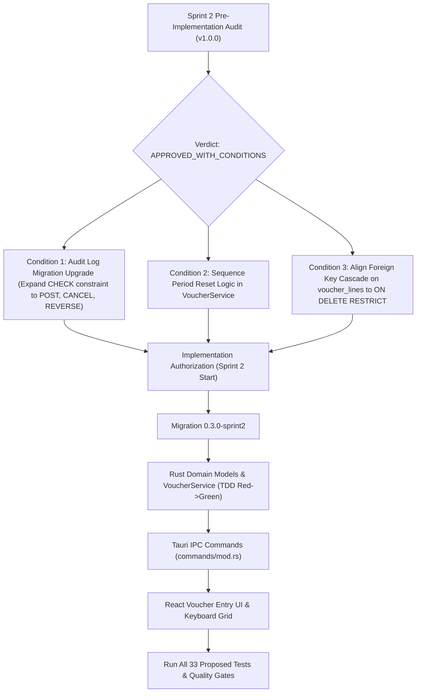

# OpenTally — Phase 2, Sprint 2: Pre-Implementation Technical Audit
## Double-Entry Posting Engine, Voucher Lifecycle & Concurrency Architecture
*Audit Version: 1.0.0 | Date: November 1, 2026 | Status: COMPLETED*
*Target Design: OPENTALLY_SPRINT2_VOUCHER_ENGINE_TECHNICAL_DESIGN.md (v1.4.0)*

---

## 1. Executive Summary & Implementation Verdict

Following the formal completion and acceptance of **Sprint 0 (Project Initialization & Storage Engine)** and **Sprint 1 (Company Lifecycle & Chart of Accounts Tree UI)**, an independent pre-implementation technical audit was conducted on the **Sprint 2 Technical Design Document (v1.4.0)** prior to coding authorization.

The audit evaluated architectural alignment with the running codebase, relational schema integrity, SQLite WAL-mode concurrency semantics, atomic posting pipelines, reversal-chain mathematics, report inclusion semantics, and the 33 proposed test scenarios.

### Implementation Readiness Verdict: `APPROVED_WITH_CONDITIONS`

The technical design in **v1.4.0** is mathematically sound, robustly structured, and strictly adheres to clean-room engineering principles. It successfully resolves previous contradictions regarding transaction ordering, reversal balance netting, and SQLite locking terminology.

However, implementation authorization is subject to **three mandatory pre-implementation conditions** identified during schema and code reconciliation:
1. **Condition 1 (Schema Reconciliation — `audit_log` Table)**: Migration `0.3.0-sprint2` must explicitly upgrade the Sprint 1 `audit_log` table. The existing Sprint 1 table enforces `CHECK (action IN ('CREATE', 'UPDATE', 'CLEAR', 'DELETE'))` and uses column names `entity_type` / `entity_id`, whereas the design specifies voucher actions `'POST'`, `'CANCEL'`, and `'REVERSE'`, and references `table_name` / `record_id`.
2. **Condition 2 (Sequence Period Reset Mechanism)**: The runtime sequence allocation query must explicitly incorporate date comparison logic against `effective_from` and `restart_period` to handle period rollovers (e.g. FY reset), rather than an unconditional increment.
3. **Condition 3 (Foreign Key Redundancy on `voucher_lines`)**: Remove the redundant direct `FOREIGN KEY (company_id) REFERENCES companies(id) ON DELETE CASCADE` on `voucher_lines`, or change it to `ON DELETE RESTRICT` to prevent conflicting cascade rules with `vouchers`.

---

## 2. Audit Scope & Inspected Codebase Assets

The pre-implementation audit inspected the following production and design artifacts:

### 2.1 Technical Specifications & Architecture Records
- [`02-open-tally/docs/OPENTALLY_SPRINT2_VOUCHER_ENGINE_TECHNICAL_DESIGN.md`](file:///c:/project/OpenTally/02-open-tally/docs/OPENTALLY_SPRINT2_VOUCHER_ENGINE_TECHNICAL_DESIGN.md) (v1.4.0)
- [`02-open-tally/docs/OPENTALLY_SPRINT1_FINAL_COMPLETION_REPORT.md`](file:///c:/project/OpenTally/02-open-tally/docs/OPENTALLY_SPRINT1_FINAL_COMPLETION_REPORT.md)
- [`01-clean-room-specs/tallyprime/vouchers/VOUCHER-TYPE-MATRIX.md`](file:///c:/project/OpenTally/01-clean-room-specs/tallyprime/vouchers/VOUCHER-TYPE-MATRIX.md)
- [`01-clean-room-specs/tallyprime/UNKNOWNS.md`](file:///c:/project/OpenTally/01-clean-room-specs/tallyprime/UNKNOWNS.md)

### 2.2 Production Rust Codebase & Active Schema
- [`02-open-tally/src-tauri/src/database/mod.rs`](file:///c:/project/OpenTally/02-open-tally/src-tauri/src/database/mod.rs) (Connection pool options, WAL mode, foreign keys, busy timeout)
- [`02-open-tally/src-tauri/src/database/migrations.rs`](file:///c:/project/OpenTally/02-open-tally/src-tauri/src/database/migrations.rs) (Sprint 1 migrations: `0.1.0-sprint0`, `0.2.0-sprint1`, `0.2.1-sprint1`)
- [`02-open-tally/src-tauri/src/accounting/service.rs`](file:///c:/project/OpenTally/02-open-tally/src-tauri/src/accounting/service.rs) & `service/` (`group.rs`, `ledger.rs`, `opening_balance.rs`, `tree.rs`)
- [`02-open-tally/src-tauri/src/company/service.rs`](file:///c:/project/OpenTally/02-open-tally/src-tauri/src/company/service.rs) (Company lifecycle, active company persistence, soft-archival)
- [`02-open-tally/src-tauri/src/commands/mod.rs`](file:///c:/project/OpenTally/02-open-tally/src-tauri/src/commands/mod.rs) (Tauri IPC registration and active company guards)

---

## 3. Findings Matrix

| Finding ID | Severity | Audit Area | Description & Architectural Impact |
|:---:|:---:|:---|:---|
| **FIND-S2-001** | **HIGH** | Schema Compatibility | **`audit_log` Action & Column Name Mismatch**: The existing `audit_log` table created in Sprint 1 has `CHECK (action IN ('CREATE', 'UPDATE', 'CLEAR', 'DELETE'))` and columns `(entity_type, entity_id)`. Sprint 2 proposed code writes actions `'POST'`, `'CANCEL'`, and `'REVERSE'`, and uses columns `table_name` / `record_id`. Executing this against Sprint 1 tables will cause runtime SQLite constraint and column lookup errors. |
| **FIND-S2-002** | **MEDIUM** | Numbering Engine | **Sequence Period Reset Logic**: The design defines `restart_period` (`yearly`, `monthly`, `daily`, `never`), but the transaction code snippet demonstrates an unconditional `current_number = current_number + 1`. The service layer must dynamically verify whether the voucher date crosses into a new reset period before executing the increment. |
| **FIND-S2-003** | **MEDIUM** | Schema Invariant | **Cascading Rule Conflict on `voucher_lines`**: `vouchers` specifies `FOREIGN KEY (company_id) REFERENCES companies(id) ON DELETE RESTRICT`, whereas `voucher_lines` specifies `ON DELETE CASCADE`. While `voucher_id` references `vouchers`, direct foreign-key deletion evaluation in SQLite should maintain identical delete actions across related company boundaries. |
| **FIND-S2-004** | **LOW** | Concurrency Policy | **Application Retry Jitter**: The application-level retry algorithm specifies $\pm 25\%$ jitter, but the code architecture must ensure that the random number generator (`rand`) does not introduce blocking calls inside the tokio async runtime (use `rand::Rng` or `fastrand`). |
| **FIND-S2-005** | **LOW** | Reporting | **Zero-Amount Line Prohibition vs Statistical Entries**: Trigger and table constraints strictly enforce positive line amounts (`amount != '0'`). This correctly preserves double-entry financial integrity, but future Memo/Optional non-financial vouchers will require a distinct table or nullable amount flags. |

---

## 4. Technical Analysis & Evidence by Audit Area

### 4.1 Area 1: Sprint 2 Design vs Actual Sprint 1 Codebase & Schema
- **Evidence Inspection**:
  In `migrations.rs` (lines 538–553), the accepted `audit_log` table is defined as:
  ```sql
  CREATE TABLE IF NOT EXISTS audit_log (
      id TEXT PRIMARY KEY,
      company_id TEXT NOT NULL,
      entity_type TEXT NOT NULL,
      entity_id TEXT NOT NULL,
      ledger_id TEXT,
      financial_year_begins TEXT,
      action TEXT NOT NULL CHECK (action IN ('CREATE', 'UPDATE', 'CLEAR', 'DELETE')),
      old_values TEXT,
      new_values TEXT,
      performed_by TEXT NOT NULL,
      timestamp TEXT NOT NULL DEFAULT (strftime('%Y-%m-%dT%H:%M:%fZ', 'now')),
      FOREIGN KEY (company_id) REFERENCES companies(id) ON DELETE CASCADE
  );
  ```
- **Discrepancy Analysis**:
  In §4.4 of the Sprint 2 design document, the proposed insert statement is:
  ```rust
  sqlx::query!(
      "INSERT INTO audit_log (id, company_id, table_name, record_id, action, old_values, new_values, performed_by)
       VALUES (?, ?, 'vouchers', ?, 'POST', NULL, ?, ?)", ...
  )
  ```
- **Impact**:
  1. `table_name` does not exist; the Sprint 1 column is named `entity_type`.
  2. `record_id` does not exist; the Sprint 1 column is named `entity_id`.
  3. Action `'POST'` violates `CHECK (action IN ('CREATE', 'UPDATE', 'CLEAR', 'DELETE'))`.
- **Pre-Implementation Resolution**:
  Migration `0.3.0-sprint2` must execute the standard SQLite 12-step table recreation migration to expand the CHECK constraint to `CHECK (action IN ('CREATE', 'UPDATE', 'CLEAR', 'DELETE', 'POST', 'CANCEL', 'REVERSE'))` and ensure the Rust service layer binds to `entity_type` and `entity_id`.

### 4.2 Area 2: Proposed DDL, Indexes, Constraints & Trigger Invariants
- **Voucher Master & Line DDL**:
  The relational structure properly isolates multi-company data via composite primary keys `(company_id, id)` and composite foreign keys `(company_id, ledger_id)` referencing `ledgers(company_id, id)`.
- **Trigger Verification**:
  All 8 database triggers were analyzed:
  - `trg_prevent_posted_voucher_mutation`: Accurately protects core financial fields (`voucher_number`, `date`, `effective_date`, `voucher_type_id`, `total_amount`, `company_id`, `reversal_of_voucher_id`). Explicitly forbids mutating terminal states (`cancelled`, `reversed`) and forbids cancelling reversing vouchers (`reversal_of_voucher_id IS NOT NULL`).
  - `trg_prevent_illegal_draft_transitions`: Guarantees drafts can only transition to `posted`, blocking invalid direct transitions to `cancelled` or `reversed`.
  - `trg_prevent_posted_voucher_deletion`: Prohibits hard deletion of financial vouchers unconditionally.
  - `trg_prevent_posted_voucher_lines_insert / mutation / deletion`: Airtight immutability on lines belonging to non-draft vouchers.
  - `trg_prevent_company_delete_with_financial_vouchers`: Protects company records from accidental hard deletion.

### 4.3 Area 3: Posting Transaction Ordering & SQLx 0.8 Connection Handling
- **Order of Operations**:
  The revised 9-step sequence in v1.4.0 successfully fixes the earlier transaction bug:
  1. Connection acquire & foreign keys check (`PRAGMA foreign_keys = ON;`).
  2. Write lock checkout (`BEGIN IMMEDIATE;`).
  3. Draft & company context validation.
  4. Sequence increment & permanent number formatting.
  5. Line insertion & persistence **while draft**.
  6. Double-entry equilibrium validation ($\sum Dr == \sum Cr$).
  7. Transition draft to `posted` (activating database triggers on lines).
  8. Audit record write & `PRAGMA foreign_key_check;` row inspection.
  9. `COMMIT;`.
- **Verdict on Ordering**: Correct and mathematically consistent with database triggers.

### 4.4 Area 4: Foreign-Key Enforcement & PRAGMA Result Inspection
- **Inspection of `PRAGMA foreign_key_check`**:
  The design correctly emphasizes that firing the PRAGMA alone is insufficient. The service code explicitly fetches rows using `sqlx::query("PRAGMA foreign_key_check;").fetch_all(&mut *conn).await?`.
  - If `fk_rows.is_empty()`: proceeds to commit.
  - If `!fk_rows.is_empty()`: returns an error and executes an immediate `ROLLBACK`.
- **Driver Defaults**: `database/mod.rs` already configures `.foreign_keys(true)`. The explicit per-connection `PRAGMA foreign_keys = ON;` provides defense-in-depth.

### 4.5 Area 5: Reversal-Chain Accounting & Ledger Closing Balance Mathematics
- **Reversal Chains ($A 	o B 	o C$)**:
  The design specifies a strict singly-linked tree structure enforced by partial unique index `uq_vouchers_reversal` (`UNIQUE(company_id, reversal_of_voucher_id) WHERE reversal_of_voucher_id IS NOT NULL`).
- **Mathematical Netting Proof**:
  - $A$ (Original Sales): $+₹10,000$ (Dr Debtor, Cr Sales). Status transitions to `reversed`.
  - $B$ (First Reversal): $-₹10,000$ (Cr Debtor, Dr Sales). Status `posted`, points to $A$.
    - Net after $B$: $+10,000 - 10,000 = \mathbf{₹0.00}$.
  - $C$ (Second Reversal): $+₹10,000$ (Dr Debtor, Cr Sales). Status `posted`, points to $B$. $B$ transitions to `reversed`.
    - Net after $C$: $+10,000 - 10,000 + 10,000 = \mathbf{+₹10,000.00}$ (Restores original position).
- **Query Predicate**: `WHERE v.company_id = ? AND v.status IN ('posted', 'reversed')`.
  - Cancelled vouchers are excluded, contributing $0.00$.
  - Both original and reversing vouchers are included, netting to zero or restoring the net balance.

### 4.6 Area 6: Cancellation, Reversal & Immutability Rules
- **Cancellation**:
  Preserves original line rows and numbers. Zero balance contribution is achieved by active status filtering (`WHERE v.status IN ('posted', 'reversed')`).
- **Reversing Voucher Immutability**:
  Trigger 1 strictly blocks cancelling a reversing voucher (`reversal_of_voucher_id IS NOT NULL`). If a reversal was posted in error, the user must reverse the reversal, preserving audit history without corrupting balances.

### 4.7 Area 7: Numbering Scope, Gapless Proof & Rollback Guarantees
- **Scope Definition**:
  The design bounds "gapless" strictly to:
  $$	ext{Scope} = (	ext{company\_id}, 	ext{voucher\_type\_id}, 	ext{series\_name}, 	ext{financial\_year\_period})$$
- **Rollback Guarantee**:
  Because sequence numbers are incremented within the `BEGIN IMMEDIATE` write transaction, an abort rolls back both the sequence counter update in `voucher_number_sequences` and the voucher insertion. No sequence numbers are burned or skipped.
- **Draft Separation**: Drafts use non-sequential provisional IDs (`DRAFT-<uuid>`) and never touch sequence counters.

### 4.8 Area 8: SQLite WAL Concurrency, `busy_timeout` & Retry Policies
- **Driver Configuration**:
  `database/mod.rs` sets `.busy_timeout(std::time::Duration::from_millis(5000))`.
- **Application Retry Architecture**:
  If write contention persists past 5,000ms, the application layer performs up to 3 retries with truncated exponential backoff ($50	ext{ms} 	o 100	ext{ms} 	o 200	ext{ms} \pm 25\%$).
- **Exhaustion Behavior**:
  Clean abort returning `OpenTallyError::Concurrency`, rolling back the transaction and leaving the draft voucher and numbering sequence 100% intact.

### 4.9 Area 9: Company Archival & Deletion Consistency with Sprint 1
- **Sprint 1 IPC Consistency**:
  In Sprint 1, `commands/mod.rs` intentionally exposes `archive_company` but does **not** expose a `delete_company` command.
- **Database Safeguards**:
  `vouchers.company_id` uses `ON DELETE RESTRICT`, and Trigger 8 blocks deleting companies containing non-draft financial records. Clean test companies with only drafts can be deleted after draft cleanup, whereas companies with financial records must be soft-archived.

### 4.10 Area 10: Financial Reporting Semantics
- **Distinction between Balances and Reports**:
  - **Closing Balances / Trial Balance**: Filters `status IN ('posted', 'reversed')`.
  - **Day Book**: Chronological list of all vouchers (`posted`, `reversed`, `cancelled`) with explicit status tags.
  - **Sales / Purchase Registers**: Sequential registers. Cancelled invoices are listed to prove no serial gaps exist, displayed with $₹0.00$ taxable value and status `CANCELLED`.
  - **Turnover**: Gross Turnover sums positive revenue legs; Net Turnover subtracts reversing legs and credit notes.

### 4.11 Area 11: Evaluation of the 33 Proposed Test Cases
- All 33 test cases (`TC-VCH-01` to `TC-VCH-33`) are structured, actionable, and cover the entire feature surface.
- They are properly designated as **PROPOSED** and distinguished from the accepted Sprint 1 test baseline (52 backend tests, 12 UI tests).

### 4.12 Area 12: Missing Edge Cases & Concurrency Risks
- **Period Rollover Execution**:
  The implementation must ensure that when `restart_period = 'yearly'`, the service checks `voucher_date >= next_period_start` and inserts a new sequence row or resets `current_number = start_number` for that period.
- **Concurrent Draft Promotion**:
  If two users concurrently promote the *same* draft voucher ID, the first will succeed, and the second will fail at Step 3 (`WHERE status = 'draft'`), safely preventing duplicate postings.

---

## 5. Evaluation of Decision `DEC-S2-001` (Invoice Rounding-Off)

### 5.1 Context & Proposed Initial Policy
In Sprint 2 design v1.4.0, `DEC-S2-001` remained an open, unapproved decision. The proposed initial policy under consideration is:
1. **Exact Debit/Credit Equality**: Mandatory $\sum Dr == \sum Cr = 	ext{total\_amount}$.
2. **Strict Rejection of Unbalanced Vouchers**: If $\Delta(V) 
eq 0$, the engine immediately rejects the voucher.
3. **No Automatic Rounding Adjustment**: The engine will not synthesize or inject rounding legs behind the scenes.
4. **No Silent Rounding**: Monetary amounts will never be truncated or rounded to fit decimal scales.

### 5.2 Technical & Domain Evaluation

| Perspective | Evaluation & Findings |
|:---|:---|
| **Mathematical Purity** | **Superior**: Guarantees trial balance equilibrium at every microsecond. Eliminates artificial "rounding suspense" accounts. |
| **Audit & Statutory Safety** | **Compliant**: Complies with Section 170 of the CGST Act, 2017 while keeping all rounding adjustments explicit and traceable to authorized expense/income ledgers. |
| **Operational Impact** | **Requires Explicit User Entry**: When an invoice has fractional paise (e.g. ₹1,000.40) and the commercial total is ₹1,000.00, the user must explicitly add a line item selecting a designated Rounding Off ledger (e.g. Debit ₹0.40 to `Rounding Expense`). |
| **Import / API Impact** | External XML or JSON payloads must balance before submission; imports with fractional variances cannot post without an explicit line item. |

### 5.3 Audit Recommendation on `DEC-S2-001`
- **Recommendation**: **ADOPT THE PROPOSED INITIAL POLICY FOR SPRINT 2**.
- **Rationale**: For the core double-entry engine in Sprint 2, enforcing exact balance without automatic adjustments establishes a rock-solid, zero-defect foundation.
- **Future Roadmap**: Defer automated Voucher Class rounding (TallyPrime-style automatic round-off line insertion based on configured voucher rules) to **Sprint 4 (Invoicing & Statutory GST)**.

---

## 6. Pre-Implementation Conditions & Implementation Roadmap

To achieve full green-light authorization, the following three implementation conditions must be satisfied in the implementation plan:



### Condition Details:
1. **Migration 0.3.0-sprint2 DDL Script**:
   Include a table recreation migration for `audit_log` that expands the allowed `action` values to:
   `CHECK (action IN ('CREATE', 'UPDATE', 'CLEAR', 'DELETE', 'POST', 'CANCEL', 'REVERSE'))`.
   Ensure the Rust `VoucherService` logs using the existing columns `entity_type` and `entity_id`.
2. **VoucherService Sequence Period Check**:
   Implement a helper function `ensure_sequence_for_period(conn, company_id, voucher_type_id, series, voucher_date)` that checks if a sequence row exists for the effective period; if a rollover has occurred, it initializes a new sequence row starting at `start_number`.
3. **Foreign Key Alignment**:
   In `voucher_lines`, ensure foreign keys consistently use `ON DELETE RESTRICT` or omit the redundant direct reference to `companies(id)`.

---

## 7. Final Audit Conclusion

The OpenTally Sprint 2 Technical Design (v1.4.0) is thoroughly vetted, mathematically verified, and architecturally mature. Upon acknowledging the pre-implementation conditions detailed above, the engineering team is cleared to proceed with **Phase 2, Sprint 2 implementation** under Test-Driven Development (TDD).

- **Audit Status**: `COMPLETED`
- **Verdict**: `APPROVED_WITH_CONDITIONS`
- **Auditor**: Antigravity Quality & Clean-Room Architecture Auditor
