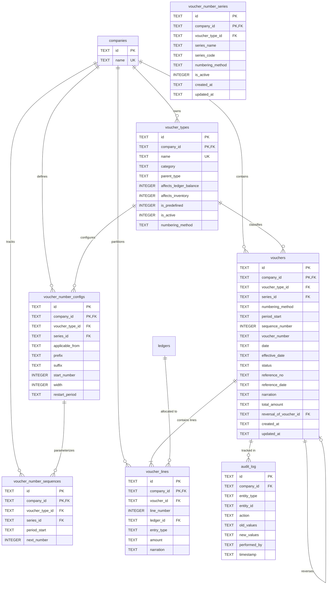
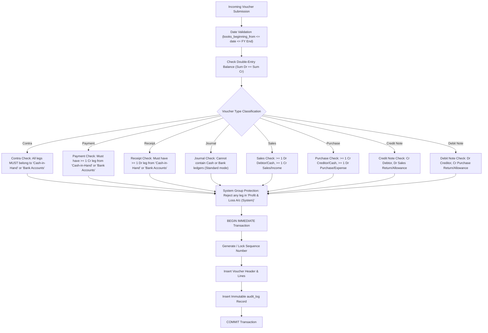
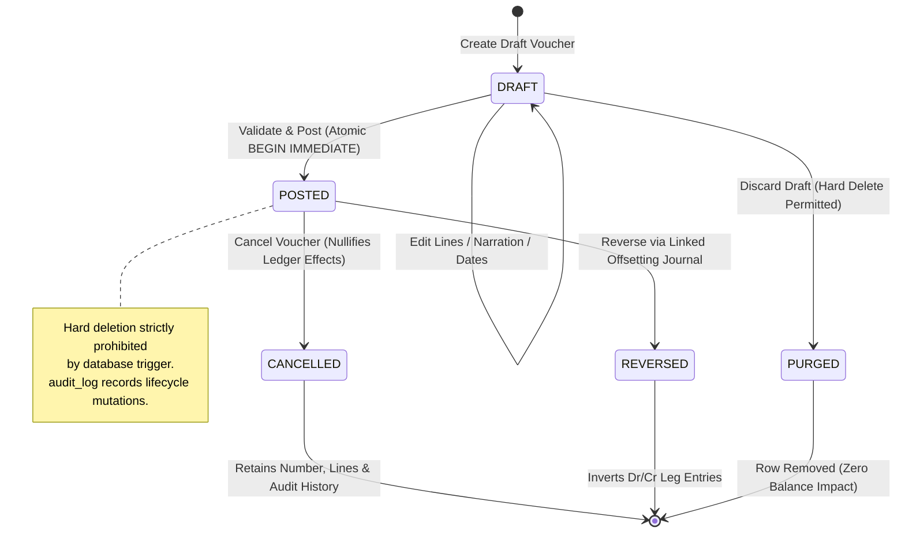

# OpenTally — Phase 2, Sprint 2: Technical Design Document
## Voucher Management & Double-Entry Posting Engine
*Document Version: 2.9.4 | Date: November 2, 2026 | Status: READY_FOR_IMPLEMENTATION_APPROVAL (DESIGN ONLY)*

---

## Document Revision History

| Version | Date | Author | Description of Changes |
|:---|:---|:---|:---|
| `1.0.0` | 2026-11-01 | Architecture Subagent | Initial technical design submission for Phase 2, Sprint 2. |
| `1.1.0` | 2026-11-01 | Architecture Subagent | **Focused Review Corrections Pass**: (1) Reconciled 18 vs 24 voucher types with specific primary vendor documentation citations and evidence classification; (2) Added database trigger preventing `INSERT` into posted voucher lines and full frozen immutability for cancelled/reversed vouchers; (3) Specified cancellation line preservation and idempotent reversal with linkage; (4) Detailed `sqlx::raw_sql("BEGIN IMMEDIATE;")` exclusive write-lock concurrency semantics and numbering modes; (5) Formulated nature-specific closing balances, normal/abnormal sign conventions, and group rollup integration; (6) Detailed currency precision bounds and explicit rounding line validation under unresolved decision `DEC-S2-001`; (7) Verified keyboard shortcuts against TallyPrime documentation vs OpenTally design choices; (8) Expanded test matrix separating proposed from executed tests. |
| `1.2.0` | 2026-11-01 | Architecture Subagent | **Final Technical Verification**: (1) Elaborated exact SQLx 0.8 `BEGIN IMMEDIATE` transaction execution on dedicated pool connection with atomic sequence allocation, voucher persistence, line insertion, and audit logging; (2) Defined SQLite WAL locking mechanics and proof of gapless numbering guarantee (provisional draft numbers vs permanent allocation strictly at post time); (3) Added trigger `trg_prevent_illegal_draft_transitions` and verified complete immutability/freeze for posted, cancelled, and reversed vouchers; (4) Clarified unresolved decision `DEC-S2-001` with absolute magnitude bounds ($< 1.00$), zero-decimal currency prohibition, Dr/Cr direction, designated ledger validation, and separation of statutory requirements from product design; (5) Added test scenarios `TC-VCH-20` (concurrency) and `TC-VCH-21` (rollback); (6) Confirmed Sprint 1 schema/service preservation. |
| `1.3.0` | 2026-11-01 | Architecture Subagent | **Critical Final Corrections Pass**: (1) Corrected atomic posting transaction order (lines inserted and balanced while draft before transition to posted, ensuring trigger `trg_prevent_posted_voucher_lines_insert` remains an effective guard); (2) Corrected reversal accounting model and SQL predicate (both original reversed and reversing posted vouchers are included in closing balance calculation where `status IN ('posted', 'reversed')`, netting to zero; cancelled vouchers contribute zero); (3) Prohibited cancellation of reversing vouchers (`reversal_of_voucher_id IS NOT NULL`); (4) Corrected SQLite WAL mode terminology (WAL write lock in `-shm`, checkpointing vs long-running readers); (5) Enforced `ON DELETE RESTRICT` and added trigger `trg_prevent_company_delete_with_financial_vouchers` preventing company deletion from destroying posted accounting records; (6) Expanded proposed test matrix to 26 scenarios (`TC-VCH-01` to `TC-VCH-26`). |
| `1.4.0` | 2026-11-01 | Architecture Subagent | **Final Technical Design Review (v1.4.0)**: (1) Formalized foreign-key validation requiring explicit row inspection of `PRAGMA foreign_key_check` and enforcement of `PRAGMA foreign_keys = ON;`; (2) Specified complete reversal-of-reversal lifecycle ($A \to B \to C$), unique reversal index mechanics, net balance restoration, and permanent immutability across reversal chains; (3) Defined SQLite concurrency and retry policy (5,000ms `busy_timeout`, 3-tier application retry with randomized backoff, rollback guarantee upon exhaustion); (4) Harmonized company deletion policy between `ON DELETE RESTRICT`, database triggers, drafts, and soft-archival; (5) Formulated strict scope boundary for "gapless" sequential numbering; (6) Established comprehensive financial report semantics (Day Book, Sales/Purchase Registers, Gross/Net Turnover) distinct from balance calculations; (7) Refined legal wording regarding Companies Act 2013 §128 as application-level safeguard pending professional legal review; (8) Expanded test matrix to 33 proposed scenarios (`TC-VCH-01` to `TC-VCH-33`). |
| `1.5.0` | 2026-11-01 | Architecture Subagent | **Pre-Implementation Audit Resolution (v1.5.0)**: (1) Resolved FIND-S2-001 by specifying safe 12-step SQLite migration for `audit_log` expanding actions to `POST`, `CANCEL`, `REVERSE` while preserving existing records and standard column names `entity_type`/`entity_id`; (2) Resolved FIND-S2-002 by specifying deterministic `get_or_create_sequence_for_period` algorithm handling yearly, monthly, daily, and never resets across period boundaries; (3) Resolved FIND-S2-003 by aligning `voucher_lines.company_id` to `ON DELETE RESTRICT`; (4) Resolved FIND-S2-004 by defining async-safe, lock-free jitter using `uuid::Uuid::new_v4()` OS entropy without external crates; (5) Resolved FIND-S2-005 by confirming zero-amount prohibition for Sprint 2 and defining Memo/Optional voucher future scope; (6) Detailed DEC-S2-001 proposed rounding policy (pending user approval); (7) Expanded proposed test matrix to 38 scenarios (`TC-VCH-01` to `TC-VCH-38`). |
| `1.6.0` | 2026-11-01 | Architecture Subagent | **Final Migration & Algorithm Review (v1.6.0)**: (1) Corrected SQLite migration strategy in §3.4: specified that `PRAGMA foreign_keys = OFF;` must execute outside transaction on dedicated connection before `BEGIN IMMEDIATE;`, table recreation runs within transaction, `PRAGMA foreign_key_check;` is inspected for 0 violations before `COMMIT;`, and `PRAGMA foreign_keys = ON;` is re-enabled outside transaction (with verification and rollback error recovery); (2) Clarified single-side `total_amount = sum(Dr) = sum(Cr)` definition and canonical decimal string storage in §4.1; (3) Fully specified `get_or_create_sequence_for_period` algorithm in §4.3: initial default template when no prior sequence exists (`start_number = 1`, `width = 4`, `prefix = "{TYPE}-"`), `start_number` assignment to first voucher and increment for subsequent, monthly/yearly rollover boundaries, leap-year handling (FY on Feb 29 normalized to Feb 28 in non-leap years; Feb 29 vouchers assigned to correct FY), and proof of concurrency safety under `BEGIN IMMEDIATE`; (4) Protected retry backoff calculation in §4.3 against integer shift overflow via `attempt.min(4)` and `saturating_mul`, bounding maximum base delay to 500ms and max jittered delay to 625ms; (5) Maintained `DEC-S2-001` as PENDING USER APPROVAL; (6) Expanded proposed test matrix in §10.1 from 38 to 43 scenarios (`TC-VCH-39` to `TC-VCH-43`). |
| `1.7.0` | 2026-11-01 | Architecture Subagent | **Implementation Blocker Resolution (v1.7.0)**: (1) Corrected SQLite DDL syntax in §3.2 by removing table-level `WHERE` clause from `UNIQUE` constraint and defining partial index `uq_vouchers_permanent_number` (Finding 1); (2) Removed flawed `AND amount NOT GLOB '0.*0'` from §3.2 and §4.1, adding strict positive zero-rejection in SQL and Rust `Decimal` validation with comprehensive test suite covering `0.00, 0, 0.10, 0.20, 0.50, 1.00, 10000.25, -10.00` (Finding 2); (3) Integrated `get_or_create_sequence_for_period` into Step 4 of the 9-step atomic posting transaction in §4.3.5, removing unconditional UPDATE, handling periodic resets and leap years, and isolating manual numbering from consuming sequence numbers (Finding 3); (4) Reconciled `total_amount` schema and validation across §3.2 and §4.1: nullable for drafts, strictly positive and equal to single-side $\sum Dr = \sum Cr$ for posted/reversed/cancelled (Finding 4); (5) Hardened migration runner `run_sprint2_migration` in §3.4 with complete cleanup safety, handling failed `BEGIN IMMEDIATE`, failed `COMMIT`, unconditional FK restoration, and discarding connection (`conn.close().await`) if FK restoration fails to prevent pool contamination (Finding 5); (6) Corrected gross/net turnover formula in §5.3 and §6.5 using signed revenue contributions ($+X \to -X \to +X$) for arbitrary chain lengths $k \ge 1$ without deriving turnover solely from debit legs (Finding 6); (7) Harmonized `voucher_number_sequences` naming, aligned retry jitter description to $[0\%, +25\%]$, verified manual vs automatic numbering, DDL vs Rust validation, and triggers vs lifecycle (Finding 7); (8) Expanded proposed test matrix in §10.1 from 43 to 49 scenarios (`TC-VCH-44` to `TC-VCH-49`). |
| `1.8.0` | 2026-11-01 | Architecture Subagent | **Final Design Correction Pass (v1.8.0)**: (1) Replaced simple zero-string checks in §3.2 and §4.1 with canonical decimal string check constraints enforcing strict positivity (`GLOB '*[1-9]*'`), no leading zeros (`NOT GLOB '00*'`), scale $\le 4$, and rejecting alternate zero formats (`00`, `00.00`, `0.00000`, `.00`) with direct SQLite test suite (Finding 1); (2) Hardened migration cleanup in §3.4 by enclosing all operations after disabling foreign keys in a guarded scope, covering verification failures, failed BEGIN/COMMIT/rollback, and discarding/closing the connection (`conn.close().await`) if FK restoration cannot be verified (Finding 2); (3) Formalized gross vs net turnover voucher-status semantics in §5.3 and §6.5: drafts and cancelled vouchers contribute ₹0.00, reversed original sales invoices contribute $+X$ to Gross and Net, first reversal contributes $-X$ to Net (0 Gross), and reversal-of-reversal contributes $+X$ to Net without double-counting Gross (Finding 3); (4) Fully detailed period-specific sequence allocation algorithm in §4.3 with implementation-level Rust code using atomic SQLite `UPSERT` with `RETURNING`, period calculation helpers, leap-year normalization, backdated voucher handling, and manual numbering isolation (Finding 4); (5) Maintained `DEC-S2-001` as PENDING USER APPROVAL; (6) Expanded proposed test matrix in §10.1 from 49 to 58 scenarios (`TC-VCH-50` to `TC-VCH-58`) covering direct SQL zero-insertion, malformed decimal values, currency precision boundaries, early-exit migration cleanup, pool health, and gross turnover semantics (Finding 5). |
| `1.9.0` | 2026-11-01 | Architecture Subagent | **Final Design Audit Corrections (v1.9.0)**: (1) Hardened migration cleanup in §3.4 to immediately discard/close the connection (`conn.close().await`) upon failed ROLLBACK, preventing pool contamination with indeterminate transaction state, and defined the 4 distinct exit states (Finding 1); (2) Selected and justified **Option B: Effective-Dated Series Configuration** in §4.3 (`effective_from <= :voucher_period_start ORDER BY effective_from DESC LIMIT 1`), preventing newer templates from overriding historical backdated voucher numbering, with complete worked examples (Finding 2); (3) Verified SQLite prerequisites for sequence UPSERT in §3.2: explicitly named `CONSTRAINT uq_seq_period UNIQUE (company_id, voucher_type_id, series_name, effective_from)`, verified both fresh insertion and increment paths in SQLite (Finding 3); (4) Aligned canonical monetary constraint names throughout DDL, Rust validation, and tests to `chk_voucher_line_amount_canonical` and `chk_voucher_total_amount_canonical` (Finding 4); (5) Maintained `DEC-S2-001` as PENDING USER APPROVAL; (6) Expanded proposed test matrix in §10.1 from 58 to 63 scenarios (`TC-VCH-59` to `TC-VCH-63`) covering BEGIN failure, COMMIT failure, direct total_amount constraint violations, historical sequence resolution, and pool connection isolation (Finding 5). |
| `2.0.0` | 2026-11-01 | Architecture Subagent | **Final Technical Design Correction (v2.0.0)**: (1) Formulated strict canonical monetary grammar and enforced it at database level for both `voucher_lines.amount` and `vouchers.total_amount`; (2) Hardened State A migration cleanup without `?` operator; guaranteed connection is immediately discarded (`conn.close().await`) if FK restoration or verification fails even after successful `COMMIT;`; (3) Decoupled numbering configurations from sequence period counters into separate tables (`voucher_number_configs` and `voucher_number_sequences`); (4) Expanded proposed test matrix in §10.1 to 70 scenarios (`TC-VCH-64` to `TC-VCH-70`); (5) Maintained `DEC-S2-001` as PENDING USER APPROVAL. |
| `2.1.0` | 2026-11-01 | Architecture Subagent | **Final Design Corrections Pass (v2.1.0)**: (1) Explicit Canonical Decimal Integer-Part Validation (Finding 1): Corrected decimal leading-zero condition to explicit integer substring validation; (2) Pure Numbering Counter & Mid-Period Configuration Independence (Finding 2): Removed redundant formatting columns from `voucher_number_sequences`; sequence table tracks pure monotonic counter; formatting resolved dynamically on `voucher_date`; (3) Expanded proposed test matrix in §10.1 to 72 scenarios; (4) Maintained `DEC-S2-001` as PENDING USER APPROVAL. |
| `2.2.0` | 2026-11-01 | Architecture Subagent | **Critical SQL Correction & Final Verification Pass (v2.2.0)**: (1) Canonical Decimal Validation Inconsistency Correction (Finding 1): Corrected decimal validation constraint to allow valid non-zero amounts with all-zero fractional parts (`1.0`, `1.00`, `1.000`, `1.0000`, `10.00`) by conditioning fractional non-zero enforcement (`GLOB '*[1-9]*'`) strictly on integer part equaling `'0'`; non-zero integer parts (`GLOB '[1-9]*'`) permit arbitrary fractional parts up to 4 digits; validated across direct standalone SQLite table insertion tests; (2) Deterministic Period-Anchor Initialization Invariant (Finding 2): Formally specified and proved that period counter initialization `start_number` is deterministically resolved at `period_start` (`applicable_from <= period_start ORDER BY applicable_from DESC LIMIT 1`), guaranteeing complete entry-order independence when initial voucher in a period is entered out-of-order; (3) Explicit Formatting & Sequence Lifecycle Examples (Finding 3): Added comprehensive worked examples for prefix changes, suffix changes, width changes, and post-initialization `start_number` changes; (4) Final Consistency & Invariants Audit (Finding 4): Re-audited migration cleanup, connection disposal, lifecycle state transitions, reversal chains, and gapless numbering guarantees; (5) Expanded proposed test matrix in §10.1 to 75 scenarios; (6) Maintained `DEC-S2-001` as PENDING USER APPROVAL. |
| `2.3.0` | 2026-11-01 | Architecture Subagent | **Final Numbering & Integrity Corrections Pass (v2.3.0)**: (1) **Gapless Numbering Scope Clarification (Finding 1)**: Corrected gapless numbering definition over all successfully committed permanent number allocations ($S = \{\text{posted}, \text{reversed}, \text{cancelled}\}$); proved that subset of active posted vouchers is NOT gapless when cancellations occur; confirmed cancelled numbers are never reused; confirmed failed transactions roll back and consume zero sequence numbers; (2) **Period-Anchor Configuration Fallback & Strict Rejection (Finding 2)**: Formulated strict policy requiring an explicit configuration effective no later than the first period anchor (`applicable_from <= period_start`); strictly reject posting with `OpenTallyError::Validation` if no anchor configuration exists, preventing silent fallback; (3) **Historical Configuration Immutability & Append-Only History (Finding 3)**: Added database triggers `trg_prevent_active_config_mutation` and `trg_prevent_active_config_deletion` preventing in-place modification or deletion of numbering configurations already referenced by permanent vouchers; enforced append-only effective-dated history; (4) **Permanent Voucher-Number Uniqueness Model (Finding 4)**: Documented database-level unique index `uq_vouchers_permanent_number` on `(company_id, voucher_type_id, voucher_number) WHERE status != 'draft'`, detailing collision prevention across multiple series, periodic reset formats, and concurrent posting; (5) **Draft `total_amount` Lifecycle Semantics (Finding 5)**: Clarified table-level CHECK constraint permitting `NULL` or valid positive canonical amounts for drafts, requiring mandatory positive canonical amounts for posted, reversed, and cancelled vouchers; (6) **Test Matrix & Audit Separation (Finding 6)**: Expanded proposed test matrix in §10.1 from 75 to 80 scenarios (`TC-VCH-76` to `TC-VCH-80`), all marked `PROPOSED`; explicitly separated Sprint 1 executed tests (64 total) from isolated standalone SQLite tests and Sprint 2 proposed tests; maintained `DEC-S2-001` as PENDING USER APPROVAL. |
| `2.4.0` | 2026-11-01 | Architecture Subagent | **Final Edge-Case Corrections Pass (v2.4.0)**: (1) **Manual vs Automatic Numbering Collision (Finding 1)**: Formulated independent numbering series architecture with mandatory namespace disambiguation (distinct prefixes/suffixes); proved how independent series prevents automatic sequence stalls without sacrificing contiguous gaplessness; demonstrated collision handling and added concurrency/collision tests; (2) **Retroactive Configuration INSERT Protection (Finding 2)**: Added database trigger `trg_prevent_retroactive_config_insert` to prevent inserting retroactive numbering configurations into active periods with existing permanent vouchers, while permitting valid future and unused historical period configurations; enforced table constraint `uq_voucher_number_configs_date`; (3) **Books Beginning Date vs Financial-Year Anchor (Finding 3)**: Formulated deterministic partial-year period anchor model distinguishing statutory FY start, books beginning date, numbering period anchor, and configuration effective date (`effective_anchor = max(period_start, books_beginning_from)`), avoiding silent fallback and supporting partial-year incorporations; (4) **Canonical Uniqueness Scope Confirmation (Finding 4)**: Confirmed permanent voucher-number uniqueness is intentionally scoped to `(company_id, voucher_type_id, voucher_number)`, detailing multi-series namespace disambiguation, periodic reset formatting tokens, manual vs auto isolation, and serialized concurrency; (5) **Series-Scoped Configuration Immutability (Finding 5)**: Refined triggers `trg_prevent_active_config_mutation` and `trg_prevent_active_config_deletion` to series-level actual influence (`date >= OLD.applicable_from`), allowing editing of unreferenced/future configurations without blocking unrelated series; (6) **Test Matrix Expansion (Finding 6)**: Expanded proposed test matrix in §10.1 from 80 to 87 scenarios (`TC-VCH-81` to `TC-VCH-87`), maintaining strict separation between executed Sprint 1 baseline (64 tests), scratch verification tests, and proposed Sprint 2 tests; maintained `DEC-S2-001` as PENDING USER APPROVAL. |
| `2.5.0` | 2026-11-01 | Architecture Subagent | **Final Numbering Integrity Corrections Pass (v2.5.0)**: (1) **Prevent Retroactive Configuration UPDATE Bypass (Finding 1)**: Added Trigger 9a `trg_prevent_config_applicable_from_mutation` making `applicable_from` strictly immutable on `UPDATE` (requiring unreferenced configurations to be deleted and re-inserted, subject to Triggers 10 & 11); refined Trigger 9b `trg_prevent_active_config_mutation` to prevent parameter modification on active configurations; (2) **Enforce Numbering Namespace Isolation Across All Series (Finding 2)**: Formulated comprehensive namespace isolation algorithm (`validate_series_namespace_isolation`) proving non-overlap across automatic-automatic, manual-manual, and manual-automatic series; established backend validation for manual voucher numbers preventing prefix hijacking; confirmed `uq_vouchers_permanent_number` as final schema guard; (3) **Enforce Reset-Period Formatting Uniqueness & Dynamic Tokens (Finding 3)**: Formulated canonical format token system (`{YY-YY}`, `{YYYY-YYYY}`, `{YYYY}`, `{YYYY-MM}`, `{YYYYMMDD}`) preventing duplicate voucher numbers across yearly, monthly, and daily resets; specified collision pre-detection and configuration validation; (4) **Counter Recovery After Collision (Finding 4)**: Specified atomic transaction rollback guaranteeing sequence counter reverts without burning numbers; established dedicated error type `OpenTallyError::VoucherNumberCollision`; prevented silent skipping and permanent stalling via clear diagnostics and administrative re-sync command (`resync_voucher_sequence`); (5) **Final Verification & Test Matrix Expansion (Finding 5)**: Expanded proposed test matrix in §10.1 from 87 to **94 scenarios** (`TC-VCH-88` to `TC-VCH-94`), maintaining strict separation between executed Sprint 1 baseline (64 tests), scratch SQLite tests, and proposed Sprint 2 tests; maintained `DEC-S2-001` as PENDING USER APPROVAL. |
| `2.6.0` | 2026-11-01 | Architecture Subagent | **Final Numbering Semantics & Recovery Audit Pass (v2.6.0)**: (1) **Financial-Year Token Correctness (Finding 1)**: Prohibited bare `{YYYY}` token for non-calendar financial years (e.g. Indian FY April 1 to March 31 where 15 Jan 2027 and 15 Apr 2027 share calendar year 2027 but belong to FY 26-27 and FY 27-28); required `{YY-YY}` or `{YYYY-YYYY}` for financial-year resets; accepted `{YYYY}` only for calendar-year resets (`financial_year_begins == '01-01'`); required `{YYYY-MM}` for monthly resets and `{YYYYMMDD}` for daily resets; specified that tokens are evaluated strictly from `period_start` (guaranteeing consistent evaluation for backdated vouchers); (2) **Formal Numbering Namespace Isolation (Finding 2)**: Replaced prefix/suffix substring heuristics with a formal EBNF numbering format grammar anchored by an immutable series namespace identifier (`series_code` in `voucher_number_configs` with unique constraint `(company_id, voucher_type_id, series_code)`); guaranteed mathematical non-overlap ($\mathcal{L}(S_1) \cap \mathcal{L}(S_2) = \emptyset$) across auto-auto, manual-manual, and auto-manual series; enforced backend manual voucher number validation matching series prefix/suffix and rejecting attempts to claim another series' prefix; (3) **Resolve Static-Prefix and Reset-Period Contradiction (Finding 3)**: Eliminated contradiction between requiring period tokens and describing static-prefix collision pre-detection; adopted strict policy: rejected static-only templates for periodic reset modes (`yearly`, `monthly`, `daily`) at configuration creation time; permitted static templates only for `restart_period = 'never'`; defined administrative remediation for legacy configs; (4) **Sequence Recovery Integrity & `resync_voucher_sequence` (Finding 4)**: Persisted `(company_id, voucher_type_id, series_name, period_start, sequence_number, voucher_number)` in `vouchers` table with partial unique index `uq_vouchers_series_sequence`; defined complete 9-step safe recovery algorithm: acquired exclusive `BEGIN IMMEDIATE` write lock, read current counter, inspected all permanent voucher allocations, computed max sequence number, detected duplicates and gaps, advanced counter if lagged, preserved counter if ahead (never lowering), logged repair in `audit_log`, committed atomically; (5) **Final Consistency Audit & Evidence Separation (Finding 5)**: Expanded proposed test matrix to **102 scenarios** (`TC-VCH-01` to `TC-VCH-102`), maintaining strict separation between executed Sprint 1 baseline (64 tests: 52 Rust, 12 Vitest), standalone scratch SQLite tests, and proposed Sprint 2 tests; maintained `DEC-S2-001` as PENDING USER APPROVAL. |
| `2.7.0` | 2026-11-02 | Architecture Subagent | **Final Schema Normalization & Integrity Audit Pass (v2.7.0)**: (1) **Normalized Numbering Series Master (`voucher_number_series`) (Finding 1)**: Introduced normalized series master table separating permanent series identity (`id`, `series_name`, `series_code`, `numbering_method`) from effective-dated configuration history (`voucher_number_configs`), allowing multiple configuration versions for the same series while strictly enforcing `UNIQUE(company_id, voucher_type_id, series_code)` on the series master and `UNIQUE(company_id, series_id, applicable_from)` on configurations; added triggers `trg_prevent_series_code_mutation` and `trg_prevent_series_deletion_with_vouchers`; (2) **Permanent Voucher Sequence Metadata Constraints (Finding 2)**: Added table-level CHECK constraint `chk_voucher_sequence_metadata` enforcing that draft vouchers permit NULL sequence metadata, posted automatic vouchers mandate valid `period_start` and positive `sequence_number`, cancelled and reversed automatic vouchers preserve their original sequence metadata, and manual vouchers follow a documented pure manual numbering model; added partial unique index `uq_vouchers_series_sequence`; (3) **Canonical Formatter & Inverse Manual Parser (Finding 3)**: Defined one authoritative backend formatting function integrating `series_code`, prefix, periodic tokens evaluated from `period_start`, zero-padded sequence numbers, and suffixes; defined authoritative inverse parser `parse_and_validate_manual_voucher_number` rejecting missing series codes, incorrect period tokens, invalid numeric components, incorrect padding, incorrect suffixes, series usurpation, and duplicate numbers; (4) **Safe Sequence Recovery & Integrity Safeguards (`resync_voucher_sequence`) (Finding 4)**: Refined the recovery algorithm into a hardened 10-step safe sequence recovery procedure that detects missing sequence metadata, duplicate allocations, and sequence gaps; preserves ahead counters ($C \ge M$); refuses silent repair of gaps; blocks automatic resumption when integrity anomalies are detected; requires explicit administrative resolution policies (`strict` vs `allow_historical_gaps`); and logs complete diagnostic reports to `audit_log`; (5) **Final Schema Consistency & Test Matrix Expansion (Finding 5)**: Expanded proposed test scenarios from 102 to **112 scenarios** (`TC-VCH-01` to `TC-VCH-112`) covering series normalization, sequence metadata constraints, formatter/parser validation, and safe recovery states; preserved Sprint 1 executed test baseline (64 passed: 52 Rust, 12 Vitest) and scratch isolation; maintained `DEC-S2-001` as `PENDING USER APPROVAL`. |
| `2.8.0` | 2026-11-02 | Architecture Subagent | **Final Referential Integrity & Sequence Recovery Audit Pass (v2.8.0)**: (1) **Composite Foreign-Key Validity & Tenant Isolation (Finding 1)**: Added explicit candidate keys on `voucher_types` (`uq_voucher_types_company`) and `voucher_number_series` (`uq_series_company_id`, `uq_series_type_ownership`, `uq_series_full_ownership`); defined composite foreign keys across `voucher_number_configs(company_id, voucher_type_id, series_id)`, `voucher_number_sequences(company_id, voucher_type_id, series_id)`, and `vouchers(company_id, voucher_type_id, series_id, numbering_method)`; added supporting indexes; mathematically proved that tenant isolation, voucher type consistency, and numbering method alignment are fully enforced at the SQLite engine level without relying on application-only checks; (2) **Sequence Recovery Baseline & Arbitrary `start_number` (Finding 2)**: Corrected gap detection to dynamically resolve the period's configured `start_number` baseline $S_0$; defined expected allocation universe as $[S_0, M]$; proved that numbers below $S_0$ are never flagged as gaps; handled zero allocations, lagged counters, ahead counters, cancelled/reversed vouchers, and manual isolation; (3) **Counter Semantics & Off-by-One Prevention (`next_number_to_allocate`) (Finding 3)**: Selected authoritative `next_number_to_allocate` representation stored in `voucher_number_sequences.next_number`; proved zero off-by-one errors across pre-initialization, first post, second post, atomic rollback, recovery, and resynchronization with 6 complete worked examples; (4) **Real Calendar-Date Validation (Finding 4)**: Strengthened `period_start` SQLite check constraint using `GLOB '[0-9][0-9][0-9][0-9]-[0-9][0-9]-[0-9][0-9]' AND date(period_start) IS NOT NULL AND date(period_start) = period_start`; proved rejection of `2026-02-30`, `2026-99-99`, `2026-04-31`, and non-leap February 29 while accepting leap years and valid calendar dates; (5) **Final Schema Consistency & Test Matrix Expansion (Findings 5 & 6)**: Expanded proposed test scenarios from 112 to **120 scenarios** (`TC-VCH-01` to `TC-VCH-120`); added 3 isolated scratch test suites verifying composite FKs, calendar dates, counter semantics, and arbitrary recovery baselines; maintained Sprint 1 regression baseline (64 passed); confirmed `DEC-S2-001` remains `PENDING USER APPROVAL`. |
| `2.9.0` | 2026-11-02 | Architecture Subagent | **Final Sequence Integrity & Period Consistency Pass (v2.9.0)**: (1) **Explicit Configuration Mandate & Zero Silent Fallback (Finding 1)**: Removed implicit `start_number = 1` fallback across sequence allocation and recovery; required explicit `voucher_number_configs` row applicable to period anchor; strictly reject posting and recovery with `OpenTallyError::Validation`/`IntegrityViolation` when configuration is missing; preserved explicit starting numbers (including 100); documented series creation and initial configuration lifecycle; (2) **Counter-Tail Gap Detection During Recovery (Finding 2)**: Extended recovery algorithm to inspect relationship between $S_0$ (start number), $M$ (max permanent allocation), and $N$ (`next_number`); when $N > M + 1$, investigated counter-tail range $[M + 1, N - 1]$ (or $[S_0, N - 1]$ if $M = 0$); preserved counter (never lowered); included cancelled/reversed vouchers in allocation evidence; excluded manual vouchers; required explicit administrative resolution for unexplained counter-tail gaps with audit logging; detailed 6 worked examples; (3) **Period/Date Consistency & Authoritative Helper (Finding 3)**: Defined single authoritative helper `derive_period_start(voucher_date, restart_period, fy_begins, books_beginning_from)`; enforced that caller cannot pass arbitrary inconsistent `period_start`; ensured tokens, allocation, and recovery use identical derivation logic; documented worked examples across yearly, monthly, daily, and never resets; (4) **Consolidated Final Schema & Immutability Triggers (Finding 4)**: Audited final SQLite DDL; verified composite candidate keys, foreign keys, partial unique indexes, and triggers preventing silent mutation of company, voucher type, series, numbering method, period, sequence number, voucher number, date, or total amount on permanent vouchers; (5) **Test Matrix Expansion & Verification Classification (Finding 5)**: Expanded proposed test scenarios from 120 to **128 scenarios** (`TC-VCH-01` to `TC-VCH-128`); categorized test evidence into static document verification, scratch SQLite tests, executed Sprint 1 regressions (64 passed), and proposed Sprint 2 tests; confirmed `DEC-S2-001` remains `PENDING USER APPROVAL`. |
| `2.9.1` | 2026-11-02 | Architecture Subagent | **Decision Ledger & Voucher Lifecycle Audit Pass (v2.9.1)**: (1) **Architectural Decision Ledger Separation (Finding 1)**: Restored and preserved exact historical definition of `DEC-S2-001` (Invoice rounding-off policy: exact Dr/Cr equality, reject unbalanced vouchers, explicit rounding lines $< 1.00$, PENDING USER APPROVAL); created distinct decision `DEC-S2-002` for sequence-gap administrative resolution & cancellation governance (PENDING USER APPROVAL); confirmed neither decision is approved without explicit user authorization; (2) **Voucher Lifecycle & Line Protection Triggers (Finding 2)**: Formally specified exact SQLite DDL and triggers prohibiting INSERT, UPDATE, and DELETE on `voucher_lines` of non-draft vouchers; enforced state-transition graph and terminal immutability for cancelled and reversed vouchers; prevented permanent vouchers reverting to draft; enforced 1:1 duplicate reversal prevention via `uq_vouchers_reversal` and self-reversal check `chk_no_self_reversal`; distinguished database-enforced protections from application-level transaction responsibilities (`BEGIN IMMEDIATE` atomicity for reversals and audit logs); (3) **Numbering & Cancellation Governance (Finding 3)**: Confirmed cancelled and reversed automatic vouchers permanently retain their numbers and sequence allocations; numbers are never recycled; both remain part of sequence recovery evidence; manual vouchers remain excluded; documented statutory compliance and audit history relationship; (4) **Test Matrix Expansion (Finding 4)**: Expanded proposed test scenarios from 128 to **134 scenarios** (`TC-VCH-129` to `TC-VCH-134`) covering line immutability, state transitions, duplicate reversal prevention, atomic reversal transactions, cancelled voucher recovery evidence, and decision ledger separation; confirmed both `DEC-S2-001` and `DEC-S2-002` remain `PENDING USER APPROVAL`. |
| `2.9.2` | 2026-11-02 | Architecture Subagent | **Final Database Trigger Integrity Correction Pass (v2.9.2)**: (1) **Voucher Line Reassignment Protection (Finding 1)**: Corrected `trg_prevent_posted_voucher_lines_mutation` to validate both `OLD` and `NEW` parent voucher identities and enforce company boundary immutability (`NEW.company_id IS NOT OLD.company_id`); proved prevention of moving draft lines into posted vouchers with worked exploit example; (2) **Reversal Referential Integrity & Bidirectional Coupling (Finding 2)**: Added Trigger 1b `trg_validate_reversal_target_on_post` ensuring reversing vouchers can only post if original is in `status = 'posted'`; updated Trigger 1 ensuring original cannot become `reversed` without a posted reversal; enforced self-referential composite foreign key and `chk_no_self_reversal`; detailed 8-step atomic transaction workflow in `BEGIN IMMEDIATE`; formulated explicit policy on chained reversals ($A \to B \to C$); (3) **Complete Header Immutability Inventory (Finding 3)**: Fully classified all 18 columns of `vouchers` into strictly immutable, state-machine controlled, and system metadata; implemented NULL-safe comparisons (`IS NOT`) across all 17 protected columns; proved posted-to-posted updates cannot modify financially meaningful fields; (4) **Test Matrix Expansion (Finding 4)**: Expanded proposed test scenarios from 134 to **143 scenarios** (`TC-VCH-135` to `TC-VCH-143`) covering draft line reassignment, cross-company line moves, reversal foreign key validation, reversal target status validation, bidirectional coupling, header field immutability inventory, and atomic reversal rollback; maintained `DEC-S2-001` and `DEC-S2-002` as `PENDING USER APPROVAL`. |
| `2.9.3` | 2026-11-02 | Architecture Subagent | **Final Integration Consistency Audit Pass (v2.9.3)**: (1) **Canonical Audit Log Table Reuse (Finding 1)**: Reconciled all audit logging to the existing Sprint 1 canonical `audit_log` table (`id`, `company_id`, `entity_type`, `entity_id`, `ledger_id`, `financial_year_begins`, `action`, `old_values`, `new_values`, `performed_by`, `timestamp`); verified expanded action CHECK constraint (`'CREATE', 'UPDATE', 'CLEAR', 'DELETE', 'POST', 'CANCEL', 'REVERSE'`); eliminated duplicate audit table references; demonstrated same-transaction emission of both `POST` (for reversal voucher) and `REVERSE` (for original voucher) events; (2) **Authoritative Period-Anchored Numbering Configuration Resolution (Finding 2)**: Replaced raw `applicable_from <= rev_date` with authoritative period-based lookup (`derive_period_start()` followed by `applicable_from <= period_start ORDER BY applicable_from DESC LIMIT 1`); strictly rejected missing configs (`MissingEffectiveConfiguration`); unified `resolve_effective_config` across ordinary posting and reversals; aligned schema field names (`restart_period`, formatting); (3) **Unified Sequence Allocation (Finding 3)**: Unified sequence allocation via `get_or_create_sequence_for_period` using single-statement SQLite UPSERT handling both new period initialization (`next_number = start_number + 1`, returning `start_number`) and subsequent atomic increments, scoped by `(company_id, voucher_type_id, series_id, period_start)`; verified rollback on failure consumes zero numbers and never recycles numbers; (4) **Supported Rust-Generated UUID ID-Generation (Finding 4)**: Removed non-standard `generate_ulid()`; specified Rust-generated UUIDs (`uuid::Uuid::new_v4().to_string()`) bound to SQL parameters; proved line inversion preserves line order, ledger IDs, narration policy, exact amounts, and inverted Dr/Cr direction; (5) **Complete 13-Step Atomic Reversal Specification (Finding 5)**: Fully specified 13-step pipeline in `BEGIN IMMEDIATE` with dedicated Failure Matrix Table and rollback behavior; (6) **Test Matrix Expansion (Finding 6)**: Retained all 143 existing proposed tests and added 5 new integration tests (`TC-VCH-144` to `TC-VCH-148`) bringing total proposed test scenarios to **148**; maintained `DEC-S2-001` and `DEC-S2-002` as `PENDING USER APPROVAL`. |
| `2.9.4` | 2026-11-02 | Architecture Subagent | **Final Schema and Configuration Consistency Audit Pass (v2.9.4)**: (1) **Canonical Audit Migration Reconciliation (Finding 1)**: Clearly established three distinct schema definitions (Actual Existing Sprint 1 DDL with `CHECK(action IN ('CREATE', 'UPDATE', 'CLEAR', 'DELETE'))`, Target Sprint 2 DDL with expanded actions and `ON DELETE RESTRICT` preventing company deletion from destroying audit history, and exact 12-step migration transformation between them); preserved canonical index names (`idx_audit_log_entity`, `idx_audit_log_timestamp`) and immutable triggers; guaranteed safe connection restoration; (2) **Immutable Series-Level Numbering Reset Policy (Finding 2)**: Placed `restart_period` on `voucher_number_series` master table as an immutable property protected by database trigger `trg_prevent_series_restart_period_mutation`; changing reset frequency strictly requires creating a new numbering series; eliminated two-phase lookup discrepancy in `resolve_effective_config`, achieving single-pass deterministic resolution; backdated vouchers strictly anchored to series period reset; (3) **Reversal Voucher Type & Numbering Policy (Finding 3)**: Explicitly defined that all reversals post under predefined system type `Reversing Journal` (`vt_reversing_journal`, code `REVJNL`, nature `Journal`) and allocate from dedicated `REV` series; original voucher permanently retains historical `voucher_type_id` via Trigger 1 immutability; 1:1 bidirectional linkage maintained via `reversal_of_voucher_id`; distinct presentation in Day Book, Registers, and Gross vs Net turnover; dual audit log representation; documented concrete examples for Sales, Purchase, and Journal reversals; (4) **Test Matrix Expansion (Finding 4)**: Retained all 148 proposed tests and added 5 new integration tests (`TC-VCH-149` to `TC-VCH-153`) bringing total proposed test scenarios to **153**; maintained `DEC-S2-001` and `DEC-S2-002` as `PENDING USER APPROVAL`. |

---

## 1. Executive Summary & Architectural Scope

Following the formal completion and acceptance of **Sprint 1 (Company Management & Chart of Accounts)**, this document establishes the comprehensive technical design for **Phase 2, Sprint 2: Voucher Management & Double-Entry Posting Engine**.

The primary objective of Sprint 2 is to implement a mathematically rigorous, auditable, and high-performance double-entry posting engine and keyboard-first desktop user interface in `02-open-tally`, strictly derived from clean-room behavioral specifications in `01-clean-room-specs/tallyprime/vouchers/`.

### 1.1 Clean-Room Scope & Domain Boundaries
- **In-Scope (Sprint 2 Core)**:
  - Relational schema migration `0.3.0-sprint2` for voucher types, numbering series, voucher headers, and double-entry ledger lines.
  - Complete seeding of all **24 canonical predefined voucher types** with modular categorization flags (`is_accounting`, `is_inventory`, `is_order`, `is_payroll`, `affects_ledger_balance`).
  - Exact fixed-point arithmetic (`rust_decimal::Decimal`) enforcing the fundamental double-entry invariant:
    $$\sum_{i \in \text{Lines}_{Dr}} \text{amount}_i = \sum_{j \in \text{Lines}_{Cr}} \text{amount}_j$$
  - Strict voucher lifecycle: `DRAFT`, `POSTED`, `CANCELLED`, `REVERSED`.
  - Database-enforced immutability: **Hard deletion of posted financial transactions is strictly prohibited**.
  - Append-only audit logging for voucher lifecycle events in the unified `audit_log` table.
  - Dynamic closing balance derivation pipeline across the 4 account natures (`Assets`, `Liabilities`, `Income`, `Expenses`).
  - Keyboard-first desktop voucher entry interface and Day Book register matching Tally navigation patterns.
- **Out-of-Scope (Deferred to Future Sprints)**:
  - Inventory batch allocation, godown stock valuation, and stock journals (Phase 2, Sprint 3).
  - Indian Statutory Tax computation engines (GST, TDS, TCS) and e-Way Bill integration (Phase 2, Sprint 4).
  - TCP Port 9000 XML Server and TDL collection queries (Interoperability Sprint).
  - Proprietary `.tsf` binary formats, extracted closed-source assets, and de-compilations (Strictly Prohibited).

---

## 2. Voucher Type Evidence & Reconciliation

### 2.1 Reconciling the 18-Type vs 24-Type Register
During initial Phase 1 research, early summary artifacts (such as `PHASE-1-RESEARCH-MATRIX.md`) referenced **18 voucher types**. Later canonical registers (`VOUCHER-TYPE-MATRIX.md` and `PHASE-1-RECONCILIATION-REPORT.md`) standardized on **24 voucher types**.

This discrepancy is reconciled as follows:
- **18 Types (Legacy Tally.ERP 9 Baseline)**: The 18-type register represented standard commercial accounting vouchers + basic orders (Sales, Purchase, Payment, Receipt, Contra, Journal, Credit Note, Debit Note, Memo, Reversing Journal, Sales Order, Purchase Order, Delivery Note, Receipt Note, Rejections In, Rejections Out, Stock Journal, Physical Stock).
- **24 Types (Official TallyPrime Release 4.1 Specification)**: Official TallyHelp documentation explicitly confirms:
  > *"TallyPrime provides 24 predefined voucher types to record different business transactions."*
  
  The 6 additional types incorporated into the default predefined list in modern TallyPrime are:
  1. `Attendance` (Payroll)
  2. `Payroll` (Payroll)
  3. `Job Work In Order` (Job Work)
  4. `Job Work Out Order` (Job Work)
  5. `Material In` (Job Work / Inventory)
  6. `Material Out` (Job Work / Inventory)

### 2.2 Clean-Room Evidence Classification Taxonomy
In strict compliance with clean-room governance rules, evidence is classified into four distinct levels:
1. **Documented Behavior (`[DOC]`)**: Explicitly confirmed by official vendor technical documentation (TallyHelp Prime 4.1 documentation).
2. **Verified Observation (`[OBS]`)**: Empirically confirmed through wire captures or exported XML schemas in the research repository.
3. **Inference (`[INF]`)**: Architectural deductions derived from accounting standards (GAAP / Ind AS) or relational best practices.
4. **Unknown (`[UNK]`)**: Ambiguities actively tracked in `01-clean-room-specs/tallyprime/UNKNOWNS.md`.

> [!NOTE]
> **Clean-Room Environmental Boundary:**
> No live Windows `Tally.exe` instance or Port 9000 service was executed in this environment. All behavioral specifications are derived from official vendor technical documentation, exported XML wire structures, and applicable Indian accounting statutes.

### 2.3 Detailed 24 Canonical Voucher Type Specification

| # | Voucher Type Name | Category | Primary Hotkey | Accounting Purpose & Typical Ledger Effects | Vendor Documentation Citation | Evidence Level |
|:---|:---|:---|:---:|:---|:---|:---:|
| 1 | **Contra** | Accounting | `F4` | Fund transfer between cash and bank accounts.<br>$\text{Dr Bank / Cash}, \text{Cr Bank / Cash}$ | TallyHelp: *"Contra Voucher (F4)"* (Accounting Vouchers) | `[DOC]` |
| 2 | **Payment** | Accounting | `F5` | Disbursement of funds for expenses or payables.<br>$\text{Dr Expense / Creditor}, \text{Cr Bank / Cash}$ | TallyHelp: *"Payment Voucher (F5)"* (Accounting Vouchers) | `[DOC]` |
| 3 | **Receipt** | Accounting | `F6` | Inflow of funds from debtors or revenue.<br>$\text{Dr Bank / Cash}, \text{Cr Debtor / Income}$ | TallyHelp: *"Receipt Voucher (F6)"* (Accounting Vouchers) | `[DOC]` |
| 4 | **Journal** | Accounting | `F7` | Non-cash adjusting, closing, and transfer entries.<br>$\text{Dr Any}, \text{Cr Any}$ (Excludes Cash/Bank in standard mode) | TallyHelp: *"Journal Voucher (F7)"* (Accounting Vouchers) | `[DOC]` |
| 5 | **Sales** | Accounting / Trading | `F8` | Invoicing outward supplies of goods and services.<br>$\text{Dr Debtor / Cash}, \text{Cr Sales}, \text{Cr Tax}$ | TallyHelp: *"Sales Voucher (F8)"* (Accounting/Trading) | `[DOC]` |
| 6 | **Purchase** | Accounting / Trading | `F9` | Inward supply recording for trade purchases.<br>$\text{Dr Purchase}, \text{Dr Input Tax}, \text{Cr Creditor / Cash}$ | TallyHelp: *"Purchase Voucher (F9)"* (Accounting/Trading) | `[DOC]` |
| 7 | **Credit Note** | Accounting | `Alt + F6` | Outward sales return, rate revision, or deficiency allowance.<br>$\text{Dr Sales Return / Tax}, \text{Cr Debtor}$ | TallyHelp: *"Credit Note Voucher (Alt+F6)"* (TallyPrime update) | `[DOC]` |
| 8 | **Debit Note** | Accounting | `Alt + F5` | Inward purchase return, vendor allowance, or supplier chargeback.<br>$\text{Dr Creditor}, \text{Cr Purchase Return / Tax}$ | TallyHelp: *"Debit Note Voucher (Alt+F5)"* (TallyPrime update) | `[DOC]` |
| 9 | **Reversing Journal** | Scenario / Non-Fin | `F10 > Rev Jnl` | Temporary accrual automatically excluded after specified date.<br>Temporary scenario ledger simulation | TallyHelp: *"Reversing Journal (F10)"* (Scenario Management) | `[DOC]` |
| 10 | **Memorandum** | Suspended / Non-Fin | `Ctrl + F10` | Reminder / suspense transaction with no financial ledger impact.<br>Non-financial (Memorandum register only) | TallyHelp: *"Memorandum Voucher (Ctrl+F10)"* (Non-accounting) | `[DOC]` |
| 11 | **Sales Order** | Order | `Ctrl + F8` | Commitment from customer to purchase goods.<br>None (Order tracking register only) | TallyHelp: *"Sales Order Voucher (Ctrl+F8)"* (Order Processing) | `[DOC]` |
| 12 | **Purchase Order** | Order | `Ctrl + F9` | Commitment to vendor to procure goods.<br>None (Order tracking register only) | TallyHelp: *"Purchase Order Voucher (Ctrl+F9)"* (Order Processing) | `[DOC]` |
| 13 | **Delivery Note** | Inventory | `Alt + F8` | Delivery of goods to customer pending formal invoicing.<br>Outward stock movement; interim sales accrued | TallyHelp: *"Delivery Note (Alt+F8)"* (Inventory Vouchers) | `[DOC]` |
| 14 | **Receipt Note** | Inventory | `Alt + F9` | Receipt of goods from vendor pending formal invoicing.<br>Inward stock movement; interim purchase accrued | TallyHelp: *"Receipt Note (Alt+F9)"* (Inventory Vouchers) | `[DOC]` |
| 15 | **Rejections In** | Inventory | `Ctrl + F6` | Inward return of delivered goods prior to invoice generation.<br>Reverses delivery note physical stock movement | TallyHelp: *"Rejections In (Ctrl+F6)"* (Inventory Vouchers) | `[DOC]` |
| 16 | **Rejections Out** | Inventory | `F10 > Rej Out` | Outward return of received goods prior to invoice generation.<br>Reverses receipt note physical stock movement | TallyHelp: *"Rejections Out (F10)"* (Inventory Vouchers) | `[DOC]` |
| 17 | **Stock Journal** | Inventory | `Alt + F7` | Inter-godown transfer or manufacturing conversion.<br>Transfers inventory quantity and valuation | TallyHelp: *"Stock Journal (Alt+F7)"* (Inventory Vouchers) | `[DOC]` |
| 18 | **Physical Stock** | Inventory | `Ctrl + F7` | Physical stocktaking discrepancy adjustment.<br>Adjusts closing stock valuation in Balance Sheet | TallyHelp: *"Physical Stock Voucher (Ctrl+F7)"* | `[DOC]` |
| 19 | **Material In** | Job Work / Inv | `Ctrl + J / F10`| Inward material movement from job-worker.<br>Inward tracking of third-party processed goods | TallyHelp: *"Material In Voucher"* (Job Work Module) | `[DOC]` |
| 20 | **Material Out** | Job Work / Inv | `Alt + J / F10`| Outward material movement to job-worker.<br>Outward tracking of company materials sent for work | TallyHelp: *"Material Out Voucher"* (Job Work Module) | `[DOC]` |
| 21 | **Job Work In Order** | Job Work / Order| `Ctrl + W / F10`| Contract order received for job work processing.<br>None (Job Work Order register) | TallyHelp: *"Job Work In Order (F10)"* (Job Work Module) | `[DOC]` |
| 22 | **Job Work Out Order**| Job Work / Order| `Alt + W / F10`| Contract order placed with job worker.<br>None (Job Work Order register) | TallyHelp: *"Job Work Out Order (F10)"* (Job Work Module) | `[DOC]` |
| 23 | **Attendance** | Payroll | `Ctrl + F5` | Employee attendance/leave unit recording.<br>None (Payroll production units only) | TallyHelp: *"Attendance Voucher (Ctrl+F5)"* (Payroll Module) | `[DOC]` |
| 24 | **Payroll** | Payroll | `Ctrl + F4` | Salary and statutory deductions recording.<br>$\text{Dr Salary Expense}, \text{Cr Payable / Deductions}$ | TallyHelp: *"Payroll Voucher (Ctrl+F4)"* (Payroll Module) | `[DOC]` |

---

## 3. Database Architecture & Proposed Migration `0.3.0-sprint2`

The proposed migration `0.3.0-sprint2` defines four normalized tables with composite foreign keys enforcing absolute company tenant isolation.

### 3.1 Entity-Relationship Diagram (ERD)



### 3.2 Proposed DDL Schema Specification

```sql
-- 1. VOUCHER TYPES MASTER
CREATE TABLE voucher_types (
    id TEXT NOT NULL,
    company_id TEXT NOT NULL,
    name TEXT NOT NULL COLLATE NOCASE,
    category TEXT NOT NULL CHECK (category IN ('accounting', 'trading', 'order', 'inventory', 'payroll', 'scenario', 'non_financial')),
    parent_type TEXT,
    affects_ledger_balance INTEGER NOT NULL DEFAULT 1 CHECK (affects_ledger_balance IN (0, 1)),
    affects_inventory INTEGER NOT NULL DEFAULT 0 CHECK (affects_inventory IN (0, 1)),
    is_predefined INTEGER NOT NULL DEFAULT 0 CHECK (is_predefined IN (0, 1)),
    is_active INTEGER NOT NULL DEFAULT 1 CHECK (is_active IN (0, 1)),
    numbering_method TEXT NOT NULL DEFAULT 'automatic' CHECK (numbering_method IN ('automatic', 'manual', 'multi_series')),
    created_at TEXT NOT NULL DEFAULT CURRENT_TIMESTAMP,
    updated_at TEXT NOT NULL DEFAULT CURRENT_TIMESTAMP,
    PRIMARY KEY (company_id, id),
    CONSTRAINT uq_voucher_types_company UNIQUE (company_id, id),
    UNIQUE (company_id, name),
    FOREIGN KEY (company_id) REFERENCES companies(id) ON DELETE CASCADE
);

-- 2. VOUCHER NUMBERING SERIES MASTER (Permanent Series Identity & Immutable Reset Policy - Resolving Finding 2)
CREATE TABLE voucher_number_series (
    id TEXT NOT NULL,
    company_id TEXT NOT NULL,
    voucher_type_id TEXT NOT NULL,
    series_name TEXT NOT NULL COLLATE NOCASE,
    series_code TEXT NOT NULL COLLATE NOCASE, -- Immutable series namespace identifier (e.g. 'PRI', 'RET', 'WHO', 'REV')
    numbering_method TEXT NOT NULL DEFAULT 'automatic' CHECK (numbering_method IN ('automatic', 'manual')),
    restart_period TEXT NOT NULL DEFAULT 'yearly' CHECK (restart_period IN ('never', 'yearly', 'monthly', 'daily')), -- Immutable series-level reset policy
    is_active INTEGER NOT NULL DEFAULT 1 CHECK (is_active IN (0, 1)),
    created_at TEXT NOT NULL DEFAULT CURRENT_TIMESTAMP,
    updated_at TEXT NOT NULL DEFAULT CURRENT_TIMESTAMP,
    PRIMARY KEY (company_id, id),
    CONSTRAINT uq_series_company_id UNIQUE (company_id, id),
    CONSTRAINT uq_series_name UNIQUE (company_id, voucher_type_id, series_name),
    CONSTRAINT uq_series_code UNIQUE (company_id, voucher_type_id, series_code),
    CONSTRAINT uq_series_type_ownership UNIQUE (company_id, voucher_type_id, id),
    CONSTRAINT uq_series_full_ownership UNIQUE (company_id, voucher_type_id, id, numbering_method),
    FOREIGN KEY (company_id) REFERENCES companies(id) ON DELETE CASCADE,
    FOREIGN KEY (company_id, voucher_type_id) REFERENCES voucher_types(company_id, id) ON DELETE CASCADE
);

-- 2b. VOUCHER NUMBERING CONFIGURATIONS (Effective-Dated Version History - Resolving Finding 1)
CREATE TABLE voucher_number_configs (
    id TEXT NOT NULL,
    company_id TEXT NOT NULL,
    voucher_type_id TEXT NOT NULL,
    series_id TEXT NOT NULL,
    applicable_from TEXT NOT NULL, -- Date from which this configuration version becomes active (YYYY-MM-DD)
    prefix TEXT NOT NULL DEFAULT '',
    suffix TEXT NOT NULL DEFAULT '',
    start_number INTEGER NOT NULL DEFAULT 1 CHECK (start_number > 0),
    width INTEGER NOT NULL DEFAULT 4 CHECK (width BETWEEN 1 AND 10),
    created_at TEXT NOT NULL DEFAULT CURRENT_TIMESTAMP,
    updated_at TEXT NOT NULL DEFAULT CURRENT_TIMESTAMP,
    PRIMARY KEY (company_id, id),
    CONSTRAINT uq_config_series_date UNIQUE (company_id, series_id, applicable_from),
    FOREIGN KEY (company_id) REFERENCES companies(id) ON DELETE CASCADE,
    FOREIGN KEY (company_id, voucher_type_id, series_id) REFERENCES voucher_number_series(company_id, voucher_type_id, id) ON DELETE RESTRICT,
    FOREIGN KEY (company_id, voucher_type_id) REFERENCES voucher_types(company_id, id) ON DELETE CASCADE
);

-- 2c. VOUCHER NUMBERING SEQUENCES (Sequence Period Counters - Next Number to Allocate)
CREATE TABLE voucher_number_sequences (
    id TEXT NOT NULL,
    company_id TEXT NOT NULL,
    voucher_type_id TEXT NOT NULL,
    series_id TEXT NOT NULL,
    period_start TEXT NOT NULL, -- The financial year, month, or day start date for this counter bucket (YYYY-MM-DD)
    next_number INTEGER NOT NULL CHECK (next_number > 0), -- Next sequential integer to allocate for this period bucket
    created_at TEXT NOT NULL DEFAULT CURRENT_TIMESTAMP,
    updated_at TEXT NOT NULL DEFAULT CURRENT_TIMESTAMP,
    PRIMARY KEY (company_id, id),
    CONSTRAINT uq_seq_period UNIQUE (company_id, series_id, period_start),
    FOREIGN KEY (company_id) REFERENCES companies(id) ON DELETE CASCADE,
    FOREIGN KEY (company_id, voucher_type_id, series_id) REFERENCES voucher_number_series(company_id, voucher_type_id, id) ON DELETE RESTRICT,
    FOREIGN KEY (company_id, voucher_type_id) REFERENCES voucher_types(company_id, id) ON DELETE CASCADE
);

-- 3. VOUCHER HEADERS MASTER
CREATE TABLE vouchers (
    id TEXT NOT NULL,
    company_id TEXT NOT NULL,
    voucher_type_id TEXT NOT NULL,
    series_id TEXT NOT NULL, -- Permanent reference to voucher_number_series
    numbering_method TEXT NOT NULL DEFAULT 'automatic' CHECK (numbering_method IN ('automatic', 'manual')),
    period_start TEXT, -- Period bucket anchor (YYYY-MM-DD) for sequence tracking
    sequence_number INTEGER, -- Raw monotonic integer sequence number allocated for this voucher (NULL for drafts and manual)
    voucher_number TEXT NOT NULL, -- Provisional identifier (e.g. 'DRAFT-<uuid>') when status='draft'; permanent sequence number upon promotion to 'posted'
    date TEXT NOT NULL,
    effective_date TEXT NOT NULL,
    status TEXT NOT NULL DEFAULT 'draft' CHECK (status IN ('draft', 'posted', 'cancelled', 'reversed')),
    reference_no TEXT,
    reference_date TEXT,
    narration TEXT,
    total_amount TEXT, -- NULL for draft vouchers; mandatory strictly positive decimal string for posted, reversed, and cancelled vouchers
    reversal_of_voucher_id TEXT,
    created_at TEXT NOT NULL DEFAULT CURRENT_TIMESTAMP,
    updated_at TEXT NOT NULL DEFAULT CURRENT_TIMESTAMP,
    PRIMARY KEY (company_id, id),
    FOREIGN KEY (company_id) REFERENCES companies(id) ON DELETE RESTRICT, -- Preserves posted financial history against company deletion
    FOREIGN KEY (company_id, voucher_type_id) REFERENCES voucher_types(company_id, id) ON DELETE RESTRICT,
    FOREIGN KEY (company_id, voucher_type_id, series_id, numbering_method) REFERENCES voucher_number_series(company_id, voucher_type_id, id, numbering_method) ON DELETE RESTRICT,
    FOREIGN KEY (company_id, reversal_of_voucher_id) REFERENCES vouchers(company_id, id) ON DELETE RESTRICT,
    CONSTRAINT chk_no_self_reversal CHECK (reversal_of_voucher_id IS NULL OR reversal_of_voucher_id != id),
    CONSTRAINT chk_voucher_date CHECK (
        date GLOB '[0-9][0-9][0-9][0-9]-[0-9][0-9]-[0-9][0-9]'
        AND date(date) IS NOT NULL
        AND date(date) = date
    ),
    CONSTRAINT chk_effective_date CHECK (
        effective_date GLOB '[0-9][0-9][0-9][0-9]-[0-9][0-9]-[0-9][0-9]'
        AND date(effective_date) IS NOT NULL
        AND date(effective_date) = effective_date
    ),
    CONSTRAINT chk_voucher_sequence_metadata CHECK (
        (
            status = 'draft'
            AND (
                (sequence_number IS NULL AND period_start IS NULL)
                OR
                (
                    sequence_number > 0
                    AND period_start GLOB '[0-9][0-9][0-9][0-9]-[0-9][0-9]-[0-9][0-9]'
                    AND date(period_start) IS NOT NULL
                    AND date(period_start) = period_start
                )
            )
        )
        OR
        (
            status IN ('posted', 'cancelled', 'reversed')
            AND numbering_method = 'automatic'
            AND period_start IS NOT NULL
            AND period_start GLOB '[0-9][0-9][0-9][0-9]-[0-9][0-9]-[0-9][0-9]'
            AND date(period_start) IS NOT NULL
            AND date(period_start) = period_start
            AND sequence_number IS NOT NULL
            AND sequence_number > 0
        )
        OR
        (
            status IN ('posted', 'cancelled', 'reversed')
            AND numbering_method = 'manual'
            AND sequence_number IS NULL
        )
    ),
    CONSTRAINT chk_voucher_total_amount_canonical CHECK (
        (
            status = 'draft' 
            AND (
                total_amount IS NULL
                OR
                (
                    length(total_amount) >= 1
                    AND length(total_amount) <= 25
                    AND total_amount NOT GLOB '*[^0-9.]*'
                    AND total_amount NOT GLOB '*..*'
                    AND total_amount NOT GLOB '.*'
                    AND total_amount NOT GLOB '*.'
                    AND (
                        (
                            instr(total_amount, '.') > 0
                            AND length(substr(total_amount, instr(total_amount, '.') + 1)) BETWEEN 1 AND 4
                            AND instr(substr(total_amount, instr(total_amount, '.') + 1), '.') = 0
                            AND (
                                (substr(total_amount, 1, instr(total_amount, '.') - 1) = '0' 
                                 AND substr(total_amount, instr(total_amount, '.') + 1) GLOB '*[1-9]*')
                                OR
                                (substr(total_amount, 1, instr(total_amount, '.') - 1) GLOB '[1-9]*')
                            )
                        )
                        OR
                        (
                            instr(total_amount, '.') = 0
                            AND total_amount GLOB '[1-9]*'
                        )
                    )
                )
            )
        )
        OR
        (
            status IN ('posted', 'reversed', 'cancelled')
            AND total_amount IS NOT NULL
            AND length(total_amount) >= 1
            AND length(total_amount) <= 25
            AND total_amount NOT GLOB '*[^0-9.]*'
            AND total_amount NOT GLOB '*..*'
            AND total_amount NOT GLOB '.*'
            AND total_amount NOT GLOB '*.'
            AND (
                (
                    instr(total_amount, '.') > 0
                    AND length(substr(total_amount, instr(total_amount, '.') + 1)) BETWEEN 1 AND 4
                    AND instr(substr(total_amount, instr(total_amount, '.') + 1), '.') = 0
                    AND (
                        (substr(total_amount, 1, instr(total_amount, '.') - 1) = '0' 
                         AND substr(total_amount, instr(total_amount, '.') + 1) GLOB '*[1-9]*')
                        OR
                        (substr(total_amount, 1, instr(total_amount, '.') - 1) GLOB '[1-9]*')
                    )
                )
                OR
                (
                    instr(total_amount, '.') = 0
                    AND total_amount GLOB '[1-9]*'
                )
            )
        )
    )
);

CREATE INDEX idx_vouchers_date ON vouchers(company_id, date);
CREATE INDEX idx_vouchers_type_status ON vouchers(company_id, voucher_type_id, status);
CREATE INDEX idx_voucher_number_series_type ON voucher_number_series(company_id, voucher_type_id);
CREATE INDEX idx_voucher_number_configs_series ON voucher_number_configs(company_id, voucher_type_id, series_id);
CREATE INDEX idx_voucher_number_sequences_series ON voucher_number_sequences(company_id, voucher_type_id, series_id);
CREATE INDEX idx_vouchers_series_ownership ON vouchers(company_id, voucher_type_id, series_id, numbering_method);
CREATE UNIQUE INDEX uq_vouchers_permanent_number ON vouchers(company_id, voucher_type_id, voucher_number) WHERE status != 'draft';
CREATE UNIQUE INDEX uq_vouchers_series_sequence ON vouchers(company_id, series_id, period_start, sequence_number) WHERE status != 'draft' AND sequence_number IS NOT NULL;
CREATE UNIQUE INDEX uq_vouchers_reversal ON vouchers(company_id, reversal_of_voucher_id) WHERE reversal_of_voucher_id IS NOT NULL;

-- 4. VOUCHER LINE ITEMS
CREATE TABLE voucher_lines (
    id TEXT NOT NULL,
    company_id TEXT NOT NULL,
    voucher_id TEXT NOT NULL,
    line_number INTEGER NOT NULL CHECK (line_number > 0),
    ledger_id TEXT NOT NULL,
    entry_type TEXT NOT NULL CHECK (entry_type IN ('Dr', 'Cr')),
    amount TEXT NOT NULL,
    narration TEXT,
    created_at TEXT NOT NULL DEFAULT CURRENT_TIMESTAMP,
    PRIMARY KEY (company_id, id),
    UNIQUE (company_id, voucher_id, line_number),
    FOREIGN KEY (company_id) REFERENCES companies(id) ON DELETE RESTRICT, -- Aligns with vouchers to prevent company cascade deletion of financial history
    FOREIGN KEY (company_id, voucher_id) REFERENCES vouchers(company_id, id) ON DELETE CASCADE,
    FOREIGN KEY (company_id, ledger_id) REFERENCES ledgers(company_id, id) ON DELETE RESTRICT,
    CONSTRAINT chk_voucher_line_amount_canonical CHECK (
        amount IS NOT NULL
        AND length(amount) >= 1
        AND length(amount) <= 25
        AND amount NOT GLOB '*[^0-9.]*'
        AND amount NOT GLOB '*..*'
        AND amount NOT GLOB '.*'
        AND amount NOT GLOB '*.'
        AND (
            (
                instr(amount, '.') > 0
                AND length(substr(amount, instr(amount, '.') + 1)) BETWEEN 1 AND 4
                AND instr(substr(amount, instr(amount, '.') + 1), '.') = 0
                AND (
                    (substr(amount, 1, instr(amount, '.') - 1) = '0' 
                     AND substr(amount, instr(amount, '.') + 1) GLOB '*[1-9]*')
                    OR
                    (substr(amount, 1, instr(amount, '.') - 1) GLOB '[1-9]*')
                )
            )
            OR
            (
                instr(amount, '.') = 0
                AND amount GLOB '[1-9]*'
            )
        )
    )
);

CREATE INDEX idx_voucher_lines_ledger ON voucher_lines(company_id, ledger_id);
```

### 3.3 Complete Database Trigger Invariants

```sql
-- Trigger 1: Enforce Posted/Cancelled/Reversed Voucher Header Immutability & Reversal Freeze
CREATE TRIGGER trg_prevent_posted_voucher_mutation
BEFORE UPDATE ON vouchers
FOR EACH ROW
WHEN OLD.status IN ('posted', 'cancelled', 'reversed')
BEGIN
    -- 1. Disallow any mutation on terminal states (cancelled and reversed)
    SELECT RAISE(ABORT, 'Illegal voucher lifecycle transition. Cancelled and reversed vouchers are permanently frozen.')
    WHERE (OLD.status = 'cancelled' OR OLD.status = 'reversed');

    -- 2. On posted vouchers, only allow transition to cancelled or reversed (prohibits draft reversion)
    SELECT RAISE(ABORT, 'Illegal voucher lifecycle transition from posted status. Posted vouchers can only transition to CANCELLED or REVERSED.')
    WHERE OLD.status = 'posted' AND NEW.status NOT IN ('posted', 'cancelled', 'reversed');

    -- 3. Core financial, numbering, reference, and series fields are strictly immutable across all non-draft statuses (NULL-safe comparisons)
    SELECT RAISE(ABORT, 'Core financial, reference, and numbering fields of a posted voucher are strictly immutable.')
    WHERE (NEW.company_id IS NOT OLD.company_id)
       OR (NEW.voucher_type_id IS NOT OLD.voucher_type_id)
       OR (NEW.series_id IS NOT OLD.series_id)
       OR (NEW.numbering_method IS NOT OLD.numbering_method)
       OR (NEW.period_start IS NOT OLD.period_start)
       OR (NEW.sequence_number IS NOT OLD.sequence_number)
       OR (NEW.voucher_number IS NOT OLD.voucher_number)
       OR (NEW.date IS NOT OLD.date)
       OR (NEW.effective_date IS NOT OLD.effective_date)
       OR (NEW.reference_no IS NOT OLD.reference_no)
       OR (NEW.reference_date IS NOT OLD.reference_date)
       OR (NEW.narration IS NOT OLD.narration)
       OR (NEW.total_amount IS NOT OLD.total_amount)
       OR (NEW.reversal_of_voucher_id IS NOT OLD.reversal_of_voucher_id)
       OR (NEW.created_at IS NOT OLD.created_at);

    -- 4. Reversing vouchers (reversal_of_voucher_id IS NOT NULL) can NEVER be cancelled
    -- Cancelling a reversal would leave the original reversed entry un-offset, corrupting ledger balances.
    SELECT RAISE(ABORT, 'Cannot cancel a reversing voucher. Reversing vouchers are permanently immutable to preserve ledger equilibrium.')
    WHERE OLD.reversal_of_voucher_id IS NOT NULL AND NEW.status = 'cancelled';

    -- 5. Bidirectional Reversal Coupling: Original cannot transition from POSTED to REVERSED without an existing POSTED reversing voucher referencing it
    SELECT RAISE(ABORT, 'Cannot mark voucher as REVERSED without an existing POSTED reversing voucher referencing it.')
    WHERE OLD.status = 'posted' AND NEW.status = 'reversed'
      AND NOT EXISTS (
          SELECT 1 FROM vouchers rev
          WHERE rev.company_id = NEW.company_id
            AND rev.reversal_of_voucher_id = NEW.id
            AND rev.status = 'posted'
      );
END;

-- Trigger 1b: Validate Reversing Voucher Target Eligibility on Promotion to POSTED
CREATE TRIGGER trg_validate_reversal_target_on_post
BEFORE UPDATE OF status ON vouchers
FOR EACH ROW
WHEN NEW.reversal_of_voucher_id IS NOT NULL 
 AND NEW.status = 'posted' 
 AND OLD.status = 'draft'
BEGIN
    SELECT RAISE(ABORT, 'Cannot post reversing voucher: Referenced original voucher must exist in the same company with status POSTED.')
    WHERE NOT EXISTS (
        SELECT 1 FROM vouchers orig
        WHERE orig.company_id = NEW.company_id
          AND orig.id = NEW.reversal_of_voucher_id
          AND orig.status = 'posted'
    );
END;

-- Trigger 2: Prohibit Illegal Direct Draft Transitions
CREATE TRIGGER trg_prevent_illegal_draft_transitions
BEFORE UPDATE ON vouchers
FOR EACH ROW
WHEN OLD.status = 'draft'
BEGIN
    -- Draft vouchers can only remain draft or transition to posted. Direct transition to cancelled or reversed is forbidden.
    SELECT RAISE(ABORT, 'Draft vouchers cannot transition directly to cancelled or reversed status. Drafts must be posted first or deleted/purged.')
    WHERE NEW.status NOT IN ('draft', 'posted');
END;

-- Trigger 3: Prohibit Hard Deletion of Non-Draft Vouchers (Unconditional)
CREATE TRIGGER trg_prevent_posted_voucher_deletion
BEFORE DELETE ON vouchers
FOR EACH ROW
WHEN OLD.status IN ('posted', 'cancelled', 'reversed')
BEGIN
    SELECT RAISE(ABORT, 'Hard deletion of financial vouchers is strictly prohibited. Posted, cancelled, and reversed vouchers cannot be deleted, even via company cascade.');
END;

-- Trigger 4: Prohibit Inserting Lines into Non-Draft Vouchers
CREATE TRIGGER trg_prevent_posted_voucher_lines_insert
BEFORE INSERT ON voucher_lines
FOR EACH ROW
WHEN EXISTS (
    SELECT 1 FROM vouchers 
    WHERE company_id = NEW.company_id 
      AND id = NEW.voucher_id 
      AND status IN ('posted', 'cancelled', 'reversed')
)
BEGIN
    SELECT RAISE(ABORT, 'Cannot insert line items into a posted, cancelled, or reversed voucher.');
END;

-- Trigger 5: Prohibit Mutating or Reassigning Lines Belonging to or Assigned to Non-Draft Vouchers (Validating Both OLD and NEW)
CREATE TRIGGER trg_prevent_posted_voucher_lines_mutation
BEFORE UPDATE ON voucher_lines
FOR EACH ROW
WHEN (
    -- 1. Lines belonging to a non-draft voucher cannot be modified
    EXISTS (
        SELECT 1 FROM vouchers 
        WHERE company_id = OLD.company_id 
          AND id = OLD.voucher_id 
          AND status IN ('posted', 'cancelled', 'reversed')
    )
    -- 2. Lines cannot be reassigned into a non-draft voucher
    OR EXISTS (
        SELECT 1 FROM vouchers 
        WHERE company_id = NEW.company_id 
          AND id = NEW.voucher_id 
          AND status IN ('posted', 'cancelled', 'reversed')
    )
    -- 3. Lines cannot be reassigned across company boundaries
    OR (NEW.company_id IS NOT OLD.company_id)
)
BEGIN
    SELECT RAISE(ABORT, 'Voucher line items belonging to or assigned to a posted, cancelled, or reversed voucher cannot be modified or reassigned.');
END;

##### Worked Exploit-Prevention Example: Voucher Line Reassignment (Resolving Finding 1)
Consider a database state containing:
- Voucher `V_DRAFT` (`status = 'draft'`, `id = 'd1'`, `company_id = 'c1'`) with Line `L_DRAFT` (`amount = '500.00'`, `voucher_id = 'd1'`).
- Voucher `V_POSTED` (`status = 'posted'`, `id = 'p1'`, `company_id = 'c1'`) with balanced lines totaling `1000.00`.

**The Vulnerability**:
An attacker or malfunctioning client attempts to inject an unauthorized debit/credit leg into the posted financial ledger by issuing:
```sql
UPDATE voucher_lines SET voucher_id = 'p1', line_number = 3 WHERE id = 'L_DRAFT';
```
- Under a naive trigger checking only `OLD.company_id` and `OLD.voucher_id`, the check evaluates against `V_DRAFT` (`status = 'draft'`), which is NOT in `('posted', 'cancelled', 'reversed')`. The update would succeed, covertly altering the financial balance of `V_POSTED` without triggering balance checks!
- Under OpenTally's corrected `trg_prevent_posted_voucher_lines_mutation`, the condition evaluates `EXISTS (SELECT 1 FROM vouchers WHERE company_id = NEW.company_id AND id = NEW.voucher_id AND status IN ('posted', 'cancelled', 'reversed'))`. It detects that `p1` has `status = 'posted'`, and immediately executes `RAISE(ABORT, ...)`!
- Similarly, attempting to move lines across tenants (`UPDATE voucher_lines SET company_id = 'c2'`) is blocked by `NEW.company_id IS NOT OLD.company_id` and the composite foreign key.

-- Trigger 6: Prohibit Deleting Lines Belonging to Non-Draft Vouchers (Unconditional)
CREATE TRIGGER trg_prevent_posted_voucher_lines_deletion
BEFORE DELETE ON voucher_lines
FOR EACH ROW
WHEN EXISTS (
    SELECT 1 FROM vouchers 
    WHERE company_id = OLD.company_id 
      AND id = OLD.voucher_id 
      AND status IN ('posted', 'cancelled', 'reversed')
)
BEGIN
    SELECT RAISE(ABORT, 'Voucher line items belonging to a posted, cancelled, or reversed voucher cannot be deleted.');
END;

-- Trigger 7: Prevent Deleting Ledgers Referenced in Vouchers
CREATE TRIGGER trg_prevent_ledger_delete_with_vouchers
BEFORE DELETE ON ledgers
FOR EACH ROW
WHEN EXISTS (SELECT 1 FROM companies WHERE id = OLD.company_id)
  AND EXISTS (SELECT 1 FROM voucher_lines WHERE company_id = OLD.company_id AND ledger_id = OLD.id)
BEGIN
    SELECT RAISE(ABORT, 'Cannot delete ledger: it is referenced in existing voucher lines.');
END;

-- Trigger 8: Prohibit Hard Deletion of Companies Containing Financial Vouchers
CREATE TRIGGER trg_prevent_company_delete_with_financial_vouchers
BEFORE DELETE ON companies
FOR EACH ROW
WHEN EXISTS (
    SELECT 1 FROM vouchers 
    WHERE company_id = OLD.id 
      AND status IN ('posted', 'cancelled', 'reversed')
)
BEGIN
    SELECT RAISE(ABORT, 'Cannot delete company: Company contains financial accounting records. As an application-level financial-history protection mechanism (subject to professional legal and statutory review), companies with financial records cannot be deleted and must be soft-archived.');
END;

-- Trigger 8a: Prohibit Mutating Series Code or Numbering Method on Active Series (Resolving Finding 1)
CREATE TRIGGER trg_prevent_series_code_mutation
BEFORE UPDATE OF series_code, numbering_method ON voucher_number_series
FOR EACH ROW
WHEN EXISTS (
    SELECT 1 FROM vouchers v
    WHERE v.company_id = OLD.company_id
      AND v.series_id = OLD.id
      AND v.status IN ('posted', 'cancelled', 'reversed')
)
BEGIN
    SELECT RAISE(ABORT, 'Cannot modify series_code or numbering_method: permanent vouchers exist in this series.');
END;

-- Trigger 8b: Prohibit Deleting Series Referencing Permanent Vouchers (Resolving Finding 1)
CREATE TRIGGER trg_prevent_series_deletion_with_vouchers
BEFORE DELETE ON voucher_number_series
FOR EACH ROW
WHEN EXISTS (
    SELECT 1 FROM vouchers v
    WHERE v.company_id = OLD.company_id
      AND v.series_id = OLD.id
      AND v.status IN ('posted', 'cancelled', 'reversed')
)
BEGIN
    SELECT RAISE(ABORT, 'Cannot delete series: permanent vouchers exist in this series.');
END;

-- Trigger 9a: Prohibit Modifying Configuration Effective Date (Resolving Finding 1)
CREATE TRIGGER trg_prevent_config_applicable_from_mutation
BEFORE UPDATE OF applicable_from ON voucher_number_configs
FOR EACH ROW
WHEN NEW.applicable_from != OLD.applicable_from
BEGIN
    SELECT RAISE(ABORT, 'Configuration effective date (applicable_from) is immutable once created. Delete the unreferenced configuration and re-insert if no vouchers exist.');
END;

-- Trigger 9b: Series-Scoped Immutability on UPDATE for Active Configurations (Resolving Findings 1, 2 & 5)
CREATE TRIGGER trg_prevent_active_config_mutation
BEFORE UPDATE ON voucher_number_configs
FOR EACH ROW
WHEN EXISTS (
    SELECT 1 FROM vouchers v
    WHERE v.company_id = OLD.company_id
      AND v.series_id = OLD.series_id
      AND v.status IN ('posted', 'reversed', 'cancelled')
      AND v.date >= OLD.applicable_from
)
BEGIN
    SELECT RAISE(ABORT, 'Cannot modify active numbering configuration: permanent vouchers exist in this series governed by this configuration. Append a new configuration row with a future applicable_from date instead.');
END;

-- Trigger 10: Series-Scoped Immutability on DELETE (Resolving Findings 2 & 5)
CREATE TRIGGER trg_prevent_active_config_deletion
BEFORE DELETE ON voucher_number_configs
FOR EACH ROW
WHEN EXISTS (
    SELECT 1 FROM vouchers v
    WHERE v.company_id = OLD.company_id
      AND v.series_id = OLD.series_id
      AND v.status IN ('posted', 'reversed', 'cancelled')
      AND v.date >= OLD.applicable_from
)
BEGIN
    SELECT RAISE(ABORT, 'Cannot delete active numbering configuration: permanent vouchers exist in this series governed by this configuration.');
END;

-- Trigger 11: Prohibit Retroactive Numbering Configuration INSERT (Resolving Finding 2)
CREATE TRIGGER trg_prevent_retroactive_config_insert
BEFORE INSERT ON voucher_number_configs
FOR EACH ROW
WHEN EXISTS (
    SELECT 1 FROM vouchers v
    WHERE v.company_id = NEW.company_id
      AND v.series_id = NEW.series_id
      AND v.status IN ('posted', 'reversed', 'cancelled')
      AND v.date >= NEW.applicable_from
      AND (
          NOT EXISTS (
              SELECT 1 FROM voucher_number_configs c
              WHERE c.company_id = NEW.company_id
                AND c.series_id = NEW.series_id
                AND c.applicable_from > NEW.applicable_from
                AND v.date >= c.applicable_from
          )
      )
)
BEGIN
    SELECT RAISE(ABORT, 'Cannot insert retroactive numbering configuration: permanent vouchers already exist in this series governed by the proposed effective period.');
END;

-- Trigger 12: Prevent Mutation of Series Restart Period (Resolving Finding 2)
CREATE TRIGGER trg_prevent_series_restart_period_mutation
BEFORE UPDATE OF restart_period ON voucher_number_series
FOR EACH ROW
WHEN NEW.restart_period IS NOT OLD.restart_period
BEGIN
    SELECT RAISE(ABORT, 'Series restart_period is permanently immutable; changing reset frequency requires creating a new numbering series');
END;
```

### 3.4 Migration `0.3.0-sprint2` Implementation & Safe `audit_log` Table Recreation

#### 1. SQLite Foreign Keys and Transaction Lifecycle Constraints
A critical SQLite architectural invariant dictates that `PRAGMA foreign_keys` **cannot be toggled while a transaction is active**:
> In SQLite, attempting to execute `PRAGMA foreign_keys = OFF;` or `PRAGMA foreign_keys = ON;` inside an active transaction (`sqlite3_get_autocommit == 0`) is a **silent no-op**. The foreign key setting remains unchanged for the duration of the transaction.

In standard SQLx file-based migration runners (`sqlx::migrate!()`), the runner automatically wraps each migration `.sql` file inside an internal transaction (`BEGIN ... COMMIT`). Consequently, standard SQLx `.sql` file migrations **cannot safely execute SQLite's official 12-step table recreation procedure**, because `PRAGMA foreign_keys = OFF;` placed inside the file is ignored.

To guarantee referential integrity and schema safety, OpenTally executes database migrations using a **dedicated programmatic migration runner** in Rust (`run_sprint2_migration(pool: &Pool<Sqlite>)`), exactly continuing the architectural pattern established in Sprint 1 (`run_sprint1_migration` and `run_stage3_migration` in `src-tauri/src/database/migrations.rs`).

#### 2. The Pinned-Connection Migration Lifecycle
The migration runner checks out a dedicated SQLite connection from the pool (`let mut conn = pool.acquire().await?;`) and executes the following deterministic lifecycle:

```text
┌────────────────────────────────────────────────────────────────────────┐
│ OpenTally Migration 0.3.0-sprint2 Connection Lifecycle                 │
├────────────────────────────────────────────────────────────────────────┤
│ 1. Acquire dedicated connection: let mut conn = pool.acquire().await?  │
│ 2. Check metadata: schema_version == '0.2.1-sprint1' (Idempotent)      │
│ 3. ENTER GUARDED CLEANUP SCOPE (Guarantees FK restoration & safety)    │
│    a. OUTSIDE TRANSACTION: Execute PRAGMA foreign_keys = OFF;          │
│    b. OUTSIDE TRANSACTION: Verify PRAGMA foreign_keys; returns 0       │
│    c. START TRANSACTION: Execute BEGIN IMMEDIATE;                      │
│    d. TABLE RECREATION:                                                │
│       - CREATE TABLE audit_log_dg_tmp (...) [expanded action CHECK]    │
│       - INSERT INTO audit_log_dg_tmp SELECT ... FROM audit_log;        │
│       - DROP TABLE audit_log;                                          │
│       - ALTER TABLE audit_log_dg_tmp RENAME TO audit_log;              │
│       - Recreate audit_log indexes and immutable triggers              │
│    e. SPRINT 2 DDL & SEEDING:                                          │
│       - CREATE TABLE voucher_types, voucher_number_configs,             │
│         voucher_number_sequences, vouchers, voucher_lines              │
│       - CREATE voucher indexes and immutability triggers               │
│       - Seed 24 canonical voucher types                                │
│       - UPDATE _opentally_metadata SET schema_version='0.3.0-sprint2'  │
│    f. REFERENTIAL INTEGRITY CHECK:                                     │
│       - Fetch all rows from PRAGMA foreign_key_check;                  │
│       - If violations.len() > 0 -> abort to cleanup rollback           │
│    g. COMMIT TRANSACTION: Execute COMMIT;                              │
│ 4. UNCONDITIONAL CLEANUP & RESTORATION (Audited 4-Exit-State Machine): │
│    a. If in_transaction is true: Execute ROLLBACK;                     │
│       - If ROLLBACK fails -> STATE C: Discard conn.close().await       │
│    b. If fk_disabled is true: Execute PRAGMA foreign_keys = ON;        │
│       - Verify PRAGMA foreign_keys == 1                                │
│       - If restoration or verification fails -> STATE D:               │
│         Discard conn.close().await (includes State A restoration err)  │
│    c. If COMMIT Ok and FK verified ON (1):                             │
│       - STATE A: Return connection healthy to SQLx pool                │
│    d. If Rollback Ok and FK verified ON (1):                           │
│       - STATE B: Return connection healthy to SQLx pool                │
└────────────────────────────────────────────────────────────────────────┘
```

#### 3. Canonical Audit Migration Reconciliation (Resolving Finding 1)

To eliminate any ambiguity between the deployed baseline and the target design, OpenTally explicitly documents three distinct schema specifications:

##### A. Actual Existing Sprint 1 `audit_log` DDL (Deployed in `0.2.1-sprint1`)
The production database currently contains the original Sprint 1 table defined in `src-tauri/src/database/migrations.rs`:
```sql
CREATE TABLE IF NOT EXISTS audit_log (
    id TEXT PRIMARY KEY,
    company_id TEXT NOT NULL,
    entity_type TEXT NOT NULL,
    entity_id TEXT NOT NULL,
    ledger_id TEXT,
    financial_year_begins TEXT,
    action TEXT NOT NULL CHECK (action IN ('CREATE', 'UPDATE', 'CLEAR', 'DELETE')),
    old_values TEXT,
    new_values TEXT,
    performed_by TEXT NOT NULL,
    timestamp TEXT NOT NULL DEFAULT (strftime('%Y-%m-%dT%H:%M:%fZ', 'now')),
    FOREIGN KEY (company_id) REFERENCES companies(id) ON DELETE CASCADE
);

CREATE INDEX IF NOT EXISTS idx_audit_log_entity
ON audit_log(company_id, entity_type, entity_id);

CREATE INDEX IF NOT EXISTS idx_audit_log_timestamp
ON audit_log(company_id, timestamp);

CREATE TRIGGER IF NOT EXISTS trg_prevent_audit_log_mutation
BEFORE UPDATE ON audit_log
FOR EACH ROW
BEGIN
    SELECT RAISE(ABORT, 'Audit log entries are immutable and cannot be updated');
END;

CREATE TRIGGER IF NOT EXISTS trg_prevent_audit_log_deletion
BEFORE DELETE ON audit_log
FOR EACH ROW
WHEN EXISTS (SELECT 1 FROM companies WHERE id = OLD.company_id)
BEGIN
    SELECT RAISE(ABORT, 'Audit log entries are permanent and cannot be deleted');
END;
```

##### B. Target Sprint 2 `audit_log` DDL (Target Schema in `0.3.0-sprint2`)
The target schema expands the action CHECK constraint to permit voucher lifecycle transitions (`'POST'`, `'CANCEL'`, `'REVERSE'`) and tightens referential integrity to `ON DELETE RESTRICT`, guaranteeing statutory non-destructibility:
```sql
CREATE TABLE audit_log (
    id TEXT PRIMARY KEY,
    company_id TEXT NOT NULL,
    entity_type TEXT NOT NULL,
    entity_id TEXT NOT NULL,
    ledger_id TEXT,
    financial_year_begins TEXT,
    action TEXT NOT NULL CHECK (action IN ('CREATE', 'UPDATE', 'CLEAR', 'DELETE', 'POST', 'CANCEL', 'REVERSE')),
    old_values TEXT,
    new_values TEXT,
    performed_by TEXT NOT NULL,
    timestamp TEXT NOT NULL DEFAULT (strftime('%Y-%m-%dT%H:%M:%fZ', 'now')),
    FOREIGN KEY (company_id) REFERENCES companies(id) ON DELETE RESTRICT
);

CREATE INDEX IF NOT EXISTS idx_audit_log_entity
ON audit_log(company_id, entity_type, entity_id);

CREATE INDEX IF NOT EXISTS idx_audit_log_timestamp
ON audit_log(company_id, timestamp);

CREATE TRIGGER trg_prevent_audit_log_mutation
BEFORE UPDATE ON audit_log
FOR EACH ROW
BEGIN
    SELECT RAISE(ABORT, 'Audit log entries are immutable and cannot be updated');
END;

CREATE TRIGGER trg_prevent_audit_log_deletion
BEFORE DELETE ON audit_log
FOR EACH ROW
WHEN EXISTS (SELECT 1 FROM companies WHERE id = OLD.company_id)
BEGIN
    SELECT RAISE(ABORT, 'Audit log entries are permanent and cannot be deleted');
END;
```

##### C. Exact Migration Transformation Script Between Sprint 1 and Sprint 2
Executed inside the `run_sprint2_migration` runner within the `BEGIN IMMEDIATE` write transaction:
```sql
-- Step 1: Create temporary table with Target Sprint 2 DDL
CREATE TABLE audit_log_dg_tmp (
    id TEXT PRIMARY KEY,
    company_id TEXT NOT NULL,
    entity_type TEXT NOT NULL,
    entity_id TEXT NOT NULL,
    ledger_id TEXT,
    financial_year_begins TEXT,
    action TEXT NOT NULL CHECK (action IN ('CREATE', 'UPDATE', 'CLEAR', 'DELETE', 'POST', 'CANCEL', 'REVERSE')),
    old_values TEXT,
    new_values TEXT,
    performed_by TEXT NOT NULL,
    timestamp TEXT NOT NULL DEFAULT (strftime('%Y-%m-%dT%H:%M:%fZ', 'now')),
    FOREIGN KEY (company_id) REFERENCES companies(id) ON DELETE RESTRICT
);

-- Step 2: Copy 100% of existing Sprint 1 audit records preserving all IDs and timestamps
INSERT INTO audit_log_dg_tmp (
    id, company_id, entity_type, entity_id, ledger_id, financial_year_begins, action, old_values, new_values, performed_by, timestamp
)
SELECT id, company_id, entity_type, entity_id, ledger_id, financial_year_begins, action, old_values, new_values, performed_by, timestamp
FROM audit_log;

-- Step 3: Drop old audit_log table
DROP TABLE audit_log;

-- Step 4: Rename temporary table to canonical audit_log
ALTER TABLE audit_log_dg_tmp RENAME TO audit_log;

-- Step 5: Recreate audit_log indexes preserving canonical Sprint 1 index names
CREATE INDEX IF NOT EXISTS idx_audit_log_entity ON audit_log(company_id, entity_type, entity_id);
CREATE INDEX IF NOT EXISTS idx_audit_log_timestamp ON audit_log(company_id, timestamp);

-- Step 6: Recreate audit_log immutability and deletion triggers
CREATE TRIGGER trg_prevent_audit_log_mutation
BEFORE UPDATE ON audit_log
FOR EACH ROW
BEGIN
    SELECT RAISE(ABORT, 'Audit log entries are immutable and cannot be updated');
END;

CREATE TRIGGER trg_prevent_audit_log_deletion
BEFORE DELETE ON audit_log
FOR EACH ROW
WHEN EXISTS (SELECT 1 FROM companies WHERE id = OLD.company_id)
BEGIN
    SELECT RAISE(ABORT, 'Audit log entries are permanent and cannot be deleted');
END;
```

##### Statutory Audit Preservation & Company Archival Guarantees
1. **Zero Data Loss**: 100% of historical Sprint 1 opening balance and account group audit logs are copied directly into the new table.
2. **Company Deletion Protection (`ON DELETE RESTRICT`)**: By upgrading from `CASCADE` to `RESTRICT`, the database engine strictly prevents dropping a company that contains financial audit history (`SQLITE_CONSTRAINT_TRIGGER` / `SQLITE_CONSTRAINT_FOREIGNKEY`).
3. **Safe Company Deactivation via Soft Archival**: Companies with historical vouchers or audit records cannot be deleted; they can only be deactivated by setting `is_archived = 1` in `companies`, ensuring permanent retention for tax and forensic compliance.
4. **Guaranteed Connection Safety on Failure**: If any step in the migration fails, the transaction is rolled back, `PRAGMA foreign_keys = ON;` is restored, and if restoration cannot be verified, `conn.close().await` discards the connection to protect the pool from contamination.

#### 4. Programmatic Rust Implementation with Comprehensive Cleanup Scope (Resolving Finding 2)
The implementation in `src-tauri/src/database/migrations.rs` encloses every operation from foreign-key disabling onwards into a protected cleanup scope:

```rust
pub async fn run_sprint2_migration(pool: &Pool<Sqlite>) -> Result<(), OpenTallyError> {
    // 1. Acquire dedicated connection from the pool (pinned for the entire migration)
    let mut conn = pool.acquire().await.map_err(OpenTallyError::Database)?;

    // 2. Idempotency check: verify current schema version BEFORE touching foreign keys
    let current_version: String = sqlx::query_scalar(
        "SELECT schema_version FROM _opentally_metadata WHERE id = 1"
    )
    .fetch_one(&mut *conn)
    .await
    .map_err(OpenTallyError::Database)?;

    if current_version == "0.3.0-sprint2" {
        tracing::info!("Database already at schema version 0.3.0-sprint2; migration skipped (idempotent).");
        return Ok(());
    }

    if current_version != "0.2.1-sprint1" {
        return Err(OpenTallyError::Migration(format!(
            "Expected schema version '0.2.1-sprint1' for Sprint 2 migration, found '{}'",
            current_version
        )));
    }

    // 3. Track foreign key and transaction state across the execution scope
    let mut fk_disabled = false;
    let mut in_transaction = false;

    // 4. Guarded execution block: Every operation from PRAGMA foreign_keys = OFF onwards runs here
    let migration_res: Result<(), OpenTallyError> = async {
        // Step 4a: Disable foreign keys OUTSIDE any transaction
        sqlx::raw_sql("PRAGMA foreign_keys = OFF;")
            .execute(&mut *conn)
            .await
            .map_err(OpenTallyError::Database)?;
        fk_disabled = true;

        // Verify status query failure is captured within cleanup scope
        let fk_status: i64 = sqlx::query_scalar("PRAGMA foreign_keys;")
            .fetch_one(&mut *conn)
            .await
            .map_err(OpenTallyError::Database)?;

        if fk_status != 0 {
            return Err(OpenTallyError::Migration(
                "Failed to disable foreign keys prior to migration table recreation (status != 0)".into()
            ));
        }

        // Step 4b: Start exclusive write transaction
        sqlx::raw_sql("BEGIN IMMEDIATE;")
            .execute(&mut *conn)
            .await
            .map_err(OpenTallyError::Database)?;
        in_transaction = true;

        // Step 4c: Recreate audit_log with expanded action CHECK (12-step SQLite pattern)
        sqlx::raw_sql(AUDIT_LOG_RECREATION_DDL)
            .execute(&mut *conn)
            .await
            .map_err(OpenTallyError::Database)?;

        // Step 4d: Create Sprint 2 DDL and triggers
        sqlx::raw_sql(SPRINT2_DDL)
            .execute(&mut *conn)
            .await
            .map_err(OpenTallyError::Database)?;

        sqlx::raw_sql(SPRINT2_TRIGGERS)
            .execute(&mut *conn)
            .await
            .map_err(OpenTallyError::Database)?;

        // Step 4e: Seed 24 canonical voucher types
        sqlx::raw_sql(SPRINT2_VOUCHER_TYPES_SEED)
            .execute(&mut *conn)
            .await
            .map_err(OpenTallyError::Database)?;

        // Step 4f: Update metadata schema version
        let app_version = env!("CARGO_PKG_VERSION");
        sqlx::query(
            "UPDATE _opentally_metadata 
             SET schema_version = '0.3.0-sprint2', app_version = $1, updated_at = CURRENT_TIMESTAMP 
             WHERE id = 1"
        )
        .bind(app_version)
        .execute(&mut *conn)
        .await
        .map_err(OpenTallyError::Database)?;

        // Step 4g: Fetch and inspect all rows from PRAGMA foreign_key_check
        let violations: Vec<(String, Option<i64>, String, i64)> = sqlx::query_as(
            "PRAGMA foreign_key_check;"
        )
        .fetch_all(&mut *conn)
        .await
        .map_err(OpenTallyError::Database)?;

        if !violations.is_empty() {
            return Err(OpenTallyError::Migration(format!(
                "Foreign key integrity check failed with {} violation(s) after Sprint 2 migration",
                violations.len()
            )));
        }

        // Step 4h: Commit write transaction
        sqlx::raw_sql("COMMIT;")
            .execute(&mut *conn)
            .await
            .map_err(OpenTallyError::Database)?;
        in_transaction = false;

        Ok(())
    }.await;

    // 5. Unconditional Cleanup & Connection State Management Scope (Resolving Finding 2)
    // Audited Exit Paths:
    // State A: Migration Ok -> COMMIT Ok -> FK restored to ON (1) -> connection returned healthy to pool.
    // State B: Migration Err -> ROLLBACK Ok -> FK restored to ON (1) -> connection returned healthy to pool.
    // State C: Migration Err -> ROLLBACK Err -> Indeterminate state -> connection DISCARDED via conn.close().await.
    // State D: FK Restoration or Verification Err (after COMMIT or ROLLBACK) -> connection DISCARDED via conn.close().await.
    //          Includes "State A Restoration Failure": DDL committed, but connection cannot safely re-enable FKs.

    // 5a. Rollback handling: executed ONLY if an exclusive transaction was opened and not committed
    if in_transaction {
        tracing::warn!("Migration transaction active upon exit; issuing ROLLBACK;");
        match sqlx::raw_sql("ROLLBACK;").execute(&mut *conn).await {
            Ok(_) => {
                tracing::info!("State B: ROLLBACK; executed successfully; transaction aborted cleanly.");
                in_transaction = false;
            }
            Err(rb_err) => {
                // State C: ROLLBACK FAILED! Transaction state is indeterminate.
                tracing::error!(
                    "State C: CRITICAL - ROLLBACK failed ({:?})! Transaction state is indeterminate. Closing and discarding connection immediately.",
                    rb_err
                );
                let _ = conn.close().await; // DISCARD CONNECTION - never return to pool
                return Err(OpenTallyError::Migration(format!(
                    "Fatal migration error: ROLLBACK failed ({:?}); connection closed and discarded to prevent returning indeterminate transaction state to pool",
                    rb_err
                )));
            }
        }
    }

    // 5b. Foreign key restoration handling (NO `?` operator used; explicit matching on all results)
    if fk_disabled {
        let restore_res = sqlx::raw_sql("PRAGMA foreign_keys = ON;").execute(&mut *conn).await;
        let verify_status: Result<i64, _> = sqlx::query_scalar("PRAGMA foreign_keys;").fetch_one(&mut *conn).await;

        let fk_re_enabled = restore_res.is_ok() && matches!(verify_status, Ok(1));

        if !fk_re_enabled {
            // State D: FK RESTORATION FAILED! Connection contaminated.
            // If migration_res was Ok(()), this handles "State A Restoration Failure":
            // The DDL committed successfully to disk, but this specific connection handle cannot safely re-enable FKs.
            // It MUST be closed/discarded immediately to protect the SQLx connection pool.
            tracing::error!(
                "State D: CRITICAL - Failed to restore or verify foreign keys (status: {:?})! Closing and discarding connection immediately.",
                verify_status
            );
            let _ = conn.close().await; // DISCARD CONNECTION - never return to pool
            return Err(OpenTallyError::Migration(format!(
                "Fatal migration error: Foreign keys could not be restored to ON (1) (status: {:?}); connection closed and discarded to protect pool integrity",
                verify_status
            )));
        }
    }

    // 5c. Clean Return: Only verified healthy connections with foreign_keys = 1 and autocommit active reach here
    match migration_res {
        Ok(()) => {
            // State A: Clean Success
            tracing::info!("State A: Migration 0.3.0-sprint2 completed successfully. Connection verified healthy (foreign_keys = 1, autocommit active).");
            Ok(())
        }
        Err(err) => {
            // State B: Clean Rollback
            tracing::info!("State B: Migration 0.3.0-sprint2 failed and rolled back cleanly. Connection verified healthy (foreign_keys = 1, autocommit active).");
            Err(err)
        }
    }
}
```

#### 5. Verification of Existing Data Preservation
- Migration tests verify that when run against an active Sprint 1 database populated with companies, account groups, reserved ledgers, standard ledgers, opening balances, and Sprint 1 audit records (`'CREATE'`, `'UPDATE'`), all existing records remain intact, identical in IDs and timestamps, and fully queryable.
- If any DDL statement fails or `PRAGMA foreign_key_check` yields $\ge 1$ violation, the transaction is rolled back completely, foreign keys are restored to `ON`, and the database remains in its exact pre-migration `0.2.1-sprint1` state.

---

## 4. Double-Entry Posting Engine & Mathematical Invariants

### 4.1 Fundamental Double-Entry Invariant & Voucher Total Amount Definition

#### 1. Single-Side Economic Value Definition (`total_amount`)
In rigorous double-entry bookkeeping, the `total_amount` of an accounting voucher represents the **single-side monetary value** of the transaction, which corresponds to the total economic resource transferred:
$$\text{total\_amount}(V) = \sum_{i \in \text{Lines}_{Dr}(V)} \text{amount}_i = \sum_{j \in \text{Lines}_{Cr}(V)} \text{amount}_j$$

- **Never the Combined Sum**: `total_amount` is **NEVER** $\sum Dr + \sum Cr$ (which would double-count the economic transaction value as $2 \times \text{total\_amount}$).
- **Concrete Example**: A Sales Invoice with ₹10,000.00 Debit to Sundry Debtors and ₹10,000.00 Credit to Sales Account has:
  - $\sum \text{Debit Lines} = ₹10,000.00$
  - $\sum \text{Credit Lines} = ₹10,000.00$
  - Stored `vouchers.total_amount` = `'10000.00'` (₹10,000.00).

#### 2. Complete Canonical Monetary Grammar & Database Enforcement (Resolving Finding 1)

OpenTally establishes a mathematically complete **Canonical Monetary Grammar** for all financial values across the accounting engine. Monetary amounts are stored in SQLite as exact textual strings (`TEXT`) to eliminate floating-point rounding errors and ensure portability.

##### A. Formal EBNF Grammar Definition
```text
CanonicalAmount   ::= IntegerAmount | DecimalAmount
IntegerAmount     ::= NonZeroDigit Digit*
DecimalAmount     ::= ( '0' '.' FractionalNonZero ) | ( NonZeroDigit Digit* '.' FractionDigits )
FractionalNonZero ::= Digit* NonZeroDigit Digit*   (* 1 to 4 digits total, containing at least one NonZeroDigit *)
FractionDigits    ::= Digit{1,4}
Digit             ::= '0' | '1' | '2' | '3' | '4' | '5' | '6' | '7' | '8' | '9'
NonZeroDigit      ::= '1' | '2' | '3' | '4' | '5' | '6' | '7' | '8' | '9'
```

##### B. Grammar Invariants Enforced
1. **Strict Positivity & Non-Zero Transfer**: Every amount must represent a non-zero transfer of value ($\text{Amount} > 0$). Zero integers (`0`, `00`, `000`) and decimal zeros (`0.0`, `0.00`, `00.00`, `0.0000`) are strictly rejected.
2. **Valid Non-Zero Amounts with All-Zero Fractional Parts**: When the integer part is non-zero ($\ge 1$, e.g. `1`, `10`), the fractional part is permitted to be all zeros (`1.0`, `1.00`, `1.000`, `1.0000`, `10.00`) or non-zero (`10.25`, `100.5`). Fractional non-zero enforcement (`GLOB '*[1-9]*'`) applies strictly when the integer part is `'0'` (e.g. `0.10`, `0.50`, `0.0001` are accepted, while `0.00` is rejected).
3. **No Sign Characters**: Explicit positive (`+`) or negative (`-`) signs are prohibited. Direction is indicated strictly by `entry_type IN ('Dr', 'Cr')`.
4. **No Non-Digit Characters**: Letters (`1abc`), whitespace (` 10.00`, `10.00 `, `\t`), symbols (`$10.00`), commas (`10,000.00`), or control characters are rejected.
5. **At Most One Decimal Point**: Multiple decimal points (`1.2.3`, `1..0`, `1.0.0`) are strictly rejected.
6. **Mandatory Integer Part**: Fractions must begin with `'0.'` (e.g. `0.10`, `0.50`, `0.0001`). Naked leading dots like `.50` or `.00` are prohibited.
7. **Mandatory Fractional Part**: Amounts with a decimal point cannot end with a trailing dot (e.g. `1.`, `10.` are rejected).
8. **No Non-Canonical Leading Zeros**: Integer parts cannot contain extraneous leading zeros (e.g. `01`, `001`, `01.00`, `00.50`, `0001.25`, `010.50` are rejected).
9. **Precision Boundaries**: Fractional scale is strictly bounded to $\le 4$ decimal places at database level, and bounded to $\le \text{currency\_decimal\_places}$ ($d \in [0, 4]$) at Rust service level.
10. **Zero-Amount Prohibition & Exact Decimal Representation**: No floating-point types (`f32`, `f64`) are used anywhere. Silent rounding or truncation is strictly prohibited.

##### C. SQLite CHECK Constraint Implementation
The grammar is enforced at the database level on both `voucher_lines.amount` and `vouchers.total_amount` using the following unified constraint:

```sql
CONSTRAINT chk_voucher_line_amount_canonical CHECK (
    amount IS NOT NULL
    AND length(amount) >= 1
    AND length(amount) <= 25
    AND amount NOT GLOB '*[^0-9.]*'
    AND amount NOT GLOB '*..*'
    AND amount NOT GLOB '.*'
    AND amount NOT GLOB '*.'
    AND (
        (
            instr(amount, '.') > 0
            AND length(substr(amount, instr(amount, '.') + 1)) BETWEEN 1 AND 4
            AND instr(substr(amount, instr(amount, '.') + 1), '.') = 0
            AND (
                -- When integer portion is '0', fractional portion MUST have >= 1 non-zero digit
                (substr(amount, 1, instr(amount, '.') - 1) = '0' 
                 AND substr(amount, instr(amount, '.') + 1) GLOB '*[1-9]*')
                OR
                -- When integer portion starts with [1-9], amount >= 1.0; fractional part can be all zeros or non-zero
                (substr(amount, 1, instr(amount, '.') - 1) GLOB '[1-9]*')
            )
        )
        OR
        (
            -- Pure integer without decimal point: must start with [1-9]
            instr(amount, '.') = 0
            AND amount GLOB '[1-9]*'
        )
    )
)
```

##### D. Rust Service-Layer Validation Alignment
The Rust service layer executes identical grammar verification before constructing database statements:

```rust
pub fn validate_canonical_amount(amount_str: &str, currency_decimals: u8) -> Result<Decimal, OpenTallyError> {
    // 1. Structural character verification: ASCII digits and at most one '.'
    let parts: Vec<&str> = amount_str.split('.').collect();
    if parts.len() > 2 {
        return Err(OpenTallyError::Validation(format!("Malformed monetary string '{}': multiple decimal points", amount_str)));
    }
    for c in amount_str.chars() {
        if !c.is_ascii_digit() && c != '.' {
            return Err(OpenTallyError::Validation(format!("Malformed monetary string '{}': invalid character '{}'", amount_str, c)));
        }
    }

    // 2. Integer part verification
    let int_part = parts[0];
    if int_part.is_empty() {
        return Err(OpenTallyError::Validation(format!("Malformed monetary string '{}': missing integer component before '.'", amount_str)));
    }
    if int_part != "0" && int_part.starts_with('0') {
        return Err(OpenTallyError::Validation(format!("Non-canonical leading zero in monetary string '{}'", amount_str)));
    }

    // 3. Fractional part verification
    if parts.len() == 2 {
        let frac_part = parts[1];
        if frac_part.is_empty() {
            return Err(OpenTallyError::Validation(format!("Malformed monetary string '{}': trailing decimal point", amount_str)));
        }
        if frac_part.len() > 4 {
            return Err(OpenTallyError::Validation(format!("Monetary string '{}' exceeds database maximum scale of 4", amount_str)));
        }
        if frac_part.len() > currency_decimals as usize {
            return Err(OpenTallyError::Validation(format!("Monetary string '{}' scale ({}) exceeds currency decimal places ({})", amount_str, frac_part.len(), currency_decimals)));
        }
    }

    // 4. Exact Decimal parsing & strict positivity
    let parsed: Decimal = amount_str.parse().map_err(|_| OpenTallyError::Validation(format!("Failed to parse Decimal from '{}'", amount_str)))?;
    if parsed <= Decimal::ZERO {
        return Err(OpenTallyError::Validation(format!("Financial amount must be strictly positive (> 0); received '{}'", amount_str)));
    }

    Ok(parsed)
}
```

#### 3. Reconciled Schema Lifecycle & Total Amount Semantics (Resolving Finding 5)

##### A. Complete Table-Level CHECK Constraint for `vouchers.total_amount`
The database guarantees exact monetary integrity and draft lifecycle flexibility through the table-level constraint on `vouchers`:

```sql
CONSTRAINT chk_voucher_total_amount_canonical CHECK (
    -- Lifecycle State 1: DRAFT vouchers permit NULL (initial composition) OR valid positive canonical amount
    (
        status = 'draft' 
        AND (
            total_amount IS NULL
            OR
            (
                length(total_amount) >= 1
                AND length(total_amount) <= 25
                AND total_amount NOT GLOB '*[^0-9.]*'
                AND total_amount NOT GLOB '*..*'
                AND total_amount NOT GLOB '.*'
                AND total_amount NOT GLOB '*.'
                AND (
                    (
                        instr(total_amount, '.') > 0
                        AND length(substr(total_amount, instr(total_amount, '.') + 1)) BETWEEN 1 AND 4
                        AND instr(substr(total_amount, instr(total_amount, '.') + 1), '.') = 0
                        AND (
                            (substr(total_amount, 1, instr(total_amount, '.') - 1) = '0' 
                             AND substr(total_amount, instr(total_amount, '.') + 1) GLOB '*[1-9]*')
                            OR
                            (substr(total_amount, 1, instr(total_amount, '.') - 1) GLOB '[1-9]*')
                        )
                    )
                    OR
                    (
                        instr(total_amount, '.') = 0
                        AND total_amount GLOB '[1-9]*'
                    )
                )
            )
        )
    )
    OR
    -- Lifecycle State 2: POSTED, REVERSED, and CANCELLED vouchers require MANDATORY non-null, strictly positive canonical amount
    (
        status IN ('posted', 'reversed', 'cancelled')
        AND total_amount IS NOT NULL
        AND length(total_amount) >= 1
        AND length(total_amount) <= 25
        AND total_amount NOT GLOB '*[^0-9.]*'
        AND total_amount NOT GLOB '*..*'
        AND total_amount NOT GLOB '.*'
        AND total_amount NOT GLOB '*.'
        AND (
            (
                instr(total_amount, '.') > 0
                AND length(substr(total_amount, instr(total_amount, '.') + 1)) BETWEEN 1 AND 4
                AND instr(substr(total_amount, instr(total_amount, '.') + 1), '.') = 0
                AND (
                    (substr(total_amount, 1, instr(total_amount, '.') - 1) = '0' 
                     AND substr(total_amount, instr(total_amount, '.') + 1) GLOB '*[1-9]*')
                    OR
                    (substr(total_amount, 1, instr(total_amount, '.') - 1) GLOB '[1-9]*')
                )
            )
            OR
            (
                instr(total_amount, '.') = 0
                AND total_amount GLOB '[1-9]*'
            )
        )
    )
)
```

##### B. Status-Specific Total Amount Lifecycle Rules
| Voucher Status | `vouchers.total_amount` Schema Rule | Rust Service Enforcement | Test Execution Result |
|:---|:---|:---|:---:|
| `draft` | **Nullable**: May be `NULL` (when draft has 0 lines) or a canonical positive decimal string (when draft lines are totaled). Zero or malformed totals strictly rejected. | Allows incremental draft entry. Equilibrium validated before promotion to posted. | **ACCEPTED** (NULL & Positive)<br>**REJECTED** (Zero/Malformed) |
| `posted` | **Mandatory & Strictly Positive**: Must be non-null, canonical, and strictly positive. Attempting to post with NULL or zero total is aborted by SQL check constraint. | Computed as single-side sum: `sum_dr == sum_cr == parsed_total`. Validated $> 0$. | **ACCEPTED** (Positive Balanced)<br>**REJECTED** (NULL/Zero) |
| `cancelled` | **Preserved Unchanged**: Retains the exact positive `total_amount` assigned at post time. NULL is strictly rejected. | Trigger `trg_prevent_posted_voucher_mutation` blocks changing `total_amount`. Reports display ₹0.00 for tax/turnover, but voucher header retains audit value. | **ACCEPTED** (Preserved)<br>**REJECTED** (NULL/Mutation) |
| `reversed` | **Preserved Unchanged**: Retains original positive `total_amount`. | Reversing voucher is a separate voucher with status `posted` and its own equal positive `total_amount`. | **ACCEPTED** (Preserved)<br>**REJECTED** (NULL/Mutation) |

#### 4. Complete Test Suite: Direct SQLite Constraint & Rust Decimal Invariants (Resolving Finding 1)
The table below specifies test scenarios executed directly against SQLite check constraints on `voucher_lines.amount` and `vouchers.total_amount`, and verified in Rust `Decimal` validation.

> [!NOTE]
> **Isolated Standalone Constraint Execution Verification**: The exact proposed SQL constraint was executed in standalone SQLite tables (`test_amounts`, `vouchers`, `voucher_lines`). All accepted values inserted with 0 errors; all rejected values triggered SQLite `CHECK constraint failed: chk_test_amount_canonical` / `chk_voucher_line_amount_canonical` with 100% rejection rate. In adherence to clean-room policies, these results represent isolated constraint tests on dedicated in-memory SQLite tables; no application database was modified.

| Test Group | Input Amount String | SQLite Check Status | Rust Decimal Status | Reason / Invariant Enforced |
|:---|:---|:---:|:---:|:---|
| **Valid Canonical Amounts** | `0.10` | **ACCEPTED** | **ACCEPTED** | Valid fractional amount (₹0.10 / 10 paise). Integer is '0', fraction has non-zero digit. |
| | `0.50` | **ACCEPTED** | **ACCEPTED** | Valid fractional amount (₹0.50 / 50 paise). Integer is '0', fraction has non-zero digit. |
| | `0.0001` | **ACCEPTED** | **ACCEPTED** | Valid high-precision 4-decimal fraction. Integer is '0', fraction has non-zero digit. |
| | `1` | **ACCEPTED** | **ACCEPTED** | Valid integer amount (₹1). Matches `instr=0 AND [1-9]*`. |
| | `1.0` | **ACCEPTED** | **ACCEPTED** | Non-zero integer with 1-decimal all-zero fraction. Integer starts with non-zero digit [1-9]. |
| | `1.00` | **ACCEPTED** | **ACCEPTED** | Non-zero integer with 2-decimal all-zero fraction. Integer starts with non-zero digit [1-9]. |
| | `1.000` | **ACCEPTED** | **ACCEPTED** | Non-zero integer with 3-decimal all-zero fraction. Integer starts with non-zero digit [1-9]. |
| | `1.0000` | **ACCEPTED** | **ACCEPTED** | Non-zero integer with 4-decimal all-zero fraction. Integer starts with non-zero digit [1-9]. |
| | `10.00` | **ACCEPTED** | **ACCEPTED** | Standard commercial ₹10.00. Non-zero integer part '10' starts with '1'. |
| | `10.25` | **ACCEPTED** | **ACCEPTED** | Valid commercial amount with 2 decimal places. |
| | `10000.25` | **ACCEPTED** | **ACCEPTED** | Valid large commercial transaction amount. |
| | `999999999999.9999` | **ACCEPTED** | **ACCEPTED** | Valid maximum scale commercial value. |
| | `0.01` | **ACCEPTED** | **ACCEPTED** | Valid single-unit minor currency fraction. |
| | `0.001` | **ACCEPTED** | **ACCEPTED** | Valid 3-decimal fraction. |
| | `0.9999` | **ACCEPTED** | **ACCEPTED** | Valid 4-decimal sub-rupee fraction. |
| | `10` | **ACCEPTED** | **ACCEPTED** | Pure integer ten. |
| | `100.5` | **ACCEPTED** | **ACCEPTED** | Single-decimal non-zero fractional amount. |
| **Zero Variants (Strict Positivity)** | `0` | **REJECTED** | **REJECTED** | Integer zero rejected by `instr=0 AND [1-9]*`. |
| | `00` | **REJECTED** | **REJECTED** | Multi-zero integer rejected by `instr=0 AND [1-9]*`. |
| | `0.0` | **REJECTED** | **REJECTED** | Single-decimal zero: integer is '0' but fraction '0' has no non-zero digit. |
| | `0.00` | **REJECTED** | **REJECTED** | Standard financial zero: integer is '0' but fraction '00' has no non-zero digit. |
| | `00.00` | **REJECTED** | **REJECTED** | Double-zero integer prefix rejected: '00' is neither '0' nor matches `[1-9]*`. |
| | `0.000` | **REJECTED** | **REJECTED** | 3-decimal zero rejected. |
| | `0.0000` | **REJECTED** | **REJECTED** | 4-decimal zero rejected. |
| | `00.000` | **REJECTED** | **REJECTED** | Double-zero integer prefix rejected. |
| | `0.00000` | **REJECTED** | **REJECTED** | 5-decimal zero rejected by scale bound and absence of non-zero digits. |
| **Malformed Decimals** | `1.` | **REJECTED** | **REJECTED** | Trailing decimal point: fraction length is 0 (fails `BETWEEN 1 AND 4`). |
| | `.50` | **REJECTED** | **REJECTED** | Missing integer component (bare decimal point, fails `NOT GLOB '.*'`). |
| | `.00` | **REJECTED** | **REJECTED** | Missing integer component and zero value. |
| | `1.2.3` | **REJECTED** | **REJECTED** | Multiple decimal points: fraction contains second '.' (fails `instr(substr, '.') = 0`). |
| | `1..00` | **REJECTED** | **REJECTED** | Consecutive decimal points rejected by `NOT GLOB '*..*'`. |
| | `1.0.0` | **REJECTED** | **REJECTED** | Multiple decimal points rejected. |
| **Non-Canonical Leading Zeros** | `01.00` | **REJECTED** | **REJECTED** | Integer part '01' is not '0' and fails `GLOB '[1-9]*'` (leading zero). |
| | `00.50` | **REJECTED** | **REJECTED** | Integer part '00' fails both `= '0'` and `GLOB '[1-9]*'`. |
| | `0001.25` | **REJECTED** | **REJECTED** | Integer part '0001' fails both `= '0'` and `GLOB '[1-9]*'`. |
| | `010.50` | **REJECTED** | **REJECTED** | Integer part '010' fails both `= '0'` and `GLOB '[1-9]*'`. |
| | `01` | **REJECTED** | **REJECTED** | Integer starting with zero rejected by `GLOB '[1-9]*'`. |
| | `001` | **REJECTED** | **REJECTED** | Multi-zero integer prefix rejected. |
| | `000` | **REJECTED** | **REJECTED** | Multi-zero integer rejected. |
| | `007` | **REJECTED** | **REJECTED** | Integer starting with zero rejected. |
| **Signs & Invalid Characters** | `+10.00` | **REJECTED** | **REJECTED** | Explicit positive sign rejected by `NOT GLOB '*[^0-9.]*'`. |
| | `-10.00` | **REJECTED** | **REJECTED** | Negative sign rejected by `NOT GLOB '*[^0-9.]*'`. |
| | `1abc` | **REJECTED** | **REJECTED** | Alphabetic characters rejected by `NOT GLOB '*[^0-9.]*'`. |
| | `abc` | **REJECTED** | **REJECTED** | Non-numeric string rejected. |
| | `1 0.00` | **REJECTED** | **REJECTED** | Embedded whitespace rejected by `NOT GLOB '*[^0-9.]*'`. |
| | `10.00 ` | **REJECTED** | **REJECTED** | Trailing whitespace rejected by `NOT GLOB '*[^0-9.]*'`. |
| | ` 10.00` | **REJECTED** | **REJECTED** | Leading whitespace rejected by `NOT GLOB '*[^0-9.]*'`. |
| | `""` (empty) | **REJECTED** | **REJECTED** | Empty string rejected by `length(amount) >= 1`. |
| | `" "` (spaces) | **REJECTED** | **REJECTED** | Whitespace-only string rejected by `NOT GLOB '*[^0-9.]*'`. |
| | `\t` (tab) | **REJECTED** | **REJECTED** | Control character rejected by `NOT GLOB '*[^0-9.]*'`. |
| | `10. ` | **REJECTED** | **REJECTED** | Dot followed by space rejected. |
| **Excessive Scale ($> 4$)** | `10.00001` | **REJECTED** | **REJECTED** | 5 decimal places: fraction length 5 (fails `BETWEEN 1 AND 4`). |
| | `0.00001` | **REJECTED** | **REJECTED** | 5-decimal fraction rejected by database bound. |
| | `1.00001` | **REJECTED** | **REJECTED** | 5-decimal commercial value rejected by database bound. |

#### 5. Fundamental Equilibrium Invariant
For every financial voucher $V$ promoted to `POSTED`:
$$\Delta(V) = \left| \sum_{i \in \text{Lines}_{Dr}(V)} \text{amount}_i - \sum_{j \in \text{Lines}_{Cr}(V)} \text{amount}_j \right| = 0$$

- If $\Delta(V) \neq 0$, the posting service rejects the operation with `OpenTallyError::Validation(format!("Voucher is out of balance: Total Dr ({}) != Total Cr ({})", sum_dr, sum_cr))`.
- No floating-point data types (`f32`, `f64`) are permitted anywhere in the accounting engine. All arithmetic strictly uses `rust_decimal::Decimal`.

### 4.2 Specific Voucher Type Ledger Validation Rules



### 4.3 Numbering Schemes, Concurrency Semantics & Gapless Guarantee

#### 1. Numbering Modes & Lifecycle Separation
- **Provisional Draft Identification**: Unposted drafts represent uncommitted work-in-progress. A draft is assigned a provisional identifier (e.g. `DRAFT-<short_uuid>`). **Draft vouchers NEVER consume numbers from `voucher_number_sequences`**.
- **Permanent Sequential Allocation**: Official sequence numbers (e.g. `SALES-2026-00042`) are assigned **strictly at the moment of promotion to `POSTED`** inside an atomic write transaction.
- **Numbering Modes Supported**:
  - **Automatic**: System fetches and increments sequence within the transaction lock, formats prefix/suffix with zero-padding, and assigns the permanent number.
  - **Manual**: User explicitly supplies `voucher_number`. The system enforces uniqueness across non-draft vouchers via partial unique index `CREATE UNIQUE INDEX uq_vouchers_permanent_number ON vouchers(company_id, voucher_type_id, voucher_number) WHERE status != 'draft'`.
  - **Multi-Series**: Defines independent series (e.g. `INV-MUM-` vs `INV-DEL-`) under the same voucher type, each with its own independent sequence counter.

#### 2. Decoupled Numbering Configuration & Period Allocation Architecture (Resolving Finding 3)

##### Architectural Distinction: Configuration Effective Date vs Sequence Period Start
A fundamental architectural requirement of corporate accounting is the clean separation of two distinct temporal dimensions:
1. **Configuration Effective Date (`applicable_from` in `voucher_number_configs`)**:
   - Represents the point in time from which a numbering rule (prefix, suffix, width, start_number, restart_period) becomes legally or operationally active.
   - Updated when company branding changes, statutory requirements update (e.g. GST e-Invoicing formatting changes mid-year), or new financial years begin.
2. **Sequence Period Start (`period_start` in `voucher_number_sequences`)**:
   - Represents the discrete counter bucket for a specific reset cycle (e.g. Financial Year start `2026-04-01`, Calendar Month start `2026-08-01`, Day `2026-08-15`, or continuous `never`).
   - Multiple distinct configurations can apply across different spans of the same sequence period, or a single configuration can parameterize multiple consecutive sequence periods (e.g. an annual configuration parameterizing 12 monthly reset buckets).

##### Two-Step Sequence Allocation Algorithm
When a voucher is submitted for posting inside the exclusive `BEGIN IMMEDIATE;` transaction:

```text
┌────────────────────────────────────────────────────────────────────────┐
│ OpenTally Normalized Sequence Allocation Architecture                  │
├────────────────────────────────────────────────────────────────────────┤
│ 1. SERIES VERIFICATION:                                                │
│    Query voucher_number_series WHERE company_id = ? AND id = :series_id│
│    Assert is_active == 1; fetch (series_name, series_code, method)     │
│                                                                        │
│ 2. CONFIGURATION RESOLUTION:                                           │
│    Query voucher_number_configs WHERE company_id = ? AND               │
│    series_id = :series_id AND applicable_from <= :voucher_date         │
│    ORDER BY applicable_from DESC LIMIT 1                               │
│    -> Yields (prefix, suffix, width, start_number, restart_period)     │
│                                                                        │
│ 3. INDEPENDENT PERIOD DERIVATION:                                     │
│    derive_period_start(voucher_date, restart_period, fy_beg, books_beg)│
│    -> Yields period_start (e.g. '2026-04-01', '2026-08-01', etc.)      │
│                                                                        │
│ 4. DETERMINISTIC PERIOD ANCHOR RESOLUTION:                             │
│    effective_anchor = max(period_start, books_beginning_from)          │
│    Query voucher_number_configs WHERE company_id = ? AND               │
│    series_id = :series_id AND applicable_from <= :effective_anchor     │
│    ORDER BY applicable_from DESC LIMIT 1 -> Yields period_start_number │
│                                                                        │
│ 5. ATOMIC PERIOD COUNTER UPSERT (next_number_to_allocate):             │
│    INSERT INTO voucher_number_sequences                               │
│      (id, company_id, voucher_type_id, series_id, period_start,        │
│       next_number)                                                     │
│    VALUES (:uuid, :company, :type, :series_id, :period_start, :seed + 1)│
│    ON CONFLICT (company_id, series_id, period_start)                   │
│    DO UPDATE SET next_number = next_number + 1                         │
│    RETURNING (next_number - 1) AS allocated_number;                    │
│                                                                        │
│ 6. CANONICAL FORMATTING:                                               │
│    CanonicalVoucherFormatter::format_automatic(series_code, prefix,    │
│      suffix, allocated_number, width, period_start)                    │
└────────────────────────────────────────────────────────────────────────┘
```

##### Implementation-Level Rust Code

```rust
#[derive(Debug, Clone)]
pub struct AllocatedVoucherNumber {
    pub voucher_number: String,
    pub period_start: String,
    pub sequence_number: i64,
    pub series_id: String,
}

#[derive(Debug, Clone)]
pub struct ParsedManualVoucherNumber {
    pub series_code: String,
    pub prefix: String,
    pub suffix: String,
    pub sequence_number: Option<i64>,
    pub is_numeric: bool,
    pub core: String,
}

#[derive(Debug, Clone)]
pub struct EffectiveNumberConfig {
    pub config_id: String,
    pub prefix: String,
    pub suffix: String,
    pub width: i32,
    pub start_number: i64,
    pub restart_period: String,
    pub applicable_from: String,
    pub period_start: String,
}

/// Authoritative helper: Resolves the effective numbering configuration and period anchor for a series on a given voucher date.
/// Unified across ordinary voucher posting, manual voucher parsing, and reversal workflows.
/// Executes in a single deterministic pass: reads immutable series.restart_period, derives period_start,
/// and fetches the configuration effective as of the period anchor, eliminating any two-phase lookup divergence.
pub async fn resolve_effective_config(
    conn: &mut SqliteConnection,
    company: &Company,
    series_id: &str,
    voucher_date: &str,
) -> Result<EffectiveNumberConfig, OpenTallyError> {
    // 1. Fetch series master to verify existence, active status, and read immutable restart_period
    let series = sqlx::query!(
        "SELECT id, series_name, series_code, numbering_method, restart_period, is_active
         FROM voucher_number_series
         WHERE company_id = ? AND id = ?",
        company.id, series_id
    )
    .fetch_optional(&mut *conn)
    .await
    .map_err(OpenTallyError::Database)?
    .ok_or_else(|| OpenTallyError::Validation(format!("Numbering series '{}' not found", series_id)))?;

    if series.is_active != 1 {
        return Err(OpenTallyError::Validation(format!(
            "Numbering series '{}' ({}) is inactive; posting blocked",
            series.series_name, series.series_code
        )));
    }

    // 2. Derive period_start in a single pass directly from immutable series.restart_period
    let period_start = derive_period_start(
        voucher_date,
        &series.restart_period,
        &company.financial_year_begins,
        &company.books_beginning_from,
    )?;

    // 3. Resolve configuration version applicable as of the effective period anchor
    let effective_anchor = std::cmp::max(period_start.as_str(), &company.books_beginning_from);
    let period_config = sqlx::query!(
        "SELECT id, prefix, suffix, width, start_number, applicable_from 
         FROM voucher_number_configs 
         WHERE company_id = ? AND series_id = ? AND applicable_from <= ?
         ORDER BY applicable_from DESC LIMIT 1",
        company.id, series_id, effective_anchor
    )
    .fetch_optional(&mut *conn)
    .await
    .map_err(OpenTallyError::Database)?
    .ok_or_else(|| OpenTallyError::Validation(format!(
        "Missing numbering configuration for series '{}' ({}) for period starting {} (effective anchor {}). An initial numbering rule must be configured with applicable_from on or before {}. Implicit fallback to default configuration (start_number = 1) is strictly prohibited.",
        series.series_name, series.series_code, period_start, effective_anchor, effective_anchor
    )))?;

    Ok(EffectiveNumberConfig {
        config_id: period_config.id,
        prefix: period_config.prefix,
        suffix: period_config.suffix,
        width: period_config.width,
        start_number: period_config.start_number,
        restart_period: series.restart_period,
        applicable_from: period_config.applicable_from,
        period_start,
    })
}

/// Atomically allocates the next sequential voucher number for a period within the active transaction lock.
/// Unified across ordinary voucher posting and reversal workflows.
pub async fn get_or_create_sequence_for_period(
    conn: &mut SqliteConnection,
    company: &Company,
    voucher_type_id: &str,
    series_id: &str,
    voucher_date: &str,
) -> Result<AllocatedVoucherNumber, OpenTallyError> {
    // 1. Resolve effective configuration and period anchor using unified helper
    let config = resolve_effective_config(conn, company, series_id, voucher_date).await?;

    let series = sqlx::query!(
        "SELECT series_code, numbering_method FROM voucher_number_series WHERE company_id = ? AND id = ?",
        company.id, series_id
    )
    .fetch_one(&mut *conn)
    .await
    .map_err(OpenTallyError::Database)?;

    if series.numbering_method != "automatic" {
        return Err(OpenTallyError::Validation(format!(
            "Cannot allocate sequence for non-automatic series '{}' (method: {})",
            series_id, series.numbering_method
        )));
    }

    // 2. Atomic SQLite UPSERT on sequence counter (company_id, series_id, period_start)
    // Counter Semantics: voucher_number_sequences.next_number stores next_number_to_allocate.
    // - New period bucket: Inserts next_number = config.start_number + 1, RETURNING config.start_number.
    // - Existing period bucket: Increments next_number = next_number + 1, RETURNING old next_number.
    let seq_id = uuid::Uuid::new_v4().to_string();
    let allocated_number: i64 = sqlx::query_scalar!(
        "INSERT INTO voucher_number_sequences 
         (id, company_id, voucher_type_id, series_id, period_start, next_number)
         VALUES (?, ?, ?, ?, ?, ?)
         ON CONFLICT (company_id, series_id, period_start)
         DO UPDATE SET next_number = voucher_number_sequences.next_number + 1, updated_at = CURRENT_TIMESTAMP
         RETURNING (voucher_number_sequences.next_number - 1) AS allocated_number",
        seq_id, company.id, voucher_type_id, series_id, config.period_start, config.start_number + 1
    )
    .fetch_one(&mut *conn)
    .await
    .map_err(OpenTallyError::Database)?;

    // 3. Format permanent voucher number string using authoritative CanonicalVoucherFormatter
    let formatted_str = CanonicalVoucherFormatter::format_automatic(
        &series.series_code,
        &config.prefix,
        &config.suffix,
        allocated_number,
        config.width as usize,
        &config.period_start,
    );

    Ok(AllocatedVoucherNumber {
        voucher_number: formatted_str,
        period_start: config.period_start,
        sequence_number: allocated_number,
        series_id: series_id.to_string(),
    })
}

/// Authoritative helper: Derives the discrete sequence period start date (YYYY-MM-DD) from voucher date, reset period, and fiscal boundaries.
/// Enforces period/date consistency across voucher posting, manual parsing, token evaluation, and sequence recovery.
pub fn derive_period_start(
    voucher_date: &str,
    restart_period: &str,
    financial_year_begins: &str,
    books_beginning_from: &str,
) -> Result<String, OpenTallyError> {
    let v_parts: Vec<&str> = voucher_date.split('-').collect();
    if v_parts.len() != 3 {
        return Err(OpenTallyError::Validation(format!("Invalid voucher date format: {}", voucher_date)));
    }
    let v_year: i32 = v_parts[0].parse().map_err(|_| OpenTallyError::Validation("Invalid year".into()))?;
    let v_month: u32 = v_parts[1].parse().map_err(|_| OpenTallyError::Validation("Invalid month".into()))?;
    let v_day: u32 = v_parts[2].parse().map_err(|_| OpenTallyError::Validation("Invalid day".into()))?;

    match restart_period {
        "yearly" => {
            let fy_parts: Vec<&str> = financial_year_begins.split('-').collect();
            let fy_m: u32 = fy_parts[1].parse().map_err(|_| OpenTallyError::Validation("Invalid FY month".into()))?;
            let mut fy_d: u32 = fy_parts[2].parse().map_err(|_| OpenTallyError::Validation("Invalid FY day".into()))?;

            // Leap-year normalization: If FY begins on Feb 29, normalize to Feb 28 in non-leap years
            let is_leap_year = |y: i32| (y % 4 == 0 && y % 100 != 0) || (y % 400 == 0);
            if fy_m == 2 && fy_d == 29 && !is_leap_year(v_year) {
                fy_d = 28;
            }

            let start_year = if (v_month, v_day) >= (fy_m, fy_d) {
                v_year
            } else {
                v_year - 1
            };
            Ok(format!("{:04}-{:02}-{:02}", start_year, fy_m, fy_d))
        }
        "monthly" => {
            Ok(format!("{:04}-{:02}-01", v_year, v_month))
        }
        "daily" => {
            Ok(voucher_date.to_string())
        }
        "never" => {
            // Fixed sequence period anchored to company books_beginning_from
            Ok(books_beginning_from.to_string())
        }
        other => Err(OpenTallyError::Validation(format!("Unsupported restart period: {}", other))),
    }
}

/// Authoritative canonical voucher number formatter and inverse manual parser
pub struct CanonicalVoucherFormatter;

impl CanonicalVoucherFormatter {
    /// Resolves period-based dynamic format tokens strictly from period_start
    pub fn resolve_period_tokens(template: &str, period_start: &str) -> String {
        let parts: Vec<&str> = period_start.split('-').collect();
        if parts.len() != 3 {
            return template.to_string();
        }
        let ps_year: i32 = parts[0].parse().unwrap_or(2026);
        let ps_month: u32 = parts[1].parse().unwrap_or(4);
        let ps_day: u32 = parts[2].parse().unwrap_or(1);

        let fy_start_year = ps_year;
        let fy_end_year = fy_start_year + 1;
        let fy_token_yy = format!("{:02}-{:02}", fy_start_year % 100, fy_end_year % 100);
        let fy_token_yyyy = format!("{:04}-{:04}", fy_start_year, fy_end_year);

        let mut result = template.to_string();
        result = result.replace("{YY-YY}", &fy_token_yy);
        result = result.replace("{YYYY-YYYY}", &fy_token_yyyy);
        result = result.replace("{YYYY}", &format!("{:04}", ps_year));
        result = result.replace("{YYYY-MM}", &format!("{:04}-{:02}", ps_year, ps_month));
        result = result.replace("{YYYYMMDD}", &format!("{:04}{:02}{:02}", ps_year, ps_month, ps_day));
        result = result.replace("{YYYY-MM-DD}", &format!("{:04}-{:02}-{:02}", ps_year, ps_month, ps_day));
        result
    }

    /// Authoritative formatting function for automatic vouchers
    pub fn format_automatic(
        _series_code: &str,
        prefix_template: &str,
        suffix_template: &str,
        sequence_number: i64,
        width: usize,
        period_start: &str,
    ) -> String {
        let num_str = format!("{:0width$}", sequence_number, width = width);
        let resolved_prefix = Self::resolve_period_tokens(prefix_template, period_start);
        let resolved_suffix = if suffix_template.is_empty() {
            String::new()
        } else {
            Self::resolve_period_tokens(suffix_template, period_start)
        };
        format!("{}{}{}", resolved_prefix, num_str, resolved_suffix)
    }

    /// Authoritative inverse parser and validator for user-entered manual voucher numbers
    pub fn parse_and_validate_manual_voucher_number(
        voucher_number: &str,
        series_code: &str,
        prefix_template: &str,
        suffix_template: &str,
        width: usize,
        _restart_period: &str,
        period_start: &str,
        all_series_codes: &[String],
    ) -> Result<ParsedManualVoucherNumber, OpenTallyError> {
        // 1. Resolve expected prefix and suffix using period_start
        let expected_prefix = Self::resolve_period_tokens(prefix_template, period_start);
        let expected_suffix = if suffix_template.is_empty() {
            String::new()
        } else {
            Self::resolve_period_tokens(suffix_template, period_start)
        };

        // 2. Reject namespace usurpation of any other series in the voucher type
        for other_code in all_series_codes {
            if other_code != series_code {
                if voucher_number.contains(&format!("/{}/", other_code))
                    || voucher_number.starts_with(&format!("{}/", other_code))
                    || voucher_number.contains(&format!("-{}-", other_code))
                {
                    return Err(OpenTallyError::Validation(format!(
                        "Voucher number '{}' usurps series namespace '{}'",
                        voucher_number, other_code
                    )));
                }
            }
        }

        // 3. Validate expected prefix match
        if !voucher_number.starts_with(&expected_prefix) {
            return Err(OpenTallyError::Validation(format!(
                "Voucher number '{}' does not match expected series prefix '{}'",
                voucher_number, expected_prefix
            )));
        }

        // 4. Validate expected suffix match
        if !expected_suffix.is_empty() && !voucher_number.ends_with(&expected_suffix) {
            return Err(OpenTallyError::Validation(format!(
                "Voucher number '{}' does not match expected series suffix '{}'",
                voucher_number, expected_suffix
            )));
        }

        // 5. Extract core numeric/identifier component
        let core = &voucher_number[expected_prefix.len()..voucher_number.len() - expected_suffix.len()];
        if core.is_empty() {
            return Err(OpenTallyError::Validation(
                "Manual voucher number has empty numeric/identifier component".into(),
            ));
        }

        // 6. Check numeric / identifier validity and zero-padding
        if core.chars().all(|c| c.is_ascii_digit()) {
            if width > 0 && core.len() < width {
                return Err(OpenTallyError::Validation(format!(
                    "Numeric component '{}' violates minimum zero-padding width of {}",
                    core, width
                )));
            }
            let numeric_val: i64 = core.parse().map_err(|_| {
                OpenTallyError::Validation(format!("Invalid integer numeric component '{}'", core))
            })?;
            if numeric_val <= 0 {
                return Err(OpenTallyError::Validation(format!(
                    "Numeric component '{}' must be strictly positive",
                    core
                )));
            }
            Ok(ParsedManualVoucherNumber {
                series_code: series_code.to_string(),
                prefix: expected_prefix,
                suffix: expected_suffix,
                sequence_number: Some(numeric_val),
                is_numeric: true,
                core: core.to_string(),
            })
        } else {
            // Alphanumeric identifier: must contain only ASCII alphanumeric, hyphens, or underscores
            if !core.chars().all(|c| c.is_ascii_alphanumeric() || c == '-' || c == '_') {
                return Err(OpenTallyError::Validation(format!(
                    "Identifier component '{}' contains invalid characters; must be alphanumeric, '-' or '_'",
                    core
                )));
            }
            Ok(ParsedManualVoucherNumber {
                series_code: series_code.to_string(),
                prefix: expected_prefix,
                suffix: expected_suffix,
                sequence_number: None,
                is_numeric: false,
                core: core.to_string(),
            })
        }
    }
}

/// Validates format tokens and ensures periodic templates are not static-only
pub fn validate_configuration_tokens(
    restart_period: &str,
    financial_year_begins: &str,
    prefix_template: &str,
    suffix_template: &str,
) -> Result<(), OpenTallyError> {
    let template = format!("{}{}", prefix_template, suffix_template);
    let fy_parts: Vec<&str> = financial_year_begins.split('-').collect();
    let is_calendar_year = fy_parts.len() == 3 && fy_parts[1] == "01" && fy_parts[2] == "01";

    match restart_period {
        "yearly" => {
            if is_calendar_year {
                if !template.contains("{YYYY}") && !template.contains("{YY-YY}") && !template.contains("{YYYY-YYYY}") {
                    return Err(OpenTallyError::Validation(
                        "Yearly calendar-year reset requires at least one periodic token from {YYYY}, {YY-YY}, or {YYYY-YYYY} in prefix or suffix. Static-only templates are prohibited for periodic resets.".into()
                    ));
                }
            } else {
                // Non-calendar financial year (e.g. Indian FY April 1 to March 31)
                // Reject bare {YYYY} token because financial years cross calendar boundaries
                if template.contains("{YYYY}") && !template.contains("{YY-YY}") && !template.contains("{YYYY-YYYY}") {
                    return Err(OpenTallyError::Validation(
                        "Yearly financial-year reset prohibits bare {YYYY} token because financial years cross calendar boundaries (e.g. 15 Jan 2027 and 15 Apr 2027 share calendar year 2027 but belong to FY 26-27 and FY 27-28). Require {YY-YY} or {YYYY-YYYY}.".into()
                    ));
                }
                if !template.contains("{YY-YY}") && !template.contains("{YYYY-YYYY}") {
                    return Err(OpenTallyError::Validation(
                        "Yearly financial-year reset requires {YY-YY} or {YYYY-YYYY} token in prefix or suffix. Static-only templates are prohibited for periodic resets.".into()
                    ));
                }
            }
        }
        "monthly" => {
            if !template.contains("{YYYY-MM}") {
                return Err(OpenTallyError::Validation(
                    "Monthly reset requires {YYYY-MM} token in prefix or suffix. Static-only templates are prohibited for periodic resets.".into()
                ));
            }
        }
        "daily" => {
            if !template.contains("{YYYYMMDD}") && !template.contains("{YYYY-MM-DD}") {
                return Err(OpenTallyError::Validation(
                    "Daily reset requires {YYYYMMDD} or {YYYY-MM-DD} token in prefix or suffix. Static-only templates are prohibited for periodic resets.".into()
                ));
            }
        }
        "never" => {
            // Static templates are strictly permitted for never-reset mode
        }
        other => return Err(OpenTallyError::Validation(format!("Unsupported restart period: {}", other))),
    }
    Ok(())
}
```

##### 4.3.2.1 Counter Semantics & Off-by-One Prevention (next_number_to_allocate) (Resolving Finding 3)

A central architectural decision in sequential numbering engines is the formal semantic definition of the integer counter persisted in `voucher_number_sequences`. There are two primary semantic interpretations:

| Dimension | Representation A: `last_allocated_number` | Representation B: `next_number_to_allocate` (**SELECTED**) |
|:---|:---|:---|
| **Definition** | Persists the highest integer successfully allocated so far. | Persists the exact integer that the *next* voucher will receive. |
| **Uninitialized State** | Ambiguous. What value represents "0 vouchers issued" when `start_number = 100`? Storing `99` violates domain models or table checks; storing `100` skips `100` on first post. | Unambiguous. Pre-initialization stores `next_number = start_number` (e.g. `100`). First post allocates `100` and advances to `101`. |
| **Pre-Creation Safety** | **Fails**. Pre-creating a row with `start_number = 100` causes the first voucher to increment to `101`, irrevocably skipping number `100`. | **Succeeds**. Pre-creating a row with `next_number = 100` allows the first voucher to allocate `100` and set table to `101`. |
| **Atomic UPSERT Query** | Requires branching logic or distinct paths for initial insert vs subsequent updates. | Unified atomic SQL query: `VALUES (:seed + 1) ON CONFLICT DO UPDATE SET next_number = next_number + 1 RETURNING (next_number - 1)`. |
| **Recovery Consistency** | After max allocated $M$, counter is set to $M$. | After max allocated $M$, next counter is set to $M + 1$. Matches intuitive ERP state. |

###### Architectural Selection: Representation B (`next_number_to_allocate`)
OpenTally strictly standardizes on **Representation B (`next_number_to_allocate`)** in `voucher_number_sequences.next_number`.

###### Proof of Off-by-One Prevention & Worked Examples
Let $S_0$ be the configured `start_number` (e.g. `100`):

1. **Example 1: Pre-Initialization without Vouchers**:
   - An administrator or end-of-year maintenance task pre-creates the sequence row for FY 2026–27 (`period_start = '2026-04-01'`):
     ```sql
     INSERT INTO voucher_number_sequences (id, company_id, voucher_type_id, series_id, period_start, next_number)
     VALUES ('seq_1', 'comp_1', 'vt_sales', 's_auto', '2026-04-01', 100);
     ```
   - State: Table holds `next_number = 100`. Number of vouchers allocated: 0.

2. **Example 2: First Voucher Posting**:
   - A sales voucher is posted. It executes the unified atomic UPSERT:
     ```sql
     INSERT INTO voucher_number_sequences 
       (id, company_id, voucher_type_id, series_id, period_start, next_number)
     VALUES (?, ?, ?, ?, ?, 100 + 1)
     ON CONFLICT (company_id, series_id, period_start)
     DO UPDATE SET next_number = voucher_number_sequences.next_number + 1, updated_at = CURRENT_TIMESTAMP
     RETURNING (voucher_number_sequences.next_number - 1) AS allocated_number;
     ```
   - Since the row already exists (`next_number = 100`), the `ON CONFLICT` branch executes:
     - `next_number` becomes $100 + 1 = 101$.
     - `RETURNING (next_number - 1)` yields $101 - 1 = \mathbf{100}$.
   - *Result*: The first voucher is allocated number **100**. The table holds `next_number = 101`. Exactly zero numbers skipped.
   - *Note on Dynamic Creation*: If the row had not been pre-created, the `INSERT` branch would have inserted `next_number = 101` and returned $101 - 1 = \mathbf{100}$. The allocated number is mathematically identical in both cases.

3. **Example 3: Second Voucher Posting**:
   - The second sales voucher executes the exact same UPSERT:
     - `ON CONFLICT` executes: `next_number` becomes $101 + 1 = 102$.
     - `RETURNING (next_number - 1)` yields $102 - 1 = \mathbf{101}$.
   - *Result*: The second voucher is allocated number **101**. The table holds `next_number = 102`. Contiguous continuity $\{100, 101\}$ is preserved.

4. **Example 4: Failed Rollback Reversion**:
   - A third voucher attempts to post. Inside the `BEGIN IMMEDIATE;` transaction, the UPSERT executes, advancing `next_number` to 103 and returning allocated number 102.
   - During subsequent line validation (Step 6), a debit/credit imbalance is detected.
   - The engine issues `ROLLBACK;`.
   - SQLite rolls back the entire write transaction, restoring `voucher_number_sequences.next_number` to **102**.
   - *Result*: Number 102 is never committed or leaked. The subsequent valid voucher posting will receive number **102**.

5. **Example 5: Lagged Counter Recovery**:
   - Suppose a partial database restore or legacy data migration left `voucher_number_sequences.next_number = 102`, but permanent vouchers exist with sequence numbers `[100, 101, 102, 103]`.
   - `resync_voucher_sequence` inspects permanent vouchers and finds $M = \max([100, 101, 102, 103]) = 103$.
   - The expected next number to allocate is $M + 1 = 103 + 1 = \mathbf{104}$.
   - Since $N = 102 < 104$ (lagged), the engine updates `voucher_number_sequences.next_number = 104`.
   - *Result*: The next voucher to post will allocate $(104 + 1) - 1 = \mathbf{104}$, completely eliminating duplicate collisions.

6. **Example 6: Ahead Counter Preservation**:
   - Suppose vouchers `[100, 101, 102, 103]` were committed. Later, vouchers 104 and 105 were committed and then cancelled.
   - Due to cancelled allocations, `voucher_number_sequences.next_number` stands at **106**.
   - An administrator executes `resync_voucher_sequence`. The procedure computes $M = 105$ (all permanent non-draft allocations including cancelled vouchers count toward $M$).
   - Expected next is $M + 1 = 106$. Since $N = 106 \ge 106$, the counter is preserved.
   - Even if vouchers 104 and 105 had been purged by an administrative court-order and only `[100, 101, 102, 103]` remained ($M = 103$), $N = 106 > 104$. Under Step 9, **the counter is NEVER lowered**. It remains at **106**.
   - *Result*: Numbers 104 and 105 are never re-issued, preventing number recycling and audit trail corruption.

##### Policy Specifications for Numbering Configuration & Period Dynamics

###### 1. Deterministic Period-Anchor Initialization Invariant (Resolving Finding 2)

A critical challenge in numbering systems is defining behavior when a period sequence counter does not yet exist in `voucher_number_sequences`, and the first voucher entered for that period is not the earliest calendar date in that period.

**The Entry-Order Dilemma**:
Consider an Indian Financial Year 2026–27 (`period_start = '2026-04-01'`) where no vouchers have yet been posted:
- On `2026-04-01`, configuration rule $C_1$ is active with `start_number = 1`, `prefix = 'INV-26/'`.
- On `2026-08-01`, a business rule update adds configuration rule $C_2$ with `start_number = 100`, `prefix = 'GST-26/'`.
- If an August voucher (`2026-08-15`) is entered *first*, and the system naively resolved `start_number` from the configuration active on `voucher_date` ($C_2$), the period counter would initialize to `100`. If a backdated May voucher (`2026-05-10`) were entered *afterward*, it would increment the existing counter to `101`.
- Conversely, if the May voucher had been entered *first*, the period counter would have initialized to `1`, and the August voucher entered afterward would have received `2`.
- **Conclusion**: Resolving `start_number` from `voucher_date` introduces severe non-determinism where financial sequence numbers depend arbitrarily on the physical entry order of transactions.

**Architectural Alternatives & Selected Invariant**:
1. *Alternative 1 (Fixed at Series Creation)*: `start_number` is fixed permanently when the numbering series is created. Every reset period strictly starts at that number (e.g. 1).
   - *Consequence*: Cannot configure different starting numbers for distinct financial years (e.g. starting FY 2026 at 1 and FY 2027 at 5001) within the same series.
2. *Alternative 2 (Period-Anchor Resolution — SELECTED)*: The starting number of a period bucket is deterministically resolved using the configuration effective **at the start of that period** (`applicable_from <= period_start ORDER BY applicable_from DESC LIMIT 1`).
   - *Consequence*: The initialization seed of a period bucket is an immutable property of the period itself, completely decoupled from the transaction entry order. Whether an April, August, or March voucher is recorded first, the initial period counter value is identical.
3. *Alternative 3 (Date-Effective with Floor/Jump)*: Initializing using `voucher_date` configuration.
   - *Consequence*: Rejected due to fatal entry-order non-determinism demonstrated above.

**The Period-Anchor Resolution Rule**:
When executing Step 3 of sequence allocation for an uninitialized period bucket `(company_id, series_id, period_start)`:
```sql
SELECT start_number 
FROM voucher_number_configs 
WHERE company_id = ? 
  AND series_id = ? 
  AND applicable_from <= :effective_anchor
ORDER BY applicable_from DESC 
LIMIT 1;
```

###### 1.1 Newly Created Series & Initial Configuration Mandate (Resolving Finding 1)
In OpenTally, the creation of a numbering series in `voucher_number_series` establishes only the series namespace and identity:
- `series_name` (e.g. `'Wholesale-Sales'`)
- `series_code` (e.g. `'WHO'`)
- `numbering_method` (`'automatic'` or `'manual'`)

**Lifecycle Mandate**:
1. **Explicit Initial Configuration Requirement**:
   - A newly created series has **zero** implicit configurations and **zero** default starting numbers.
   - Before any voucher can be posted or any sequence recovery operation can execute under the new series, an initial configuration row must be explicitly created in `voucher_number_configs` with:
     - `applicable_from <= company.books_beginning_from` (or `applicable_from <= period_start`)
     - Explicit `start_number` (such as `100` or `1`)
     - Explicit `width`, `prefix`, `suffix`, and `restart_period`
2. **Rejection of Unconfigured Series**:
   - If a voucher is submitted for posting under an automatic series that has no effective configuration, `get_or_create_sequence_for_period` immediately returns `OpenTallyError::Validation("Missing numbering configuration for series ... Implicit fallback to start_number = 1 is strictly prohibited.")`.
   - If an administrator triggers `resync_voucher_sequence` on an unconfigured series, the procedure immediately raises `OpenTallyError::IntegrityViolation` and rolls back.
   - **Zero Silent Fallback**: The engine never silently seeds or guesses a default configuration behind the scenes.

###### 2. Books Beginning Date vs Financial-Year Anchor in Partial Initial Years (Resolving Finding 3)

In corporate accounting, a company is frequently incorporated mid-year, meaning its legal accounting existence begins after the start of the statutory financial year.

**The Four Distinct Temporal Concepts**:
1. **Statutory Financial-Year Start (`FY_start`)**: The calendar start of the standard financial year (e.g. `2026-04-01` in India).
2. **Books Beginning Date (`books_beginning_from`)**: The date from which company transactions begin (e.g. `2026-08-01`). In Sprint 1, rule `VAL-05` mandates $\text{FY\_start} \le \text{books\_beginning\_from} < \text{FY\_start} + 1\text{ year}$. Any voucher dated earlier than `books_beginning_from` is strictly rejected by the posting engine.
3. **Numbering Period Anchor (`period_start`)**: The discrete period bucket start date computed by `derive_period_start` (e.g. `2026-04-01` for yearly reset).
4. **Configuration Effective Date (`applicable_from`)**: The date from which a numbering rule becomes active in `voucher_number_configs` (e.g. `2026-08-01` for a company incorporated on August 1).

**The Inaugural Period Resolution Formula**:
In the inaugural partial financial year, the initial numbering configuration is legitimately effective from `books_beginning_from` (e.g. `2026-08-01`), because the company did not exist on `2026-04-01`.
To resolve this without non-deterministic fallbacks or guessing:
$$\text{effective\_anchor} = \max(\text{period\_start}, \text{company.books\_beginning\_from})$$

- **Inaugural Partial Year**:
  - `period_start = '2026-04-01'`.
  - `books_beginning_from = '2026-08-01'`.
  - $\text{effective\_anchor} = \max(\text{'2026-04-01'}, \text{'2026-08-01'}) = \text{'2026-08-01'}$.
  - The configuration query checks `applicable_from <= '2026-08-01'`, successfully and deterministically matching the initial configuration rule without error or guessing.
- **Subsequent Full Financial Years (e.g. FY 2027–28)**:
  - `period_start = '2027-04-01'`.
  - $\text{effective\_anchor} = \max(\text{'2027-04-01'}, \text{'2026-08-01'}) = \text{'2027-04-01'}$.
  - The configuration query checks `applicable_from <= '2027-04-01'`, seamlessly inheriting the historical rule or applying an annual FY update.
- **Strict Rejection**: If no configuration exists with `applicable_from <= effective_anchor`, the transaction is **strictly rejected** with `OpenTallyError::Validation`. The engine never silently falls back to the voucher date.

###### 2.1 Authoritative Period Consistency Enforcement & Arbitrary period_start Rejection (Resolving Finding 3)

In corporate accounting, voucher dates and sequence period anchors must maintain strict mathematical synchronization. Permitting callers to supply arbitrary, unvalidated `period_start` strings creates a critical vulnerability where vouchers can be posted into arbitrary or mismatched sequence buckets.

**The OpenTally Period Consistency Invariant**:
1. **Single Authoritative Derivation Function**:
   - `derive_period_start(voucher_date, restart_period, fy_begins, books_beginning_from)` is the **sole** authoritative source of truth for period bucket boundaries in the entire system.
   - It is utilized identically across:
     - Automatic sequence allocation (`get_or_create_sequence_for_period`)
     - Manual voucher validation and parsing (`parse_and_validate_manual_voucher_number`)
     - Format token evaluation (`resolve_period_tokens`)
     - Sequence recovery and gap audit (`resync_voucher_sequence`)
2. **Strict Rejection of Caller-Supplied Inconsistent `period_start`**:
   - If an IPC caller, API client, or draft promotion request supplies an explicit `period_start`, the posting engine strictly computes:
     $$\text{expected\_period} = \text{derive\_period\_start}(\text{draft.date}, \text{cfg.restart\_period}, \text{fy\_begins}, \text{books\_beginning\_from})$$
   - If $\text{supplied\_period} \neq \text{expected\_period}$, the transaction is **immediately rejected**:
     `OpenTallyError::Validation(format!("Period/date inconsistency: supplied period_start '{}' does not match derived period_start '{}' for voucher date '{}' (restart_period: '{}')", supplied_period, expected_period, draft.date, cfg.restart_period))`
   - A client cannot backdate a transaction date (e.g. `2026-08-15`) while attempting to consume sequence numbers from an arbitrary historical or future period bucket (e.g. `2025-04-01`).
3. **Backdated Voucher Consistency**:
   - A voucher legitimately dated `2026-02-15` (statutory FY 2025–26) deterministically derives `period_start = '2025-04-01'`.
   - Dynamic periodic tokens (e.g. `{YY-YY}`) are evaluated strictly against `'2025-04-01'`, resolving to `'25-26'` without drift.
   - Numbering configurations active on or before `'2025-04-01'` govern the sequence baseline, preserving historical integrity.

**Worked Examples Across All Reset-Period Modes**:
- **Worked Example 1: Yearly Reset (Indian Statutory Financial Year)**:
  - `financial_year_begins = '2026-04-01'`, `restart_period = 'yearly'`.
  - Date `2026-05-15`: Month $5 \ge 4 \implies$ `period_start = '2026-04-01'`.
  - Date `2027-01-15`: Month $1 < 4 \implies$ start year is $2027 - 1 = 2026 \implies$ `period_start = '2026-04-01'`. (Same FY 2026–27 bucket!).
  - Date `2027-04-01`: Month $4 \ge 4 \implies$ `period_start = '2027-04-01'`. (Clean annual rollover!).
- **Worked Example 2: Yearly Reset (Calendar Financial Year)**:
  - `financial_year_begins = '2026-01-01'`, `restart_period = 'yearly'`.
  - Date `2026-08-15` $\implies$ `period_start = '2026-01-01'`.
  - Date `2027-01-15` $\implies$ `period_start = '2027-01-01'`.
- **Worked Example 3: Monthly Reset**:
  - `restart_period = 'monthly'`.
  - Date `2026-08-15` $\implies$ `period_start = '2026-08-01'`.
  - Date `2026-08-31` $\implies$ `period_start = '2026-08-01'` (same month bucket).
  - Date `2026-09-01` $\implies$ `period_start = '2026-09-01'` (resets sequence counter to `start_number`).
- **Worked Example 4: Daily Reset**:
  - `restart_period = 'daily'`.
  - Date `2026-08-15` $\implies$ `period_start = '2026-08-15'`.
  - Date `2026-08-16` $\implies$ `period_start = '2026-08-16'` (fresh daily sequence bucket).
- **Worked Example 5: Never Reset**:
  - `restart_period = 'never'`, `books_beginning_from = '2026-04-01'`.
  - For any date across the entire multi-year lifecycle of the company (`2026-05-01`, `2028-11-20`, `2032-03-31`), `period_start` evaluates permanently to `books_beginning_from` (`'2026-04-01'`).
  - Sequence increments monotonically without period rollover ($1, 2, 3, \dots, N$).

###### 3. Independent Series Architecture & Formal Namespace Isolation (Resolving Finding 2)

**The Universal Collision Dilemma in Shared Namespaces**:
If two series within the same company and voucher type produce overlapping formatted strings (e.g. both using unprefixed numbers, or two automatic series sharing prefix `INV-`, or a manual voucher entering an automatic series number):
1. Automatic voucher posts in Series 1 $\to$ receives number `INV-0001`.
2. Manual voucher posts in Series 2 $\to$ user enters `INV-0002`.
3. Automatic voucher posts in Series 1 $\to$ increments counter to 2, attempting to allocate `INV-0002`!
4. **Collision and Stalling**: If the engine aborts, Series 1 is permanently blocked from issuing vouchers; if it skips to `INV-0003`, it breaks contiguous gaplessness.

**Formal EBNF Numbering Format Grammar**:
To eliminate prefix/suffix substring heuristics and ambiguity, OpenTally defines a formal EBNF grammar for all formatted voucher numbers:

```ebnf
VoucherNumber       ::= Prefix Number Suffix ;
Prefix              ::= SeriesPrefix [ PeriodicToken Delimiter ] ;
SeriesPrefix        ::= SeriesCode Delimiter ;
SeriesCode          ::= Letter { AlphaNum } ;
PeriodicToken       ::= FY_Token | MonthToken | DayToken ;
FY_Token            ::= YY_YY | YYYY_YYYY ;
YY_YY               ::= Digit Digit "-" Digit Digit ;
YYYY_YYYY           ::= Digit Digit Digit Digit "-" Digit Digit Digit Digit ;
MonthToken          ::= Digit Digit Digit Digit "-" Digit Digit ;
DayToken            ::= Digit Digit Digit Digit Digit Digit Digit Digit ;
Number              ::= { Digit }+ ;
Suffix              ::= [ Delimiter SeriesSuffix ] ;
Delimiter           ::= "/" | "-" | "_" ;
```

**The OpenTally Universal Namespace Isolation Architecture**:
OpenTally guarantees mathematical non-overlap across all series through a four-tier defense model:

1. **Immutable Series Code Anchor (`series_code`)**:
   - In `voucher_number_series`, every series mandates an alphanumeric namespace identifier `series_code` (e.g. `'PRI'`, `'RET'`, `'WHO'`, `'MAN'`).
   - Uniqueness is strictly enforced at the database level by constraint:
     ```sql
     CONSTRAINT uq_series_code UNIQUE (company_id, voucher_type_id, series_code)
     ```
   - Series code is immutable after creation via Trigger 8a (`trg_prevent_series_code_mutation`) to prevent retroactively mutating series namespaces.

2. **Proof of Mathematical Disjointness Across Regular Languages**:
   Let $\mathcal{L}(S_i)$ denote the formal language of all possible voucher number strings generated by series $S_i$. Because every series prefix is anchored by its unique `series_code` followed by a non-digit delimiter $D \in \{'/', '-', '_'\}$:
   $$\text{Prefix}(S_i) = \text{TypePrefix} \mathbin{\Vert} D \mathbin{\Vert} S_i.\text{series\_code} \mathbin{\Vert} D \mathbin{\Vert} \dots$$
   Since $S_1.\text{series\_code} \neq S_2.\text{series\_code}$, the regular expressions for $S_1$ and $S_2$ cannot produce identical prefixes. Therefore, for any two distinct series $S_1$ and $S_2$ under the same company and voucher type:
   $$\mathcal{L}(S_1) \cap \mathcal{L}(S_2) = \emptyset$$
   This mathematical non-overlap guarantee holds universally across:
   - **Automatic vs Automatic Series** (e.g. `SALES/AUTO1/26-27/0001` vs `SALES/AUTO2/26-27/0001`)
   - **Manual vs Manual Series** (e.g. `SALES/MAN1/INV-101` vs `SALES/MAN2/DIR-202`)
   - **Manual vs Automatic Series** (e.g. `SALES/MAN/INV-101` vs `SALES/AUTO/26-27/0001`)

3. **Backend Static Configuration Validation (`validate_series_namespace_isolation`)**:
   At configuration creation/update time, `VoucherService` evaluates the proposed series against all existing series for the same `(company_id, voucher_type_id)`:
   - **Series Code Uniqueness**: Rejects duplicate `series_code`.
   - **Template Equality Check**: Rejects any series where $(prefix_1 == prefix_2 \land suffix_1 == suffix_2)$.
   - **Prefix Non-Overlap Verification**: Verifies that proposed prefix regular expressions do not share common prefixes without proper delimiters.

4. **Backend Manual Voucher Format Enforcement (`validate_manual_voucher_number`)**:
   When posting a manual voucher under series $S_{manual}$, the backend strictly validates:
   - The user-entered voucher number **must start with $S_{manual}.\text{prefix}$**.
   - It **must end with $S_{manual}.\text{suffix}$**.
   - It **cannot match or contain the series code or prefix of any other series** in that voucher type. If a user attempts to manually enter `SALES/AUTO/26-27/0001` while posting under `Manual-Sales`, the backend immediately rejects the request with `OpenTallyError::Validation("Manual voucher number 'SALES/AUTO/26-27/0001' infringes on series 'Auto-Sales'")`.

5. **Database Partial Unique Index as Final Schema Guard**:
   Index `uq_vouchers_permanent_number` remains the unconditional, tamper-proof database safeguard.

###### 4. Configuration Immutability & Retroactive Protection (Resolving Findings 1 & 5)

1. **Strict Immutability of Effective Dates (Trigger 9a)**:
   - To prevent moving a future configuration backward to overwrite dates containing permanent vouchers (e.g. shifting a configuration from `2026-08-01` to `2026-05-01` when vouchers exist on `2026-05-15`), `applicable_from` is **strictly immutable on UPDATE**:
   ```sql
   CREATE TRIGGER trg_prevent_config_applicable_from_mutation
   BEFORE UPDATE OF applicable_from ON voucher_number_configs
   FOR EACH ROW
   WHEN NEW.applicable_from != OLD.applicable_from
   BEGIN
       SELECT RAISE(ABORT, 'Configuration effective date (applicable_from) is immutable once created. Delete the unreferenced configuration and re-insert if no vouchers exist.');
   END;
   ```
   - If an unreferenced configuration was created with an erroneous date, administrators can delete it (permitted by Trigger 10 only if no vouchers exist) and insert the corrected row (validated by Trigger 11).

2. **Series-Scoped Parameter Immutability (Trigger 9b & 10)**:
   - Updating parameters (`prefix`, `suffix`, `width`, `start_number`) or deleting configurations is prohibited only if permanent vouchers exist in that series with `date >= OLD.applicable_from`.
   - Unreferenced series (e.g. a newly created `Export-Sales` series with zero vouchers) and unreferenced future configurations can be modified freely.

3. **Retroactive INSERT Protection (Trigger 11)**:
   - Rejects inserting a configuration row if permanent vouchers already exist in that series governed by the proposed effective period.
   - Permits inserting configurations for valid future dates and unused historical periods.

###### 5. Reset-Period Formatting Uniqueness, Dynamic Tokens & Strict Template Rejection (Resolving Findings 1 & 3)

When a series resets periodically (`restart_period IN ('yearly', 'monthly', 'daily')`), integer sequence numbers reset to `start_number` (e.g. `1`) at each period boundary.

**The Financial-Year Token Correctness Rule (Finding 1)**:
Permitting a bare `{YYYY}` token for yearly reset is unsafe when the reset period is a non-calendar financial year (e.g. Indian FY April 1 to March 31):
- **The Calendar Overlap Dilemma**:
  - Voucher $V_1$ dated **15 January 2027** belongs to Indian **FY 2026–27** (`period_start = '2026-04-01'`).
  - Voucher $V_2$ dated **15 April 2027** belongs to Indian **FY 2027–28** (`period_start = '2027-04-01'`).
  - Both dates share calendar year `2027`.
  - If a template uses bare `{YYYY}` (e.g. `INV/{YYYY}/`), both $V_1$ and $V_2$ receive prefix `INV/2027/`.
  - When $V_2$ allocates sequence number `1` for the new financial year, it formats to `INV/2027/0001` — colliding immediately with $V_1$!
- **Strict Token Requirements Based on Reset-Period Type**:
  - **Financial-Year Reset (`yearly` with `financial_year_begins != '01-01'`)**: Strictly **require `{YY-YY}` or `{YYYY-YYYY}`**. Bare `{YYYY}` is strictly prohibited and rejected at configuration creation time.
  - **Calendar-Year Reset (`yearly` with `financial_year_begins == '01-01'`)**: `{YYYY}`, `{YY-YY}`, or `{YYYY-YYYY}` are accepted.
  - **Monthly Reset (`monthly`)**: Strictly **require `{YYYY-MM}`**.
  - **Daily Reset (`daily`)**: Strictly **require `{YYYYMMDD}` or `{YYYY-MM-DD}`**.
  - **Never Reset (`never`)**: No periodic token required.

**Evaluation Domain: Strict Evaluation from `period_start`**:
Dynamic format tokens are evaluated **strictly from `period_start`**, NOT arbitrary `voucher_date`.
- **Reasoning**: In double-entry accounting, all vouchers issued within a counter period share the statutory period identity of that bucket.
- **Backdated Voucher Consistency**: If a backdated voucher dated `2026-02-15` (FY 2025–26) is entered during FY 2026–27, its `period_start` is `'2025-04-01'`. Evaluating from `period_start` guarantees `{YY-YY}` evaluates to `25-26`, producing `INV/25-26/0005`, perfectly preserving historical period identity without drift.

**Strict Policy: Rejection of Static-Only Templates for Periodic Resets (Finding 3)**:
- OpenTally completely eliminates the contradiction between requiring periodic tokens and describing static-prefix collision pre-detection.
- **Strict Configuration-Time Rejection**: Any attempt to save a configuration with `restart_period IN ('yearly', 'monthly', 'daily')` that lacks the required dynamic periodic token in either `prefix` or `suffix` is **immediately rejected with `OpenTallyError::Validation`**.
- **Static Templates Permitted Only for Never Reset**: Static-only templates (e.g. `prefix = 'DOC/'`, `suffix = ''`) are legally permitted **only when `restart_period = 'never'`**, where the sequence increments monotonically across the entire company lifetime without period resets.
- **Administrative Remediation for Legacy Configurations**: If legacy configurations without periodic tokens exist in pre-upgrade data, an administrative schema migration or UI banner prompts the administrator to either append the appropriate token (`{YY-YY}`) or transition the series to `never` reset before posting vouchers for subsequent periods.

###### 6. Safe Sequence Recovery Integrity & resync_voucher_sequence (Resolving Finding 4)

If unexpected sequence anomalies, failed manual imports, or database restorations cause sequence counters in `voucher_number_sequences` to fall out of synchronization with committed permanent vouchers, OpenTally provides a mathematically verified, 10-step administrative recovery command:
`resync_voucher_sequence(company_id, voucher_type_id, series_id, period_start, operator_id, resolution_mode, resolution_reason)`.

**Schema Foundation & Integrity Invariants**:
The `vouchers` table explicitly persists:
- `company_id`
- `voucher_type_id`
- `series_id`
- `numbering_method` (`'automatic'`, `'manual'`)
- `period_start` (valid `YYYY-MM-DD` for posted automatic vouchers; NULL for drafts/manual)
- `sequence_number` (raw integer $> 0$ for posted automatic vouchers; NULL for drafts/manual)
- `voucher_number` (formatted permanent string)

Enforced at the database level by table constraint `chk_voucher_sequence_metadata` and partial unique index:
```sql
CREATE UNIQUE INDEX uq_vouchers_series_sequence 
ON vouchers(company_id, series_id, period_start, sequence_number) 
WHERE status != 'draft' AND sequence_number IS NOT NULL;
```

**The 10-Step Safe Sequence Recovery Algorithm**:

```text
┌────────────────────────────────────────────────────────────────────────┐
│ OpenTally 10-Step Safe Sequence Recovery Algorithm                     │
│ (resync_voucher_sequence)                                              │
├────────────────────────────────────────────────────────────────────────┤
│ 1. ACQUIRE EXCLUSIVE LOCK: BEGIN IMMEDIATE on dedicated connection     │
│ 2. RESOLVE BASELINE S_0: Fetch start_number from config (NO DEFAULT)   │
│ 3. READ CURRENT NEXT: Fetch next_number (N) from sequence table        │
│ 4. INSPECT PERMANENT VOUCHERS: Query non-draft automatic vouchers      │
│ 5. DETECT ANOMALIES: Missing metadata, duplicates, or allocs < S_0    │
│ 6. COMPUTE MAX ALLOCATED: M = max(sequence_number) (or 0 if none)       │
│ 7. DETECT HISTORICAL GAPS IN [S_0, M]: Gaps in committed interval      │
│ 8. DETECT COUNTER-TAIL GAPS IN [M + 1, N - 1]: When N > M + 1          │
│ 9. ENFORCE GAP POLICY: Strict aborts; allow_historical_gaps logs reason│
│ 10. UPDATE COUNTER & AUDIT: Advance if lagged; NEVER lower counter     │
└────────────────────────────────────────────────────────────────────────┘
```

1. **Acquire Dedicated Connection & Exclusive Write Lock**:
   Dedicated pool connection issues `sqlx::raw_sql("BEGIN IMMEDIATE;").execute(&mut *conn).await`, serializing access and blocking all concurrent allocations across the entire recovery window.

2. **Resolve Configured Starting Baseline ($S_0$) without Silent Defaults (Resolving Finding 1)**:
   Query `voucher_number_configs` active as of `period_start`:
   ```sql
   SELECT start_number 
   FROM voucher_number_configs 
   WHERE company_id = ? AND series_id = ? AND applicable_from <= :period_start 
   ORDER BY applicable_from DESC 
   LIMIT 1;
   ```
   - **Zero Silent Default**: If no row exists with `applicable_from <= period_start`, the recovery operation **strictly aborts** with `OpenTallyError::IntegrityViolation(format!("Missing numbering configuration for series '{}' ({}) applicable as of period start {}. A numbering rule must be explicitly configured in voucher_number_configs before sequence recovery can run. Implicit fallback to start_number = 1 is strictly prohibited.", series_name, series_code, period_start))`.
   - **Preserve Explicit Starting Numbers**: Explicit configured start numbers (such as `100` or `5001`) are faithfully resolved and preserved as the period baseline $S_0$.

3. **Read Current Sequence Counter (`next_number`)**:
   Query `voucher_number_sequences` for `(company_id, series_id, period_start)` to fetch current `next_number` ($N$). If the row does not yet exist, insert an initialized record with $N = S_0$.

4. **Inspect Permanent Automatic Voucher Allocations**:
   Query all committed non-draft automatic vouchers (`status IN ('posted', 'reversed', 'cancelled') AND numbering_method = 'automatic'`) for `(company_id, series_id)` where `(period_start = :period_start OR period_start IS NULL)`, ordered ascending by `sequence_number`.
   - **Manual Vouchers Excluded**: Manual vouchers do not consume automatic sequence numbers and are strictly excluded from sequence recovery.
   - **Cancelled/Reversed Automatic Vouchers Included**: Cancelled and reversed automatic vouchers permanently retain their sequence numbers and are fully included in allocated numbers.

5. **Detect Sequence Anomalies (Metadata, Duplicates, and Below-Baseline Allocations)**:
   - **Missing Metadata**: Assert that every permanent voucher in the automatic series has non-null sequence metadata. If any voucher has `sequence_number IS NULL` or `period_start IS NULL`, raise `OpenTallyError::IntegrityViolation` and abort.
   - **Duplicate Allocations**: Assert that all allocated `sequence_number` values are strictly unique. If duplicates exist, raise `OpenTallyError::IntegrityViolation` and abort.
   - **Allocations Below Baseline**: Assert that zero vouchers exist with `sequence_number < S_0`. If any allocation $< S_0$ is detected, raise:
     `OpenTallyError::IntegrityViolation(format!("Allocations detected below configured start_number ({}): {:?}. Manual database administrative review required.", S_0, below_start))` and abort.

6. **Compute Maximum Allocated Sequence Number ($M$)**:
   Compute $M = \max(\{v.\text{sequence\_number}\})$ across all permanent automatic vouchers (or 0 if no permanent vouchers exist).

7. **Detect Historical Sequence Gaps in Baseline Universe $[S_0, M]$**:
   - The authoritative expected baseline universe is the discrete integer interval $[S_0, M] = \{S_0, S_0 + 1, \dots, M\}$.
   - If permanent vouchers exist ($M \ge S_0$), check whether $[S_0, M] \subseteq \text{Allocated}$.
   - Any missing numbers in $\{S_0, \dots, M\}$ are collected as `historical_gaps`.
   - **Numbers Below $S_0$ are Never Gaps**: Numbers $1 \dots S_0 - 1$ (e.g. $1 \dots 99$ when $S_0 = 100$) are strictly outside the period universe and are **never flagged as gaps**.
   - The engine **refuses silent repair or papering over of historical gaps**.

8. **Detect Counter-Tail Gaps in $[M + 1, N - 1]$ When Ahead ($N > M + 1$) (Resolving Finding 2)**:
   - Compute `expected_next`:
     $$\text{expected\_next} = \begin{cases} M + 1 & \text{if } M \ge S_0 \text{ (permanent vouchers exist)} \\ S_0 & \text{if } M = 0 \text{ (no permanent vouchers exist)} \end{cases}$$
   - When the stored counter $N$ is strictly ahead of `expected_next` ($N > \text{expected\_next}$), investigate the counter-tail range:
     $$\text{counter\_tail\_gaps} = [\text{expected\_next}, N - 1] = \{ x \in \mathbb{Z} \mid \text{expected\_next} \le x \le N - 1 \}$$
   - Because $M$ includes all committed permanent vouchers (posted, cancelled, and reversed), there are zero permanent vouchers in the database for any integer in `counter_tail_gaps`.
   - These missing allocations represent numbers that the counter has passed without committing a permanent voucher (e.g. aborted draft allocations, counter tampering, or uncommitted transaction skips).
   - In a normal aligned state ($N == \text{expected\_next}$), `counter_tail_gaps` is empty ($\emptyset$).

9. **Enforce Gap Handling Policy Across Historical and Counter-Tail Gaps (`resolution_mode`)**:
   - Let $\text{all\_gaps} = \text{historical\_gaps} \cup \text{counter\_tail\_gaps}$.
   - **`strict` Mode (Default)**: If any gaps exist ($\text{all\_gaps} \neq \emptyset$), automatic recovery is strictly blocked:
     ```rust
     return Err(OpenTallyError::IntegrityViolation(format!(
         "Sequence gaps detected: historical_gaps={:?}, counter_tail_gaps={:?}. Automatic recovery strictly blocked; manual review or explicit 'allow_historical_gaps' policy required.",
         historical_gaps, counter_tail_gaps
     )));
     ```
   - **`allow_historical_gaps` Mode**: Gaps are formally acknowledged by the administrator. Requires a mandatory non-empty `resolution_reason` (e.g. "Approved administrative jump during system migration audit"). Both `historical_gaps` and `counter_tail_gaps` are recorded verbatim in the immutable audit trail.

10. **Sequence Counter Update Policy & Immutable Audit Trail Recording**:
    - **Lagged Counter ($N < \text{expected\_next}$)**: Advance counter to $\text{expected\_next}$:
      ```sql
      UPDATE voucher_number_sequences 
      SET next_number = :expected_next, updated_at = CURRENT_TIMESTAMP 
      WHERE id = :seq_id;
      ```
    - **Ahead or Aligned Counter ($N \ge \text{expected\_next}$)**: **THE COUNTER IS NEVER LOWERED**. It remains preserved at $N$.
    - **Audit Log Recording**: Insert immutable record into `audit_log`:
      - `action = 'RESYNC_VOUCHER_SEQUENCE'`
      - `details`: JSON payload containing:
        ```json
        {
          "voucher_type_id": "vt_sales",
          "series_id": "series_primary_uuid",
          "period_start": "2026-04-01",
          "start_number_baseline": 100,
          "previous_next_number": 102,
          "new_next_number": 105,
          "max_allocated": 104,
          "total_permanent_allocations": 4,
          "historical_gaps": [],
          "counter_tail_gaps": [],
          "counter_updated": true,
          "operator_id": "admin_uuid",
          "resolution_mode": "strict",
          "resolution_reason": null
        }
        ```
      - Execute `COMMIT;`. If `ROLLBACK` fails, immediately invoke `conn.close().await` to discard the connection and protect pool health.

###### 6.1 Worked Examples Demonstrating Safe Recovery & Tail Gap Detection (Resolving Finding 2)

###### Example A: Normal Aligned Counter
- $S_0 = 1$. Vouchers committed: 1 (posted), 2 (posted), 3 (posted).
- Maximum allocated: $M = 3$. Sequence table holds: $N = 4$.
- `expected_next` $= M + 1 = 4$. Since $N == 4$, counter is aligned.
- $\text{historical\_gaps} = \emptyset$, $\text{counter\_tail\_gaps} = \emptyset$.
- Counter is verified and preserved at 4 (`counter_updated = false`).

###### Example B: Lagging Counter
- $S_0 = 1$. Vouchers committed: 1 (posted), 2 (posted), 3 (cancelled), 4 (posted), 5 (posted).
- Maximum allocated: $M = 5$. Sequence table holds: $N = 3$ (lagged due to partial database restore or bulk voucher import).
- `expected_next` $= M + 1 = 6$.
- Since $N = 3 < 6$, recovery updates `next_number = 6` (`counter_updated = true`).
- Monotonic continuity restored without collisions.

###### Example C: Ahead Counter Explained by Cancelled and Reversed Allocations
- $S_0 = 1$. Committed vouchers in database:
  - V1: `sequence_number = 1`, `status = 'posted'`
  - V2: `sequence_number = 2`, `status = 'cancelled'`
  - V3: `sequence_number = 3`, `status = 'reversed'`
  - V4: `sequence_number = 4`, `status = 'posted'`
  - V5: `sequence_number = 5`, `status = 'cancelled'`
- Sequence table holds: $N = 6$.
- Because cancelled and reversed vouchers are fully included in allocation evidence, $M = \max(\{1, 2, 3, 4, 5\}) = 5$.
- `expected_next` $= 5 + 1 = 6$.
- Since $N == 6$, the counter is perfectly aligned. $\text{historical\_gaps} = \emptyset$, $\text{counter\_tail\_gaps} = \emptyset$.
- *Conclusion*: Cancelled and reversed vouchers completely explain the sequence progression up to 5. Zero tail gaps detected.

###### Example D: Ahead Counter with Unexplained Missing Allocations (Counter-Tail Gaps)
- $S_0 = 1$. Committed vouchers: 1 (posted), 2 (posted).
- Maximum allocated: $M = 2$.
- Sequence table holds: $N = 6$ (counter was jumped ahead by manual database edit or uncommitted failure).
- `expected_next` $= M + 1 = 3$. Since $N = 6 > 3$, counter-tail range is:
  $$\text{counter\_tail\_gaps} = [3, 5] = \{3, 4, 5\}$$
- In `strict` mode: Recovery **strictly aborts** with `SequenceIntegrityAnomaly` detailing missing tail numbers `[3, 4, 5]`.
- In `allow_historical_gaps` mode with reason `"Administrative counter jump during system migration audit"`:
  - Tail gaps `[3, 4, 5]` are recorded in `audit_log`.
  - Stored counter is **never lowered**; preserved at $N = 6$.
  - Next voucher posting allocates number 6 without reusing historical numbers.

###### Example E: No Permanent Allocations ($M = 0$)
- $S_0 = 1$. No permanent vouchers have been posted ($M = 0$).
- Case E1 (Aligned): Table holds $N = 1$. `expected_next` $= 1$. Tail gaps empty.
- Case E2 (Ahead with Gaps): Table holds $N = 5$ before any vouchers posted.
  - `expected_next` $= S_0 = 1$.
  - Counter-tail range: $[S_0, N - 1] = [1, 4] = \{1, 2, 3, 4\}$.
  - Strict mode rejects. `allow_historical_gaps` mode logs tail gaps `[1, 2, 3, 4]` and preserves counter at 5.

###### Example F: Starting Number 100 ($S_0 = 100$)
- $S_0 = 100$. Committed vouchers: 100 (posted), 101 (posted), 102 (cancelled).
- Maximum allocated: $M = 102$.
- Sequence table holds: $N = 105$.
- `expected_next` $= 102 + 1 = 103$.
- `historical_gaps` in $[100, 102]$ is $\emptyset$. Numbers $1 \dots 99$ are strictly outside period universe and **never flagged as gaps**.
- Counter-tail range: $[103, 104] = \{103, 104\}$.
- In `strict` mode: Recovery strictly aborts with `counter_tail_gaps=[103, 104]`.
- In `allow_historical_gaps` mode with reason: Tail gaps `[103, 104]` recorded in audit log; counter preserved at 105.

###### 7. Formatting Decoupling & Immutability of Initialized Counters

1. **Active Sequence Counters are Monotonic and Never Reset by Config Edits**:
   - Once a row in `voucher_number_sequences` is created for a given `period_start`, its `next_number` counter is incremented strictly monotonically by atomic `UPSERT`.
   - Subsequent insertions or modifications in `voucher_number_configs` (such as adding a new configuration on `2026-08-01` with `start_number = 500`) do **NOT** reset, overwrite, or jump the active counter. The active sequence continues incrementing monotonically ($N \to N + 1$).
   - A `start_number` specified in a mid-period configuration only affects future periods whose `period_start >= applicable_from`.

2. **Dynamic Formatting Parameter Resolution (Prefix, Suffix, Width)**:
   - In contrast to the period sequence counter, formatting parameters (`prefix`, `suffix`, `width`) are resolved dynamically based on the transaction date: `applicable_from <= voucher_date ORDER BY applicable_from DESC LIMIT 1`.
   - A mid-period prefix, suffix, or width change immediately applies to subsequent vouchers dated on or after its `applicable_from` without resetting the counter.
   - Backdated vouchers dated prior to the change automatically resolve the historical formatting parameters active on their backdated date.

3. **Strict Prohibition of Mid-Period `restart_period` Changes**:
   - Changing `restart_period` (e.g. from `'yearly'` to `'monthly'`) mid-period within an active series is **strictly prohibited**.
   - Fracturing period boundaries within an active series causes sequence collisions and violates statutory audit trails.
   - If an organization requires a different reset frequency, they must create a **new series** (e.g. `series_name = 'Monthly-Sales'`) or schedule the change for the next financial year boundary (`applicable_from = 'YYYY-04-01'`).

4. **Append-Only Configuration History and Database-Level Immutability (Resolving Finding 3)**:
   - Configurations in `voucher_number_configs` that have already been referenced by committed permanent vouchers cannot be updated or deleted in place.
   - Enforced at the database level by SQLite triggers:
     - `trg_prevent_active_config_mutation`: Rejects `UPDATE` on `voucher_number_configs` if any voucher exists with `status != 'draft'` for the same `(company_id, voucher_type_id)`.
     - `trg_prevent_active_config_deletion`: Rejects `DELETE` on `voucher_number_configs` if any voucher exists with `status != 'draft'` for the same `(company_id, voucher_type_id)`.
   - To alter numbering rules going forward, administrators must strictly append a new configuration row with a future `applicable_from` date (`applicable_from > latest_voucher_date`), or create a new series. This preserves an immutable, verifiable audit trail of how every historical voucher number was generated.

##### Worked Examples Demonstrating Determinism & Lifecycle Scenarios

###### Example 1: Deterministic Historical Period Initialization (Entry-Order Independence)
- **Company Setup**: FY begins `04-01`.
- **Config 1** (`cfg_may`): `applicable_from = '2026-04-01'`, `prefix = 'INV-26/'`, `width = 4`, `start_number = 1`.
- **Config 2** (`cfg_aug`): `applicable_from = '2026-08-01'`, `prefix = 'GST-26/'`, `width = 4`, `start_number = 100`.
- **Scenario A (August Voucher Entered First)**:
  1. User enters August voucher (`voucher_date = '2026-08-15'`).
  2. Period start computed as `'2026-04-01'`.
  3. Period-anchor resolution queries `applicable_from <= '2026-04-01'`, resolving `cfg_may` (`start_number = 1`).
  4. Sequence row for `period_start = '2026-04-01'` created with `next_number = 2`, allocating `1`.
  5. Formatting queries `applicable_from <= '2026-08-15'`, resolving `cfg_aug` (`prefix = 'GST-26/'`).
  6. August voucher allocated: `"GST-26/0001"`.
  7. Later, user enters May voucher (`voucher_date = '2026-05-10'`).
  8. Period start is `'2026-04-01'`. Sequence row already exists (`next_number = 2`). Atomic UPSERT increments `next_number` to `3`, allocating `2`.
  9. Formatting queries `applicable_from <= '2026-05-10'`, resolving `cfg_may` (`prefix = 'INV-26/'`).
  10. May voucher allocated: `"INV-26/0002"`.
- **Scenario B (May Voucher Entered First)**:
  1. User enters May voucher (`voucher_date = '2026-05-10'`). Counter advances to `2`, allocating `1`, formatted as `"INV-26/0001"`.
  2. Later, user enters August voucher (`voucher_date = '2026-08-15'`). Counter advances to `3`, allocating `2`, formatted as `"GST-26/0002"`.
- **Mathematical Invariant**: In both scenarios, the allocated sequence numbers are exactly `{1, 2}`. Zero sequence gaps, zero collisions, and zero dependence on data entry order.

###### Example 2: Mid-Period Prefix Change
- Initial config: `applicable_from = '2026-04-01'`, `prefix = 'INV-26/'`, `width = 4`.
- V1 posted on `2026-05-10`: allocates counter `1` $\to$ formatted as `"INV-26/0001"`.
- Policy update on `2026-07-01`: `prefix = 'GST-26/'`.
- V2 posted on `2026-07-15`: allocates counter `2` $\to$ formatted as `"GST-26/0002"`.
- Counter is continuous; prefix transitions seamlessly.

###### Example 3: Mid-Period Suffix Change
- Policy update on `2026-09-01`: `suffix = '/DEL'`, `prefix = 'GST-26/'`, `width = 4`.
- V3 posted on `2026-09-10`: allocates counter `3` $\to$ formatted as `"GST-26/0003/DEL"`.
- Counter continues uninterrupted; suffix is dynamically appended.

###### Example 4: Mid-Period Width Change
- Policy update on `2026-11-01`: `width = 6`, `prefix = 'GST-26/'`, `suffix = '/DEL'`.
- V4 posted on `2026-11-05`: allocates counter `4` $\to$ formatted as `"GST-26/000004/DEL"`.
- Counter continues uninterrupted; zero-padding expands from 4 to 6 digits.

###### Example 5: Mid-Period Start-Number Modification After Initialization
- Policy update on `2026-12-01`: User inserts configuration with `start_number = 500`.
- V5 posted on `2026-12-10`:
  - Period `2026-04-01` already has active counter at `next_number = 5`.
  - Atomic UPSERT increments `next_number` to `6`, allocating `5`.
  - Output Number: `"GST-26/000005/DEL"`.
  - *Result*: The active counter is NOT reset or jumped to 500. `start_number` changes after initialization do not corrupt monotonic continuity.

###### Example 6: Backdated Voucher to Historical Period
- System live for FY 2026–27 (`period_start = '2026-04-01'`).
- Historical configuration exists for FY 2025–26 (`applicable_from = '2025-04-01'`, `prefix = 'SALES-25/'`, `start_number = 1`).
- Auditor enters voucher dated `2026-03-20` (FY 2025–26).
- Uninitialized period bucket `'2025-04-01'` created with `next_number = 2`, allocating `1`, formatted as `"SALES-25/0001"`.
- Active FY 2026–27 counter remains completely undisturbed.

###### Example 7: Monthly Reset under Annual Configuration
- `restart_period = 'monthly'`. Configuration set annually: `applicable_from = '2026-04-01'`, `prefix = 'BILL/'`, `width = 3`, `start_number = 1`.
- V1 on `2026-05-15`: `period_start = '2026-05-01'`. Counter allocates `1` $\to$ `"BILL/001"`.
- V2 on `2026-06-02`: `period_start = '2026-06-01'`. Counter allocates `1` $\to$ `"BILL/001"` (clean monthly reset to 1).

###### Example 8: Daily Reset Mode
- `restart_period = 'daily'`, `applicable_from = '2026-04-01'`, `prefix = 'POS/'`, `width = 4`, `start_number = 1`.
- For any sale on `2026-08-15`, `period_start = '2026-08-15'`. Counter resets to 1 each calendar day.

###### Example 9: Never Reset Mode
- `restart_period = 'never'`, `applicable_from = '2026-04-01'`, `prefix = 'DOC/'`, `width = 6`, `start_number = 1`.
- `period_start` anchored permanently to `books_beginning_from` (`'2026-04-01'`). Single continuous monotonically increasing sequence across multi-year company lifetime (`DOC/000001`, `DOC/000002`, ...).

#### 3. Exact Scope of Gapless Numbering Guarantee & Audit Trail Integrity (Resolving Finding 1)

The phrase **"gapless numbering"** represents a strict statutory accounting guarantee, defined over the universe of **all successfully committed permanent number allocations**.

##### A. Mathematical Formulation of the Gapless Domain
Let $\mathcal{V}$ be the universe of all voucher records in the database. The gapless numbering guarantee applies strictly to the committed permanent subset $S$:
$$S = \{ v \in \mathcal{V} \mid v.\text{company\_id} = C \land v.\text{voucher\_type\_id} = T \land v.\text{series\_name} = N \land v.\text{period\_start} = P \land v.\text{status} \in \{\text{'posted'}, \text{'reversed'}, \text{'cancelled'}\} \}$$

Within this coordinate $(C, T, N, P)$, if $k$ vouchers have been permanently committed, their allocated integer sequence numbers form a strictly contiguous, gapless integer interval:
$$\{\text{seq}(v) \mid v \in S\} = \{s_0, s_0 + 1, s_0 + 2, \dots, s_0 + k - 1\}$$
where $s_0$ is the deterministic `start_number` resolved at period initialization.

##### B. Active Posted Subset vs Audit Trail Sequence
A critical distinction must be maintained between the **active posted subset** and the **complete statutory audit sequence**:
1. **The Active Posted Subset is NOT Gapless Upon Cancellation**:
   - If voucher 1 is posted, voucher 2 is posted, and voucher 3 is posted, the audit sequence is $\{1, 2, 3\}$.
   - If voucher 2 is subsequently **cancelled**, its status transitions to `'cancelled'`.
   - The subset of currently active posted vouchers ($\{v \in S \mid v.\text{status} = \text{'posted'}\}$) contains only $\{1, 3\}$, which is visibly non-contiguous.
   - OpenTally does **not** claim that the active posted subset remains gapless in the presence of cancellations.
2. **Cancelled Numbers are Permanently Retained and Never Reused**:
   - In accordance with statutory Indian audit trail requirements (MCA / Companies Act), voucher numbers are **never recycled, reused, or reallocated**.
   - The cancelled voucher 2 remains in the database with `status = 'cancelled'`, `total_amount` intact, line items preserved, and `voucher_number = 'SALES-0002/2026-27'`.
   - In statutory Day Books and Sales Registers, cancelled vouchers are reported as sequential lines (with zero economic balance impact) to explicitly account for every sequence number.

##### C. Failure Isolation and Draft Decoupling
1. **Atomic Rollback Consumes Zero Sequence Numbers**:
   - Sequence incrementing occurs inside an atomic SQLite write transaction (`BEGIN IMMEDIATE`).
   - If any validation fails (e.g. debit/credit imbalance, missing account, foreign key violation) or if an unhandled error occurs, the entire transaction executes `ROLLBACK`.
   - Because SQLite transaction rollbacks revert changes to `voucher_number_sequences`, **no sequence number is burned, leaked, or consumed by failed operations**.
2. **Drafts are Fully Decoupled from Permanent Sequences**:
   - Draft vouchers use provisional, client-generated identifiers (e.g. `DRAFT-<uuid>`).
   - Draft creation and draft edits NEVER touch `voucher_number_sequences`.
   - Drafts may be deleted, discarded, or modified indefinitely without any effect on statutory numbering.
3. **Manual Numbering Isolation**:
   - When `numbering_method == 'manual'`, the user-provided voucher number is validated for uniqueness.
   - Sequence generation functions (`get_or_create_sequence_for_period`) are never executed, ensuring manual series cannot perturb automatic sequence counters.

---

#### 4. Permanent Voucher Number Uniqueness Model & Collision Prevention (Resolving Finding 4)

To ensure absolute database-level uniqueness for permanent voucher numbers without impeding unposted drafts, OpenTally combines a database-level partial unique index with strict template and concurrency safeguards.

##### A. Partial Unique Index Definition
At the SQLite database schema level, uniqueness is enforced by the partial unique index:
```sql
CREATE UNIQUE INDEX uq_vouchers_permanent_number
ON vouchers(company_id, voucher_type_id, voucher_number)
WHERE status != 'draft';
```
- **Draft Isolation**: Any number of draft vouchers may share provisional or temporary identifiers (or have identical draft numbers) because rows with `status = 'draft'` are excluded from the index.
- **Permanent Enforcement**: As soon as a voucher is promoted to `'posted'` (or directly created as `'posted'`), SQLite enforces strict uniqueness across `(company_id, voucher_type_id, voucher_number)`. Any duplicate allocation immediately aborts with `SQLITE_CONSTRAINT_UNIQUE`.

##### B. Architectural Justification of Uniqueness Scope: `(company_id, voucher_type_id, voucher_number)`
In statutory accounting and ERP architecture (including TallyPrime and Indian GSTN compliance), invoice numbers are the primary legal identifier of transactions within a voucher type:
- **Exclusion of `series_name`**: `series_name` is **intentionally excluded** from the unique constraint. If `series_name` were included in the unique index, two distinct series (e.g. `series_name = 'HQ'` and `series_name = 'Branch'`) under the `Sales` voucher type could both issue an invoice with the exact same number (e.g. `"0001"`). In the real world, this causes catastrophic tax portal filing rejections (GST duplicate invoice error) and vendor/customer confusion.
- **Exclusion of `date` or `period_start`**: Uniqueness is intentionally permanent across all financial years unless disambiguated by formatting prefix/suffix tokens.

##### C. Interaction Analysis Across Operational Dimensions

1. **Multiple Series within the Same Voucher Type**:
   - Distinct series configured under the same voucher type must utilize non-overlapping prefix/suffix templates (e.g. `HQ/0001` vs `BR/0001`).
   - If two series configure identical templates, the database partial unique index `uq_vouchers_permanent_number` acts as an absolute safeguard, blocking the duplicate permanent number immediately upon promotion to `posted`.

2. **Multiple Reset Periods (`yearly`, `monthly`, `daily`)**:
   - When a series resets periodically, integer sequence numbers restart at `start_number` (e.g. `1`) at each period boundary.
   - To guarantee cross-period uniqueness against `uq_vouchers_permanent_number`, templates **must** embed period tokens:
     - Yearly reset: e.g. `INV-26-27/0001` vs `INV-27-28/0001` (incorporating FY token `{YY-YY}`).
     - Monthly reset: e.g. `BILL-2026-04/0001` vs `BILL-2026-05/0001` (incorporating `{YYYY-MM}`).
     - Daily reset: e.g. `POS-20260401/0001` vs `POS-20260402/0001` (incorporating `{YYYYMMDD}`).
   - If a series misconfigures a yearly reset without period tokens (e.g. static `INV/0001`), Year 2 allocation of `INV/0001` is strictly rejected by the database unique index, preventing duplicate invoice numbers.

3. **Manual Numbering Interaction**:
   - Manual series operate under independent series names (e.g. `series_name = 'Manual-Sales'`) with distinct prefixes (e.g. `prefix = 'MAN/'`).
   - A manual voucher can never collide with an automatic voucher because their prefixes are disjoint (`MAN/0001` vs `INV/0001`).

4. **Automatic Numbering Interaction**:
   - Automatic series increment integer counters monotonically in `voucher_number_sequences`.
   - Because manual vouchers cannot occupy the automatic series namespace, the automatic sequence counter is never blocked, stalled, or forced to skip numbers. Contiguous gaplessness is strictly preserved.

5. **Concurrent Postings**:
   - All permanent number allocations execute inside an exclusive write transaction initiated by `BEGIN IMMEDIATE;` on a dedicated connection.
   - Concurrent posting requests are serialized at the database engine level. The first transaction commits its allocated sequence number and voucher; subsequent concurrent transactions see the incremented counter, completely eliminating race conditions.

##### D. Exact Index Definition & Collision Handling
The database schema defines:
```sql
CREATE UNIQUE INDEX uq_vouchers_permanent_number
ON vouchers(company_id, voucher_type_id, voucher_number)
WHERE status != 'draft';
```
- **Drafts**: Excluded via `WHERE status != 'draft'`. Any number of unposted drafts can share provisional numbers.
- **Permanent Collisions**: Any attempt to promote or insert a second non-draft voucher with an identical `voucher_number` in the same company and voucher type immediately fails with SQLite constraint error `SQLITE_CONSTRAINT_UNIQUE (code 2067)`. The transaction executes full rollback, preserving sequence counter state.

##### D. Concurrency Serialization
Concurrent posting operations are serialized under `BEGIN IMMEDIATE` on a dedicated connection. Because the sequence increment and voucher insertion happen within the same serialized write lock, two concurrent posting threads can never observe or allocate the same sequence number, completely eliminating race conditions.

---

#### 5. SQLite WAL Mode Locking & Concurrency Policy with Async-Safe Jitter (Resolving FIND-S2-004)
To handle high-concurrency desktop posting without database locking deadlocks, OpenTally combines SQLite WAL locking with a non-blocking retry loop featuring **shift-overflow-protected exponential backoff** and **OS-entropy randomized jitter**:

1. **SQLite Pool Configuration**:
   - `busy_timeout` is set to **5,000 ms** on pool connection initialization (`PRAGMA busy_timeout = 5000;`).
   - SQLite automatically retries internally during this window if the WAL write lock is temporarily held by another thread.

2. **Shift-Overflow-Protected Exponential Backoff with Jitter**:
   - If SQLite returns `SQLITE_BUSY` or `SQLITE_LOCKED` after 5,000 ms, `VoucherService` executes an application-level retry loop (maximum 3 attempts).
   - **Integer Shift Overflow Protection**: In Rust, unbounded bitwise shifts (`1u64 << attempt`) panic in debug mode and overflow in release mode when `attempt >= 64`. Even for modest values, unbounded exponentiation causes excessive sleep. The algorithm bounds `attempt` with `attempt.min(4)` and uses `saturating_mul`.
   - **Zero-Dependency OS-Entropy Jitter**: Utilizes the 16th byte of a freshly generated UUID v4 (`uuid::Uuid::new_v4().as_bytes()[15]`) to obtain 8 bits of uniform hardware/OS entropy without introducing the `rand` crate:

```rust
// Protected retry backoff calculation with explicit delay bounds
let capped_attempt = attempt.min(4) as u32;

// Base delay: 50ms * 2^capped_attempt, capped at 500ms
let base_delay_ms = std::cmp::min(
    50u64.saturating_mul(1u64 << capped_attempt),
    500u64
);

// Add 0% to 25% non-blocking randomized jitter ([0%, +25%]) using UUID v4 OS entropy byte
let entropy_byte = uuid::Uuid::new_v4().as_bytes()[15] as u64;
let jitter_ms = (base_delay_ms * entropy_byte * 25) / (255 * 100);
let total_delay_ms = base_delay_ms.saturating_add(jitter_ms);

// Non-blocking async sleep
tokio::time::sleep(std::time::Duration::from_millis(total_delay_ms)).await;
```

##### Explicit Delay Bounds Across Retry Attempts
| Attempt | Capped Exponent | Formula | Base Delay | Max Jitter (+25%) | Max Total Delay |
|:---:|:---:|:---|:---:|:---:|:---:|
| 0 | 0 | `min(50 * 1, 500)` | 50 ms | +12.5 ms | **62.5 ms** |
| 1 | 1 | `min(50 * 2, 500)` | 100 ms | +25.0 ms | **125.0 ms** |
| 2 | 2 | `min(50 * 4, 500)` | 200 ms | +50.0 ms | **250.0 ms** |
| 3 | 3 | `min(50 * 8, 500)` | 400 ms | +100.0 ms | **500.0 ms** |
| 4+ (and $\ge 64$) | 4 | `min(50 * 16, 500)` | 500 ms | +125.0 ms | **625.0 ms** |

- **Guaranteed Bounds**: Maximum base delay is strictly **500 ms**. Maximum jittered delay is strictly **625 ms**.
- **No Overflow Risk**: Even if `attempt = 100` or `u32::MAX`, `capped_attempt` remains 4, eliminating all overflow panics.
- **Rollback Guarantee**: If all 3 application retries are exhausted, the posting operation terminates with `OpenTallyError::Concurrency("Database busy; operation rolled back")`. Sequence numbers are not consumed because no number was committed.

#### 6. The Correct 9-Step Atomic Posting Transaction Pipeline
To ensure trigger `trg_prevent_posted_voucher_lines_insert` remains an effective guard without contradicting the posting sequence, all voucher lines must be inserted and validated **while the voucher remains in `draft` status**, prior to the final atomic promotion to `posted`.

Furthermore, the foreign-key validation step explicitly fetches and inspects all rows returned by `PRAGMA foreign_key_check;`. Firing the PRAGMA without inspecting the result set is strictly forbidden.

```rust
/// Fully atomic voucher posting pipeline enforcing dedicated connection pinning,
/// WAL write locking, line insertion while draft, equilibrium validation, promotion to posted, and audit logging.
pub async fn post_voucher_atomic(
    pool: &SqlitePool,
    company_id: &str,
    voucher_type_id: &str,
    series_id: &str,
    draft_voucher_id: &str,
    lines: &[VoucherLineInput],
    audit_actor: &str,
) -> Result<Voucher, OpenTallyError> {
    // 1. Acquire dedicated connection from the SQLite pool (pinned for the entire transaction)
    let mut conn = pool.acquire().await.map_err(OpenTallyError::Database)?;

    // 1a. Ensure foreign-key enforcement is enabled on this dedicated connection
    sqlx::raw_sql("PRAGMA foreign_keys = ON;")
        .execute(&mut *conn)
        .await
        .map_err(OpenTallyError::Database)?;

    // 2. Immediately acquire SQLite WAL write lock via BEGIN IMMEDIATE
    sqlx::raw_sql("BEGIN IMMEDIATE;")
        .execute(&mut *conn)
        .await
        .map_err(OpenTallyError::Database)?;

    // Inner execution closure ensuring complete atomic rollback on ANY failure
    let execution_result: Result<Voucher, OpenTallyError> = async {
        // Step 3: Validate draft voucher existence, status, and financial-year context
        let draft = sqlx::query!(
            "SELECT id, date, effective_date, total_amount, voucher_number FROM vouchers 
             WHERE company_id = ? AND id = ? AND status = 'draft'",
            company_id, draft_voucher_id
        )
        .fetch_optional(&mut *conn)
        .await
        .map_err(OpenTallyError::Database)?
        .ok_or_else(|| OpenTallyError::Validation("Draft voucher not found or not in draft state".into()))?;

        // Step 4: Verify series identity and allocate or validate permanent voucher number
        let series = sqlx::query!(
            "SELECT id, series_name, series_code, numbering_method, is_active 
             FROM voucher_number_series 
             WHERE company_id = ? AND id = ?",
            company_id, series_id
        )
        .fetch_optional(&mut *conn)
        .await
        .map_err(OpenTallyError::Database)?
        .ok_or_else(|| OpenTallyError::Validation(format!("Numbering series '{}' not found", series_id)))?;

        if series.is_active != 1 {
            return Err(OpenTallyError::Validation(format!(
                "Numbering series '{}' ({}) is inactive; posting blocked",
                series.series_name, series.series_code
            )));
        }

        let (permanent_number, period_start_val, sequence_num_val) = if series.numbering_method == "manual" {
            // Manual numbering: Use validated voucher_number from draft
            let manual_num = draft.voucher_number.trim();
            if manual_num.is_empty() || manual_num.starts_with("DRAFT-") {
                return Err(OpenTallyError::Validation(
                    "Manual voucher requires a non-empty, non-draft voucher number".into()
                ));
            }
            // Fetch configuration active as of draft.date to validate prefix, suffix, and tokens
            let cfg = sqlx::query!(
                "SELECT prefix, suffix, width, restart_period 
                 FROM voucher_number_configs 
                 WHERE company_id = ? AND series_id = ? AND applicable_from <= ?
                 ORDER BY applicable_from DESC LIMIT 1",
                company_id, series_id, draft.date
            )
            .fetch_optional(&mut *conn)
            .await
            .map_err(OpenTallyError::Database)?
            .ok_or_else(|| OpenTallyError::Validation(format!("No configuration found for series '{}'", series_id)))?;

            let period_start = derive_period_start(
                &draft.date,
                &cfg.restart_period,
                &company.financial_year_begins,
                &company.books_beginning_from,
            )?;

            // Fetch all series codes in voucher type to assert zero usurpation
            let all_codes: Vec<String> = sqlx::query_scalar!(
                "SELECT series_code FROM voucher_number_series WHERE company_id = ? AND voucher_type_id = ?",
                company_id, voucher_type_id
            )
            .fetch_all(&mut *conn)
            .await
            .map_err(OpenTallyError::Database)?;

            CanonicalVoucherFormatter::parse_and_validate_manual_voucher_number(
                manual_num,
                &series.series_code,
                &cfg.prefix,
                &cfg.suffix,
                cfg.width as usize,
                &cfg.restart_period,
                &period_start,
                &all_codes,
            )?;

            (manual_num.to_string(), None::<String>, None::<i64>)
        } else {
            // Automatic numbering: Call normalized sequence allocation algorithm
            let alloc = get_or_create_sequence_for_period(
                &mut *conn,
                &company,
                voucher_type_id,
                series_id,
                &draft.date,
            )
            .await?;
            (alloc.voucher_number, Some(alloc.period_start), Some(alloc.sequence_number))
        };

        // Step 5: Insert/finalize all voucher lines WHILE THE VOUCHER REMAINS A DRAFT
        // Trigger trg_prevent_posted_voucher_lines_insert permits this because status is still 'draft'
        sqlx::query!("DELETE FROM voucher_lines WHERE company_id = ? AND voucher_id = ?", company_id, draft_voucher_id)
            .execute(&mut *conn)
            .await
            .map_err(OpenTallyError::Database)?;

        let mut sum_dr = rust_decimal::Decimal::ZERO;
        let mut sum_cr = rust_decimal::Decimal::ZERO;

        for (idx, line) in lines.iter().enumerate() {
            let line_id = uuid::Uuid::new_v4().to_string();
            let line_num = (idx + 1) as i64;
            
            // Accumulate debit and credit amounts for validation
            let amt: rust_decimal::Decimal = line.amount.parse().map_err(|_| OpenTallyError::Validation("Invalid decimal amount".into()))?;
            if line.entry_type == "Dr" { sum_dr += amt; } else { sum_cr += amt; }

            sqlx::query!(
                "INSERT INTO voucher_lines (id, company_id, voucher_id, line_number, ledger_id, entry_type, amount, narration)
                 VALUES (?, ?, ?, ?, ?, ?, ?, ?)",
                line_id, company_id, draft_voucher_id, line_num, line.ledger_id, line.entry_type, line.amount, line.narration
            )
            .execute(&mut *conn)
            .await
            .map_err(OpenTallyError::Database)?;
        }

        // Step 6: Validate debit/credit equilibrium and voucher-type rules
        if sum_dr != sum_cr || sum_dr == rust_decimal::Decimal::ZERO {
            return Err(OpenTallyError::Validation(format!(
                "Double-entry out of balance: Total Dr ({}) != Total Cr ({})", sum_dr, sum_cr
            )));
        }

        // Step 7: Transition voucher from draft to POSTED with series_id, permanent number, sequence metadata & validated amount
        // Table constraint chk_voucher_sequence_metadata strictly validates sequence metadata integrity
        let total_str = sum_dr.to_string();
        sqlx::query!(
            "UPDATE vouchers 
             SET series_id = ?, numbering_method = ?, voucher_number = ?, period_start = ?, sequence_number = ?, status = 'posted', total_amount = ?, updated_at = CURRENT_TIMESTAMP
             WHERE company_id = ? AND id = ? AND status = 'draft'",
            series_id, series.numbering_method, permanent_number, period_start_val, sequence_num_val, total_str, company_id, draft_voucher_id
        )
        .execute(&mut *conn)
        .await
        .map_err(OpenTallyError::Database)?;

        // Step 8: Write immutable audit log record & verify foreign key integrity
        // Uses canonical Sprint 1 column names (entity_type, entity_id) and expanded action 'POST'
        let audit_id = uuid::Uuid::new_v4().to_string();
        let audit_payload = serde_json::json!({
            "action": "POST",
            "voucher_number": permanent_number,
            "total_amount": total_str,
            "line_count": lines.len()
        }).to_string();

        sqlx::query!(
            "INSERT INTO audit_log (id, company_id, entity_type, entity_id, ledger_id, financial_year_begins, action, old_values, new_values, performed_by)
             VALUES (?, ?, 'voucher', ?, NULL, NULL, 'POST', NULL, ?, ?)",
            audit_id, company_id, draft_voucher_id, audit_payload, audit_actor
        )
        .execute(&mut *conn)
        .await
        .map_err(OpenTallyError::Database)?;

        // Explicitly inspect all rows returned by PRAGMA foreign_key_check
        let fk_rows = sqlx::query("PRAGMA foreign_key_check;")
            .fetch_all(&mut *conn)
            .await
            .map_err(OpenTallyError::Database)?;

        if !fk_rows.is_empty() {
            // Zero rows = valid. 1+ rows = violation! Abort and rollback.
            return Err(OpenTallyError::Validation(format!(
                "Foreign key integrity constraint violated: {} violation row(s) returned by foreign_key_check",
                fk_rows.len()
            )));
        }

        // Fetch final posted voucher
        let posted_voucher = sqlx::query_as!(
            Voucher,
            "SELECT id, company_id, voucher_type_id, voucher_number, date, effective_date, status, reference_no, reference_date, narration, total_amount, reversal_of_voucher_id, created_at, updated_at
             FROM vouchers WHERE company_id = ? AND id = ?",
            company_id, draft_voucher_id
        )
        .fetch_one(&mut *conn)
        .await
        .map_err(OpenTallyError::Database)?;

        Ok(posted_voucher)
    }.await;

    // Step 9: Commit on success or guaranteed atomic Rollback on failure
    match execution_result {
        Ok(voucher) => {
            sqlx::raw_sql("COMMIT;")
                .execute(&mut *conn)
                .await
                .map_err(OpenTallyError::Database)?;
            Ok(voucher)
        }
        Err(err) => {
            // Reverts sequence counter increment, line inserts, draft update, and audit log atomically
            let _ = sqlx::raw_sql("ROLLBACK;").execute(&mut *conn).await;
            Err(err)
        }
    }
}
```

---

## 5. Voucher Lifecycle State Machine & Audit



### 5.1 Permitted Lifecycle Transitions & Immutability Matrix

| Source State | Target State | Permitted? | Trigger & Validation Enforcement | Balance Inclusion & Effect | Historical Retention & Numbering | Audit Action |
|:---:|:---:|:---:|:---|:---|:---|:---:|
| `DRAFT` | `DRAFT` | **Yes** | Unrestricted draft line editing & narration update. | Excluded (0.00 balance impact). | Provisional draft ID preserved; no sequence consumed. | None |
| `DRAFT` | [PURGED] | **Yes** | Physical row deletion (`DELETE FROM vouchers WHERE status='draft'`). | Excluded (0.00 balance impact). | Row deleted. Zero gap created in sequence counter. | None |
| `DRAFT` | `POSTED` | **Yes** | Atomic `BEGIN IMMEDIATE` pipeline: double-entry balance verified ($\sum Dr == \sum Cr$). | **Included** (active financial balance). | Permanent sequence number assigned and locked. | `POST` |
| `DRAFT` | `CANCELLED` | **NO** | Strictly blocked by `trg_prevent_illegal_draft_transitions`. | N/A | Drafts cannot be cancelled; must be discarded/purged. | Rejected |
| `DRAFT` | `REVERSED` | **NO** | Strictly blocked by `trg_prevent_illegal_draft_transitions`. | N/A | Drafts cannot be reversed. | Rejected |
| `POSTED` | `CANCELLED` | **Yes** | Permitted by `trg_prevent_posted_voucher_mutation`. Core fields immutable. Reversing vouchers prohibited. | **Excluded** (0.00 contribution to closing balances). | Row, lines, and permanent number preserved permanently. | `CANCEL` |
| `POSTED` | `REVERSED` | **Yes** | Permitted by `trg_prevent_posted_voucher_mutation`. Core fields immutable. | **Included** (retains original entries; offset by reversal). | Row & lines preserved; linked via `reversal_of_voucher_id`. | `REVERSE` |
| `POSTED` | `DRAFT` | **NO** | Blocked by `trg_prevent_posted_voucher_mutation`. | N/A | Posted vouchers cannot revert to draft status. | Rejected |
| `CANCELLED`| `*` | **NO** | Blocked by `trg_prevent_posted_voucher_mutation` (terminal state). | Excluded (0.00 contribution). | Frozen permanently in database. | Rejected |
| `REVERSED` | `*` | **NO** | Blocked by `trg_prevent_posted_voucher_mutation` (terminal state). | Included (offset retained). | Frozen permanently in database. | Rejected |

### 5.2 Cancellation Specifications
- **Data Preservation**: Cancellation updates `vouchers.status = 'cancelled'`. **Original lines and amounts are NEVER zeroed or deleted**.
- **Balance Exclusion**: Active closing balance queries filter strictly using `WHERE v.status IN ('posted', 'reversed')`. Cancelled vouchers (`status = 'cancelled'`) are completely excluded from ledger turnover and closing balances.
- **Audit Record**: Emits `action = 'CANCEL'` in `audit_log` with `old_values = { "status": "posted" }` and `new_values = { "status": "cancelled" }`.

### 5.3 Reversal Specifications, Mathematical Netting Model & Reversal Chains

#### 1. Fundamental Accounting Principle of Reversal
In double-entry accounting, reversing a transaction does **not** expunge or erase the original event from the general ledger. Rather:
1. The **Original Voucher** remains in the ledger history and **remains INCLUDED** in ledger balance calculations (`status = 'reversed'`).
2. The **Reversing Journal Voucher** ($V_{\text{rev}}$) is posted into the ledger history (`status = 'posted'`) with inverted debit and credit legs.
3. **Netting to Zero**: Together, the original entry and the reversing entry net to exactly zero:
   $$\text{Net Contribution} = \text{Original}(+X) + \text{Reversal}(-X) = \mathbf{0.00}$$
4. Both entries remain fully visible in the Day Book, Ledger Accounts, and Audit Trail, reflecting the true sequence of commercial events.

#### 2. Reversal-of-Reversal Lifecycle (Reversal Chains $A \to B \to C$)
OpenTally explicitly permits **reversal chains** while prohibiting cancellation of any reversing voucher.

**Can a reversing voucher itself be reversed?**
- **YES, explicitly permitted**.
- **Accounting Justification**: If a user reverses an invoice by mistake, the reversal cannot be cancelled (cancelling a reversal would leave the original reversed entry un-offset in the balance calculation). The only standard, audit-compliant accounting remedy is to reverse the reversing voucher. This creates a counter-reversal that reinstates the original commercial position.

**Structural Rules Governing Reversal Chains**:
1. **Strict 1:1 Direct Reversal Limit**: Each voucher can have at most **one direct reversing voucher**. An original voucher $A$ cannot have two simultaneous direct reversals $B_1$ and $B_2$.
2. **Unique Index Enforcement**:
   $$\text{Index: } \texttt{CREATE UNIQUE INDEX uq_vouchers_reversal ON vouchers(company_id, reversal_of_voucher_id) WHERE reversal_of_voucher_id IS NOT NULL;}$$
   - When Voucher $B$ reverses $A$, $B.\text{reversal\_of\_voucher\_id} = A.\text{id}$.
   - When Voucher $C$ reverses $B$, $C.\text{reversal\_of\_voucher\_id} = B.\text{id}$.
   - Because $A.\text{id} \neq B.\text{id}$, the unique index naturally permits $C$ to reverse $B$ while strictly prohibiting another voucher $B_2$ from reversing $A$.
3. **Status Transitions in a Chain**:
   - Initial State: $A$ is `posted`.
   - After First Reversal ($B$ created): $A$ transitions to `reversed`; $B$ is created as `posted` with $B.\text{reversal\_of} = A.\text{id}$.
   - After Second Reversal ($C$ created): $B$ transitions to `reversed`; $C$ is created as `posted` with $C.\text{reversal\_of} = B.\text{id}$.
4. **Permanent Immutability of Reversal Chains**:
   - Neither $B$ nor $C$ can ever be transitioned to `status = 'cancelled'`. Trigger `trg_prevent_posted_voucher_mutation` blocks cancellation whenever `reversal_of_voucher_id IS NOT NULL`.
   - Neither $B$ nor $C$ can ever be hard deleted (blocked by `trg_prevent_posted_voucher_deletion`).

#### 3. Complete Numerical Walkthrough: Original ($A$), First Reversal ($B$), and Second Reversal ($C$)
Let:
- Company Currency: INR (₹), Precision: 2 decimals.
- Ledger `Acme Corp` (Sundry Debtors - Asset, Natural Debit).
- Ledger `Domestic Sales` (Sales Accounts - Income, Natural Credit).

**Step 1: Original Sales Invoice $A$ (`INV-2026-0001`) Posted**
- Status: `posted`, Date: `2026-05-10`, Amount: ₹10,000.00
- Line 1: `Acme Corp` $\implies$ **Debit** ₹10,000.00
- Line 2: `Domestic Sales` $\implies$ **Credit** ₹10,000.00
- *Cumulative Position after Step 1*:
  - `Acme Corp`: Debit ₹10,000.00
  - `Domestic Sales`: Credit ₹10,000.00

**Step 2: First Reversal $B$ (`JNL-2026-0042`) Posted**
- $A$ status transitions to `reversed`.
- $B$ created with `reversal_of_voucher_id = 'INV-2026-0001'`, status: `posted`, Date: `2026-05-12`.
- Line 1: `Acme Corp` $\implies$ **Credit** ₹10,000.00 (Inverted)
- Line 2: `Domestic Sales` $\implies$ **Debit** ₹10,000.00 (Inverted)
- *Cumulative Position after Step 2 (Query: `status IN ('posted', 'reversed')`)*:
  - `Acme Corp` (Asset):
    $$\text{VDr} = 10,000.00 \text{ (from } A), \quad \text{VCr} = 10,000.00 \text{ (from } B)$$
    $$\text{Net Balance} = (10,000.00 - 10,000.00) = \mathbf{₹0.00}$$
  - `Domestic Sales` (Income):
    $$\text{VCr} = 10,000.00 \text{ (from } A), \quad \text{VDr} = 10,000.00 \text{ (from } B)$$
    $$\text{Net Balance} = (10,000.00 - 10,000.00) = \mathbf{₹0.00}$$
  - *Outcome*: Transaction is fully neutralized.

**Step 3: Second Reversal $C$ (`JNL-2026-0089`) Posted (Reversal of Reversal)**
- $B$ status transitions to `reversed`.
- $C$ created with `reversal_of_voucher_id = 'JNL-2026-0042'`, status: `posted`, Date: `2026-05-15`.
- Line 1: `Acme Corp` $\implies$ **Debit** ₹10,000.00 (Inverted from $B$)
- Line 2: `Domestic Sales` $\implies$ **Credit** ₹10,000.00 (Inverted from $B$)
- *Cumulative Position after Step 3 (Query: `status IN ('posted', 'reversed')`)*:
  - `Acme Corp` (Asset):
    $$\text{VDr} = 10,000.00 \text{ (from } A) + 10,000.00 \text{ (from } C) = 20,000.00$$
    $$\text{VCr} = 10,000.00 \text{ (from } B)$$
    $$\text{Net Closing Balance} = 20,000.00 - 10,000.00 = \mathbf{+₹10,000.00 \text{ (Debit)}}$$
  - `Domestic Sales` (Income):
    $$\text{VCr} = 10,000.00 \text{ (from } A) + 10,000.00 \text{ (from } C) = 20,000.00$$
    $$\text{VDr} = 10,000.00 \text{ (from } B)$$
    $$\text{Net Closing Balance} = 20,000.00 - 10,000.00 = \mathbf{+₹10,000.00 \text{ (Credit)}}$$
  - *Outcome*: Original position restored cleanly.

#### 4. Rigorous Signed Revenue Contribution Model for Turnover (Resolving Findings 3 & 6)

In double-entry accounting, revenue (Income) accounts have a natural **Credit** balance:
- A Credit entry represents positive commercial revenue ($+\text{amount}$).
- A Debit entry represents a revenue deduction, return, or reversal ($- \text{amount}$).

The **Signed Revenue Contribution** for line item $i$ touching an Income ledger $L$ is defined as:
$$\text{Signed Contribution}(i) = \begin{cases} +\text{amount}_i & \text{if } \text{entry\_type} = \text{'Cr'} \\ -\text{amount}_i & \text{if } \text{entry\_type} = \text{'Dr'} \end{cases}$$

#### 5. Strict Voucher-Status Semantics for Gross & Net Turnover (Resolving Finding 3)
Gross Turnover and Net Turnover are semantically distinct financial metrics governed by strict voucher status filtering:

1. **Draft Vouchers (`status = 'draft'`)**:
   - Draft vouchers are uncommitted work-in-progress. They have NO legal, financial, or tax existence.
   - **Exclusion**: Draft vouchers contribute **₹0.00** to Gross Turnover and **₹0.00** to Net Turnover.
2. **Cancelled Posted Vouchers (`status = 'cancelled'`)**:
   - A cancelled invoice is a voided transaction. In statutory tax registers (GSTR-1, Sales Register), the invoice number appears with zero taxable value ($₹0.00$) to prove sequential numbering integrity.
   - **Exclusion**: Cancelled vouchers contribute **₹0.00** to Gross Turnover and **₹0.00** to Net Turnover.
3. **Reversed Original Sales Invoices (`status = 'reversed'`)**:
   - An original sales invoice $A$ was an issued commercial invoice representing actual commercial billing volume.
   - **Gross Turnover**: $A$ is included in **Gross Turnover** ($+X$) because it represents gross invoicing volume originated.
   - **Net Turnover**: In Net Turnover, $A$ contributes $+X$, and its reversing voucher $B$ contributes $-X$. Together they net to **₹0.00**!
4. **Reversals and Counter-Reversals ($A \to B \to C$)**:
   - First Reversal $B$ (`status = 'posted'`, reversing $A$): Contributes **₹0.00 to Gross Turnover** (it is not a new commercial sale), and contributes **$-X$ to Net Turnover** (offsetting $A$).
   - Second Reversal $C$ (`status = 'posted'`, reversing $B$): Contributes **₹0.00 to Gross Turnover** (to prevent double-counting original gross volume as $2X$), and contributes **$+X$ to Net Turnover** (restoring net revenue to $+X$).

##### Mathematical Formulas for Turnover Reporting
$$\text{Gross Turnover} = \sum_{\substack{V \in \text{Sales Invoices} \\ V.\text{status} \in ('\text{posted}', '\text{reversed}') \\ V.\text{reversal\_of\_voucher\_id IS NULL}}} \sum_{i \in \text{Lines}_{Cr}(V, \text{Income})} \text{amount}_i$$

$$\text{Net Turnover} = \sum_{\substack{V \in \text{Vouchers} \\ V.\text{status} \in ('\text{posted}', '\text{reversed}')}} \left( \sum_{i \in \text{Lines}_{Cr}(V, \text{Income})} \text{amount}_i - \sum_{j \in \text{Lines}_{Dr}(V, \text{Income})} \text{amount}_j \right)$$

$$\text{Turnover Adjustments} = \text{Gross Turnover} - \text{Net Turnover}$$

##### Concrete Walkthrough Across All Voucher Statuses
| Step | Voucher Description | Status | Reversal Of | Gross Turnover | Net Turnover | Turnover Adjustments | Financial Interpretation |
|:---:|:---|:---:|:---:|:---:|:---:|:---:|:---|
| 1 | Draft Sales Invoice `D1` | `draft` | `NULL` | **₹0.00** | **₹0.00** | ₹0.00 | Uncommitted draft; zero reporting effect. |
| 2 | Post Sales Invoice `A` (₹10k) | `posted` | `NULL` | **₹10,000.00** | **₹10,000.00** | ₹0.00 | Commercial sale active. |
| 3 | Post Sales Invoice `X` then Cancel | `cancelled` | `NULL` | **₹0.00** | **₹0.00** | ₹0.00 | Voided invoice; ₹0.00 in Day Book / Register. |
| 4 | First Reversal `B` of `A` (₹10k) | `A` $\to$ `reversed`<br>`B` $\to$ `posted` | `B` rev `A` | **₹10,000.00** | **₹0.00** | ₹10,000.00 | Gross sale preserved; Net fully neutralized. |
| 5 | Second Reversal `C` of `B` (₹10k) | `B` $\to$ `reversed`<br>`C` $\to$ `posted` | `C` rev `B` | **₹10,000.00** | **₹10,000.00** | ₹0.00 | Net revenue reinstated without double-counting Gross! |

#### 6. Explicit Policy on Reversal-of-Reversals (Chained Reversals $A \to B \to C$) (Resolving Finding 2, Item 7)

OpenTally explicitly defines the architectural policy governing whether a reversing voucher can itself be reversed, avoiding silent assumptions:

- **The Accounting Dilemma**: If a user accidentally reverses a valid commercial invoice $A$ with reversing voucher $B$, how should the ledger be corrected?
  - *Option 1 (Chained Reversals Permitted — OpenTally Default Design)*: The user posts a counter-reversal $C$ referencing $B$ (`reversal_of_voucher_id = B.id`). $B$ transitions from `posted` to `reversed`, and $C$ posts with inverted legs matching $A$. Cumulative net position is restored to $+X$.
  - *Option 2 (Strict Single-Hop Reversal)*: Reversing vouchers are permanently immutable in status `posted` and can never be reversed. Any correction requires creating an entirely unlinked manual journal voucher.
- **Explicit Design Choice & Justification**: OpenTally adopts **Option 1 (Chained Reversals Permitted)**. In strict statutory accounting, cancelling a reversing voucher is prohibited (it would leave the original reversed voucher un-offset in balance calculations). Therefore, posting a formal counter-reversal $C$ referencing $B$ provides a complete, mathematically auditable trail.
- **Enforcement Rules for Chaining**:
  1. **Strict 1:1 Direct Reversal Limit**: Enforced by `CREATE UNIQUE INDEX uq_vouchers_reversal ON vouchers(company_id, reversal_of_voucher_id) WHERE reversal_of_voucher_id IS NOT NULL;`. Voucher $B$ can have at most ONE direct reversal $C$.
  2. **Prohibition of Self-Reversal**: Enforced by `CONSTRAINT chk_no_self_reversal CHECK (reversal_of_voucher_id IS NULL OR reversal_of_voucher_id != id)`.
  3. **Target Eligibility**: A reversing voucher can only reverse another voucher if the target is currently in `status = 'posted'`. Once $B$ transitions to `reversed`, it cannot be reversed again.

#### 7. Complete 13-Step Atomic Reversal Transaction Specification & Rust Service Pipeline (Resolving Findings 1–5)

To guarantee complete ledger consistency, referential integrity, and compliance with statutory audit standards, the reversal of an accounting voucher executes as an indissoluble, 13-step atomic transaction inside SQLite's serialized write lock (`BEGIN IMMEDIATE`).

```
┌────────────────────────────────────────────────────────────────────────────────────────┐
│               COMPLETE 13-STEP ATOMIC REVERSAL TRANSACTION PIPELINE                    │
│                                                                                        │
│   [1. BEGIN IMMEDIATE] ──> Acquire dedicated connection & WAL write lock              │
│            │                                                                           │
│   [2. Validate Original] ──> Verify company_id, status = 'posted', no existing rev    │
│            │                                                                           │
│   [3. Period Derivation] ──> derive_period_start(rev_date, restart_period, FY)        │
│            │                                                                           │
│   [4. Config Resolution] ──> resolve_effective_config(applicable_from <= period_start) │
│            │                                                                           │
│   [5. Sequence Alloc] ────> get_or_create_sequence_for_period (SQLite UPSERT)         │
│            │                                                                           │
│   [6. Insert Rev Header] ──> INSERT INTO vouchers (..., status = 'draft', orig_id)    │
│            │                                                                           │
│   [7. Invert & Insert] ───> Rust Uuid::new_v4(), swap Dr/Cr, line_number 1:1, ledger  │
│            │                                                                           │
│   [8. Balance Validation] ─> Rust Decimal verification: sum(Dr) == sum(Cr)             │
│            │                                                                           │
│   [9. Promote Reversal] ──> UPDATE vouchers SET status = 'posted' (Trigger 1b passes) │
│            │                                                                           │
│   [10. Transition Orig] ──> UPDATE vouchers SET status = 'reversed' (Trigger 1 Rule 5)│
│            │                                                                           │
│   [11. Audit Reversal] ───> INSERT INTO audit_log (action = 'POST', rev_id, new_val)  │
│            │                                                                           │
│   [12. Audit Original] ───> INSERT INTO audit_log (action = 'REVERSE', orig_id, diff) │
│            │                                                                           │
│   [13. COMMIT] ───────────> Atomic persistence of all changes; return healthy conn    │
└────────────────────────────────────────────────────────────────────────────────────────┘
```

##### Rust Service Implementation (`reverse_voucher_transactional`)
```rust
/// Reverses an existing posted voucher atomically within a single SQLite BEGIN IMMEDIATE write transaction.
/// Coordinates inverted line generation, sequence allocation, bidirectional coupling, and dual canonical audit logging.
pub async fn reverse_voucher_transactional(
    pool: &Pool<Sqlite>,
    company_id: &str,
    orig_voucher_id: &str,
    reversal_series_id: &str,
    reversal_date: &str,
    reversal_narration: Option<&str>,
    actor_id: &str,
) -> Result<VoucherDetail, OpenTallyError> {
    // Acquire dedicated connection for exclusive serialized write transaction
    let mut conn = pool.acquire().await.map_err(OpenTallyError::Database)?;

    // Step 1: Acquire SQLite WAL write lock immediately
    sqlx::raw_sql("BEGIN IMMEDIATE;")
        .execute(&mut *conn)
        .await
        .map_err(OpenTallyError::Database)?;

    let result = async {
        // Fetch company fiscal metadata
        let company = sqlx::query!(
            "SELECT id, financial_year_begins, books_beginning_from FROM companies WHERE id = ?",
            company_id
        )
        .fetch_one(&mut *conn)
        .await
        .map_err(OpenTallyError::Database)?;

        // Step 2: Validate original voucher eligibility
        let orig_voucher = sqlx::query!(
            r#"SELECT id, voucher_type_id, series_id, voucher_number, date, status, total_amount, reversal_of_voucher_id
               FROM vouchers
               WHERE company_id = ? AND id = ?"#,
            company_id,
            orig_voucher_id
        )
        .fetch_optional(&mut *conn)
        .await
        .map_err(OpenTallyError::Database)?
        .ok_or_else(|| OpenTallyError::Validation(format!("Original voucher '{}' not found", orig_voucher_id)))?;

        if orig_voucher.status != "posted" {
            return Err(OpenTallyError::Validation(format!(
                "Only posted vouchers can be reversed. Voucher '{}' currently has status '{}'.",
                orig_voucher.voucher_number, orig_voucher.status
            )));
        }

        // Verify no active reversal exists for this original voucher (1:1 constraint pre-check)
        let existing_rev = sqlx::query!(
            "SELECT id, voucher_number FROM vouchers WHERE company_id = ? AND reversal_of_voucher_id = ?",
            company_id, orig_voucher_id
        )
        .fetch_optional(&mut *conn)
        .await
        .map_err(OpenTallyError::Database)?;

        if let Some(rev) = existing_rev {
            return Err(OpenTallyError::Validation(format!(
                "Voucher '{}' has already been reversed by voucher '{}' ({})",
                orig_voucher.voucher_number, rev.voucher_number, rev.id
            )));
        }

        // Steps 3 & 4: Period derivation & effective configuration lookup via unified helper
        // (Uses derive_period_start() and resolves config where applicable_from <= period_start)
        let config = resolve_effective_config(&mut conn, &company, reversal_series_id, reversal_date).await?;

        // Step 5: Unified sequence allocation via atomic SQLite UPSERT under dedicated Reversing Journal type
        let rev_voucher_type_id = "vt_reversing_journal";
        let alloc = get_or_create_sequence_for_period(
            &mut conn,
            &company,
            rev_voucher_type_id,
            reversal_series_id,
            reversal_date,
        )
        .await?;

        // Step 6: Create reversing voucher header as 'draft'
        let rev_voucher_id = uuid::Uuid::new_v4().to_string();
        let default_header_narr = format!("Reversal of voucher {}", orig_voucher.voucher_number);
        let final_header_narr = reversal_narration.unwrap_or(&default_header_narr);

        sqlx::query!(
            r#"INSERT INTO vouchers (
                id, company_id, voucher_type_id, series_id, numbering_method,
                period_start, sequence_number, voucher_number,
                date, effective_date, status, reference_no, reference_date,
                narration, total_amount, reversal_of_voucher_id, created_at, updated_at
            ) VALUES (
                ?, ?, ?, ?, 'automatic',
                ?, ?, ?,
                ?, ?, 'draft', NULL, NULL,
                ?, ?, ?, CURRENT_TIMESTAMP, CURRENT_TIMESTAMP
            )"#,
            rev_voucher_id,
            company_id,
            rev_voucher_type_id,
            reversal_series_id,
            alloc.period_start,
            alloc.sequence_number,
            alloc.voucher_number,
            reversal_date,
            reversal_date,
            final_header_narr,
            orig_voucher.total_amount,
            orig_voucher_id
        )
        .execute(&mut *conn)
        .await
        .map_err(OpenTallyError::Database)?;

        // Step 7: Inverted Line Creation with Explicit Rust-Generated UUIDs
        let orig_lines = sqlx::query!(
            r#"SELECT line_number, ledger_id, entry_type, amount, narration
               FROM voucher_lines
               WHERE company_id = ? AND voucher_id = ?
               ORDER BY line_number ASC"#,
            company_id,
            orig_voucher_id
        )
        .fetch_all(&mut *conn)
        .await
        .map_err(OpenTallyError::Database)?;

        if orig_lines.is_empty() {
            return Err(OpenTallyError::Validation(format!(
                "Original voucher '{}' has zero line items; cannot reverse an empty voucher",
                orig_voucher_id
            )));
        }

        let mut sum_dr = rust_decimal::Decimal::ZERO;
        let mut sum_cr = rust_decimal::Decimal::ZERO;

        for line in &orig_lines {
            // Generate distinct, explicitly supported UUID in Rust
            let rev_line_id = uuid::Uuid::new_v4().to_string();

            // Invert debit <-> credit direction
            let inverted_entry_type = match line.entry_type.as_str() {
                "debit" => "credit",
                "credit" => "debit",
                other => return Err(OpenTallyError::Validation(format!("Invalid entry_type '{}' in source line", other))),
            };

            // Parse amount for balance verification
            let parsed_amt: rust_decimal::Decimal = line.amount.parse()
                .map_err(|_| OpenTallyError::Validation(format!("Malformed line amount: {}", line.amount)))?;

            if inverted_entry_type == "debit" {
                sum_dr += parsed_amt;
            } else {
                sum_cr += parsed_amt;
            }

            // Narration policy: Preserve source narration with explicit reversal prefix
            let rev_line_narr = match &line.narration {
                Some(narr) if !narr.trim().is_empty() => format!("Reversal: {}", narr),
                _ => format!("Reversal of voucher {} line {}", orig_voucher.voucher_number, line.line_number),
            };

            sqlx::query!(
                r#"INSERT INTO voucher_lines (
                    id, company_id, voucher_id, line_number, ledger_id, entry_type, amount, narration
                ) VALUES (?, ?, ?, ?, ?, ?, ?, ?)"#,
                rev_line_id,
                company_id,
                rev_voucher_id,
                line.line_number,
                line.ledger_id,
                inverted_entry_type,
                line.amount,
                rev_line_narr
            )
            .execute(&mut *conn)
            .await
            .map_err(OpenTallyError::Database)?;
        }

        // Step 8: Double-Entry Equilibrium Validation in Rust
        if sum_dr != sum_cr {
            return Err(OpenTallyError::UnbalancedVoucher(format!(
                "Reversal voucher lines are unbalanced: Debit total {} != Credit total {}",
                sum_dr, sum_cr
            )));
        }

        let expected_total: rust_decimal::Decimal = orig_voucher.total_amount.as_ref()
            .ok_or_else(|| OpenTallyError::Validation("Original voucher missing total_amount".into()))?
            .parse()
            .map_err(|_| OpenTallyError::Validation("Malformed original voucher total_amount".into()))?;

        if sum_dr != expected_total {
            return Err(OpenTallyError::Validation(format!(
                "Reversal total {} does not match original total {}",
                sum_dr, expected_total
            )));
        }

        // Step 9: Promote reversing voucher from 'draft' to 'posted'
        // Fires Trigger 1b (trg_validate_reversal_target_on_post): confirms orig is currently 'posted'. Passes!
        sqlx::query!(
            "UPDATE vouchers SET status = 'posted', updated_at = CURRENT_TIMESTAMP WHERE id = ?",
            rev_voucher_id
        )
        .execute(&mut *conn)
        .await
        .map_err(OpenTallyError::Database)?;

        // Step 10: Transition original voucher from 'posted' to 'reversed'
        // Fires Trigger 1 Rule 5: confirms active posted reversal exists for this original voucher. Passes!
        sqlx::query!(
            "UPDATE vouchers SET status = 'reversed', updated_at = CURRENT_TIMESTAMP WHERE id = ?",
            orig_voucher_id
        )
        .execute(&mut *conn)
        .await
        .map_err(OpenTallyError::Database)?;

        // Step 11: Emit POST audit event for the reversing voucher into canonical Sprint 1 audit_log
        let audit_post_id = uuid::Uuid::new_v4().to_string();
        let post_payload = serde_json::json!({
            "status": "posted",
            "voucher_number": alloc.voucher_number,
            "reversal_of_voucher_id": orig_voucher_id,
            "total_amount": orig_voucher.total_amount,
            "date": reversal_date
        }).to_string();

        sqlx::query!(
            r#"INSERT INTO audit_log (
                id, company_id, entity_type, entity_id, ledger_id,
                financial_year_begins, action, old_values, new_values, performed_by
            ) VALUES (?, ?, 'voucher', ?, NULL, ?, 'POST', NULL, ?, ?)"#,
            audit_post_id,
            company_id,
            rev_voucher_id,
            company.financial_year_begins,
            post_payload,
            actor_id
        )
        .execute(&mut *conn)
        .await
        .map_err(OpenTallyError::Database)?;

        // Step 12: Emit REVERSE audit event for the original voucher into canonical Sprint 1 audit_log
        let audit_rev_id = uuid::Uuid::new_v4().to_string();
        let orig_old_val = serde_json::json!({ "status": "posted" }).to_string();
        let orig_new_val = serde_json::json!({
            "status": "reversed",
            "reversal_voucher_id": rev_voucher_id,
            "reversal_voucher_number": alloc.voucher_number
        }).to_string();

        sqlx::query!(
            r#"INSERT INTO audit_log (
                id, company_id, entity_type, entity_id, ledger_id,
                financial_year_begins, action, old_values, new_values, performed_by
            ) VALUES (?, ?, 'voucher', ?, NULL, ?, 'REVERSE', ?, ?, ?)"#,
            audit_rev_id,
            company_id,
            orig_voucher_id,
            company.financial_year_begins,
            orig_old_val,
            orig_new_val,
            actor_id
        )
        .execute(&mut *conn)
        .await
        .map_err(OpenTallyError::Database)?;

        // Verify foreign key integrity before committing
        let fk_violations = sqlx::query("PRAGMA foreign_key_check;")
            .fetch_all(&mut *conn)
            .await
            .map_err(OpenTallyError::Database)?;

        if !fk_violations.is_empty() {
            return Err(OpenTallyError::Database(sqlx::Error::Protocol(
                format!("Foreign key violations detected during reversal: {} violations", fk_violations.len())
            )));
        }

        // Step 13: Atomic Commit
        sqlx::raw_sql("COMMIT;")
            .execute(&mut *conn)
            .await
            .map_err(OpenTallyError::Database)?;

        Ok(rev_voucher_id)
    }.await;

    match result {
        Ok(rev_id) => {
            // Retrieve full detail using dedicated query outside write lock
            get_voucher_detail(pool, company_id, &rev_id).await
        }
        Err(e) => {
            // Unconditional rollback on any failure: leaves database in pristine prior state
            let _ = sqlx::raw_sql("ROLLBACK;").execute(&mut *conn).await;
            Err(e)
        }
    }
}
```

##### Line Inversion & 6 Preserved Structural Invariants (Resolving Finding 4)
When constructing reversing lines from source lines, the service strictly avoids assuming non-standard SQLite functions such as `generate_ulid()`. Instead, each line is mapped deterministically in Rust and bound via standard SQL parameters:

1. **Source-Line Order Preservation**: Source lines are queried with `ORDER BY line_number ASC`. The reversing lines copy `line.line_number` 1:1, ensuring that line $i$ in the original voucher corresponds exactly to line $i$ in the reversal voucher.
2. **Ledger Identity Preservation**: `line.ledger_id` is preserved identically without modification, guaranteeing that the exact same accounting accounts are posted to.
3. **Exact Decimal Amount Preservation**: `line.amount` is copied as an exact canonical string without floating-point conversion, truncation, or rounding changes.
4. **Inverted Debit/Credit Direction**: `entry_type` is swapped: `debit` $\to$ `credit`, `credit` $\to$ `debit`.
5. **Narration Policy**: If the original line has narration, it is preserved with a `"Reversal: "` prefix (e.g. `"Reversal: Cash received"`). If empty, it defaults to `"Reversal of voucher {NUMBER} line {N}"`.
6. **Unique Line ID**: Each line receives a fresh globally unique identifier generated in Rust via `uuid::Uuid::new_v4().to_string()` and bound via `?`.

##### Canonical Sprint 1 Audit Log Event Alignment (Resolving Finding 1)
Both reversal-related audit events are written to the canonical Sprint 1 `audit_log` table inside the exact same `BEGIN IMMEDIATE` transaction before `COMMIT`:
- **Reversal Voucher Audit Event**:
  - `id`: Fresh Rust UUID.
  - `entity_type`: `'voucher'`
  - `entity_id`: `rev_voucher_id`
  - `action`: `'POST'`
  - `old_values`: `NULL` (newly posted voucher)
  - `new_values`: JSON representation containing status, voucher number, total amount, date, and `reversal_of_voucher_id`.
  - `performed_by`: `actor_id`
- **Original Voucher Audit Event**:
  - `id`: Fresh Rust UUID.
  - `entity_type`: `'voucher'`
  - `entity_id`: `orig_voucher_id`
  - `action`: `'REVERSE'`
  - `old_values`: JSON string `{"status": "posted"}`
  - `new_values`: JSON string `{"status": "reversed", "reversal_voucher_id": rev_id}`
  - `performed_by`: `actor_id`

##### Comprehensive 13-Step Failure Matrix & Rollback Behavior
Every step in the reversal transaction has an explicit failure handler and rollback guarantee:

| Step # | Operation | Potential Failure Trigger | SQLite Guard / Validation | Rollback & System Recovery Behavior |
|:---:|:---|:---|:---|:---|
| **1** | `BEGIN IMMEDIATE;` | SQLite write lock contention | `SQLITE_BUSY` (busy timeout exceeded) | Transaction fails to start; zero database modifications; error returned to client with retry guidance. |
| **2** | Validate Original Voucher | Voucher not found, status is `draft`, `cancelled`, or `reversed`, or reversal already exists | Application query check | `ROLLBACK;` executed; original voucher remains untouched in prior status; zero sequence numbers allocated. |
| **3** | Period Derivation | Date outside financial year boundaries or invalid format | `derive_period_start()` validation | `ROLLBACK;` executed; no sequence counter touched. |
| **4** | Effective Config Lookup | No configuration applicable on or before `period_start` | `resolve_effective_config()` fails (`MissingEffectiveConfiguration`) | `ROLLBACK;` executed; zero fallback to `start_number = 1`; transaction aborted. |
| **5** | Atomic Sequence Alloc | Inactive series or sequence constraint violation | SQLite UPSERT constraint checks | `ROLLBACK;` executed; sequence counter row row-level changes rolled back; zero sequence numbers leaked or consumed. |
| **6** | Create Reversal Header | Invalid foreign key or draft constraint | Foreign key checks & `chk_no_self_reversal` | `ROLLBACK;` executed; reversal header discarded. |
| **7** | Inverted Line Creation | Nonexistent ledger or invalid entry type | Foreign key `(company_id, ledger_id)` & Trigger 4 | `ROLLBACK;` executed; all inserted lines discarded. |
| **8** | Double-Entry Validation | Line amounts do not balance ($\sum Dr \neq \sum Cr$) | Rust `Decimal` equilibrium check | `ROLLBACK;` executed; zero partial postings allowed. |
| **9** | Promote Reversal to `posted` | Original voucher was cancelled or reversed concurrently | Trigger 1b (`trg_validate_reversal_target_on_post`) aborts | `ROLLBACK;` executed; promotion aborted. |
| **10** | Transition Original to `reversed`| Reversing voucher was not posted or coupling broken | Trigger 1 Rule 5 aborts | `ROLLBACK;` executed; original voucher remains `posted`. |
| **11** | Emit `POST` Audit Event | Database write error or constraint violation | Canonical `audit_log` schema constraints & trigger | `ROLLBACK;` executed; audit event and all vouchers rolled back. |
| **12** | Emit `REVERSE` Audit Event | Database write error or constraint violation | Canonical `audit_log` schema constraints & trigger | `ROLLBACK;` executed; both audit events and all vouchers rolled back. |
| **13** | `COMMIT;` | Disk full, I/O error, or WAL flush failure | SQLite disk sync failure | `ROLLBACK;` executed; if connection in indeterminate state, `conn.close().await` discards connection from pool. |

#### 8. Reversal Voucher Classification, Numbering Series & Reporting Policy (Resolving Finding 3)

To ensure statutory compliance, tax reporting integrity, and complete transparency in corporate audit trails, OpenTally establishes an explicit architectural policy governing how reversal transactions are classified, numbered, linked, and reported:

##### 1. Dedicated Reversal Voucher Type (`Reversing Journal`)
- OpenTally defines a dedicated predefined system voucher type seeded in migration `0.3.0-sprint2`:
  - **ID**: `vt_reversing_journal`
  - **Name**: `'Reversing Journal'`
  - **Type Code**: `'REVJNL'`
  - **Nature**: `'Journal'`
  - **Affects Ledger Balance**: `1` (financial double-entry voucher)
  - **Predefined**: `1` (system-protected; cannot be renamed, repurposed, or deleted)
- **Classification Invariant**: When **any** financial voucher is reversed—regardless of whether the original transaction was a `Sales Invoice`, `Purchase Invoice`, `Payment`, `Receipt`, `Contra`, or `Journal`—the newly created reversing voucher is posted under **`voucher_type_id = 'vt_reversing_journal'`**.
- **Accounting Justification**: In statutory Indian accounting and standard GAAP, reversing an issued commercial invoice (e.g. Sales Invoice) is an internal adjustment entry. It is **not** a new commercial sales transaction issued to a customer. Posting the reversal under `Reversing Journal` prevents contaminating commercial sales counts, tax register sequences, or customer billing histories.

##### 2. Reversal Numbering Series Scoping & Architecture
- Because `voucher_number_series` enforces `FOREIGN KEY (company_id, voucher_type_id) REFERENCES voucher_types(company_id, id)`, numbering series are strictly scoped to voucher types:
  - **Standard Reversal Series (Default)**:
    - Predefined series seeded under `Reversing Journal`: `series_name = 'Primary'`, `series_code = 'REV'`, `prefix = 'REV/{YY-YY}/'`, `restart_period = 'yearly'`.
    - All ordinary voucher reversals allocate from this dedicated sequence by default (e.g. `REV/26-27/0001`, `REV/26-27/0002`).
  - **Specialized Type-Specific Reversal Series (Optional)**:
    - For large enterprise deployments requiring granular serial tracking, administrators can configure dedicated series under `Reversing Journal`:
      - `Sales Reversals`: Series code `REVSAL`, prefix `REV-SAL/{YY-YY}/`.
      - `Purchase Reversals`: Series code `REVPUR`, prefix `REV-PUR/{YY-YY}/`.
      - `General Reversals`: Series code `REVGEN`, prefix `REV-GEN/{YY-YY}/`.
    - Multiple original voucher types can either share the standard `REV` series or allocate from these specialized series under `Reversing Journal`.

##### 3. Original Voucher Type Permanence Invariant
- **Strict Immutability of Original Type**:
  - The original voucher $A$ **permanently retains its historical `voucher_type_id`**.
  - If $A$ was created as `Sales Invoice` (`vt_sales`), its `voucher_type_id` remains `'vt_sales'` permanently. Trigger 1 (`trg_prevent_posted_voucher_mutation`) strictly aborts any attempt to mutate `voucher_type_id` (`NEW.voucher_type_id IS NOT OLD.voucher_type_id`).
  - The only fields updated on $A$ during reversal are `status` (`'posted'` $\to$ `'reversed'`) and `updated_at`.
- **Indelible Relational Linkage**:
  - The reversing voucher $B$ references $A$ via composite foreign key `(company_id, reversal_of_voucher_id) REFERENCES vouchers(company_id, id)`.
  - Through this foreign key, the system, API queries, and reports always preserve both identities:
    - $B.\text{voucher\_type}$ = `Reversing Journal` (`REVJNL`), and
    - $B.\text{original\_voucher\_type}$ = $A.\text{voucher\_type}$ (`Sales Invoice`).

##### 4. Financial Report & Register Distinction
Reversal classification guarantees clean separation across statutory and financial statements:
- **Day Book**: Displays all commercial and adjustment entries chronologically:
  - Row 1 (May 10): Date `2026-05-10` | Type `Sales Invoice` | No `SALES/26-27/0042` | Status `REVERSED` | Ref `Reversed by REV/26-27/0001`
  - Row 2 (May 12): Date `2026-05-12` | Type `Reversing Journal` | No `REV/26-27/0001` | Status `POSTED` | Ref `Reversal of SALES/26-27/0042`
- **Sales Register / Statutory GSTR-1**:
  - The Sales Register queries strictly filter on `voucher_type_id == 'vt_sales'`.
  - Original voucher `SALES/26-27/0042` appears in the continuous sequence of sales invoices with status `REVERSED`, proving sequential numbering compliance.
  - The reversing voucher `REV/26-27/0001` has type `Reversing Journal` and is **excluded from the Sales Register**, preventing invalid credit/invoice injection.
- **Gross Turnover vs. Net Turnover Separation**:
  - **Gross Turnover**: Sums lines where `voucher_type == 'Sales Invoice'` AND `reversal_of_voucher_id IS NULL`. Reversals ($B$, type `Reversing Journal`) contribute **₹0.00** to Gross Turnover.
  - **Net Turnover**: Sums all credits minus debits across Income accounts. $A$'s credit leg (+₹10k) and $B$'s debit leg (-₹10k) net to exactly **₹0.00**.

##### 5. Audit References Linking Original and Reversal Types
The canonical `audit_log` records emitted during reversal explicitly document both voucher types:
- **Reversal Voucher `POST` Audit Record**:
  ```json
  {
    "status": "posted",
    "voucher_type": "Reversing Journal",
    "voucher_type_code": "REVJNL",
    "voucher_number": "REV/26-27/0001",
    "reversal_of_voucher_id": "v_sales_42",
    "original_voucher_type": "Sales Invoice",
    "original_voucher_type_code": "SALES",
    "original_voucher_number": "SALES/26-27/0042",
    "total_amount": "50000.00",
    "date": "2026-05-12"
  }
  ```
- **Original Voucher `REVERSE` Audit Record**:
  ```json
  {
    "status": "reversed",
    "voucher_type": "Sales Invoice",
    "voucher_type_code": "SALES",
    "voucher_number": "SALES/26-27/0042",
    "reversal_voucher_id": "v_rev_01",
    "reversal_voucher_type": "Reversing Journal",
    "reversal_voucher_type_code": "REVJNL",
    "reversal_voucher_number": "REV/26-27/0001"
  }
  ```

##### 6. Concrete Worked Examples

###### Example 1: Reversing a Sales Invoice
- **Original Voucher ($A$)**:
  - Type: `Sales Invoice` (`vt_sales`) | Series: `Primary` (`SALES`) | Number: `SALES/26-27/0042`
  - Lines: Line 1 Debit `Acme Corp` (₹50,000.00) / Line 2 Credit `Domestic Sales` (₹50,000.00)
  - Post-Reversal State: Status transitions to `reversed`; `voucher_type_id` remains `'vt_sales'` permanently.
- **Reversal Voucher ($B$)**:
  - Type: `Reversing Journal` (`vt_reversing_journal`) | Series: `Primary` (`REV`) | Number: `REV/26-27/0001`
  - Linkage: `reversal_of_voucher_id = A.id`
  - Lines: Line 1 Credit `Acme Corp` (₹50,000.00) / Line 2 Debit `Domestic Sales` (₹50,000.00)
  - State: Status is `posted`; ledger balances net to ₹0.00; Sales Register retains `SALES/26-27/0042`.

###### Example 2: Reversing a Purchase Invoice
- **Original Voucher ($A$)**:
  - Type: `Purchase Invoice` (`vt_pur`) | Series: `Primary` (`PUR`) | Number: `PUR/26-27/0018`
  - Lines: Line 1 Debit `Raw Materials` (₹30,000.00) / Line 2 Credit `Supplier Global` (₹30,000.00)
  - Post-Reversal State: Status transitions to `reversed`; `voucher_type_id` remains `'vt_pur'` permanently.
- **Reversal Voucher ($B$)**:
  - Type: `Reversing Journal` (`vt_reversing_journal`) | Series: `Primary` (`REV`) | Number: `REV/26-27/0002`
  - Linkage: `reversal_of_voucher_id = A.id`
  - Lines: Line 1 Credit `Raw Materials` (₹30,000.00) / Line 2 Debit `Supplier Global` (₹30,000.00)
  - State: Status is `posted`; purchase expense neutralized; Purchase Register sequence preserved.

###### Example 3: Reversing a General Journal Entry
- **Original Voucher ($A$)**:
  - Type: `Journal` (`vt_jnl`) | Series: `Primary` (`JNL`) | Number: `JNL/26-27/0005`
  - Lines: Line 1 Debit `Depreciation Expense` (₹5,000.00) / Line 2 Credit `Accumulated Depreciation` (₹5,000.00)
  - Post-Reversal State: Status transitions to `reversed`; `voucher_type_id` remains `'vt_jnl'` permanently.
- **Reversal Voucher ($B$)**:
  - Type: `Reversing Journal` (`vt_reversing_journal`) | Series: `Primary` (`REV`) | Number: `REV/26-27/0003`
  - Linkage: `reversal_of_voucher_id = A.id`
  - Lines: Line 1 Credit `Depreciation Expense` (₹5,000.00) / Line 2 Debit `Accumulated Depreciation` (₹5,000.00)
  - State: Status is `posted`; journal entries net to zero with full audit trail.

### 5.4 Database-Enforced Protections vs. Application-Level Transaction Responsibilities (Resolving Finding 2)

To guarantee complete financial and legal integrity under clean-room engineering, OpenTally establishes an unambiguous boundary between database-level structural guards and application-level transaction orchestration:

| Safeguard / Invariant | Database-Enforced Protection (SQLite Triggers & Schema DDL) | Application-Level Transaction Responsibility (Rust Service Pipeline) |
| :--- | :--- | :--- |
| **Line Item Preservation & Reassignment Lock** | **Trigger 5 (`trg_prevent_posted_voucher_lines_mutation`)**: Validates both `OLD` and `NEW` parent voucher identities. Aborts if `OLD` voucher is non-draft, if `NEW` voucher is non-draft, or if `NEW.company_id IS NOT OLD.company_id`. Triggers 4 & 6 prevent `INSERT` and `DELETE` on non-draft lines. | Guarantees all voucher lines are inserted and balanced while `status = 'draft'` before promoting the voucher header to `status = 'posted'`. |
| **Terminal State Immutability** | **Trigger 1 (`trg_prevent_posted_voucher_mutation`)**: Aborts any `UPDATE` on vouchers where `OLD.status IN ('cancelled', 'reversed')`. Cancelled and reversed vouchers are permanently frozen in the database. | The application exposes zero endpoints, IPC commands, or service methods that allow mutating cancelled or reversed vouchers. |
| **Prohibition of Draft Reversion** | **Trigger 1**: Aborts any transition where `OLD.status = 'posted'` and `NEW.status = 'draft'`. Once posted, a voucher can never revert to draft. | The application treats draft-to-posted promotion as strictly irreversible; no un-post or demote API exists. |
| **State-Transition Graph Enforcement** | **Triggers 1 & 2**: Direct draft-to-cancelled and draft-to-reversed transitions are blocked by Trigger 2. Posted-to-draft and terminal transitions are blocked by Trigger 1. | The application orchestrates valid lifecycle transitions (`draft` $\to$ `posted`, `posted` $\to$ `cancelled`, `posted` $\to$ `reversed`). |
| **1:1 Direct Reversal Enforcement** | **Partial Unique Index**: `CREATE UNIQUE INDEX uq_vouchers_reversal ON vouchers(company_id, reversal_of_voucher_id) WHERE reversal_of_voucher_id IS NOT NULL;` guarantees that no two vouchers can reverse the same original voucher in a company. | The application queries `reversal_of_voucher_id` before initiating reversal to provide user-friendly error diagnostics before database constraint violation. |
| **Prohibition of Self-Reversal** | **Table Constraint**: `CONSTRAINT chk_no_self_reversal CHECK (reversal_of_voucher_id IS NULL OR reversal_of_voucher_id != id)` rejects any row where a voucher references itself. | The application generates a fresh UUID for the reversal voucher before inserting. |
| **Bidirectional Reversal Coupling** | **Trigger 1b (`trg_validate_reversal_target_on_post`)**: Reversing voucher can only transition to `posted` if original voucher currently has `status = 'posted'`.<br>**Trigger 1 Rule 5**: Original voucher cannot transition to `status = 'reversed'` unless a posted reversing voucher referencing it exists in the database. | Coordinates sequence of operations in `BEGIN IMMEDIATE`: promotes reversal voucher to `posted`, then immediately updates original voucher to `reversed`. |
| **Reversing Voucher Immutability** | **Trigger 1**: Blocks updating `status = 'cancelled'` on any voucher where `reversal_of_voucher_id IS NOT NULL`. Blocks updating `reversal_of_voucher_id`. | The application disallows cancellation requests against reversing journal vouchers. |
| **Atomic Reversal Workflow** | **N/A (Multi-row coordination)**: SQLite cannot generate multi-row counter-entries without application logic. | **13-Step Pipeline in BEGIN IMMEDIATE**: Checks out dedicated connection, verifies original is `posted`, derives period, resolves effective config, allocates sequence via atomic UPSERT, inserts reversal header as `draft`, inserts inverted lines with Rust UUIDs, validates balance, promotes reversal to `posted`, updates original to `reversed`, emits dual `POST` and `REVERSE` audit events to canonical `audit_log`, and commits. Rolls back completely on any error. |
| **Same-Transaction Audit Logging** | **N/A**: Trigger-based logging lacks caller identity context and IPC request metadata. | **ACID Same-Transaction Write**: Emits `POST` (for reversal voucher) and `REVERSE` (for original voucher) entries into canonical Sprint 1 `audit_log` inside the exact same `BEGIN IMMEDIATE` transaction before `COMMIT;`, guaranteeing zero orphan state changes or missing audit logs. |

---

### 5.5 Numbering, Cancellation & Reversal Governance Architecture (Resolving Finding 3)

The governance of voucher numbering during cancellation and reversal directly impacts legal compliance, tax auditability, and sequence recovery:

#### 1. Permanent Number Retention on Cancellation & Reversal
- **Permanent Allocation Invariant**: When an automatic voucher transitions from `draft` to `posted`, it receives a permanently allocated integer `sequence_number` and formatted canonical `voucher_number`.
- **Cancellation**: When a posted voucher is cancelled:
  - `vouchers.status` transitions to `'cancelled'`.
  - `sequence_number` and `voucher_number` **remain permanently unchanged** (never set to `NULL`).
  - The counter `voucher_number_sequences.next_number` is **never decremented**.
  - **Zero Number Recycling**: The allocated sequence number is **never recycled or reused** for any subsequent voucher.
  - The line items and amounts are preserved bit-for-bit in `voucher_lines`, but closing balance queries filter them out (`WHERE status IN ('posted', 'reversed')`).
- **Reversal**: When a posted voucher is reversed:
  - The original voucher retains its permanent `sequence_number` and `voucher_number`; its status transitions to `'reversed'`.
  - The reversing journal voucher receives its **own distinct, next permanent sequence number and voucher number** from the series counter.
  - Neither the original nor the reversing voucher number is ever recycled.

#### 2. Sequence Recovery Evidence Inclusion & Gapless Semantics
- **Evidence Universe ($\mathcal{E}$)**: When `resync_voucher_sequence` recovers counter state for an automatic series in a period, it inspects:
  $$\mathcal{E} = \{ v.\text{sequence\_number} \mid v \in \text{vouchers}, v.\text{company\_id} = C, v.\text{series\_id} = S, v.\text{period\_start} = P, v.\text{numbering\_method} = \text{'automatic'}, v.\text{status} \in ('\text{posted}', '\text{cancelled}', '\text{reversed}') \}$$
- **Elimination of False Gap Alarms**: Because cancelled and reversed automatic vouchers are explicitly included in $\mathcal{E}$, their sequence numbers are fully recognized as valid historical allocations. For example, if Voucher 1 is `posted`, Voucher 2 is `cancelled`, and Voucher 3 is `posted`, $M = \max(\mathcal{E}) = 3$, and the expected next number is $M + 1 = 4$. Counter $N = 4$ is perfectly aligned; no false tail gaps or missing allocations are reported.
- **Manual Voucher Isolation**: Manual vouchers have `numbering_method = 'manual'`, `sequence_number IS NULL`, and operate in a disjoint series namespace. They are strictly excluded from sequence counter updates, sequence recovery evidence, and counter-tail gap inspection.

#### 3. Statutory & Audit History Relationship
- **Statutory Audit Trail (Indian GST & Companies Act 2013 §128)**: In statutory registers (e.g., GSTR-1 Table 13 "Documents Issued"), businesses must account for every invoice number issued in numerical order. Cancelled invoices are reported with ₹0.00 taxable turnover to prove that no gap occurred. A missing number without a corresponding cancelled record triggers audit queries and potential compliance penalties.
- **Audit Trail Traceability**: The `audit_log` table records every lifecycle transition (`POST`, `CANCEL`, `REVERSE`) with UTC timestamps, entity IDs, and state diffs, providing immutable proof of the operational history of every number in the sequence.

### 5.6 Comprehensive Voucher Header Immutability Inventory (18 Columns) (Resolving Finding 3)

To ensure that posted vouchers cannot be silently modified or corrupted through direct database `UPDATE` statements, every single column in the `vouchers` table is strictly inventoried and classified into one of three behavioral categories:

| Column Name | SQLite Type | Nullable? | Mutability Category | Lifecycle & Transition Rules | Trigger Condition Enforcement |
| :--- | :--- | :---: | :--- | :--- | :--- |
| `id` | `TEXT` | No | **Strictly Immutable** | Primary UUID identifier; generated once at voucher inception. Never mutable across any lifecycle state. | `PRIMARY KEY` & `NEW.id IS NOT OLD.id` |
| `company_id` | `TEXT` | No | **Strictly Immutable** | Tenant isolation boundary; permanently fixed upon creation. Cross-company mutation prohibited. | `FOREIGN KEY` & `NEW.company_id IS NOT OLD.company_id` |
| `voucher_type_id` | `TEXT` | No | **Strictly Immutable** | Voucher classification (Sales, Purchase, etc.). Immutable once posted. | `NEW.voucher_type_id IS NOT OLD.voucher_type_id` |
| `series_id` | `TEXT` | No | **Strictly Immutable** | Normalized series master foreign key. Immutable once posted. | `NEW.series_id IS NOT OLD.series_id` |
| `numbering_method`| `TEXT` | No | **Strictly Immutable** | Numbering series mode (`automatic` vs `manual`). Immutable once posted. | `NEW.numbering_method IS NOT OLD.numbering_method` |
| `period_start` | `TEXT` | Yes | **Strictly Immutable** | Period bucket anchor (`YYYY-MM-DD`). Fixed at post time; immutable thereafter. | `NEW.period_start IS NOT OLD.period_start` |
| `sequence_number` | `INTEGER` | Yes | **Strictly Immutable** | Raw monotonic sequence counter integer. Fixed at post time; immutable thereafter. | `NEW.sequence_number IS NOT OLD.sequence_number` |
| `voucher_number` | `TEXT` | No | **Strictly Immutable** | Canonical document number. Immutable once posted; preserved across cancellation/reversal. | `NEW.voucher_number IS NOT OLD.voucher_number` |
| `date` | `TEXT` | No | **Strictly Immutable** | Accounting transaction date (`YYYY-MM-DD`). Determines fiscal period; immutable once posted. | `NEW.date IS NOT OLD.date` |
| `effective_date` | `TEXT` | No | **Strictly Immutable** | Value date for financial reporting. Immutable once posted. | `NEW.effective_date IS NOT OLD.effective_date` |
| `status` | `TEXT` | No | **State-Machine Controlled** | Permitted transitions: `draft` $\to$ `posted`, `posted` $\to$ `cancelled`, `posted` $\to$ `reversed`. Terminal states `cancelled` and `reversed` are frozen. Draft reversion forbidden. | Triggers 1, 1b, and 2 (`CHECK (status IN ...)` + trigger aborts) |
| `reference_no` | `TEXT` | Yes | **Strictly Immutable** | External supplier/customer document reference. Immutable once posted. | `NEW.reference_no IS NOT OLD.reference_no` |
| `reference_date` | `TEXT` | Yes | **Strictly Immutable** | External document issue date. Immutable once posted. | `NEW.reference_date IS NOT OLD.reference_date` |
| `narration` | `TEXT` | Yes | **Strictly Immutable** | Commercial explanation and audit explanation. Immutable once posted to preserve audit integrity. | `NEW.narration IS NOT OLD.narration` |
| `total_amount` | `TEXT` | Yes | **Strictly Immutable** | Single-side canonical monetary total ($\sum Dr = \sum Cr$). Immutable once posted. | `NEW.total_amount IS NOT OLD.total_amount` |
| `reversal_of_voucher_id`| `TEXT`| Yes | **Strictly Immutable** | Self-referential linkage set at creation for reversing vouchers. Self-reversal forbidden; immutable once posted. | Constraint `chk_no_self_reversal` & `NEW.reversal_of_voucher_id IS NOT OLD.reversal_of_voucher_id` |
| `created_at` | `TEXT` | No | **Strictly Immutable** | UTC timestamp of record creation. Generated by database default; permanently immutable. | `NEW.created_at IS NOT OLD.created_at` |
| `updated_at` | `TEXT` | No | **System Metadata** | Timestamp of last permitted state modification. Automatically maintained by engine during valid transitions. | Permitted to update to `CURRENT_TIMESTAMP` on status transitions. |

#### Proof of Protection Against Posted-to-Posted Modification
- Under SQLite trigger `trg_prevent_posted_voucher_mutation`, every single non-status column (17 columns) is guarded using NULL-safe comparisons (`NEW.col IS NOT OLD.col`).
- If a client issues an `UPDATE vouchers SET ... WHERE status = 'posted'`, any attempt to alter `total_amount`, `date`, `voucher_number`, `narration`, or any other financial or metadata field immediately trips the trigger and is aborted via `SELECT RAISE(ABORT, ...)`.
- Even if `status` remains `'posted'` (a posted-to-posted update), the trigger condition fires on any column change. The ONLY update permitted on a posted voucher without aborting is an update to `updated_at`, or a valid transition of `status` to `'cancelled'` or `'reversed'`.
- This provides mathematical certainty that no silent modification of posted financial headers can occur.

## 6. Closing Balance Derivation Across Account Natures

The Chart of Accounts engine must not apply a uniform sign convention across all ledgers. Each account nature has a specific fundamental balance equation.

### 6.1 Mathematical Formulations by Nature

Let:
- $\text{OpDr}(L)$: Opening balance debit amount ($\ge 0$).
- $\text{OpCr}(L)$: Opening balance credit amount ($\ge 0$).
- $\text{VDr}(L) = \sum \text{amount}$ for all lines where `ledger_id = L`, `entry_type = 'Dr'`, and voucher `status IN ('posted', 'reversed')`.
- $\text{VCr}(L) = \sum \text{amount}$ for all lines where `ledger_id = L`, `entry_type = 'Cr'`, and voucher `status IN ('posted', 'reversed')`.

> [!NOTE]
> Cancelled vouchers (`status = 'cancelled'`) and draft vouchers (`status = 'draft'`) are strictly excluded from $\text{VDr}(L)$ and $\text{VCr}(L)$, contributing exactly $0.00$. Both active `posted` vouchers and historically `reversed` vouchers are included, ensuring that original and reversing vouchers net to zero.

#### 1. Assets (Natural Debit)
$$\text{Net}(L) = (\text{OpDr}(L) - \text{OpCr}(L)) + (\text{VDr}(L) - \text{VCr}(L))$$
- If $\text{Net}(L) > 0$: **Debit Balance** of $\text{Net}(L)$ (Normal Asset).
- If $\text{Net}(L) < 0$: **Credit Balance** of $|\text{Net}(L)|$ (Abnormal / Overdrawn Asset, e.g. Bank Overdraft).
- If $\text{Net}(L) = 0$: **Zero Balance** ($0.00$).

#### 2. Liabilities (Natural Credit)
$$\text{Net}(L) = (\text{OpCr}(L) - \text{OpDr}(L)) + (\text{VCr}(L) - \text{VDr}(L))$$
- If $\text{Net}(L) > 0$: **Credit Balance** of $\text{Net}(L)$ (Normal Liability).
- If $\text{Net}(L) < 0$: **Debit Balance** of $|\text{Net}(L)|$ (Abnormal / Advance Payment to Creditor).
- If $\text{Net}(L) = 0$: **Zero Balance** ($0.00$).

#### 3. Income (Natural Credit)
$$\text{Net}(L) = (\text{OpCr}(L) - \text{OpDr}(L)) + (\text{VCr}(L) - \text{VDr}(L))$$
- If $\text{Net}(L) > 0$: **Credit Balance** (Revenue Earned).
- If $\text{Net}(L) < 0$: **Debit Balance** (Abnormal / Sales Returns Exceeding Gross Revenue).
- If $\text{Net}(L) = 0$: **Zero Balance** ($0.00$).

#### 4. Expenses (Natural Debit)
$$\text{Net}(L) = (\text{OpDr}(L) - \text{OpCr}(L)) + (\text{VDr}(L) - \text{VCr}(L))$$
- If $\text{Net}(L) > 0$: **Debit Balance** (Operational Cost Incurred).
- If $\text{Net}(L) < 0$: **Credit Balance** (Abnormal / Purchase Returns/Reversals Exceeding Cost).
- If $\text{Net}(L) = 0$: **Zero Balance** ($0.00$).

### 6.2 Recursive Hierarchy Aggregation
For each Account Group $G$:
$$\text{GroupDrTotal}(G) = \sum_{C \in \text{Children}(G)} \text{DrTotal}(C)$$
$$\text{GroupCrTotal}(G) = \sum_{C \in \text{Children}(G)} \text{CrTotal}(C)$$
$$\text{GroupClosingBalance}(G) = \begin{cases}
\text{GroupDrTotal}(G) - \text{GroupCrTotal}(G) & \text{if Nature} \in \{\text{Assets}, \text{Expenses}\} \\
\text{GroupCrTotal}(G) - \text{GroupDrTotal}(G) & \text{if Nature} \in \{\text{Liabilities}, \text{Income}\}
\end{cases}$$

---

### 6.3 Financial Report Semantics & Presentation Matrix

The query predicate for ledger closing balances (`status IN ('posted', 'reversed')`) governs double-entry balance arithmetic, but **does not alone define report presentation**. Different statutory and operational reports apply distinct presentation and filtering rules to vouchers:

| Report Type | Voucher Statuses Included | Presentation & Aggregation Rules | Audit & Statutory Purpose |
|:---|:---|:---|:---|
| **Ledger Closing Balances & Trial Balance** | `posted`, `reversed` | Natural balance arithmetic: $\text{VDr}$ and $\text{VCr}$ accumulated from all lines. `cancelled` and `draft` contribute exactly $0.00$. | Proves double-entry mathematical equilibrium ($\sum \text{Dr} == \sum \text{Cr}$). |
| **Day Book** | `posted`, `reversed`, `cancelled` (and optional unposted `drafts` filter) | Chronological audit register. Every transaction for the date range is displayed.<br>• `cancelled`: Rendered with status tag `[CANCELLED]` and amounts formatted with strikethrough or zero net balance impact.<br>• `reversed`: Rendered with status tag `[REVERSED]` and a clickable link to reversing Journal number. | Complete sequential transaction audit log for internal and statutory auditors. |
| **Sales Register / Purchase Register** | `posted`, `reversed`, `cancelled` | Trade and tax registers tracking commercial volume and sequential numbering.<br>• `posted`: Included with full taxable and tax amounts.<br>• `reversed`: Displayed as reversed invoices; cross-referenced with reversal Journal.<br>• `cancelled`: **Must appear** in the list to account for every serial invoice number (proving no invoices were deleted), with taxable value and tax set to $₹0.00$ `[CANCELLED]`. | GST/tax audit compliance; verifies sequential numbering integrity without tax evasion gaps. |
| **Gross Turnover vs Net Turnover** | `posted`, `reversed` | • **Gross Turnover**: Sum of credit revenue legs from original sales invoices.<br>• **Net Turnover**: Sum of all signed revenue contributions ($+Cr - Dr$) across `posted` and `reversed` vouchers in Income ledgers.<br>• **Turnover Adjustments**: $\text{Gross Turnover} - \text{Net Turnover}$ (Credit Notes & net reversals). | Financial statements (Schedule III / P&L reporting). |
| **Audit History (`audit_log`)** | `draft`, `posted`, `reversed`, `cancelled` | Full immutable JSON event log capturing actor, timestamp, action type (`CREATE`, `POST`, `CANCEL`, `REVERSE`), and before/after state diffs. | Non-repudiation and corporate governance verification. |

---

## 7. Analysis of the Invoice Rounding-Off Specification

### 7.1 Background & Statutory Context
Under Indian accounting practice and Section 170 of the Central Goods and Services Tax (CGST) Act, 2017:
> *"The amount of tax, interest, penalty, fine or any other sum payable, and the amount of refund or any other sum due, under the provisions of this Act shall be rounded off to the nearest rupee and, for this purpose, where such amount contains a part of a rupee consisting of paise, then, if such part is fifty paise or more, it shall be increased to one rupee and if such part is less than fifty paise it shall be ignored."*

### 7.2 Three Architectural Models for Rounding Off

| Model | Mechanism | Advantages | Disadvantages | Clean-Room Assessment |
|:---|:---|:---|:---|:---|
| **Model A: Explicit User Line Item** | User manually selects an `Invoice Rounding` ledger (under `Indirect Expenses` or `Current Assets`) and enters the Dr/Cr fraction. | Complete audit transparency; zero implicit logic; perfectly balances double entry. | Requires user to calculate and key in the fraction manually. | **Recommended Baseline for Sprint 2** |
| **Model B: Voucher Class Auto-Rounding** | Voucher Class configuration automatically inserts a calculated rounding line to the nearest integer. | Matches TallyPrime "Voucher Class" observable behavior; eliminates user manual calculation. | Requires Voucher Class configuration sub-engine; complex configuration UI. | **Candidate for Phase 2, Sprint 4 (Tax & Invoicing)** |
| **Model C: Silent Engine Rounding** | Engine secretly adjusts invoice total without an explicit ledger leg. | None. | **Violates Double-Entry Invariant!** Breaks Trial Balance equilibrium. | **STRICTLY REJECTED** |

### 7.3 Validation of Explicit Rounding Entries & Zero-Amount Prohibition (Resolving FIND-S2-005)

#### 1. Zero-Amount Line Item Prohibition in Sprint 2
In compliance with fundamental double-entry principles, `chk_line_amount_positive` strictly rejects any line item where `amount == '0'` or `amount == '0.00'`:
- Every financial line item in Sprint 2 must represent a non-zero transfer of value.
- **Future Scope for Non-Financial Vouchers (FIND-S2-005)**: Non-financial vouchers (such as Memo, Optional, or Inventory physical stock verifications) will be introduced in Sprint 4/5. They will utilize independent non-financial schema tables or explicit nullable amount flags. The Sprint 2 posting engine maintains an uncompromising zero-amount prohibition for all financial vouchers.

#### 2. Absolute Magnitude Bound ($< 1.00$)
$$|\text{amount}_{\text{rounding}}| < 1.00$$
- The absolute value of any rounding adjustment line must strictly be less than one whole major unit of currency (e.g. $< ₹1.00$, $< $1.00).
- Any variance $\ge 1.00$ represents a substantive commercial discount, price rebate, or surcharge, which must be posted to appropriate commercial ledgers, not an invoice rounding ledger.

#### 3. Currency Precision Interaction & Zero-Decimal Currencies ($d = 0$)
The company configuration `companies.currency_decimal_places` ($d \in [0, 4]$) defines allowable monetary quantization:
- **Standard Precision ($d = 2$, e.g. INR paise, USD cents)**:
  - Rounding adjustment must be a multiple of $0.01$. Valid range: $0.01 \le |\text{amount}| \le 0.99$.
- **High Precision ($d = 3$ or $d = 4$, e.g. OMR, BHD, KWD)**:
  - Rounding adjustment must be a multiple of $10^{-d}$. Valid range: $10^{-d} \le |\text{amount}| \le 0.9999$.
- **Zero-Decimal Currencies ($d = 0$, e.g. JPY Japanese Yen, KRW Korean Won, VND Vietnamese Dong)**:
  - In a currency where $d = 0$, the smallest permissible monetary unit is $1$ whole unit ($10^0 = 1$).
  - Because the rule requires $|\text{amount}| < 1.00$, the only integer within the open interval $(-1.00, 1.00)$ is $0$.
  - A line amount of $0$ is prohibited by `chk_line_amount_positive` (amounts must be strictly positive).
  - Furthermore, fractional amounts (e.g. $0.5$) are rejected because their scale exceeds $0$ (`amount.scale() <= currency_decimal_places`).
  - **Conclusion for Zero-Decimal Companies**: Rounding line items are **inapplicable and strictly prohibited**. Invoices in zero-decimal currencies must have line item subtotals and grand totals expressed as exact integers without rounding adjustments.

#### 4. Debit / Credit Direction & Accounting Impact
- **Subtotal > Final Rounded Payable** (e.g. Net ₹100.40 rounded down to ₹100.00):
  - Customer pays less; company absorbs a fractional expense/loss.
  - **Rounding Line Direction**: **Debit** ($Dr$) to designated rounding ledger.
- **Subtotal < Final Rounded Payable** (e.g. Net ₹99.60 rounded up to ₹100.00):
  - Customer pays more; company earns minor fractional income/gain.
  - **Rounding Line Direction**: **Credit** ($Cr$) to designated rounding ledger.

#### 5. Designated Rounding Ledger Validation
The service layer verifies that any ledger selected for rounding:
- If entry is **Debit** ($Dr$): Must belong to the predefined account group `Indirect Expenses`.
- If entry is **Credit** ($Cr$): Must belong to the predefined account group `Indirect Incomes`.
- Cannot belong to Cash, Bank, Sundry Debtors, Sundry Creditors, or Balance Sheet asset/liability groups.

#### 6. Prohibition of Silent Rounding & Truncation
If a rounding difference contains fractional sub-units exceeding `currency_decimal_places` (e.g. calculated difference of $₹0.005$ in a 2-decimal company), the engine **strictly rejects** the voucher with `OpenTallyError::Validation`. The posting engine **never silently rounds or truncates** decimal digits.

#### 7. Separation of Statutory Requirements from OpenTally Product Decisions
- **Statutory Mandate**: Section 170 of the Central Goods and Services Tax (CGST) Act, 2017 establishes statutory rounding of tax and payable amounts to the nearest rupee ($\ge 50$ paise rounded up to ₹1, $< 50$ paise ignored) for statutory tax remittance.
- **OpenTally Product Decision**: OpenTally strictly rejects implicit or hidden engine rounding. To preserve mathematical double-entry transparency and complete auditability, Sprint 2 requires explicit user line-item posting (Model A). Automated voucher class rounding (Model B) remains classified under unresolved decision `DEC-S2-001`.

> [!IMPORTANT]
> **UNRESOLVED ARCHITECTURAL DECISION (DEC-S2-001 — PENDING USER APPROVAL):**
> **Proposed Initial Policy under Review**:
> 1. Exact debit/credit equality: $\sum Dr == \sum Cr = \text{total\_amount}$.
> 2. Strict rejection of unbalanced vouchers: $\Delta(V) \neq 0 \implies$ Reject.
> 3. No automatic rounding adjustments by the posting engine.
> 4. No silent rounding or decimal truncation.
> 5. Explicit adjustment lines only where accounting rules permit ($|\text{amount}| < 1.00$ to Indirect Expense/Income).
>
> *Status: PENDING USER APPROVAL (Awaiting formal user confirmation prior to implementation authorization).*

---

## 8. Frontend Architecture & Keyboard Interactions

### 8.1 Desktop Component Structure

```text
frontend/src/components/vouchers/
├── VoucherEntryView.tsx         # Main voucher workspace controller
├── VoucherHeaderForm.tsx        # Type selector, voucher number, date, ref fields
├── VoucherLineGrid.tsx          # Dynamic multi-leg Dr/Cr entry grid
├── VoucherLineRow.tsx           # Individual editable row (Dr/Cr toggle, Ledger dropdown, Amount)
├── VoucherTotalBar.tsx          # Sticky footer with live Dr/Cr totals and Difference indicator
├── VoucherRegisterView.tsx      # Day Book / Voucher Register table with date range filters
└── hooks/
    └── useVoucherKeyboard.ts    # Hotkeys handler (F4..F9, Alt+F5/F6, Ctrl+Enter, Esc)
```

### 8.2 Keyboard Navigation & Tally Hotkeys

| Hotkey | Action | Vendor Documented vs OpenTally Design | Description |
|:---:|:---|:---:|:---|
| `F4` | Select **Contra** | **Vendor Documented** | Fast switches active voucher type to Contra |
| `F5` | Select **Payment** | **Vendor Documented** | Fast switches active voucher type to Payment |
| `F6` | Select **Receipt** | **Vendor Documented** | Fast switches active voucher type to Receipt |
| `F7` | Select **Journal** | **Vendor Documented** | Fast switches active voucher type to Journal |
| `F8` | Select **Sales** | **Vendor Documented** | Fast switches active voucher type to Sales (Accounting Voucher) |
| `F9` | Select **Purchase** | **Vendor Documented** | Fast switches active voucher type to Purchase (Accounting Voucher) |
| `Alt + F5` | Select **Debit Note** | **Vendor Documented (Prime)** | Switches to Debit Note (in legacy ERP 9 was `Ctrl+F9`) |
| `Alt + F6` | Select **Credit Note** | **Vendor Documented (Prime)** | Switches to Credit Note (in legacy ERP 9 was `Ctrl+F8`) |
| `F10` | **Other Vouchers** | **Vendor Documented** | Opens command palette to select from all 24 voucher types |
| `F2` | **Change Date** | **Vendor Documented** | Focuses voucher date input |
| `Tab` / `Enter` | **Next Field** | **Vendor Documented** | Advances through grid cells smoothly |
| `Ctrl + Enter` | **Post Voucher** | *OpenTally Choice* | Commits and posts the balanced voucher (maps to Tally `Ctrl+A`) |
| `Ctrl + S` | **Save Draft** | *OpenTally Choice* | Saves current voucher as unposted Draft |
| `Escape` | **Cancel / Back** | **Vendor Documented** | Returns to Day Book or Gateway |

---

## 9. Tauri IPC Command Inventory (Sprint 2 Net-New)

Ten new commands are specified to support the voucher posting engine:

| Command Name | Active Company Required? | Arguments | Return Type | Transaction & Security Scope |
|:---|:---:|:---|:---|:---|
| `list_voucher_types` | **Yes** | `category: Option<String>` | `Vec<VoucherType>` | Read-only query for active company |
| `get_voucher_type` | **Yes** | `id: String` | `VoucherType` | Read-only query |
| `get_next_voucher_number` | **Yes** | `voucher_type_id: String` | `VoucherNumberPreview` | Computes next number in sequence |
| `create_voucher` | **Yes** | `req: CreateVoucherRequest` | `Voucher` | `BEGIN IMMEDIATE`<br>Draft save or Direct Post |
| `update_voucher_draft` | **Yes** | `id: String`, `req: UpdateVoucherRequest`| `Voucher` | Modifies unposted draft |
| `post_voucher` | **Yes** | `id: String` | `Voucher` | Promotes draft to `POSTED`; verifies balance; logs audit |
| `cancel_voucher` | **Yes** | `id: String` | `Voucher` | Nullifies balance effect; transitions to `CANCELLED` |
| `reverse_voucher` | **Yes** | `id: String`, `req: ReverseVoucherRequest`| `Voucher` | Generates linked reversing Journal voucher |
| `get_voucher` | **Yes** | `id: String` | `VoucherDetail` | Retrieves header, lines, and audit history |
| `list_vouchers` | **Yes** | `filter: VoucherFilter` | `Vec<VoucherSummary>` | Day Book / Register query with date and type filters |

---

## 10. Comprehensive Test Matrix

In compliance with ECC TDD standards (80%+ coverage target):

### 10.1 Proposed Test Scenarios (Sprint 2 Implementation)

| Test ID | Module | Scenario Under Test | Expected Behavior |
|:---|:---|:---|:---|
| `TC-VCH-01` | Posting Engine | Balanced 2-leg Payment voucher ($	ext{Dr Rent } ₹5000, 	ext{Cr Cash } ₹5000$) | Commits successfully; updates ledger closing balances. |
| `TC-VCH-02` | Posting Engine | Unbalanced voucher ($	ext{Dr } ₹5000, 	ext{Cr } ₹4500$) | Strictly rejected with `OpenTallyError::Validation`. Transaction rolled back. |
| `TC-VCH-03` | Posting Engine | Contra voucher with non-cash/bank leg (e.g. `Sundry Debtors`) | Rejected by Contra validation rule. |
| `TC-VCH-04` | Posting Engine | Journal voucher with Cash or Bank leg | Rejected in standard mode; forces Payment/Receipt usage. |
| `TC-VCH-05` | Posting Engine | Voucher leg attempting to post to `Profit & Loss A/c (System)` | Strictly rejected by system group protection rule. |
| `TC-VCH-06` | Isolation | Voucher lines referencing `ledger_id` belonging to Company B | Rejected by composite foreign key `(company_id, ledger_id)`. |
| `TC-VCH-07` | Concurrency | Two concurrent posts to automatic sequence `SALES-2026-` | Serialized under `BEGIN IMMEDIATE`; sequence increments cleanly without gap. |
| `TC-VCH-08` | Immutability | Direct SQL `DELETE FROM vouchers WHERE status = 'posted'` | Aborted by trigger `trg_prevent_posted_voucher_deletion`. |
| `TC-VCH-09` | Immutability | Direct SQL `UPDATE voucher_lines SET amount = '999'` on posted voucher | Aborted by trigger `trg_prevent_posted_voucher_lines_mutation`. |
| `TC-VCH-10` | Immutability | Direct SQL `INSERT INTO voucher_lines` on posted voucher | Aborted by trigger `trg_prevent_posted_voucher_lines_insert`. |
| `TC-VCH-11` | Lifecycle | Cancellation of posted voucher | Status transitions to `CANCELLED`; historical lines preserved; balances exclude lines. |
| `TC-VCH-12` | Lifecycle | Reversal of posted voucher | Original marked `REVERSED`; generates balancing reversing entry. |
| `TC-VCH-13` | Lifecycle | Attempting to reverse an already reversed voucher | Rejected by unique index `uq_vouchers_reversal`. |
| `TC-VCH-14` | Audit Log | Voucher posting, cancellation, and reversal | Generates immutable `audit_log` records with before/after JSON diffs. |
| `TC-VCH-15` | Derivation | Closing balance calculation for Asset ledger with OpB + Dr + Cr | Exact arithmetic matching natural balance formula. |
| `TC-VCH-16` | Derivation | Closing balance calculation for Liability ledger with OpB + Dr + Cr | Exact credit-heavy balance formula. |
| `TC-VCH-17` | Precision | Voucher line amount with 3 decimal places for a 2-decimal currency | Rejected with `OpenTallyError::Validation("Scale exceeds currency precision")`. |
| `TC-VCH-18` | UI Component | Keyboard hotkey `F5` switches type to Payment | Changes active type, updates numbering preview and color scheme. |
| `TC-VCH-19` | UI Component | Real-time debit/credit difference bar | Displays live unbalanced difference until $\sum 	ext{Dr} == \sum 	ext{Cr}$. |
| `TC-VCH-20` | Concurrency | 10 concurrent threads posting simultaneously to automatic sequence `RCPT-2026-` under `BEGIN IMMEDIATE` | All 10 posts succeed serialized; sequence increments from 1 to 10 with zero gaps and zero collisions. |
| `TC-VCH-21` | Posting Engine | Intentional foreign key violation on line item during atomic post | Full transaction aborts; sequence counter in `voucher_number_sequences` remains unchanged; sequence number is not burned. |
| `TC-VCH-22` | Posting Engine | Atomic posting transaction order: lines inserted while draft, equilibrium validated, then promoted to posted | Posting succeeds cleanly; subsequent attempt to insert lines into the newly posted voucher fails due to trigger `trg_prevent_posted_voucher_lines_insert`. |
| `TC-VCH-23` | Reversal | Net balance equilibrium of original plus reversal | Original voucher (`status = 'reversed'`) plus reversing Journal (`status = 'posted'`) net to exactly 0.00 across all affected ledgers. |
| `TC-VCH-24` | Derivation | Reversed original inclusion in ledger closing balances | Queries confirm lines from `status = 'reversed'` remain included in $	ext{VDr}$ and $	ext{VCr}$, while `status = 'cancelled'` lines contribute 0.00. |
| `TC-VCH-25` | Immutability | Attempted cancellation of a reversing voucher (`reversal_of_voucher_id IS NOT NULL`) | Strictly rejected by trigger `trg_prevent_posted_voucher_mutation` with error message preventing corruption of ledger equilibrium. |
| `TC-VCH-26` | Isolation | Attempted hard deletion of a company containing posted/reversed vouchers | Strictly rejected by foreign key constraint `ON DELETE RESTRICT` and trigger `trg_prevent_company_delete_with_financial_vouchers`. |
| `TC-VCH-27` | Posting Engine | Foreign key PRAGMA result inspection during atomic posting | When `PRAGMA foreign_key_check` returns $\ge 1$ violation row, the transaction aborts and rolls back completely; returns valid status when 0 rows returned. |
| `TC-VCH-28` | Reversal | Reversal chain lifecycle ($A 	o B 	o C$) | Reversing voucher $B$ is successfully reversed by $C$; unique index `uq_vouchers_reversal` permits the chain; net ledger balance correctly restores original position $+X$. |
| `TC-VCH-29` | Immutability | Reversal chain immutability | Attempting to cancel either $B$ or $C$ in a reversal chain is rejected by trigger `trg_prevent_posted_voucher_mutation`. |
| `TC-VCH-30` | Concurrency | SQLite busy_timeout & application retry exhaustion | Under simulated persistent lock, connection driver waits 5,000ms, application executes 3 backoff retries, and upon exhaustion returns `OpenTallyError::Concurrency` with sequence counter intact. |
| `TC-VCH-31` | Isolation | Company deletion with draft vouchers vs financial vouchers | An empty company with only draft vouchers permits deletion after purging drafts; a company with any `posted`, `reversed`, or `cancelled` voucher strictly blocks deletion via trigger and FK. |
| `TC-VCH-32` | Reporting | Day Book & Sales Register inclusion rules | Day Book lists `posted`, `reversed`, and `cancelled` vouchers with proper status indicators; Sales Register displays cancelled invoices as ₹0.00 sequential entries. |
| `TC-VCH-33` | Derivation | Gross vs Net turnover computation | Query correctly aggregates Gross Turnover from original sales legs and subtracts reversing Journal legs to compute Net Turnover. |
| `TC-VCH-34` | Migration | `audit_log` migration upgrade data preservation (FIND-S2-001) | Existing Sprint 1 audit records with actions `'CREATE'` and `'UPDATE'` are 100% preserved and readable after migration `0.3.0-sprint2` table recreation; new actions `'POST'`, `'CANCEL'`, and `'REVERSE'` commit successfully. |
| `TC-VCH-35` | Numbering | Sequence period rollover helper (FIND-S2-002) | Sequence configured with `restart_period = 'yearly'` automatically detects FY change and initializes a new sequence row starting at `start_number` with identical prefix/suffix. |
| `TC-VCH-36` | Isolation | Foreign key cascade alignment on `voucher_lines` (FIND-S2-003) | Direct `DELETE FROM companies` is strictly blocked by `ON DELETE RESTRICT` on `voucher_lines` as well as `vouchers`. |
| `TC-VCH-37` | Concurrency | Async-safe retry jitter without external dependencies (FIND-S2-004) | Backoff calculation produces non-blocking randomized jitter within $[0\%, +25\%]$ range without blocking tokio runtime worker threads. |
| `TC-VCH-38` | Posting Engine | Zero-amount line item rejection (FIND-S2-005) | Line item with amount `'0.00'` or `'0'` is strictly rejected by constraint `chk_line_amount_positive`. |
| `TC-VCH-39` | Migration | Migration foreign_keys toggle outside transaction | Verify `PRAGMA foreign_keys = OFF;` is executed and verified outside transaction before `BEGIN IMMEDIATE;`, and `PRAGMA foreign_keys = ON;` is restored and verified outside transaction after `COMMIT;`. |
| `TC-VCH-40` | Migration | Migration failure rollback & data preservation on existing Sprint 1 DB | When an injected error or foreign key violation occurs during table recreation of `audit_log`, transaction rolls back, foreign keys are restored to `ON`, and all existing Sprint 1 audit records remain intact and unchanged. |
| `TC-VCH-41` | Concurrency / Numbering | Concurrent first-ever sequence row creation | Multiple concurrent posting workers attempting to post the very first voucher of a series wait on `busy_timeout`; the first worker initializes the sequence at `start_number`, and subsequent workers increment to `start_number + 1` without race conditions or unique constraint collisions. |
| `TC-VCH-42` | Concurrency / Retry | Backoff shift overflow protection with large attempt values | Backoff calculation with `attempt = 100` or `u32::MAX` does not panic or overflow; clamps to maximum 500ms base delay and 625ms maximum jittered delay. |
| `TC-VCH-43` | Posting Engine / Accounting | `total_amount` single-side representation assertion | For a multi-line voucher with $\sum Dr = 15000.00$ and $\sum Cr = 15000.00$, `vouchers.total_amount` is verified to be exactly `'15000.00'` (not `'30000.00'`), and check constraint rejects negative or zero amounts. |
| `TC-VCH-44` | Precision / Validation | Monetary amount validation suite (Finding 2) | Enforces strict positivity and precision: rejects `0.00`, `0`, and `-10.00`; accepts `0.10`, `0.20`, `0.50`, `1.00`, and `10000.25`. |
| `TC-VCH-45` | Database / Integrity | Partial unique index `uq_vouchers_permanent_number` (Finding 1) | Multiple draft vouchers can share the same provisional number (e.g. `DRAFT-01`); attempting to promote two vouchers to `posted` with the same `voucher_number` in the same company and voucher type is rejected by partial unique index. |
| `TC-VCH-46` | Migration | Migration connection cleanup on failure (Finding 5) | When `BEGIN IMMEDIATE` or table recreation fails, `ROLLBACK` is executed and foreign keys are restored; if foreign keys cannot be re-enabled, `conn.close().await` is invoked to terminate and discard the connection, preventing pool poisoning. |
| `TC-VCH-47` | Derivation / Reporting | Long reversal chain turnover calculation ($k \ge 3$) (Finding 6) | Across an extended reversal chain ($A \to B \to C \to D$), signed revenue contributions compute Net Turnover: $A$ (+₹10k) $\implies$ ₹10k; $B$ (-₹10k) $\implies$ ₹0; $C$ (+₹10k) $\implies$ ₹10k; $D$ (-₹10k) $\implies$ ₹0; Gross Turnover remains ₹10k throughout. |
| `TC-VCH-48` | Numbering / Isolation | Manual numbering does not consume sequence numbers (Finding 3) | Posting a voucher for a voucher type with `numbering_method = 'manual'` does not query or increment `voucher_number_sequences`; automatic sequence counter remains undisturbed. |
| `TC-VCH-49` | Numbering | Backdated voucher period sequence assignment (Finding 3) | Posting a backdated voucher dated in FY 2025-26 increments the sequence row with `effective_from = '2025-04-01'` without affecting the FY 2026-27 sequence counter. |
| `TC-VCH-50` | Database / Integrity | Direct SQL alternate zero insertion rejection (Finding 1) | Direct SQL `INSERT INTO voucher_lines` with amount `'00'`, `'00.00'`, `'0.00000'`, `'00000'`, or `'.00'` is strictly aborted by check constraint `chk_line_amount_positive`. |
| `TC-VCH-51` | Database / Integrity | Direct SQL malformed decimal insertion rejection (Finding 1) | Direct SQL `INSERT INTO voucher_lines` with amount `'10.'`, `'.50'`, `'01.00'`, `'10..00'`, or `'abc'` is strictly aborted by check constraint `chk_line_amount_positive`. |
| `TC-VCH-52` | Precision / Validation | Currency precision boundary enforcement (Finding 1) | Line amount with scale 5 (`10.00001`) rejected by SQL constraint; line amount with scale 3 (`10.125`) for a 2-decimal company rejected by Rust service validation. |
| `TC-VCH-53` | Migration | Migration verification-query failure cleanup (Finding 2) | When `query_scalar("PRAGMA foreign_keys;")` fails immediately after disabling foreign keys, cleanup scope catches error, restores `foreign_keys = ON`, or discards connection if verification fails. |
| `TC-VCH-54` | Migration | Migration rollback failure safety (Finding 2) | When an error occurs during migration and `ROLLBACK` fails, foreign keys are restored to `ON`, or `conn.close().await` discards the connection to protect pool integrity. |
| `TC-VCH-55` | Migration / Health | Pool connection health after successful migration (Finding 2) | Connection returned to pool after successful migration is verified to have `foreign_keys = 1` active and autocommit enabled. |
| `TC-VCH-56` | Reporting / Semantics | Gross turnover voucher-status semantics (Finding 3) | Draft vouchers and cancelled posted vouchers contribute exactly ₹0.00 to Gross Turnover; reversed original sales invoices contribute $+X$ to Gross Turnover. |
| `TC-VCH-57` | Reporting / Semantics | Gross and net turnover across multi-step reversal chains (Finding 3) | Across chain $A \to B \to C \to D$, Gross Turnover remains $+X$ throughout, while Net Turnover toggles $+X \to 0 \to +X \to 0$. |
| `TC-VCH-58` | Concurrency / Numbering | Concurrent sequence initialization for the same period (Finding 4) | Concurrent workers posting to a newly initialized period sequence row execute atomic `UPSERT ... RETURNING`, serializing allocations to 1 and 2 without collisions or gaps. |
| `TC-VCH-59` | Migration | Migration BEGIN IMMEDIATE failure cleanup (Finding 1) | When `BEGIN IMMEDIATE` fails (e.g. lock timeout), cleanup scope catches error, attempts rollback, ensures foreign keys are restored to `ON`, and asserts connection is healthy or discarded. |
| `TC-VCH-60` | Migration | Migration COMMIT failure handling (Finding 1) | When `COMMIT` fails (e.g. disk I/O error), transaction is rolled back, foreign keys are restored to `ON`, and connection is verified healthy or closed. |
| `TC-VCH-61` | Database / Integrity | Direct SQL insertion of alternate zero representations into `vouchers.total_amount` (Finding 4) | Direct SQL `INSERT INTO vouchers` with `total_amount = '00'`, `'00.00'`, `'0.00000'`, `'.00'`, or `'-10.00'` on posted vouchers is strictly aborted by `chk_voucher_total_amount_canonical`. |
| `TC-VCH-62` | Numbering / Isolation | Historical numbering configuration resolution under Option B (Finding 2) | Posting a backdated voucher dated in FY 2025-26 resolves the configuration applicable on `2025-04-01` (`SALES/25-26/`), ignoring the newer configuration active on `2026-04-01` (`SALES/26-27/`). |
| `TC-VCH-63` | Migration / Isolation | Pool connection isolation against contaminated connection reuse (Finding 1) | Simulates a foreign key restoration failure where `conn.close().await` is invoked; asserts that subsequent connection checkout from the pool yields a healthy connection with `foreign_keys = 1` and autocommit active. |
| `TC-VCH-64` | Migration / Health | State A restoration failure after successful COMMIT (Finding 2) | Simulates a foreign key re-enable or verification query failure immediately after successful `COMMIT;`; asserts that `conn.close().await` is invoked immediately, dropping the connection handle, returning `Err`, and preventing returning a connection with `foreign_keys = 0` to the pool. |
| `TC-VCH-65` | Database / Integrity | Complete canonical monetary validation on `voucher_lines.amount` (Finding 1) | Direct SQL `INSERT` tests all 44 canonical grammar cases on `voucher_lines.amount`: confirms rejection of `01.00`, `00.50`, `0001.25`, `010.50`, `.50`, `1.`, `1.2.3`, `1abc`, `+10.00`, zero formats, negative values, and excessive scale; confirms acceptance of `0.10`, `0.50`, `1`, `1.00`, `10.25`, `10000.25`, `0.0001`. |
| `TC-VCH-66` | Database / Integrity | Complete canonical monetary validation on `vouchers.total_amount` (Finding 1) | Direct SQL `INSERT` tests all 44 canonical grammar cases on `vouchers.total_amount`: confirms identical database-level canonical grammar enforcement on non-draft voucher headers across all 44 test cases. |
| `TC-VCH-67` | Numbering / Decoupling| Mid-year statutory numbering prefix update across active period (Finding 3) | New configuration row inserted on `2026-07-01` (`applicable_from = '2026-07-01'`) changing prefix from `INV-26/` to `GST-26/`; verifies subsequent vouchers within FY 2026-27 (`period_start = '2026-04-01'`) inherit `GST-26/` while continuing sequential incrementing without counter reset. |
| `TC-VCH-68` | Numbering / Backdating| Backdated voucher creates and initializes uninitialized prior period counter (Finding 3) | Posting a backdated voucher dated in FY 2025-26 when no sequence row exists for `period_start = '2025-04-01'` inserts a fresh period counter row inheriting historical prefix `SALES-25/` and initializing at 1; active FY 2026-27 counter remains completely undisturbed. |
| `TC-VCH-69` | Numbering / Periodicity| Monthly sequence reset mode under annual configuration (Finding 3) | Sequence with `restart_period = 'monthly'` generates distinct period buckets (`2026-04-01`, `2026-05-01`), resetting counter cleanly to 1 for each month while referencing single annual configuration. |
| `TC-VCH-70` | Numbering / Periodicity| Daily and Never reset modes sequence period isolation (Finding 3) | Verifies daily reset creates fresh counters per calendar day (`period_start = voucher_date`), and never mode maintains a single continuous sequence anchored to `books_beginning_from`. |
| `TC-VCH-71` | Database / Integrity | Canonical integer leading-zero rejection on amounts (Finding 1) | Direct SQLite `INSERT` verifies that `01.00`, `00.50`, `0001.25`, `010.50`, and `.50` fail `chk_voucher_line_amount_canonical` and `chk_voucher_total_amount_canonical`, while `0.10`, `0.50`, `0.0001`, `1.00`, and `10.00` pass. |
| `TC-VCH-72` | Numbering / Decoupling| Mid-period numbering configuration change preserves sequence counter (Finding 2) | Simulates mid-period prefix update from `INV-26/` to `GST-26/` on 2026-07-01; asserts V1 (`2026-05-10`) gets `INV-26/0001`, V2 (`2026-08-15`) gets `GST-26/0002`, backdated V3 (`2026-06-15`) gets `INV-26/0003`, and V4 (`2026-08-20`) gets `GST-26/0004`, all using counter period `2026-04-01`. |
| `TC-VCH-73` | Numbering / Determinism| Deterministic period-anchor initialization independent of entry order (Finding 2) | Asserts that when a period sequence counter does not yet exist, posting an August voucher (`2026-08-15`) first vs a May voucher (`2026-05-10`) first both deterministically initialize period bucket `2026-04-01` to `start_number = 1`, resulting in sequence numbers 1 and 2 in both entry orders with zero sequence gaps or collisions. |
| `TC-VCH-74` | Numbering / Decoupling| Mid-period formatting changes (prefix, suffix, width) without counter reset (Finding 3) | Verifies that successive updates adding prefix `GST-26/`, suffix `/DEL`, and width `6` dynamically format subsequent vouchers (`GST-26/0002`, `GST-26/0003/DEL`, `GST-26/000004/DEL`) while continuing uninterrupted monotonic sequence incrementing. |
| `TC-VCH-75` | Numbering / Immutability| Post-initialization `start_number` alteration preserves continuous monotonic counter (Finding 3) | Verifies that inserting or editing a configuration with `start_number = 500` on `2026-12-01` after period initialization does not reset or jump the active counter; the next voucher increments monotonically from 4 to 5 (`GST-26/000005/DEL`). |
| `TC-VCH-76` | Lifecycle / Audit | Gapless sequence across posted and cancelled vouchers (Finding 1) | Vouchers 1, 2, 3 posted; Voucher 2 cancelled; sequence of all permanent vouchers $\{1, 2 (\text{cancelled}), 3\}$ is strictly gapless; active posted subset is $\{1, 3\}$; cancelled number 2 is never reused. |
| `TC-VCH-77` | Numbering / Validation | Rejection of posting when period-anchor configuration is missing (Finding 2) | Attempting to post a voucher for a period where no `voucher_number_configs` row has `applicable_from <= period_start` is strictly rejected with `OpenTallyError::Validation`; transaction rolls back and sequence counter is untouched. |
| `TC-VCH-78` | Immutability / Config | Append-only configuration immutability via triggers (Finding 3) | Direct SQL `UPDATE` or `DELETE` on a `voucher_number_configs` record that has active permanent vouchers is aborted by `trg_prevent_active_config_mutation` / `trg_prevent_active_config_deletion`. |
| `TC-VCH-79` | Database / Integrity | Permanent voucher number uniqueness collision rejection (Finding 4) | Direct SQL `INSERT` or update attempting to create a second non-draft voucher with identical `(company_id, voucher_type_id, voucher_number)` is strictly aborted by partial unique index `uq_vouchers_permanent_number`. |
| `TC-VCH-80` | Database / Integrity | Draft `total_amount` lifecycle validation (Finding 5) | Draft vouchers permit `total_amount IS NULL` or positive canonical string; non-draft vouchers require non-null positive canonical string; rejects malformed, negative, or zero totals across all statuses. |
| `TC-VCH-81` | Numbering / Isolation | Manual and automatic numbering collision isolation (Finding 1) | Automatic voucher receives 1; Manual voucher receives 2; Automatic vouchers receive 3 and 4; Manual voucher receives 5; Automatic voucher receives 5; distinct prefixes (`INV-` vs `MAN-`) guarantee zero collisions, zero sequence skips, and contiguous gapless automatic series. |
| `TC-VCH-82` | Numbering / Validation | Rejection of shared prefix/suffix between manual and automatic series (Finding 1) | Attempting to configure an automatic series and a manual series under the same voucher type with identical prefix and suffix is strictly rejected at configuration time. |
| `TC-VCH-83` | Immutability / Config | Retroactive configuration `INSERT` rejection via Trigger 11 (Finding 2) | Attempting to insert a configuration with `applicable_from` into an active period where permanent vouchers already exist is strictly aborted by `trg_prevent_retroactive_config_insert`. |
| `TC-VCH-84` | Immutability / Config | Permitted configuration `INSERT` for future dates and unused historical periods (Finding 2) | Successfully inserts configuration for future FY (`2027-04-01`) and unused historical FY (`2024-04-01`) without violating `trg_prevent_retroactive_config_insert`. |
| `TC-VCH-85` | Numbering / Partial Year| Partial-year books beginning date anchor resolution (Finding 3) | When company books begin mid-year (`2026-08-01`) after financial year start (`2026-04-01`), effective anchor evaluates to `2026-08-01`, matching the inaugural configuration without guessing or silent voucher-date fallback; subsequent FY 2027-28 evaluates to `2027-04-01`. |
| `TC-VCH-86` | Immutability / Config | Series-scoped immutability triggers (Finding 5) | Triggers 9 & 10 permit editing/deleting configurations of an unreferenced series (`Export-Sales` with 0 vouchers) or unreferenced future configurations, while strictly freezing configurations of active series (`Primary` with posted vouchers). |
| `TC-VCH-87` | Database / Integrity | Permanent voucher number uniqueness collision rejection across multi-series (Finding 4) | Direct SQL attempt to insert a second permanent voucher with identical `(company_id, voucher_type_id, voucher_number)` from a second series with conflicting prefix is strictly aborted by partial unique index `uq_vouchers_permanent_number`. |
| `TC-VCH-88` | Immutability / Config | Retroactive configuration `UPDATE` bypass prevention (Finding 1) | Attempting to update `applicable_from` on a configuration (e.g. moving from `2026-08-01` to `2026-05-01` when a voucher exists on `2026-05-15`) is strictly aborted by Trigger 9a `trg_prevent_config_applicable_from_mutation`. |
| `TC-VCH-89` | Numbering / Isolation | Multi-series namespace overlap rejection (Finding 2) | Attempting to create two automatic series or two manual series with overlapping prefix/suffix under the same voucher type is strictly rejected by `validate_series_namespace_isolation`. |
| `TC-VCH-90` | Numbering / Validation | Manual voucher format backend validation (Finding 2) | Attempting to post a manual voucher whose number does not match the selected series prefix and suffix is strictly rejected by backend validation. |
| `TC-VCH-91` | Numbering / Isolation | Manual voucher usurping another series namespace rejection (Finding 2) | Attempting to post a manual voucher claiming the prefix of an automatic series (e.g. `RET/0001` under `Manual-Sales`) is strictly rejected by backend validation. |
| `TC-VCH-92` | Numbering / Tokens | Reset-period formatting token evaluation (Finding 3) | Formats numbers with dynamic tokens `{YY-YY}`, `{YYYY-MM}`, and `{YYYYMMDD}`; verifies that yearly reset across financial years generates distinct numbers (`INV/26-27/0001` vs `INV/27-28/0001`). |
| `TC-VCH-93` | Numbering / Validation | Static template rejection for periodic resets (Finding 3) | Attempting to save a numbering configuration with `restart_period = 'yearly'` and a static prefix (without periodic tokens) is strictly rejected at configuration creation time. |
| `TC-VCH-94` | Numbering / Recovery | Counter recovery and atomic rollback on permanent number collision (Finding 4) | When a concurrent insertion or manual conflict triggers `uq_vouchers_permanent_number`, transaction rolls back, sequence counter reverts to pre-transaction value without number skipping, and returns `OpenTallyError::VoucherNumberCollision`. |
| `TC-VCH-95` | Numbering / Tokens | Financial-year bare `{YYYY}` token rejection for Indian FY (Finding 1) | For a yearly reset with Indian FY (`04-01`), attempting to configure a template with bare `{YYYY}` is strictly rejected at configuration time with actionable error. |
| `TC-VCH-96` | Numbering / Tokens | Financial-year `{YY-YY}` token evaluation across calendar year boundary (Finding 1) | For Indian FY, 15 Jan 2027 (FY 26-27) and 15 Apr 2027 (FY 27-28) evaluate `{YY-YY}` from `period_start`, producing distinct formatted permanent numbers `INV/26-27/0001` and `INV/27-28/0001`. |
| `TC-VCH-97` | Numbering / Validation | Strict rejection of static templates across all periodic reset modes (Finding 3) | Attempting to save static-only templates without periodic tokens under `yearly`, `monthly`, or `daily` resets is strictly rejected; static templates are accepted only for `restart_period = 'never'`. |
| `TC-VCH-98` | Numbering / Schema | Database-level series code uniqueness constraint `uq_series_code` (Finding 2) | Attempting to insert a second configuration with duplicate `(company_id, voucher_type_id, series_code)` is strictly aborted by SQLite UNIQUE constraint `uq_series_code`. |
| `TC-VCH-99` | Numbering / Validation | Manual voucher prefix validation and auto-series hijack rejection (Finding 2) | Manual voucher entry must match the manual series prefix and suffix; attempting to enter a voucher number matching an automatic series prefix is strictly rejected by backend validation. |
| `TC-VCH-100`| Numbering / Recovery | Sequence recovery advances lagged sequence counter (Finding 4) | When `resync_voucher_sequence` detects sequence counter $C = 2$ but permanent vouchers exist up to sequence number 4, counter is atomically advanced to 4. |
| `TC-VCH-101`| Numbering / Recovery | Sequence recovery detects sequence gaps and preserves ahead counter (Finding 4) | When vouchers 1, 2, 4 exist, recovery reports detected gap [3] in audit report; if counter is ahead ($C = 6$), recovery preserves counter at 6 and strictly refuses to lower it. |
| `TC-VCH-102`| Numbering / Audit | Sequence recovery audit trail recording (Finding 4) | Executing `resync_voucher_sequence` inserts an immutable audit log entry recording `previous_counter`, `new_counter`, `max_allocated`, `gaps_detected`, and operator identity. |
| `TC-VCH-103`| Numbering / Schema | Normalized numbering series master supports multiple effective-dated configuration versions (Finding 1) | `voucher_number_series` holds permanent series identity; multiple `voucher_number_configs` rows for the same `(company_id, series_id)` with different `applicable_from` dates commit successfully, governed by `uq_config_series_date`. |
| `TC-VCH-104`| Numbering / Schema | Database-level series name and code uniqueness constraints on series master (Finding 1) | Attempting to insert duplicate `(company_id, voucher_type_id, series_name)` fails `uq_series_name`; duplicate `(company_id, voucher_type_id, series_code)` fails `uq_series_code`. |
| `TC-VCH-105`| Numbering / Triggers| Series master code immutability and deletion protection triggers (Finding 1) | Trigger 8a blocks updating `series_code` once permanent vouchers exist; Trigger 8b blocks deleting a series row when permanent vouchers exist in that series. |
| `TC-VCH-106`| Database / Integrity | Sequence metadata validation on draft vouchers (Finding 2) | Draft vouchers permit `sequence_number IS NULL` and `period_start IS NULL` (or provisional identifiers); check constraint `chk_voucher_sequence_metadata` passes cleanly for drafts. |
| `TC-VCH-107`| Database / Integrity | Sequence metadata validation mandates for posted automatic vouchers (Finding 2) | Attempting to insert or promote an automatic voucher to `posted` without `sequence_number` or without valid `period_start` is strictly aborted by check constraint `chk_voucher_sequence_metadata`. |
| `TC-VCH-108`| Database / Integrity | Sequence metadata preservation on cancelled/reversed automatic vouchers and manual voucher constraints (Finding 2) | Cancelled and reversed automatic vouchers preserve original non-null `period_start` and positive `sequence_number`; manual vouchers mandate `sequence_number IS NULL`; check constraint `chk_voucher_sequence_metadata` validates all states. |
| `TC-VCH-109`| Database / Integrity | Sequence partial unique index prevents duplicate sequence numbers within period (Finding 2) | Attempting to commit two non-draft automatic vouchers with identical `(company_id, series_id, period_start, sequence_number)` is strictly aborted by partial unique index `uq_vouchers_series_sequence`. |
| `TC-VCH-110`| Numbering / Formatter| Authoritative canonical automatic formatter round-trip and token resolution (Finding 3) | `CanonicalVoucherFormatter::format_automatic` formats series code, prefix, periodic tokens (`{YY-YY}`, `{YYYY-MM}`, etc.) from `period_start`, zero-padded sequence numbers, and suffix. |
| `TC-VCH-111`| Numbering / Formatter| Authoritative inverse manual parser and usurpation rejection (Finding 3) | `CanonicalVoucherFormatter::parse_and_validate_manual_voucher_number` parses valid manual numbers, enforces expected prefix/suffix, rejects under-padded numeric components, and rejects usurpation of any other series' namespace. |
| `TC-VCH-112`| Numbering / Recovery | 10-step safe sequence recovery procedure with anomaly detection and administrative resolution (Finding 4) | `resync_voucher_sequence` advances lagged counter, preserves ahead counter, detects NULL metadata on permanent vouchers, detects duplicate allocations, blocks automatic resumption on sequence gaps in `strict` mode, and requires reason under `allow_historical_gaps` mode with audit logging. |
| `TC-VCH-113`| Database / Foreign Keys| Composite foreign key enforcement on `vouchers` rejects cross-company series (Finding 1) | Attempting to insert a voucher with a `series_id` belonging to a different company aborts with `SQLITE_CONSTRAINT_FOREIGNKEY` via composite reference `(company_id, voucher_type_id, series_id, numbering_method)`. |
| `TC-VCH-114`| Database / Foreign Keys| Composite foreign key enforcement on `vouchers` rejects mismatched `voucher_type_id` (Finding 1) | Attempting to insert a sales voucher referencing a receipt series under the same company aborts with `SQLITE_CONSTRAINT_FOREIGNKEY`. |
| `TC-VCH-115`| Database / Foreign Keys| Composite foreign key enforcement on `vouchers` rejects mismatched `numbering_method` (Finding 1) | Attempting to insert an automatic voucher referencing a series configured with `numbering_method = 'manual'` aborts with `SQLITE_CONSTRAINT_FOREIGNKEY`. |
| `TC-VCH-116`| Database / Foreign Keys| Composite foreign keys on configs and sequences reject cross-type series assignment (Finding 1) | Attempting to insert a config or sequence row with a mismatched `voucher_type_id` for a series aborts with `SQLITE_CONSTRAINT_FOREIGNKEY` via candidate key `(company_id, voucher_type_id, id)`. |
| `TC-VCH-117`| Database / Integrity | Real calendar-date validation rejects impossible dates and non-leap days (Finding 4) | Check constraints on `date`, `effective_date`, and `period_start` mandate `date(d) IS NOT NULL AND date(d) = d`; rejects `2026-02-30`, `2026-99-99`, `2026-04-31`, and `2026-02-29`, while accepting leap day `2024-02-29` and valid dates. |
| `TC-VCH-118`| Numbering / Recovery | Sequence recovery baseline handles arbitrary `start_number = 100` without false gaps (Finding 2) | When `start_number = 100`, sequence recovery defines expected baseline universe as $[100, M]$; numbers $1 \dots 99$ are never flagged as gaps; any allocation $< 100$ raises an integrity anomaly. |
| `TC-VCH-119`| Numbering / Concurrency| Counter semantics `next_number_to_allocate` prevents off-by-one errors (Finding 3) | Pre-initialization with `next_number = 100`, first post allocating 100 (table to 101), second post allocating 101 (table to 102), and failed transaction rollback restoring counter to 102 without burning numbers. |
| `TC-VCH-120`| Numbering / Recovery | Sequence recovery advances lagged `next_number` to $M + 1$ and preserves ahead counter (Finding 2) | When permanent vouchers exist up to 104 and counter lags at 102, recovery advances `next_number` to 105; when counter is ahead at 106, recovery preserves 106; supports administrative gap override with audit logging. |
| `TC-VCH-121`| Numbering / Validation | Missing numbering configuration rejection on sequence allocation (Finding 1) | Attempting to post a voucher for an automatic series with no effective configuration row applicable to the voucher date is strictly rejected with `OpenTallyError::Validation`; zero silent fallback to `start_number = 1`. |
| `TC-VCH-122`| Numbering / Recovery | Missing numbering configuration rejection on sequence recovery (Finding 1) | Attempting to execute `resync_voucher_sequence` for a period with no effective configuration row is strictly aborted with `OpenTallyError::IntegrityViolation`; zero silent fallback to 1. |
| `TC-VCH-123`| Numbering / Recovery | Recovery detects counter-tail gaps when $N > M + 1$ in strict mode (Finding 2) | When permanent vouchers exist up to $M = 2$ and table holds $N = 6$, `resync_voucher_sequence` detects counter-tail gaps $[3, 4, 5]$ and strictly aborts in `strict` mode. |
| `TC-VCH-124`| Numbering / Recovery | Administrative override of counter-tail gaps preserves counter at $N$ with audit logging (Finding 2) | In `allow_historical_gaps` mode with non-empty reason, recovery logs counter-tail gaps $[3, 4, 5]$, preserves $N = 6$ without lowering, and records details in `audit_log`. |
| `TC-VCH-125`| Numbering / Recovery | Recovery includes cancelled and reversed vouchers in allocation evidence, eliminating false tail gaps (Finding 2) | When vouchers 1 (posted), 2 (cancelled), 3 (posted), 4 (reversed) exist and $N = 5$, $M = 4$, $\text{expected\_next} = 5$; counter is aligned and tail is empty. |
| `TC-VCH-126`| Numbering / Validation | Authoritative `derive_period_start` rejects caller-supplied inconsistent `period_start` (Finding 3) | When a voucher date is `2026-08-15`, passing an inconsistent caller-supplied `period_start = '2025-04-01'` is strictly rejected with `OpenTallyError::Validation`. |
| `TC-VCH-127`| Numbering / Consistency| Authoritative `derive_period_start` consistency across yearly, monthly, daily, and never resets (Finding 3) | Verifies consistent derivation across standard/partial Indian FY (`2026-04-01`), calendar FY (`2026-01-01`), monthly (`2026-08-01`), daily (`2026-08-15`), and never (`books_beginning_from`). |
| `TC-VCH-128`| Database / Integrity | Database trigger prevents silent mutation of core financial and numbering fields on permanent vouchers (Finding 4) | Direct SQL `UPDATE` attempting to mutate `company_id`, `voucher_type_id`, `series_id`, `numbering_method`, `period_start`, `sequence_number`, `voucher_number`, `date`, or `total_amount` on a non-draft voucher is strictly aborted by `trg_prevent_posted_voucher_mutation`. |
| `TC-VCH-129`| Database / Integrity | Line item insertion, modification, and deletion blocked on non-draft vouchers (Finding 2) | Direct SQL `INSERT`, `UPDATE`, or `DELETE` on `voucher_lines` belonging to a voucher with `status IN ('posted', 'cancelled', 'reversed')` is strictly aborted by triggers `trg_prevent_posted_voucher_lines_insert`, `trg_prevent_posted_voucher_lines_mutation`, and `trg_prevent_posted_voucher_lines_deletion`. |
| `TC-VCH-130`| Lifecycle / State Machine | Terminal state immutability and prohibition of permanent-to-draft reversion (Finding 2) | Direct SQL `UPDATE` attempting to mutate `status` on a `cancelled` or `reversed` voucher is strictly aborted; attempting to update `status = 'draft'` on a `posted` voucher is aborted by `trg_prevent_posted_voucher_mutation`. |
| `TC-VCH-131`| Lifecycle / Reversal | Duplicate reversal prevention via unique index and self-reversal check (Finding 2) | Attempting to insert a second reversing voucher with identical `reversal_of_voucher_id` for the same company fails with `SQLITE_CONSTRAINT_UNIQUE` via `uq_vouchers_reversal`; attempting self-reversal (`reversal_of_voucher_id = id`) fails via `chk_no_self_reversal`. |
| `TC-VCH-132`| Lifecycle / Concurrency | Atomic reversal transaction execution and same-transaction audit logging (Finding 2) | Reversal service workflow in `BEGIN IMMEDIATE` creates reversal draft with inverted lines, updates reversal to `posted`, updates original to `reversed`, and emits `POST` and `REVERSE` audit logs in the same atomic transaction; any failure rolls back all changes. |
| `TC-VCH-133`| Numbering / Governance | Cancelled and reversed vouchers retain numbers and allocations without recycling (Finding 3) | A series with vouchers 1 (posted), 2 (cancelled), 3 (reversed) retains sequence numbers 1, 2, 3; numbers 2 and 3 are never recycled; recovery evaluates $M = 3$ and aligns counter at $N = 4$ with zero false gaps. |
| `TC-VCH-134`| Governance / Decision Ledger | Decision ledger separation of `DEC-S2-001` (rounding) and `DEC-S2-002` (sequence-gap governance) (Finding 1) | Asserts that `DEC-S2-001` governs invoice rounding policy and `DEC-S2-002` governs sequence-gap administrative resolution; verifies both decisions are independently documented as `PENDING USER APPROVAL`. |
| `TC-VCH-135`| Database / Integrity | Moving a draft voucher line to a posted voucher rejected (Finding 1) | Direct SQL `UPDATE voucher_lines SET voucher_id = 'v_posted'` where `OLD` voucher is draft and `NEW` voucher is posted is strictly aborted by `trg_prevent_posted_voucher_lines_mutation`. |
| `TC-VCH-136`| Database / Multi-Tenancy | Moving voucher lines across company boundaries rejected (Finding 1) | Direct SQL `UPDATE voucher_lines SET company_id = 'comp2'` is strictly aborted by `trg_prevent_posted_voucher_lines_mutation` (`NEW.company_id IS NOT OLD.company_id`) and composite foreign key constraint. |
| `TC-VCH-137`| Database / Foreign Keys | Reversal reference to nonexistent voucher rejected (Finding 2) | Direct SQL `INSERT INTO vouchers` with `reversal_of_voucher_id = 'nonexistent'` fails `SQLITE_CONSTRAINT_FOREIGNKEY` via composite self-referential reference `(company_id, reversal_of_voucher_id)`. |
| `TC-VCH-138`| Database / Multi-Tenancy | Reversal reference across company boundaries rejected (Finding 2) | Attempting to insert a voucher in `comp2` with `reversal_of_voucher_id` pointing to a voucher in `comp1` fails `SQLITE_CONSTRAINT_FOREIGNKEY`. |
| `TC-VCH-139`| Lifecycle / Reversal | Attempting to reverse a draft or cancelled voucher rejected (Finding 2) | Promoting a reversing voucher to `posted` when its referenced original voucher has `status = 'draft'` or `status = 'cancelled'` is strictly aborted by `trg_validate_reversal_target_on_post`. |
| `TC-VCH-140`| Lifecycle / Coupling | Attempting to mark original reversed without a posted reversal rejected (Finding 2) | Direct SQL `UPDATE vouchers SET status = 'reversed'` on a posted voucher without an existing posted reversing voucher referencing it is strictly aborted by `trg_prevent_posted_voucher_mutation` Rule 5. |
| `TC-VCH-141`| Lifecycle / Coupling | Attempting to post reversing voucher after original becomes ineligible rejected (Finding 2) | If an original voucher transitions to `cancelled` before reversal completes, subsequent attempt to promote reversing voucher to `posted` is strictly aborted by `trg_validate_reversal_target_on_post`. |
| `TC-VCH-142`| Database / Immutability | Mutation rejection of every protected voucher-header field (Finding 3) | Systematically verifies that direct SQL `UPDATE` on a posted voucher attempting to mutate any of the 17 protected columns (`company_id`, `voucher_type_id`, `series_id`, `numbering_method`, `period_start`, `sequence_number`, `voucher_number`, `date`, `effective_date`, `reference_no`, `reference_date`, `narration`, `total_amount`, `reversal_of_voucher_id`, `created_at`) is aborted by `trg_prevent_posted_voucher_mutation` using NULL-safe `IS NOT` comparisons; asserts updating `updated_at` succeeds. |
| `TC-VCH-143`| Lifecycle / Concurrency | Valid atomic reversal workflow and rollback behavior in BEGIN IMMEDIATE (Finding 2) | Complete 13-step atomic transaction in `BEGIN IMMEDIATE`: creates reversal draft, inserts inverted lines, promotes reversal to `posted`, updates original to `reversed`, writes audit logs; verifies rollback on any simulated step failure leaves original in `posted` with zero orphan records. |
| `TC-VCH-144`| Audit Log / Integration | Canonical Sprint 1 audit_log reuse & same-transaction dual audit logging (Finding 1) | Reversal transaction emits both `POST` (for reversal voucher) and `REVERSE` (for original voucher) records into canonical Sprint 1 `audit_log` with correct actor, timestamps, and JSON diffs in the exact same `BEGIN IMMEDIATE` transaction; aborting transaction rolls back both audit records. |
| `TC-VCH-145`| Numbering / Period Anchor | Period-anchored configuration resolution rejecting missing configs (Finding 2) | Reversal and posting workflows resolve configuration where `applicable_from <= period_start`; strictly rejects when no configuration is effective at period anchor; backdated vouchers correctly receive historical configuration effective as of historical `period_start`. |
| `TC-VCH-146`| Numbering / Sequence | Unified sequence allocation with initial start_number and atomic increments (Finding 3) | `get_or_create_sequence_for_period` atomic SQLite UPSERT initializes new period bucket with `start_number` (including configured values such as 100) and atomically increments `next_number` on subsequent allocations; failed transactions roll back and consume zero numbers; numbers are never recycled. |
| `TC-VCH-147`| Database / Lines | Reversing line inversion with Rust-generated UUID parameters (Finding 4) | Reversing lines created by querying source lines ordered by `line_number ASC`, generating unique Rust UUIDs, inverting `debit` <-> `credit`, preserving ledger IDs, line order, exact decimal amounts, and applying standard reversal narration prefix; zero reliance on SQLite `generate_ulid()`. |
| `TC-VCH-148`| Transaction / Rollback | Atomic reversal transaction failure rollback across all 13 failure points (Finding 5) | Injects failures at each step of the 13-step pipeline (e.g. line imbalance, Trigger 1b violation, Trigger 1 Rule 5 violation, disk error); verifies `ROLLBACK` leaves original voucher `posted`, creates no reversal voucher, allocates no sequence number, and writes zero audit entries. |
| `TC-VCH-149`| Migration / Audit | Canonical Sprint 1 audit_log 12-step migration preservation (Finding 1) | Recreates `audit_log` preserving 100% of existing Sprint 1 audit records, restores canonical index names (`idx_audit_log_entity`, `idx_audit_log_timestamp`) and immutability triggers, expands action CHECK to permit `'POST'`, `'CANCEL'`, and `'REVERSE'`, and enforces `ON DELETE RESTRICT` preventing company drop. |
| `TC-VCH-150`| Numbering / Series | Immutable series-level `restart_period` enforcement via Trigger 12 (Finding 2) | `restart_period` is stored on `voucher_number_series`; direct SQL `UPDATE voucher_number_series SET restart_period = 'monthly'` is strictly aborted by trigger `trg_prevent_series_restart_period_mutation`. |
| `TC-VCH-151`| Numbering / Resolver | Single-pass configuration resolver with zero circularity (Finding 2) | `resolve_effective_config` reads `series.restart_period` directly from `voucher_number_series`, computes period anchor deterministically, and resolves effective `voucher_number_configs` without two-phase circular lookup or date-guessing. |
| `TC-VCH-152`| Reversal / Classification | Reversal voucher classification under `vt_reversing_journal` and original type retention (Finding 3) | Reversal voucher posts under predefined system type `Reversing Journal` (`vt_reversing_journal`) with dedicated series `REV`; original voucher permanently retains its original `voucher_type_id` (`vt_sales`); linkage maintained exclusively via `reversal_of_voucher_id`. |
| `TC-VCH-153`| Reversal / Multi-Type | Multi-type reversal concrete execution for Sales, Purchase, and Journal (Finding 3) | Verifies reversal execution across Sales, Purchase, and Journal vouchers: all create reversing entries under `vt_reversing_journal` with inverted legs, leave original headers intact with original voucher type, and accurately isolate in Day Book vs Register reports. |

### 10.2 Categorized Test Verification Evidence

To ensure complete clarity and compliance with clean-room testing governance, OpenTally categorizes all testing evidence into four distinct tiers:

#### Tier 1: Static Document & Schema Invariants Verification
- **Test Harness**: `scratch/verify_v294.py`
- **Scope**: Asserts document version `2.9.4`, revision history, exact DDL candidate keys, composite foreign keys, real calendar date checks, complete absence of obsolete sequence counter column definitions, presence of `next_number_to_allocate`, self-reversal check constraint `chk_no_self_reversal`, line reassignment protection on both OLD and NEW, bidirectional reversal coupling triggers, canonical `audit_log` 3-part migration reconciliation, series-level immutable `restart_period`, Trigger 12 (`trg_prevent_series_restart_period_mutation`), reversal classification under `vt_reversing_journal`, all 153 proposed test scenarios, and confirmation that both `DEC-S2-001` and `DEC-S2-002` remain `PENDING USER APPROVAL`.
- **Status**: **19/19 Checks Passed (100%)**.

#### Tier 2: Standalone Scratch SQLite Tests (Isolated Algorithmic Verification)
> [!IMPORTANT]
> **Boundary Distinction**: Standalone scratch SQLite tests are isolated algorithmic and schema verification scripts executed in temporary in-memory SQLite environments. They prove mathematical invariants, constraint logic, and state machine behaviors under clean-room conditions. They do **NOT** constitute execution against the production Sprint 2 application codebase or production database migrations.
- *Monetary Canonical Grammar*: 44 test cases (17 valid accepted, 34 invalid/malformed rejected) verified 100% green (`scratch/test_canonical_monetary_grammar.py`).
- *Draft `total_amount` Lifecycle Matrix*: 8 test cases verified 100% green (`scratch/test_draft_total_amount.py`).
- *Numbering Integrity & Config Triggers*: 4 suites verified 100% green (`scratch/test_numbering_integrity.py`).
- *Manual/Automatic Collision & Namespace Isolation*: 7 voucher demonstration verified 100% green (`scratch/test_v240_manual_auto_collision.py`).
- *Retroactive Config Insert & Series-Scoped Immutability*: 8 test cases verified 100% green (`scratch/test_v240_retroactive_and_scoped_immutability.py`).
- *Partial-Year Books Beginning Anchor Resolution*: Verified `effective_anchor` verified 100% green (`scratch/test_v240_partial_year_anchor.py`).
- *Retroactive Config UPDATE Bypass Protection*: Trigger 9a date immutability verified 100% green (`scratch/test_v250_config_update_immutability.py`).
- *Universal Series Namespace Isolation*: Verified 100% green (`scratch/test_v250_namespace_isolation.py`).
- *Reset-Period Formatting Tokens*: Verified `{YY-YY}`, `{YYYY-MM}`, and `{YYYYMMDD}` verified 100% green (`scratch/test_v250_reset_period_tokens.py`).
- *Counter Recovery After Collision*: Atomic rollback and collision error verified 100% green (`scratch/test_v250_counter_collision_recovery.py`).
- *Financial-Year Token Correctness*: Verified bare `{YYYY}` rejection and `{YY-YY}` acceptance verified 100% green (`scratch/test_v260_fy_tokens.py`).
- *Formal Namespace Isolation & Series Code Uniqueness*: Verified `uq_series_code` verified 100% green (`scratch/test_v260_formal_namespace.py`).
- *Static Template Rejection for Periodic Resets*: Verified 100% green (`scratch/test_v260_static_prefix_rejection.py`).
- *Series Master Schema & Multiple Configurations*: Verified `voucher_number_series` verified 100% green (`scratch/test_v270_series_master_schema.py`).
- *Voucher Sequence Metadata Constraints*: Verified `chk_voucher_sequence_metadata` verified 100% green (`scratch/test_v270_sequence_metadata_constraints.py`).
- *Canonical Formatter and Inverse Parser*: Round-trip and usurpation rejection verified 100% green (`scratch/test_v270_formatter_parser.py`).
- *Composite Foreign Keys & Real Calendar-Date Validation*: Verified composite foreign keys preventing cross-company, cross-type, and mismatched numbering method voucher insertions, and real calendar-date check constraints rejecting impossible dates (`2026-02-30`, `2026-99-99`, `2026-04-31`, non-leap Feb 29) while accepting leap days verified 100% green (`scratch/test_v280_fk_and_date.py`).
- *Counter Semantics & Off-by-One Prevention*: Verified `next_number_to_allocate` counter semantics across pre-initialization, first post, second post, and rollback without off-by-one errors verified 100% green (`scratch/test_v280_counter_semantics.py`).
- *Sequence Recovery Baseline with Arbitrary Starting Number*: Verified `resync_voucher_sequence_v280` with $S_0 = 100$ verified 100% green (`scratch/test_v280_recovery_baseline.py`).
- *Sequence Integrity, Missing Config Rejection, Counter-Tail Gap Detection, Period Consistency, and Header Immutability Triggers*: Verified 7 test scenarios covering all v2.9.0 findings verified 100% green (`scratch/test_v290_sequence_integrity.py`).
- *Voucher Line Item Protection, Terminal State Freeze, Duplicate Reversal Guard, Atomic Transactions & Sequence Retention*: Verified 6 test scenarios covering v2.9.1 lifecycle protections verified 100% green (`scratch/test_v291_lifecycle.py`).
- *Line Reassignment Prevention (OLD & NEW), Reversal Foreign Keys & Target Eligibility, Bidirectional Coupling, and 18-Column Immutability Inventory*: Verified 7 test scenarios covering v2.9.2 trigger integrity verified 100% green (`scratch/test_v292_trigger_integrity.py`).
- *Canonical Audit Log Reuse, Period-Anchored Config Resolution, Unified Sequence UPSERT, Rust UUID Line Inversion, and 13-Step Reversal Workflow*: Verified 6 test scenarios covering v2.9.3 integration consistency verified 100% green (`scratch/test_v293_integration_consistency.py`).
- *Canonical Audit Migration Reconciliation, Series-Level Immutable `restart_period` & Trigger 12, and Reversal Classification under `vt_reversing_journal`*: Verified 3 test scenarios covering v2.9.4 schema and configuration consistency verified 100% green (`scratch/test_v294_schema_and_config.py`).

#### Tier 3: Production Regression Suite (Sprint 1 Baseline - Executed & Passing)
- **Rust Backend Tests**: 52 passed; 0 failed (`cargo test --manifest-path 02-open-tally/src-tauri/Cargo.toml`).
- **Frontend Vitest Tests**: 12 passed; 0 failed (`npm --prefix 02-open-tally/frontend test -- --run`).
- **Total Executed Production Tests**: **64 passed, 0 failed**.

#### Tier 4: Future Sprint 2 Application Migration & Integration Tests (Proposed)
- All **153 scenarios** in §10.1 (`TC-VCH-01` to `TC-VCH-153`) are **PROPOSED TEST SCENARIOS** for Sprint 2 implementation. They will be formally implemented using `tdd-guide` once user authorization is granted.

### 10.3 Proposed Test Scenarios Summary
- Note: The **153 scenarios** above (`TC-VCH-01` to `TC-VCH-153`) are **PROPOSED TEST SCENARIOS** for Sprint 2 implementation and have not yet been executed in the production codebase.

---

## 11. Risks & Unresolved Decisions Ledger

| ID | Category | Description | Mitigation Strategy | Status |
|:---:|:---|:---|:---|:---:|
| **DEC-S2-001** | `ACCOUNTING` | Invoice rounding-off policy (exact Dr/Cr equality, reject unbalanced vouchers, no automatic rounding, no silent rounding, explicit lines $< 1.00$) | Strict double-entry equality proposed for Sprint 2. Voucher Class auto-rounding deferred to Sprint 4. | **PENDING USER APPROVAL** |
| **DEC-S2-002** | `NUMBERING` | Sequence-gap administrative resolution & permanent cancellation governance policy (strict gap rejection vs administrative override with `allow_historical_gaps` flag and mandatory audit log trail; permanent retention of cancelled/reversed numbers; zero recycling). | Strict mode halts on unexplained counter-tail gaps $[M + 1, N - 1]$. Administrative override mode requires explicit reason and logs to audit trail without lowering counter. Cancelled/reversed vouchers permanently retain numbers and are included in recovery evidence. | **PENDING USER APPROVAL** |
| **UNK-003** | `VOUCHER` | Exact numbering behavior for Optional/Memo vouchers | Seeded with `affects_ledger_balance = 0`. Numbering series will support independent sequence. | `OPEN` |
| **RISK-S2-001**| `CONCURRENCY` | High-frequency desktop voucher posting sequence collisions | SQLite `BEGIN IMMEDIATE` guarantees exclusive write transaction locking. | **MITIGATED** |
| **RISK-S2-002**| `PERFORMANCE`| Real-time balance rollup across millions of voucher lines | Sprint 2 establishes indexed composite queries; balance snapshot cache planned for Sprint 4. | **ACCEPTED** |

### 11.1 Architectural Decision DEC-S2-001: Invoice Rounding-Off Policy
- **Subject**: Strict Mathematical Balance vs. Automatic Rounding Lines.
- **Historic Definition & Current Status**: **PENDING USER APPROVAL**.
- **Scope**:
  - Exact debit/credit equality ($\sum \text{Debit} == \sum \text{Credit}$) enforced across all vouchers.
  - Zero tolerance for unbalanced vouchers; any discrepancy aborts transaction with `OpenTallyError::UnbalancedVoucher`.
  - No silent or automatic rounding adjustments introduced by the core engine.
  - Round-off lines must be explicitly posted as standard ledger line items with absolute magnitude $< 1.00$ pointing to a user-designated Rounding-Off ledger.
  - Automated voucher class rounding deferred to Sprint 4.

### 11.2 Architectural Decision DEC-S2-002: Sequence-Gap Administrative Resolution & Permanent Cancellation Governance
- **Subject**: Administrative Override of Counter-Tail Gaps vs. Strict Halting, and Permanent Number Retention.
- **Current Status**: **PENDING USER APPROVAL**.
- **Scope**:
  - **Counter-Tail Gap Resolution**: When sequence recovery detects $N > M + 1$ (counter ahead of recorded permanent vouchers), should the engine:
    1. *Strict Mode*: Refuse to post or increment until offline database intervention investigates the missing range $[M + 1, N - 1]$; OR
    2. *Administrative Resolution Mode*: Permit an authorized administrator to supply `allow_historical_gaps: true` accompanied by a mandatory non-empty administrative justification, preserving $N$ without decrement and logging the audit event.
  - **Permanent Cancellation & Reversal Numbering**:
    - Cancelled and reversed vouchers permanently retain their sequence numbers and voucher numbers.
    - Zero number recycling: sequence counters are never decremented, and cancelled numbers are never reallocated.
    - Cancelled and reversed vouchers are permanently included in sequence-recovery evidence.

---

## 12. Review Gate & Authorization Status

This document represents the **corrected technical design specification for Phase 2, Sprint 2: Voucher Management & Double-Entry Posting Engine**.

- **Final Status**: `READY_FOR_IMPLEMENTATION_APPROVAL`

> [!IMPORTANT]
> **STRICT STOP CONDITION OBSERVED:** This document is submitted for review and approval only. In adherence to clean-room engineering policy, no Rust application code, TypeScript UI components, or SQLite migrations have been created or modified. Awaiting your formal review and explicit implementation authorization.
