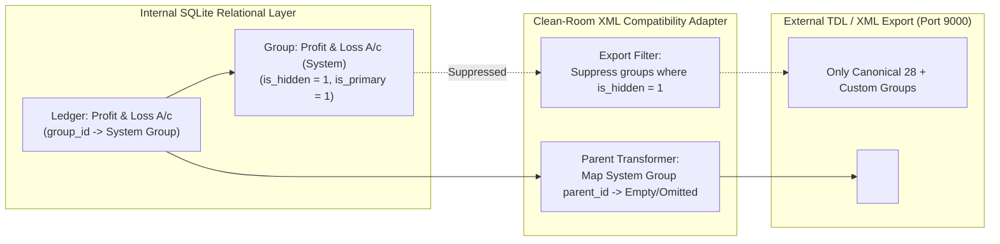
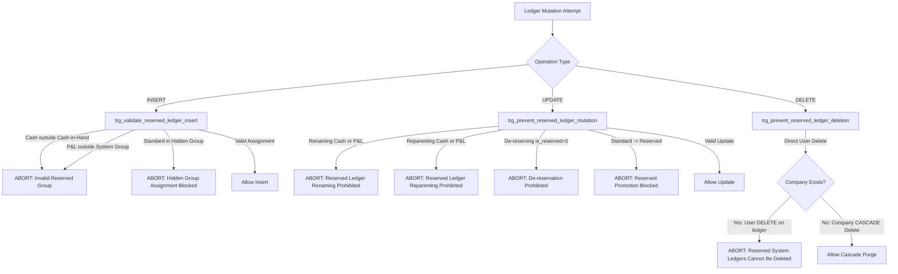
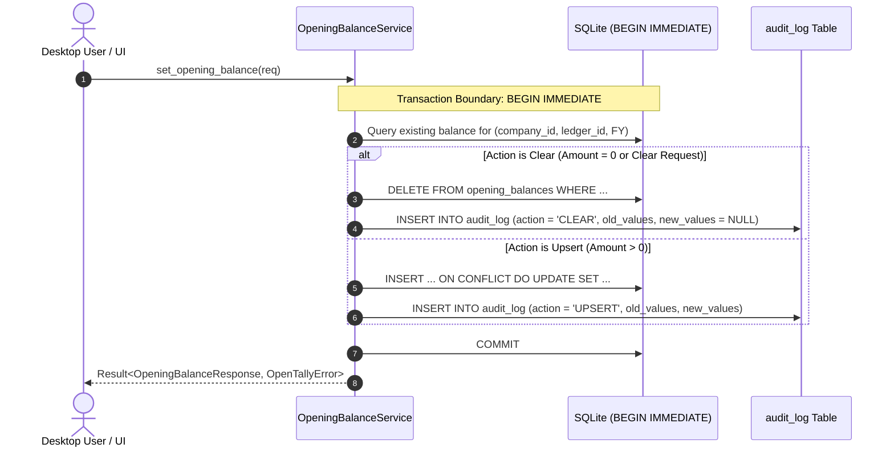
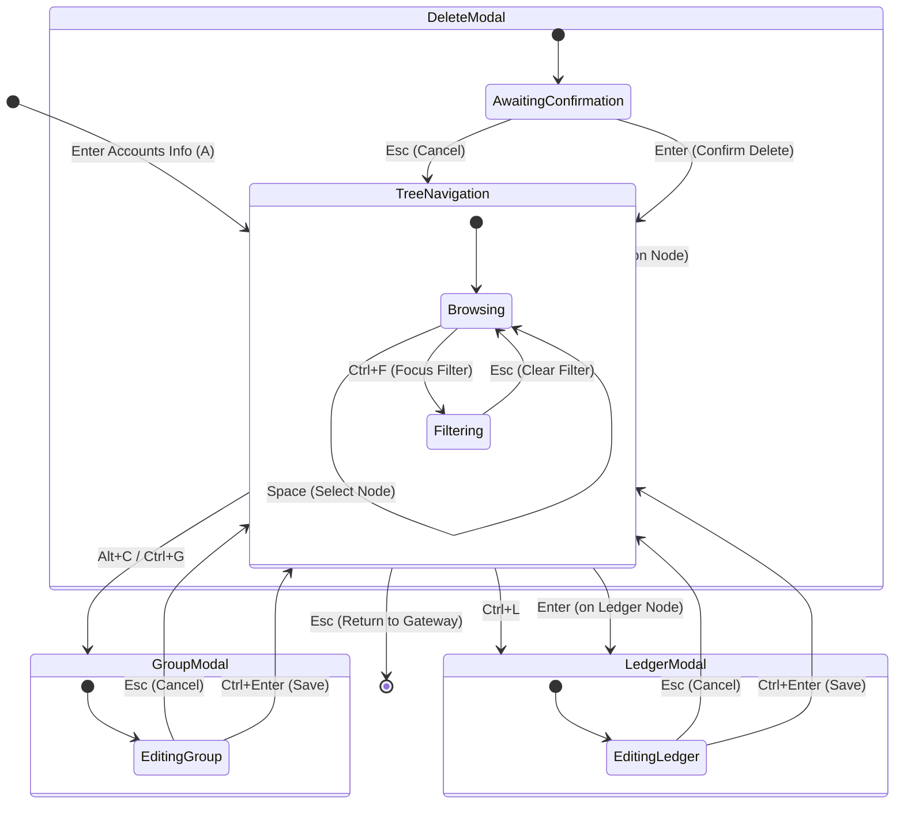

# OpenTally — Phase 2, Sprint 1, Stage 3: Technical Design
## Chart of Accounts Operations & Tree UI (v1.1.1)

**Document Version**: 1.1.1  
**Phase**: Phase 2 — Core Accounting Engine & Desktop UI  
**Sprint**: Sprint 1 — Company Management & Chart of Accounts  
**Stage**: Stage 3 — Chart of Accounts Operations & Tree UI  
**Status**: **FINAL TECHNICAL DESIGN SPECIFICATION (DESIGN ONLY — STRICTLY NO IMPLEMENTATION)**  
**Clean-Room Compliance**: **100% STRICT CLEAN ROOM (Zero Proprietary Code, Formats, or Binaries)**  

---

## 1. Scope, System Boundaries & Architectural Invariants

### 1.1 In-Scope Capabilities
Stage 3 transitions the Chart of Accounts (COA) for the active company into a fully operational master subsystem with complete domain services, relational integrity enforcement, Tauri IPC commands, and a keyboard-driven desktop Tree UI:

1. **Account Group Management**:
   - Hierarchical query and listing of predefined (canonical 28) and user-created groups for the active company.
   - Creation of user-defined sub-groups under valid parent groups.
   - Modification of permitted group attributes (`name`, `parent_id` reparenting).
   - Recursive cycle detection preventing circular parent-child relationships.
   - Multi-tenant boundary isolation enforced at both database and service layers.
   - Strict immutability protection for predefined groups (deletion, renaming, and nature mutation strictly blocked).
   - Safe deletion validation preventing deletion of non-empty groups (containing ledgers or child groups).
   - Invariant inheritance of accounting nature (`Assets`, `Liabilities`, `Income`, `Expenses`) and Gross Profit attribution.

2. **Ledger Master Management**:
   - Creation of standard ledgers assigned to valid account groups.
   - Listing, searching, and filtering ledgers by name, parent group, or classification.
   - Modification of permitted ledger attributes (`name`, `description`, `group_id` reparenting).
   - Absolute protection of reserved system ledgers (`Cash` under `Cash-in-Hand` and `Profit & Loss A/c` under `Profit & Loss A/c (System)`): deletion, renaming, and reparenting strictly blocked.
   - Prevention of standard ledger assignment to hidden system groups.
   - Prevention of ledger deletion when referenced by opening balances or accounting records.

3. **Opening Balance Domain Lifecycle & Atomic Audit History**:
   - Explicit domain operations for setting (`Upsert`) and clearing (`Clear`) ledger opening balances with debit (`Dr`) or credit (`Cr`) indicators.
   - Clear distinction between an absent balance record, an explicit zero balance, and an active balance.
   - Exact monetary decimal validation using `rust_decimal::Decimal` matching company currency decimal precision without silent rounding.
   - Calculation of opening balance totals ($\sum \text{Dr}$, $\sum \text{Cr}$) and dynamic difference monitoring ("Difference in opening balances").
   - Atomic recording of balance modifications and clearing within the same database transaction (`BEGIN IMMEDIATE ... COMMIT`).
   - Immutable audit log protected by database-level triggers preventing modification or deletion.

4. **Hierarchical Chart of Accounts Desktop UI**:
   - Keyboard-first, tree-structured desktop interface matching accounting ergonomics.
   - Arrow-key navigation (`Up`/`Down` for cursor, `Right`/`Left` for expand/collapse).
   - Hotkey actions (<kbd>Enter</kbd> to toggle/edit, <kbd>Space</kbd> to select, <kbd>Alt+C</kbd> / <kbd>Ctrl+G</kbd> for group creation, <kbd>Ctrl+L</kbd> for ledger creation, <kbd>Delete</kbd> for deletion confirmation, <kbd>Ctrl+F</kbd> for instant search).
   - Clear visual discrimination between Primary Groups, Sub-Groups, Standard Ledgers, and Reserved Ledgers.
   - Prominent sticky status bar displaying active company context and opening balance totals.
   - Modular React component design strictly adhering to the <400 lines maintainability ceiling.

### 1.2 Explicit Exclusions (Out of Scope for Stage 3)
- **Zero Transaction Vouchers**: No Sales, Purchase, Payment, Receipt, Contra, or Journal vouchers (scheduled for Sprint 2).
- **Zero Voucher Posting Engine**: No modification of ledger balances via double-entry transaction posting.
- **Zero HTTP Port 9000 Interoperability**: Deferred pending ADR-002 HTTP daemon framework selection.
- **Zero Bill-by-Bill Allocation**: Detailed outstanding invoice tracking (`New Ref`, `Agst Ref`) is modeled in schema but deferred to voucher workflows.
- **Zero Tax Engine Calculations**: Indian GST, TDS, and TCS computation pipelines are deferred to Sprint 3.

---

## 2. Canonical 28 Groups vs. Hidden Profit & Loss System Group & XML Interoperability

### 2.1 The Canonical 28 Predefined Accounting Groups
In TallyPrime, the standard chart of accounts is organized into **exactly 28 canonical predefined groups**: 15 Primary Groups (which report directly to financial statements) and 13 Secondary Groups (which roll up into primary groups).

```text
CANONICAL PREDEFINED GROUPS (28)
├── PRIMARY GROUPS (15) [parent_id = NULL, is_primary = 1, is_hidden = 0]
│   ├── Capital Account (Liabilities)
│   ├── Current Assets (Assets)
│   ├── Current Liabilities (Liabilities)
│   ├── Fixed Assets (Assets)
│   ├── Investments (Assets)
│   ├── Loans (Liability) (Liabilities)
│   ├── Suspense A/c (Liabilities)
│   ├── Misc. Expenses (ASSET) (Assets)
│   ├── Branch / Divisions (Liabilities)
│   ├── Sales Accounts (Income, Gross Profit = True)
│   ├── Purchase Accounts (Expenses, Gross Profit = True)
│   ├── Direct Incomes (Income, Gross Profit = True)
│   ├── Direct Expenses (Expenses, Gross Profit = True)
│   ├── Indirect Incomes (Income, Gross Profit = False)
│   └── Indirect Expenses (Expenses, Gross Profit = False)
│
└── SECONDARY GROUPS (13) [parent_id != NULL, is_primary = 0, is_hidden = 0]
    ├── Under 'Capital Account':
    │   └── Reserves & Surplus (Liabilities)
    ├── Under 'Current Assets':
    │   ├── Bank Accounts (Assets)
    │   ├── Cash-in-Hand (Assets)  --> Contains Reserved 'Cash' Ledger
    │   ├── Deposits (Asset) (Assets)
    │   ├── Loans & Advances (Asset) (Assets)
    │   ├── Stock-in-Hand (Assets)
    │   └── Sundry Debtors (Assets)
    ├── Under 'Current Liabilities':
    │   ├── Duties & Taxes (Liabilities)
    │   ├── Provisions (Liabilities)
    │   └── Sundry Creditors (Liabilities)
    └── Under 'Loans (Liability)':
        ├── Bank OD A/c (Liabilities)
        ├── Secured Loans (Liabilities)
        └── Unsecured Loans (Liabilities)
```

### 2.2 The 29th Group: `Profit & Loss A/c (System)`
To maintain relational integrity without violating double-entry foreign-key constraints, OpenTally introduced a dedicated system group for the reserved Profit & Loss ledger.

| Attribute | Specification | Rationale & Architectural Rule |
| :--- | :--- | :--- |
| **Relational Identifier** | `id`: System-generated UUID<br>`name`: `"Profit & Loss A/c (System)"` | Provides a concrete relational anchor satisfying `ledgers.group_id REFERENCES account_groups(id)`. |
| **Flags** | `is_primary = 1`<br>`is_predefined = 1`<br>`is_hidden = 1`<br>`affects_gross_profit = 0` | Marked primary (`parent_id = NULL`) so it does not distort user group balances. Flagged `is_hidden = 1`. |
| **Visibility** | **Strictly Hidden (0% User Visibility)** | Excluded from group selection comboboxes, tree displays, and standard export collections. |
| **Mutability** | **100% Immutable** | Cannot be renamed, reparented, edited, or deleted. Database triggers explicitly reject assigning standard ledgers to it. |
| **Reporting Behavior** | **Zero Statement Presence** | It never appears as a line item on Balance Sheet or Profit & Loss statements. Financial reporting engines extract the child `Profit & Loss A/c` ledger directly as a balance-sheet equity accumulator. |

### 2.3 External XML Interoperability & Port 9000 Mapping Layer
A critical clean-room architectural requirement is maintaining a strict boundary between internal relational storage and external wire/XML representations:



1. **Export Mapping (Hypothesis — Classified as UNKNOWN)**:
   - When generating XML group collections (`<GROUP>` tags), any group with `is_hidden = 1` is proposed to be suppressed. The synthetic `Profit & Loss A/c (System)` group is never serialized into XML.
   - When serializing the reserved `Profit & Loss A/c` ledger (`<LEDGER NAME="Profit & Loss A/c">`), the hypothesis is to emit an empty parent tag `<PARENT/>` or omit the `<PARENT>` element entirely. **This mapping is classified as UNKNOWN (tracked under UNK-007) until verified by live empirical wire captures.**
   - In contrast, the reserved `Cash` ledger emits `<PARENT>Cash-in-Hand</PARENT>` normally.
   - **Important Constraint**: XML import/export and Port 9000 interoperability are strictly out of scope and **NOT implemented in Stage 3**.
2. **Import Mapping (Hypothesis)**:
   - When importing third-party TDL XML where `<LEDGER NAME="Profit & Loss A/c">` has an empty or omitted `<PARENT>` tag, the hypothetical import adapter would resolve its `group_id` to the company's internal synthetic `Profit & Loss A/c (System)` group ID.
3. **Protocol Unknowns Boundary**:
   - Wire attributes and XML schema variations on Port 9000 are documented in `01-clean-room-specs/tallyprime/UNKNOWNS.md` (specifically `UNK-007`). OpenTally does not fabricate speculative XML attributes or implement premature XML bridges.

---

## 3. Statutory Audit Trail Framework & Legal Compliance Disclaimers

### 3.1 Official Legal & Regulatory Mandates (India MCA)
In India, accounting software governance is governed by the Ministry of Corporate Affairs (MCA) under the Companies Act, 2013, and associated statutory rules:

1. **Companies Act, 2013 — Section 134(5)**:
   - Sets forth the statutory requirement for the **Directors' Responsibility Statement**.
   - Specifically, Section 134(5)(e) mandates that directors ensure adequate internal financial controls are in place and operating effectively, which encompasses controls over accounting record accuracy and tamper prevention.
2. **Companies Act, 2013 — Section 128(5)**:
   - Mandates that books of account of every company relating to a period of not less than **eight financial years** immediately preceding a financial year, together with the vouchers relevant to any entry in such books of account, shall be kept in good order.
3. **Companies (Accounts) Rules, 2014 — Rule 3(1) Proviso**:
   - **Notification Authority**: Ministry of Corporate Affairs (MCA) Gazette Notification **G.S.R. 205(E)** dated 24th March, 2021 (with subsequent commencement notifications **G.S.R. 247(E)** dated 1st April, 2021, and **G.S.R. 235(E)** dated 31st March, 2022, bringing the rule into mandatory effect on **1st April, 2023**).
   - **Statutory Text / Mandate**:
     > *"Provided that for the financial year commencing on or after the 1st day of April, 2023, every company which uses accounting software for maintaining its books of account, shall use only such accounting software which has a feature of recording audit trail of each and every transaction, creating an edit log of each change made in books of account along with the date when such changes were made and ensuring that the audit trail cannot be disabled."*
4. **Companies (Audit and Auditors) Rules, 2014 — Rule 11(g)**:
   - **Notification Authority**: MCA Gazette Notification **G.S.R. 248(E)** dated 1st April, 2021 (effective **1st April, 2023**).
   - **Statutory Mandate**: Requires the statutory auditor's report to include a specific statement on:
     > *"Whether the company has used such accounting software for maintaining its books of account which has a feature of recording audit trail (edit log) facility and the same has operated throughout the year for all transactions recorded in the software and the audit trail feature has not been tampered with and the audit trail has been preserved by the company as per the statutory requirements for record retention."*
5. **ICAI Implementation Guidance**:
   - The Institute of Chartered Accountants of India (ICAI) published the *"Implementation Guide on Reporting on Audit Trail under Rule 11(g) of the Companies (Audit and Auditors) Rules, 2014"*, clarifying that the edit log must capture master data edits, opening balance changes, transaction edits, timestamping, user identification, and unalterable persistence.

### 3.2 Clean-Room Engineering Boundary, SQLite Limitations & Legal Disclaimer

> [!CAUTION]
> **MANDATORY LEGAL & STATUTORY DISCLAIMER:**
> 1. **Software Primitives vs. Legal Compliance**: OpenTally implements technical audit trail primitives (database triggers, append-only logging tables, field-level JSON change deltas, actor attribution, and UTC timestamps). **The presence of an append-only audit trail in the software does not, and cannot, by itself constitute statutory or legal compliance.** OpenTally does not claim tamper-proof cryptographic storage or certified statutory compliance.
> 2. **Technical Limitations of Local SQLite Triggers**: SQLite triggers are in-engine application enforcement mechanisms that execute solely during normal DML database operations issued through SQLite connections. **They are NOT technically non-disableable** at the operating system or raw storage level. Any actor with direct filesystem access, admin privileges, external SQLite CLI access, or hex editors can bypass, alter, or drop triggers (`DROP TRIGGER`) or modify SQLite database files directly outside the application process boundary.
> 3. **Actor Attribution Without Fictitious Identities**: OpenTally operates as a single-tenant local desktop application without an internal multi-user authentication subsystem. The actor field (`performed_by`) is strictly recorded as `"desktop_user"` (a generic local desktop session identifier, NOT an authenticated human identity) or `"system"` for automated migrations/seeders. Fabricated user identities, simulated auth roles, or fictitious employee credentials must never be invented.
> 4. **Operational & Environmental Dependencies**: Full statutory compliance under MCA Rule 3(1) and Rule 11(g) depends on the broader operating environment, including database file-level OS permissions, hardware access controls, preventing raw SQLite file substitution, operating system time synchronization (NTP), physical security, and management oversight.
> 5. **Professional Review Required**: All statutory assertions, applicability evaluations, retention policies (including Section 128(5) 8-year preservation), and audit-readiness assessments are **SUBJECT TO INDEPENDENT PROFESSIONAL LEGAL & CHARTERED ACCOUNTANCY REVIEW**. OpenTally provides no legal warranties.

---

## 4. Complete Database-Level Protections for Reserved Ledgers

The SQLite database schema (`0.2.0-sprint1`) enforces absolute relational protection for the reserved `Cash` and `Profit & Loss A/c` ledgers.



### 4.1 Database Constraints & Indexes
1. **Partial Unique Index (`uq_company_reserved_ledger`)**:
   ```sql
   CREATE UNIQUE INDEX uq_company_reserved_ledger
   ON ledgers(company_id, ledger_classification)
   WHERE ledger_classification IN ('cash', 'profit_and_loss');
   ```
   Guarantees that a company can never contain more than one Cash ledger and one Profit & Loss ledger.
2. **Case-Insensitive Master Uniqueness**:
   ```sql
   CONSTRAINT uq_company_ledger_name UNIQUE (company_id, name COLLATE NOCASE);
   ```
   Prevents naming collisions with reserved ledgers (e.g., creating a second ledger named `"cash"` or `"PROFIT & LOSS A/C"` is rejected).
3. **Classification Check Constraint**:
   ```sql
   CONSTRAINT chk_reserved_classification CHECK (
       (is_reserved = 1 AND ledger_classification IN ('cash', 'profit_and_loss')) OR
       (is_reserved = 0 AND ledger_classification = 'standard')
   );
   ```

### 4.2 Database Triggers
1. **Insert Trigger (`trg_validate_reserved_ledger_insert`)**:
   - Rejects creating a Cash ledger outside the `Cash-in-Hand` group.
   - Rejects creating a Profit & Loss ledger outside the `Profit & Loss A/c (System)` group.
   - Rejects creating a standard ledger under any hidden system group (`is_hidden = 1`).
2. **Mutation Trigger (`trg_prevent_reserved_ledger_mutation`)**:
   - Rejects modifying `name`, `group_id`, `company_id`, `id`, `ledger_classification`, or `is_reserved` on any reserved ledger.
   - Rejects converting standard ledgers into reserved ledgers.
3. **Deletion Trigger (`trg_prevent_reserved_ledger_deletion`)**:
   ```sql
   CREATE TRIGGER trg_prevent_reserved_ledger_deletion
   BEFORE DELETE ON ledgers
   FOR EACH ROW
   WHEN OLD.is_reserved = 1 AND EXISTS (SELECT 1 FROM companies WHERE id = OLD.company_id)
   BEGIN
       SELECT RAISE(ABORT, 'Reserved system ledgers (Cash, Profit & Loss A/c) cannot be deleted');
   END;
   ```
   **Preservation of Company Cascade Deletion**:
   When a company is deleted (`DELETE FROM companies WHERE id = $1`), SQLite's `ON DELETE CASCADE` triggers deletion of all child ledgers. Because SQLite executes parent company deletion first, the clause `EXISTS (SELECT 1 FROM companies WHERE id = OLD.company_id)` evaluates to `FALSE` during cascade deletion. Thus, the trigger permits clean company purging while strictly aborting any direct user `DELETE FROM ledgers WHERE name = 'Cash'`.

---

## 5. Opening Balance Domain Lifecycle, Exact Precision & Atomic Audit History

### 5.1 Three-State Domain Lifecycle
In double-entry accounting, an uninitialized ledger is distinct from an explicit zero balance. OpenTally models opening balance operations as explicit domain actions:

```mermaid
stateDiagram-v2
    [*] --> Absent: Ledger Created (No Opening Balance Record)
    
    Absent --> Active: SetOpeningBalanceAction::Upsert(Dr/Cr, Amount > 0)
    Active --> Active: SetOpeningBalanceAction::Upsert(Dr/Cr, Amount > 0)
    Active --> Cleared: SetOpeningBalanceAction::Clear / Amount = 0
    Cleared --> Active: SetOpeningBalanceAction::Upsert(Dr/Cr, Amount > 0)
    Absent --> Cleared: Input 0 / Clear (No-Op on Row, Logs Audit if Prior Existed)
```

1. **State 1: Absent Balance Record**:
   - No row exists in `opening_balances` for `(company_id, ledger_id, financial_year_begins)`.
   - Represents an uninitialized opening balance. Does not contribute to $\sum \text{Dr}$ or $\sum \text{Cr}$.
2. **State 2: Active Opening Balance**:
   - An exact positive amount (`amount > 0`) with a valid indicator (`Dr` or `Cr`).
   - Stored in `opening_balances` and incorporated into equilibrium rollup.
3. **State 3: Explicit Balance Clearing (`ClearOpeningBalance`)**:
   - When a user inputs `0`, `0.00`, or explicitly clears the balance field, OpenTally executes an explicit domain action `ClearOpeningBalance`.
   - The corresponding row in `opening_balances` is deleted (`DELETE FROM opening_balances WHERE ...`) to prevent database bloat and eliminate redundant zero-value rollup operations.
   - An audit log entry with `action = 'CLEAR'` is recorded atomically.

### 5.2 Debit and Credit Representation
- In SQLite: Stored explicitly as `balance_type TEXT NOT NULL CHECK (balance_type IN ('Dr', 'Cr'))`.
- In Rust:
  ```rust
  #[derive(Debug, Clone, Copy, PartialEq, Eq, Serialize, Deserialize)]
  pub enum BalanceType {
      Dr,
      Cr,
  }
  ```
- **Financial Rollup Rules**:
  - For `Assets` and `Expenses`: Debit amounts are positive; Credit amounts are negative (reducing asset value).
  - For `Liabilities` and `Income`: Credit amounts are positive; Debit amounts are negative (reducing liability).

### 5.3 Exact Monetary Decimal Precision (Zero Silent Rounding)
- Stored as exact `TEXT` in SQLite, validated via `rust_decimal::Decimal`.
- Database constraint:
  ```sql
  CONSTRAINT chk_opening_amount_non_negative CHECK (
      length(amount) > 0
      AND amount GLOB '[0-9]*'
      AND amount GLOB '*[0-9]'
      AND amount NOT GLOB '*[^0-9.]*'
      AND amount NOT GLOB '*.*.*'
  );
  ```
- **Validation Rules**:
  1. Negative values (e.g. `-100.00`) are rejected at both service and database layers.
  2. Trailing zeros are accepted and normalized (e.g., `100.5` becomes `100.50` for a 2-decimal currency).
  3. **Strict Prohibition on Silent Rounding**: If a user submits `100.235` for an INR company (`currency_decimal_places = 2`), the application **must not round silently** to `100.24`. It must return:
     ```rust
     OpenTallyError::Validation("Amount '100.235' exceeds company currency precision of 2 decimal places".to_string())
     ```

### 5.4 Atomic Upsert, Clearing & Audit Transaction Flow
Every opening balance mutation or clearing must occur within the **same atomic database transaction** (`BEGIN IMMEDIATE ... COMMIT`), ensuring that state changes and audit logs can never drift:



### 5.5 Database Triggers for Audit Log Immutability & Local Engine Limitations
Within normal application execution, the `audit_log` table is guarded against `UPDATE` and direct `DELETE` via SQLite triggers. However, as noted in Section 3.2, these triggers only guard queries issued within the database engine and do not prevent out-of-band tampering by users with raw file, hex-editing, or external SQLite DDL access. In addition, the actor attribute `performed_by` is strictly set to `"desktop_user"` (a generic local desktop session identifier, not an authenticated human identity) or `"system"` for automated seeders/migrations; no fictitious user accounts or spoofed credentials are created. OpenTally does not claim tamper-proof cryptographic hardware storage or certified statutory compliance.

```sql
-- Audit Log Schema Definition
CREATE TABLE IF NOT EXISTS audit_log (
    id TEXT PRIMARY KEY,
    company_id TEXT NOT NULL,
    entity_type TEXT NOT NULL,
    entity_id TEXT NOT NULL,
    ledger_id TEXT,
    financial_year_begins TEXT,
    action TEXT NOT NULL CHECK (action IN ('CREATE', 'UPDATE', 'CLEAR', 'DELETE')),
    old_values TEXT, -- JSON serialization of previous state
    new_values TEXT, -- JSON serialization of new state
    performed_by TEXT NOT NULL,
    timestamp TEXT NOT NULL DEFAULT (strftime('%Y-%m-%dT%H:%M:%fZ', 'now')),
    FOREIGN KEY (company_id) REFERENCES companies(id) ON DELETE CASCADE
);

CREATE INDEX IF NOT EXISTS idx_audit_log_entity
ON audit_log(company_id, entity_type, entity_id);

CREATE INDEX IF NOT EXISTS idx_audit_log_timestamp
ON audit_log(company_id, timestamp);

-- Trigger 1: Prevent any UPDATE to audit_log
CREATE TRIGGER IF NOT EXISTS trg_prevent_audit_log_mutation
BEFORE UPDATE ON audit_log
FOR EACH ROW
BEGIN
    SELECT RAISE(ABORT, 'Audit log entries are immutable and cannot be updated');
END;

-- Trigger 2: Prevent direct user DELETE on audit_log
CREATE TRIGGER IF NOT EXISTS trg_prevent_audit_log_deletion
BEFORE DELETE ON audit_log
FOR EACH ROW
WHEN EXISTS (SELECT 1 FROM companies WHERE id = OLD.company_id)
BEGIN
    SELECT RAISE(ABORT, 'Audit log entries are permanent and cannot be deleted');
END;
```

---

## 6. Explicit Keyboard Interaction & Ergonomics Specification

OpenTally replicates TallyPrime's renowned keyboard-first desktop ergonomics.



### 6.1 Complete Keyboard Interaction Table

| Key Combination | Target Context | Exact Behavioral Action | Pre-Conditions & Conflict Handling |
| :--- | :--- | :--- | :--- |
| **`&uarr;` (Up Arrow)** | `AccountTreeView` | Moves cursor up to previous visible node in linear tree index. | Stops at row 0; no-op when search input or modal is focused. |
| **`&darr;` (Down Arrow)** | `AccountTreeView` | Moves cursor down to next visible node in linear tree index. | Stops at bottom row; no-op when modal is focused. |
| **`&rarr;` (Right Arrow)** | `AccountTreeView` | If highlighted group is collapsed $\to$ expands group.<br>If highlighted group is expanded $\to$ moves cursor to first child.<br>If highlighted node is a ledger $\to$ no-op. | No-op when modal or search input is focused. |
| **`&larr;` (Left Arrow)** | `AccountTreeView` | If highlighted group is expanded $\to$ collapses group.<br>If highlighted group is collapsed $\to$ jumps cursor to parent group.<br>If highlighted node is a ledger $\to$ jumps cursor to parent group. | No-op when modal or search input is focused. |
| **`Enter`** | `AccountTreeView` | If highlighted node is a Group $\to$ toggles expand/collapse.<br>If highlighted node is a Ledger $\to$ opens `LedgerFormModal` for editing. | Within modals: advances to next field; submits form on final button. |
| **`Space`** | `AccountTreeView` | Toggles selection/highlight checkbox on current row. | Does not expand or collapse node. |
| **`Ctrl + F`** | Global View | Immediately focuses search typeahead input field. | Suspends arrow navigation in tree until search is cleared or <kbd>Esc</kbd> pressed. |
| **`Alt + C` / `Ctrl + G`**| Global View | Opens `GroupFormModal`. Automatically pre-populates the parent group dropdown with the currently highlighted group. | Suspends global shortcuts while modal is open. |
| **`Ctrl + L`** | Global View | Opens `LedgerFormModal`. Automatically pre-populates the group dropdown with the currently highlighted group. | Suspends global shortcuts while modal is open. |
| **`Delete`** | `AccountTreeView` | **Opens `DeleteConfirmModal`**. Never deletes immediately. | Displays high-contrast confirmation showing node name and invariant warning. |
| **`Esc`** | Modal Scope | Dismisses active modal dialog without saving changes. | Returns focus cleanly to previously active tree row. |
| **`Esc`** | Global View | Closes Chart of Accounts view and navigates back to Gateway of OpenTally. | Only fires when no modal is active and search input is unfocused. |
| **`D` / `C`** | `LedgerFormModal` | Hotkey toggle for Opening Balance type: <kbd>D</kbd> sets `Dr`, <kbd>C</kbd> sets `Cr`. | Only active when focusing the Opening Balance type field. |
| **`Ctrl + Enter`** | Modal Scope | Immediately submits form from any input field (Save & Close). | Validates required fields before submitting. |

---

## 7. Command-Specific IPC Validation & Authorization Matrix

The table below defines the strict defensive contract, validation rules, authorization guards, and transaction boundaries for all 11 Stage 3 Chart of Accounts IPC commands, with contextual Stage 2 Company Management commands included for architectural comparison:

| # | Command Name & Signature | Active Company Required? | Company Status & Ownership Validation | Input Validation Rules | Authorization & Structural Guards | ACID Transaction Scope & Isolation |
|---|--------------------------|:------------------------:|---------------------------------------|------------------------|-----------------------------------|-----------------------------------|
| **C1** | `create_company(req)` | **No** | None (Global operation) | Name non-empty, unique; valid ISO dates; FY <= Books date; decimal places 0..4. | Accessible from Welcome/Gateway screen. | `BEGIN IMMEDIATE`<br>Seeds 29 groups + 2 ledgers. Full rollback on error. |
| **C2** | `list_companies()` | **No** | None (Global query) | None | Returns all companies ordered by `name ASC`. | Read-Only Snapshot (`BEGIN TRANSACTION`). |
| **C3** | `get_company(id)` | **No** | Validates target `id` exists in database. | Target UUID non-empty and valid format. | Rejects non-existent company with 404/NotFound. | Read-Only Snapshot (`BEGIN TRANSACTION`). |
| **C4** | `select_company(id)` | **No** | Verifies company status == `Active`. Blocks selection if `Archived`. | Target UUID non-empty and valid. | Updates active company state in memory and database table. | `BEGIN IMMEDIATE`<br>Atomic state update. |
| **C5** | `archive_company(id)` | **No** | Verifies company exists and is `Active`. | Target UUID valid. | Blocks archiving if already archived. Deselects if active. | `BEGIN IMMEDIATE`<br>Status update. |
| **1** | `get_chart_of_accounts()` | **Yes** | Verifies active company exists and status == `Active`. | None | Rejects execution if active company is missing or archived. | Read-Only Snapshot (`BEGIN TRANSACTION`). Queries tree & balance totals. |
| **2** | `list_account_groups()` | **Yes** | Verifies active company exists and status == `Active`. | None | Filters out hidden system groups (`is_hidden = 0`). Multi-tenant isolation. | Read-Only Snapshot (`BEGIN TRANSACTION`). |
| **3** | `create_account_group(req)` | **Yes** | Verifies active company exists and status == `Active`. | Name non-empty (1..100 chars); `parent_id` non-empty and valid UUID. | Verifies `parent_id` belongs to active company. Rejects hidden system parents. Inherits nature. | `BEGIN IMMEDIATE`<br>Atomic insert. |
| **4** | `update_account_group(id, req)` | **Yes** | Verifies active company exists and status == `Active`. | Target `id` valid; Name non-empty (1..100 chars). | **Rejects modifying predefined groups (`is_predefined = 1`)**. Runs recursive cycle detection on reparenting. Rejects cross-nature reparenting. | `BEGIN IMMEDIATE`<br>Validation & update in single transaction. |
| **5** | `delete_account_group(id)` | **Yes** | Verifies active company exists and status == `Active`. | Target `id` valid UUID. | **Rejects deleting predefined groups**. Validates group contains 0 child groups and 0 child ledgers. Aborts if non-empty. | `BEGIN IMMEDIATE`<br>Relies on Trigger 4 and service checks. |
| **6** | `list_ledgers()` | **Yes** | Verifies active company exists and status == `Active`. | None | Returns all ledgers for active company. Excludes deleted/orphaned rows. | Read-Only Snapshot (`BEGIN TRANSACTION`). |
| **7** | `get_ledger(id)` | **Yes** | Verifies active company exists and status == `Active`. | Target `id` valid UUID. | Returns ledger details + current FY opening balance. 404 if not found in active company. | Read-Only Snapshot (`BEGIN TRANSACTION`). |
| **8** | `create_ledger(req)` | **Yes** | Verifies active company exists and status == `Active`. | Name non-empty (1..100 chars); `group_id` valid UUID; valid opening balance if present. | **Rejects creating standard ledger in hidden system group**. Rejects name collision. Persists optional opening balance atomically. | `BEGIN IMMEDIATE`<br>Ledger insert + optional opening balance + audit log. |
| **9** | `update_ledger(id, req)` | **Yes** | Verifies active company exists and status == `Active`. | Target `id` valid UUID; Name non-empty (1..100 chars). | **Rejects renaming or reparenting reserved ledgers (`Cash`, `Profit & Loss A/c`)**. Enforces unique name per company. | `BEGIN IMMEDIATE`<br>Atomic update. |
| **10** | `delete_ledger(id)` | **Yes** | Verifies active company exists and status == `Active`. | Target `id` valid UUID. | **Rejects deleting reserved ledgers (`is_reserved = 1`)**. Rejects deleting ledgers with opening balances or transaction entries. | `BEGIN IMMEDIATE`<br>Trigger 3 & Trigger 5 enforce relational integrity. |
| **11** | `set_opening_balance(req)` | **Yes** | Verifies active company exists and status == `Active`. | Amount must be non-negative; matches company currency decimal places (no silent rounding); balance type in (`Dr`, `Cr`). | Validates ledger belongs to active company. Dispatches `Clear` on amount=0 or `Upsert` on amount>0. | `BEGIN IMMEDIATE`<br>Atomic balance mutation + immutable audit log write. |

---

## 8. Comprehensive 16-Scenario Test Matrix

The test matrix covers all required scenarios across Unit, Integration, and Desktop UI test layers:

```text
TEST COVERAGE SUMMARY:
- Unit Tests (Rust): 8 scenarios
- Integration Tests (Rust / SQLite): 6 scenarios
- Desktop UI Tests (React / Vitest): 2 scenarios
Total: Exactly 16 fully enumerated test scenarios
```

### Scenario Breakdown

#### Scenario 1: Multi-Company Account Group Listing (`TC-GRP-01`)
- **Test Type**: Integration Test (Rust / SQLite)
- **Setup**: Create Company Alpha and Company Beta in test database. Create custom group `Northern Debtors` in Company Alpha and `Southern Debtors` in Company Beta.
- **Action**: Call `GroupService::list_groups(pool, alpha_id)` and `GroupService::list_groups(pool, beta_id)`.
- **Expected Assertion**: Company Alpha's list contains exactly 28 visible predefined groups + `Northern Debtors`. Company Beta's list contains 28 visible predefined groups + `Southern Debtors`. Zero cross-tenant data exposure.

#### Scenario 2: Create User-Defined Group (`TC-GRP-02`)
- **Test Type**: Unit Test (Rust)
- **Setup**: Active company with seeded groups.
- **Action**: Invoke `GroupService::create_group` with name `"Special Clients"`, parent `"Sundry Debtors"`.
- **Expected Assertion**: Record persisted successfully with `is_primary = 0`, `is_predefined = 0`, `nature = Assets`, `affects_gross_profit = 0`, `parent_id` matching `Sundry Debtors`.

#### Scenario 3: Edit User-Defined Group Attributes (`TC-GRP-03`)
- **Test Type**: Unit Test (Rust)
- **Setup**: Custom group `"Special Clients"` exists under `"Sundry Debtors"`.
- **Action**: Invoke `GroupService::update_group` renaming to `"VIP Clients"` and reparenting under `"Current Assets"`.
- **Expected Assertion**: Name updated to `"VIP Clients"`; `parent_id` updated; `nature = Assets` preserved.

#### Scenario 4: Reject Edits to Protected Predefined Groups (`TC-GRP-04`)
- **Test Type**: Unit Test (Rust)
- **Setup**: Predefined group `"Current Assets"` (`is_predefined = 1`).
- **Action**: Attempt `GroupService::update_group` renaming to `"Liquid Assets"` or changing its parent.
- **Expected Assertion**: Aborts with `OpenTallyError::Validation("Predefined group 'Current Assets' is protected and cannot be altered or reparented")`.

#### Scenario 5: Reject Circular Group Hierarchy (`TC-GRP-05`)
- **Test Type**: Unit Test (Rust)
- **Setup**: Create Group 1 $\to$ Group 2 under Group 1 $\to$ Group 3 under Group 2.
- **Action**: Attempt to reparent Group 1 under Group 3.
- **Expected Assertion**: Cycle detection validator aborts with `OpenTallyError::Validation("Circular hierarchy detected: group 'Group 1' is an ancestor of 'Group 3'")`. Database state unmodified.

#### Scenario 6: Reject Cross-Company Parent Assignment (`TC-GRP-06`)
- **Test Type**: Integration Test (Rust / SQLite)
- **Setup**: Company Alpha and Company Beta exist.
- **Action**: Attempt to create an account group in Company Alpha referencing `parent_id` belonging to Company Beta.
- **Expected Assertion**: Rejected by composite foreign key `FOREIGN KEY (company_id, parent_id) REFERENCES account_groups(company_id, id)` and service validation.

#### Scenario 7: Reject Deletion of Non-Empty Groups (`TC-GRP-07`)
- **Test Type**: Integration Test (Rust / SQLite)
- **Setup**: Create custom group `"Regional Debtors"`; create child ledger `"Customer X"` under it.
- **Action**: Invoke `GroupService::delete_group` on `"Regional Debtors"`.
- **Expected Assertion**: Aborts with `OpenTallyError::Validation` triggered by `trg_prevent_group_delete_with_children` ("Cannot delete account group with child groups or ledgers").

#### Scenario 8: Create Standard Ledger Under Valid Group (`TC-LED-01`)
- **Test Type**: Unit Test (Rust)
- **Setup**: Active company with seeded groups.
- **Action**: Create ledger `"ICICI Bank Operating A/c"` under `"Bank Accounts"` with description `"Main account"`.
- **Expected Assertion**: Ledger persisted with `is_reserved = 0`, `ledger_classification = 'standard'`, and valid `group_id`.

#### Scenario 9: Reject Standard Ledger in Hidden System Group (`TC-LED-02`)
- **Test Type**: Unit Test (Rust)
- **Setup**: Retrieve hidden system group `"Profit & Loss A/c (System)"`.
- **Action**: Attempt to create standard ledger `"Custom Expense"` under `"Profit & Loss A/c (System)"`.
- **Expected Assertion**: Aborts with `OpenTallyError::Validation` triggered by `trg_validate_reserved_ledger_insert` ("Standard ledgers cannot belong to hidden system groups").

#### Scenario 10: Protect Reserved Cash and P&L Ledgers (`TC-LED-03`)
- **Test Type**: Integration Test (Rust / SQLite)
- **Setup**: Seeded company containing reserved `"Cash"` and `"Profit & Loss A/c"`.
- **Action**:
  1. Attempt to rename `"Cash"` to `"Petty Cash"`.
  2. Attempt to reparent `"Cash"` under `"Sundry Debtors"`.
  3. Attempt `DELETE FROM ledgers WHERE name = 'Cash'`.
- **Expected Assertion**: Operations 1 and 2 aborted by `trg_prevent_reserved_ledger_mutation`. Operation 3 aborted by `trg_prevent_reserved_ledger_deletion`.

#### Scenario 11: Prevent Deletion of Referenced Ledgers (`TC-LED-04`)
- **Test Type**: Integration Test (Rust / SQLite)
- **Setup**: Standard ledger `"Supplier Alpha"` exists with an opening balance of ₹10,000.00 Cr.
- **Action**: Invoke `LedgerService::delete_ledger` on `"Supplier Alpha"`.
- **Expected Assertion**: Aborted by `trg_prevent_ledger_delete_with_opening_balances` ("Cannot delete ledger with existing opening balances").

#### Scenario 12: Opening Balance Validation & Precision Enforcement (`TC-OPB-01`)
- **Test Type**: Unit Test (Rust)
- **Setup**: Company with `currency_decimal_places = 2`.
- **Action & Assertions**:
  - `amount = "50000.00"`, `balance_type = "Dr"` $\to$ **Accepted**.
  - `amount = "-500.00"` $\to$ **Rejected** ("Opening balance amount must be non-negative").
  - `amount = "100.235"` $\to$ **Rejected** ("Amount exceeds currency precision of 2 decimal places"). Silent rounding rejected.
  - `amount = "0.00"` $\to$ **Accepted and cleared** (row deleted from `opening_balances`, audit log action `'CLEAR'` written).

#### Scenario 13: Opening Balance Equilibrium Rollup Calculation (`TC-OPB-02`)
- **Test Type**: Integration Test (Rust / SQLite)
- **Setup**: Ledger 1: ₹500.00 Dr; Ledger 2: ₹300.00 Dr; Ledger 3: ₹200.00 Dr; Ledger 4: ₹800.00 Cr.
- **Action**: Invoke `OpeningBalanceService::get_equilibrium(pool, company_id)`.
- **Expected Assertion**: Total Debits = ₹1,000.00; Total Credits = ₹800.00; Net Difference = ₹200.00 Dr; `is_balanced = false`.

#### Scenario 14: Multi-Level Recursive Tree Rollup (`TC-TRE-01`)
- **Test Type**: Integration Test (Rust / SQLite)
- **Setup**: Primary Group `Current Assets` $\to$ Secondary `Sundry Debtors` $\to$ Sub-Group `North Region` $\to$ Ledger `Client A` (₹10,000.00 Dr).
- **Action**: Invoke `TreeService::get_chart_of_accounts_tree`.
- **Expected Assertion**: Aggregated debits for `North Region`, `Sundry Debtors`, and `Current Assets` all equal ₹10,000.00 Dr.

#### Scenario 15: Tree Keyboard Navigation & Expansion (`TC-UI-01`)
- **Test Type**: Desktop UI Test (Vitest / React Testing Library)
- **Setup**: Render `AccountTreeView` with 3 groups and 2 ledgers.
- **Action**: Fire `ArrowDown` $\to$ assert cursor moves to row 1. Fire `ArrowRight` $\to$ assert group expands. Fire `Enter` on ledger row $\to$ assert edit modal opens.
- **Expected Assertion**: State reflects expected active index, expansion set, and modal visibility.

#### Scenario 16: Company Isolation & Unselected State (`TC-SEC-01`)
- **Test Type**: Unit Test (Rust)
- **Setup**: `AppState::active_company_id` set to `None`.
- **Action**: Invoke `commands::get_chart_of_accounts`.
- **Expected Assertion**: Returns `OpenTallyError::Validation("No active company selected. Please select a company (F3) first.")`.

---

## 9. Migration Compatibility Strategy

- **Baseline Schema**: Version `0.2.0-sprint1` already includes all required core tables (`companies`, `company_settings`, `account_groups`, `ledgers`, `opening_balances`) and triggers (`trg_validate_reserved_ledger_insert`, `trg_prevent_reserved_ledger_mutation`, `trg_prevent_reserved_ledger_deletion`, `trg_prevent_group_delete_with_children`, `trg_prevent_ledger_delete_with_opening_balances`).
- **Targeted Patch Migration (`0.2.1-sprint1`)**:
  To support statutory audit logging and immutable triggers without modifying accepted baseline schema, a non-breaking incremental migration `0.2.1-sprint1` will be introduced upon implementation authorization:
  ```sql
  -- Migration: 0.2.1-sprint1 (Audit Log & Master Protection Triggers)
  CREATE TABLE IF NOT EXISTS audit_log (
      id TEXT PRIMARY KEY,
      company_id TEXT NOT NULL,
      entity_type TEXT NOT NULL,
      entity_id TEXT NOT NULL,
      ledger_id TEXT,
      financial_year_begins TEXT,
      action TEXT NOT NULL CHECK (action IN ('CREATE', 'UPDATE', 'CLEAR', 'DELETE')),
      old_values TEXT,
      new_values TEXT,
      performed_by TEXT NOT NULL,
      timestamp TEXT NOT NULL DEFAULT (strftime('%Y-%m-%dT%H:%M:%fZ', 'now')),
      FOREIGN KEY (company_id) REFERENCES companies(id) ON DELETE CASCADE
  );

  CREATE INDEX IF NOT EXISTS idx_audit_log_entity
  ON audit_log(company_id, entity_type, entity_id);

  CREATE TRIGGER IF NOT EXISTS trg_prevent_audit_log_mutation
  BEFORE UPDATE ON audit_log
  FOR EACH ROW
  BEGIN
      SELECT RAISE(ABORT, 'Audit log entries are immutable and cannot be updated');
  END;

  CREATE TRIGGER IF NOT EXISTS trg_prevent_audit_log_deletion
  BEFORE DELETE ON audit_log
  FOR EACH ROW
  WHEN EXISTS (SELECT 1 FROM companies WHERE id = OLD.company_id)
  BEGIN
      SELECT RAISE(ABORT, 'Audit log entries are permanent and cannot be deleted');
  END;

  CREATE TRIGGER IF NOT EXISTS trg_prevent_predefined_group_deletion
  BEFORE DELETE ON account_groups
  FOR EACH ROW
  WHEN OLD.is_predefined = 1 AND EXISTS (SELECT 1 FROM companies WHERE id = OLD.company_id)
  BEGIN
      SELECT RAISE(ABORT, 'Predefined system account groups cannot be deleted');
  END;
  ```
- **Zero Schema Disruption**: Existing `0.2.0-sprint1` DDL is 100% preserved. No tables are dropped, renamed, or modified.

---

## 10. Status of Tracked Unknowns (`UNKNOWNS.md`)

All items (`UNK-001` through `UNK-007`) in `01-clean-room-specs/tallyprime/UNKNOWNS.md` are actively tracked:

- `UNK-001` (`INTEROP_WIRE`): Malformed Port 9000 POST handling (`OPEN`).
- `UNK-002` (`ACCOUNTING_ENGINE`): Multi-item invoice fractional paise rounding (`OPEN`).
- `UNK-003` (`VOUCHER_LIFECYCLE`): Optional and Memo voucher sequencing and state (`OPEN`).
- `UNK-004` (`INTEROP_WIRE`): Regional Indian script Unicode encoding in XML (`OPEN`).
- `UNK-005` (`ACCOUNTING_ENGINE`): Cross-Nature Sub-Group Reparenting Semantics (`OPEN`). OpenTally decision: reject cross-nature moves.
- `UNK-006` (`ACCOUNTING_ENGINE`): Duplicate Group Names Under Differing Parents (`OPEN`). OpenTally decision: enforce company-wide uniqueness.
- `UNK-007` (`INTEROP_WIRE`): TDL XML Collection Request Structure for Chart of Accounts Tree (`OPEN`). Documented: external XML collections represent `Profit & Loss A/c` with `<PARENT/>` (empty/omitted parent) to suppress internal synthetic groups.

---

## 11. Proposed Step-by-Step Implementation Sequence

Upon explicit human authorization, implementation will proceed using the mandatory ECC TDD workflow (Red $\to$ Green $\to$ Refactor):

1. **Step 1: Domain Models, Actions & Validators (RED $\to$ GREEN)**:
   - File: `src-tauri/src/accounting/model.rs` and `src-tauri/src/accounting/validator.rs`.
   - Implement `AccountGroup`, `Ledger`, `OpeningBalance`, `SetOpeningBalanceAction` (`Upsert` vs `Clear`), cycle detection, and precision validator.
2. **Step 2: Database Migration 0.2.1-sprint1**:
   - Add `audit_log` table, `trg_prevent_audit_log_mutation`, `trg_prevent_audit_log_deletion`, and `trg_prevent_predefined_group_deletion`.
3. **Step 3: GroupService & LedgerService (RED $\to$ GREEN)**:
   - File: `src-tauri/src/accounting/service.rs`.
   - Implement group and ledger CRUD, predefined group immutability guards, and reserved ledger constraints.
4. **Step 4: OpeningBalanceService & Atomic Audit Logger (RED $\to$ GREEN)**:
   - Implement atomic `BEGIN IMMEDIATE ... COMMIT` transaction updating/clearing balances and recording immutable audit entries.
   - Implement equilibrium rollup calculation ($\sum \text{Dr}$, $\sum \text{Cr}$, difference).
5. **Step 5: Recursive Chart of Accounts Tree Service (RED $\to$ GREEN)**:
   - Implement recursive tree query and nested hierarchy calculation in `service.rs`.
6. **Step 6: Tauri IPC Commands**:
   - Implement the 11 commands in `src-tauri/src/commands/mod.rs` enforcing the validation matrix and register in `src-tauri/src/lib.rs`.
7. **Step 7: Frontend API Client & TypeScript Types**:
   - Update `frontend/src/types/index.ts` and `frontend/src/services/api.ts`.
8. **Step 8: Hierarchical Tree UI & Modals**:
   - Author `ChartOfAccountsView.tsx`, `AccountTreeView.tsx`, `AccountTreeNode.tsx`, `GroupFormModal.tsx`, `LedgerFormModal.tsx`, `DeleteConfirmModal.tsx`.
   - Wire Gateway menu item `Accounts Info` (`A`).
9. **Step 9: Automated Test Suite & Code Review**:
   - Run all 16 test cases in `src-tauri/src/accounting/tests.rs` and frontend Vitest suites.
   - Run `code-reviewer` agent and verify clean clippy, fmt, and build status.

---

## 12. Strict Stop Condition Sign-Off

**TECHNICAL DESIGN SPECIFICATION COMPLETED.**

- **Zero Rust application source code has been modified.**
- **Zero React application source code has been modified.**
- **Zero database migrations have been executed.**
- **Accepted Stage 1 and Stage 2 implementations remain 100% untouched and green.**

**AWAITING EXPLICIT USER APPROVAL BEFORE INITIATING STAGE 3 IMPLEMENTATION.**
