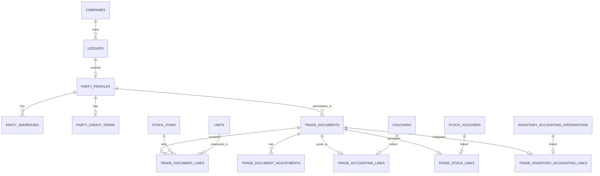
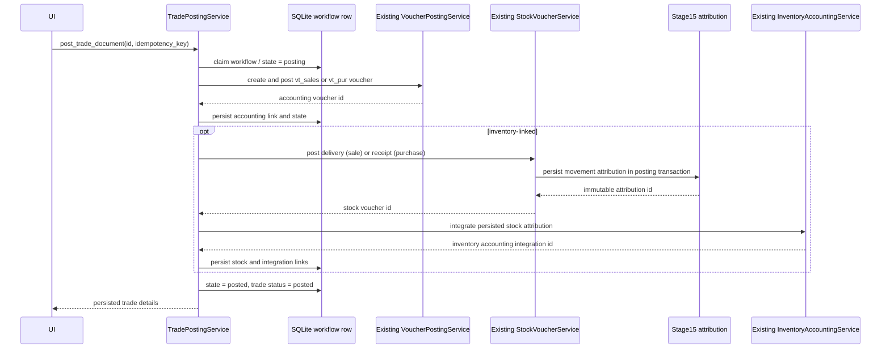
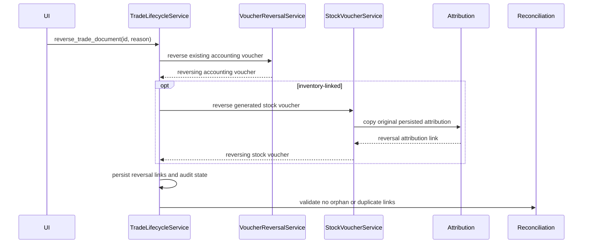

# OpenTally Sprint 6 Stage 16

## Sales & Purchase Management: Architecture and Foundation

**Status:** Proposed architecture; implementation intentionally not started  
**Date:** 2026-11-15  
**Scope:** Party master, sales and purchase document foundations, inventory/accounting integration boundaries, receivables/payables groundwork, and tax extensibility.

## 1. Architectural position

Sales and purchase management will be a domain extension around the existing accounting and inventory engines. It will not introduce a second ledger master, voucher pipeline, numbering allocator, stock movement engine, valuation engine, or financial arithmetic implementation.

The authoritative records remain:

| Concern | Existing authority | Stage 16 relationship |
|---|---|---|
| Account groups and ledgers | `account_groups`, `ledgers`, `LedgerService` | Parties reference an existing ledger using a company-scoped composite foreign key. |
| Accounting voucher lifecycle | `vouchers`, `voucher_lines`, `VoucherDraftService`, `VoucherPostingService`, cancellation/reversal/correction services | A trade document owns or references its accounting voucher. Permanent numbering comes from the existing voucher series. |
| Stock transactions | `stock_vouchers`, `stock_voucher_lines`, `stock_movements`, `StockVoucherService` | Inventory-linked trade lines generate one linked stock voucher; no movement rows are written directly by sales/purchase code. |
| Valuation | `ValuationService`, `inventory_cost_layers`, `inventory_valuation_consumptions` | Delivery/receipt valuation is created by the existing stock posting path. |
| Immutable posting evidence | `inventory_valuation_attributions`, `inventory_valuation_layer_uses` | Trade accounting consumes persisted attribution; it never recomputes historical cost. |
| Inventory accounting integration | `InventoryAccountingService`, `inventory_accounting_integrations` | A trade integration references the generated stock voucher and its persisted accounting impact. |
| Audit history | immutable `audit_log` and voucher service audit writes | Trade lifecycle transitions emit audit records; posted accounting and stock history remain immutable. |
| Exact arithmetic | `rust_decimal::Decimal` and canonical SQLite text amounts | All proposed monetary and quantity fields use canonical decimal text and service-level `Decimal`. |

## 2. Findings from the current implementation

The architecture was based on the implementation, not only prior documents.

### Accounting and vouchers

- Account groups and ledgers are company-scoped and use composite primary/foreign keys in `src-tauri/src/database/migrations.rs`.
- `LedgerClassification` currently exposes `standard`, `cash`, `profit_and_loss`, and the working tree also contains later inventory-facing classifications. Party ledgers should use the existing `party` classification where the current schema/runtime supports it; the migration must reconcile this with the deployed schema before implementation.
- `Voucher` and `VoucherLine` are generic enough to represent accounting-only sales and purchases. Voucher lines contain ledger, debit/credit, amount, and narration, but no stock-item fields.
- `VoucherDraftService` owns draft creation and editing. `VoucherPostingService` uses SQLite `BEGIN IMMEDIATE`, validates double entry, allocates permanent sequence metadata, writes audit history, and commits atomically.
- Cancellation, reversal, and correction are separate services. Reversal creates a one-to-one inverted accounting voucher and preserves audit history; posted lines are protected by database triggers.
- Existing voucher types include `vt_sales` and purchase-order types. A purchase accounting voucher type must be confirmed against the seeded voucher-type set before implementation; it must be added through an additive migration only if missing.

### Inventory and valuation

- Inventory masters are `stock_groups`, `stock_categories`, `units`, `stock_items`, and `godowns`.
- Stock transactions are limited to receipt, delivery, transfer, and adjustment. `StockVoucherService` owns draft, post, cancellation, reversal, movement creation, company isolation, and negative-stock checks.
- `stock_movements` is the append-only movement ledger. `inventory_cost_layers` and `inventory_valuation_consumptions` support FIFO/WAC.
- Stage 15 persists per-movement attribution and FIFO layer uses. Reversal copies original attribution rather than recalculating it.
- `InventoryAccountingService` consumes persisted attribution and is idempotent per company and stock voucher. It currently generates inventory accounting entries as a separate integration step.
- The existing inventory accounting mapping is configured at company level for inventory asset, COGS, adjustment, receipt offset, and journal series. It does not yet express sales income, purchase payable, party, discount, charge, or tax mappings.

### Application boundary

- Tauri commands in `src-tauri/src/commands/mod.rs` resolve the active company before invoking services. Existing accounting, voucher, inventory, valuation, reconciliation, and export commands follow this pattern.
- `src-tauri/src/lib.rs` registers commands and runs additive migrations during application startup.
- React navigation is state-based in `frontend/src/App.tsx`; the Gateway provides keyboard-friendly entries and existing inventory/report components establish the UI pattern.
- `frontend/src/services/api.ts` wraps Tauri `invoke` calls and retains browser-only mock behavior for selected existing screens. Sales/purchase persistence must not silently use mock data in the native application.

## 3. Domain model

### 3.1 Party management

Parties are an extension of ledgers, not a parallel accounting identity.

```text
companies
  └── account_groups ── ledgers (ledger_classification = party)
                           └── party_profiles
                                ├── customer/supplier role flags
                                ├── party_addresses
                                └── party_credit_terms
```

`party_profiles` has one row per company/ledger pair. A role set permits customer, supplier, or both without duplicating the linked ledger. Contact values and addresses are operational metadata; receivable/payable balances remain ledger-derived.

### 3.2 Trade documents

```text
party_profiles ──< trade_documents ──< trade_document_lines
                         │                    ├── stock_items / units
                         │                    └── trade_line_taxes (future groundwork)
                         ├── accounting voucher (existing vouchers)
                         ├── stock voucher (existing stock_vouchers, optional)
                         └── trade_document_adjustments
```

`trade_documents` represents the commercial document and lifecycle metadata. The existing accounting voucher remains the authoritative double-entry record. A trade document may be accounting-only or inventory-linked.

`trade_document_lines` stores document-time commercial facts: item/ledger reference, quantity, unit, rate, discount, line amount, and description. It does not store a second stock movement or valuation result. Quantity/rate/amount are canonical decimal text.

`trade_document_adjustments` represents non-line discounts, charges, or future tax components as explicit signed document facts. The posting service converts approved facts into accounting lines; it does not embed tax policy in generic voucher code.

Typed link tables record generated accounting, stock, and inventory-accounting IDs. Each link is company-scoped, unique by source document and link type, and immutable after posting except for lifecycle metadata. Separate link tables preserve target-table foreign keys and make one-to-many future extensions explicit.



## 4. Proposed database design

The following is a design target for an additive migration. Exact column names and constraints must be reviewed against the migration runner before implementation.

### 4.1 Party tables

```sql
CREATE TABLE party_profiles (
  id TEXT NOT NULL,
  company_id TEXT NOT NULL,
  ledger_id TEXT NOT NULL,
  display_name TEXT NOT NULL COLLATE NOCASE,
  customer_enabled INTEGER NOT NULL DEFAULT 0 CHECK (customer_enabled IN (0,1)),
  supplier_enabled INTEGER NOT NULL DEFAULT 0 CHECK (supplier_enabled IN (0,1)),
  phone TEXT, email TEXT,
  tax_registration_reference TEXT,
  is_active INTEGER NOT NULL DEFAULT 1 CHECK (is_active IN (0,1)),
  created_at TEXT NOT NULL DEFAULT CURRENT_TIMESTAMP,
  updated_at TEXT NOT NULL DEFAULT CURRENT_TIMESTAMP,
  PRIMARY KEY (company_id, id),
  UNIQUE (company_id, ledger_id),
  FOREIGN KEY (company_id, ledger_id) REFERENCES ledgers(company_id, id) ON DELETE RESTRICT,
  CHECK (customer_enabled = 1 OR supplier_enabled = 1)
);

CREATE INDEX idx_party_profiles_role
  ON party_profiles(company_id, customer_enabled, supplier_enabled, is_active);

CREATE TABLE party_addresses (
  id TEXT NOT NULL,
  company_id TEXT NOT NULL,
  party_id TEXT NOT NULL,
  address_type TEXT NOT NULL CHECK (address_type IN ('billing','shipping','both','other')),
  address_text TEXT NOT NULL,
  is_default INTEGER NOT NULL DEFAULT 0 CHECK (is_default IN (0,1)),
  PRIMARY KEY (company_id, id),
  FOREIGN KEY (company_id, party_id) REFERENCES party_profiles(company_id, id) ON DELETE CASCADE
);

CREATE TABLE party_credit_terms (
  company_id TEXT NOT NULL,
  party_id TEXT NOT NULL,
  credit_days INTEGER NOT NULL DEFAULT 0 CHECK (credit_days >= 0),
  credit_limit TEXT NOT NULL DEFAULT '0',
  PRIMARY KEY (company_id, party_id),
  FOREIGN KEY (company_id, party_id) REFERENCES party_profiles(company_id, id) ON DELETE CASCADE
);
```

The party profile does not duplicate opening balances. Existing `opening_balances` on the linked ledger remains authoritative. Any party-level display of opening receivable/payable is a filtered view of that ledger balance.

### 4.2 Trade document tables

```sql
CREATE TABLE trade_documents (
  id TEXT NOT NULL,
  company_id TEXT NOT NULL,
  document_type TEXT NOT NULL CHECK (document_type IN ('sales','purchase')),
  party_id TEXT NOT NULL,
  document_date TEXT NOT NULL,
  due_date TEXT,
  supplier_invoice_no TEXT,
  supplier_invoice_date TEXT,
  reference_no TEXT,
  narration TEXT,
  stock_linked INTEGER NOT NULL DEFAULT 0 CHECK (stock_linked IN (0,1)),
  status TEXT NOT NULL CHECK (status IN ('draft','posted','cancelled','reversed')),
  subtotal TEXT NOT NULL DEFAULT '0',
  discount_total TEXT NOT NULL DEFAULT '0',
  charge_total TEXT NOT NULL DEFAULT '0',
  tax_total TEXT NOT NULL DEFAULT '0',
  grand_total TEXT NOT NULL DEFAULT '0',
  reversal_of_document_id TEXT,
  created_at TEXT NOT NULL DEFAULT CURRENT_TIMESTAMP,
  updated_at TEXT NOT NULL DEFAULT CURRENT_TIMESTAMP,
  PRIMARY KEY (company_id, id),
  FOREIGN KEY (company_id, party_id) REFERENCES party_profiles(company_id, id) ON DELETE RESTRICT,
  FOREIGN KEY (company_id, accounting_voucher_id) REFERENCES vouchers(company_id, id) ON DELETE RESTRICT,
  FOREIGN KEY (company_id, reversal_of_document_id) REFERENCES trade_documents(company_id, id) ON DELETE RESTRICT
);

CREATE INDEX idx_trade_documents_register
  ON trade_documents(company_id, document_type, document_date, status, id);
CREATE INDEX idx_trade_documents_party_due
  ON trade_documents(company_id, party_id, status, due_date);

CREATE TABLE trade_document_adjustments (
  id TEXT NOT NULL,
  company_id TEXT NOT NULL,
  trade_document_id TEXT NOT NULL,
  adjustment_type TEXT NOT NULL CHECK (adjustment_type IN ('discount','charge','tax')),
  description TEXT,
  amount TEXT NOT NULL,
  ledger_id TEXT,
  PRIMARY KEY (company_id, id),
  FOREIGN KEY (company_id, trade_document_id) REFERENCES trade_documents(company_id, id) ON DELETE CASCADE,
  FOREIGN KEY (company_id, ledger_id) REFERENCES ledgers(company_id, id) ON DELETE RESTRICT,
  CHECK (amount NOT GLOB '*[^0-9.]*')
);

CREATE TABLE trade_document_lines (
  id TEXT NOT NULL,
  company_id TEXT NOT NULL,
  trade_document_id TEXT NOT NULL,
  line_number INTEGER NOT NULL CHECK (line_number > 0),
  stock_item_id TEXT,
  unit_id TEXT,
  ledger_id TEXT,
  description TEXT,
  quantity TEXT,
  rate TEXT NOT NULL,
  discount TEXT NOT NULL DEFAULT '0',
  amount TEXT NOT NULL,
  PRIMARY KEY (company_id, id),
  UNIQUE (company_id, trade_document_id, line_number),
  FOREIGN KEY (company_id, trade_document_id) REFERENCES trade_documents(company_id, id) ON DELETE CASCADE,
  FOREIGN KEY (company_id, stock_item_id) REFERENCES stock_items(company_id, id) ON DELETE RESTRICT,
  FOREIGN KEY (company_id, unit_id) REFERENCES units(company_id, id) ON DELETE RESTRICT,
  FOREIGN KEY (company_id, ledger_id) REFERENCES ledgers(company_id, id) ON DELETE RESTRICT,
  CHECK ((stock_item_id IS NULL AND unit_id IS NULL) OR (stock_item_id IS NOT NULL AND unit_id IS NOT NULL)),
  CHECK (quantity IS NULL OR quantity NOT GLOB '*[^0-9.]*'),
  CHECK (rate NOT GLOB '*[^0-9.]*' AND discount NOT GLOB '*[^0-9.]*' AND amount NOT GLOB '*[^0-9.]*')
);

CREATE TABLE trade_accounting_links (
  id TEXT NOT NULL,
  company_id TEXT NOT NULL,
  trade_document_id TEXT NOT NULL,
  accounting_voucher_id TEXT NOT NULL,
  created_at TEXT NOT NULL DEFAULT CURRENT_TIMESTAMP,
  PRIMARY KEY (company_id, id),
  UNIQUE (company_id, trade_document_id),
  UNIQUE (company_id, accounting_voucher_id),
  FOREIGN KEY (company_id, trade_document_id) REFERENCES trade_documents(company_id, id) ON DELETE CASCADE,
  FOREIGN KEY (company_id, accounting_voucher_id) REFERENCES vouchers(company_id, id) ON DELETE RESTRICT
);

CREATE TABLE trade_stock_links (
  id TEXT NOT NULL,
  company_id TEXT NOT NULL,
  trade_document_id TEXT NOT NULL,
  stock_voucher_id TEXT NOT NULL,
  created_at TEXT NOT NULL DEFAULT CURRENT_TIMESTAMP,
  PRIMARY KEY (company_id, id),
  UNIQUE (company_id, trade_document_id),
  UNIQUE (company_id, stock_voucher_id),
  FOREIGN KEY (company_id, trade_document_id) REFERENCES trade_documents(company_id, id) ON DELETE CASCADE,
  FOREIGN KEY (company_id, stock_voucher_id) REFERENCES stock_vouchers(company_id, id) ON DELETE RESTRICT
);

CREATE TABLE trade_inventory_accounting_links (
  id TEXT NOT NULL,
  company_id TEXT NOT NULL,
  trade_document_id TEXT NOT NULL,
  integration_id TEXT NOT NULL,
  created_at TEXT NOT NULL DEFAULT CURRENT_TIMESTAMP,
  PRIMARY KEY (company_id, id),
  UNIQUE (company_id, trade_document_id),
  UNIQUE (company_id, integration_id),
  FOREIGN KEY (company_id, trade_document_id) REFERENCES trade_documents(company_id, id) ON DELETE CASCADE,
  FOREIGN KEY (company_id, integration_id) REFERENCES inventory_accounting_integrations(company_id, id) ON DELETE RESTRICT
);
```

The typed link tables deliberately avoid a polymorphic `linked_id`. Their composite foreign keys let reconciliation identify exact orphan and cross-company references.

For line-level traceability, add `trade_document_line_stock_links(company_id, id, trade_line_id, stock_voucher_line_id)` with unique `(company_id, trade_line_id)` and `(company_id, stock_voucher_line_id)` plus composite foreign keys to `trade_document_lines` and `stock_voucher_lines`. The trade header links identify the operation; the line links identify exactly which commercial quantity generated each stock movement. Valuation attribution remains linked through `stock_voucher_line_id → stock_movement_id → inventory_valuation_attributions`.

## 5. Posting architecture

### Sales

For an accounting-only sale, the service creates an existing `vt_sales` accounting voucher with:

- Customer/party ledger: debit for the receivable, unless an approved cash/bank mode is introduced later.
- Sales ledger: credit for income.
- Discount and charges: explicit mapped debit/credit lines according to approved policy.
- Tax lines: only when a configured, approved tax rule is available.

For an inventory-linked sale, the service additionally creates and posts one existing stock `delivery` voucher. The stock posting path creates the movement and immutable FIFO/WAC attribution. Existing inventory accounting integration creates the COGS debit and inventory-asset credit from that persisted attribution. The trade document links both the accounting voucher and generated stock voucher; it does not write stock movement rows itself.

### Purchase

For an accounting-only purchase, the service creates an existing purchase accounting voucher with supplier/payable and purchase/expense mappings.

For an inventory-linked purchase, the service additionally creates and posts one existing stock `receipt` voucher. Receipt unit cost is taken from the commercial line after approved discount/charge allocation rules. Existing valuation persists the receipt layer and attribution. The purchase accounting voucher and inventory integration must use the same persisted commercial amount and approved ledger mappings.

The exact purchase/sales ledger mapping policy is unresolved and must be approved before implementation. The current Stage 14 inventory mapping (`receipt_offset_ledger_id`) must not be silently reused as a payable or income policy.

### Transaction boundary

The final implementation must provide an orchestration transaction boundary that prevents a posted trade document from existing without its required accounting/stock links. Existing services own independent transactions today, so the implementation plan must either:

1. expose transaction-aware lower-level posting functions that share one SQLite transaction, or
2. introduce a durable state machine (`draft` → `posting` → `posted`/`failed`) with recovery and idempotent link checks.

Calling the current public services sequentially without a boundary is not sufficient for atomic sales/purchase posting.

## 6. Receivables and payables authority

The authoritative outstanding balance is the linked party ledger’s posted voucher balance, filtered by company and ledger. `trade_documents` supplies due dates and invoice references; it does not maintain a competing balance column.

Until receipt/payment allocation exists, outstanding reporting must clearly state that it is ledger-level and unallocated. Future allocation should reference the existing posted accounting voucher and line, with an append-only allocation table and exact Decimal remaining balance. No allocation table is required for this foundation stage unless needed to preserve a correct lifecycle link.

## 7. Tax architecture groundwork

Tax is represented as configuration and document evidence, not hardcoded GST logic. A future additive model should contain:

- tax code/rule identity;
- effective-from/effective-to dates;
- inclusive/exclusive mode;
- rate as canonical Decimal text;
- line/document applicability;
- rounding precision/method;
- mapped tax ledger;
- jurisdiction and registration metadata.

No rate, tax jurisdiction, legal threshold, or GST compliance claim is included in this stage. Tax posting must fail closed when a required approved configuration is absent.

## 8. Frontend architecture

Stage 16 UI should extend the existing Gateway, form, table, keyboard shortcut, active-company, and error-notification patterns:

- Party master view: ledger link, role flags, contacts, addresses, credit terms, active state.
- Sales and purchase editor: header, party, date/due date, line grid, optional stock item/unit, rate, discount, charges, totals, references, draft/post actions.
- Register: document type, party, date, status, number, total, due date, search/filter, detail navigation.
- Detail view: commercial facts plus linked accounting voucher, stock voucher, valuation attribution, and lifecycle audit status.

The frontend API should use typed request/response models and invoke Tauri commands. Browser mock data may remain for existing screens, but Stage 16 persistence screens should display an explicit native-runtime requirement rather than fabricate financial records.

## 9. Risks and dependencies

- The current schema/runtime classification values must be reconciled before using `party` ledgers.
- Existing public service transactions are not composable; atomic orchestration is the main implementation risk.
- Sales and purchase ledger mapping is policy-sensitive and cannot be inferred from the current inventory offset mapping.
- Tax-inclusive pricing, discounts, charges, and rounding allocation require approved rules before posting.
- Existing stock accounting integration is a separate journal; whether the final commercial document uses one combined journal or linked journals requires a decision.
- Historical posted vouchers must remain unchanged. New links must be additive and must not backfill unverifiable historical attribution.

## 10. Stage 16 boundary

This document defines architecture only. It does not implement parties, sales/purchase tables, migrations, services, commands, UI, tax calculations, receipt/payment allocation, or new accounting policies.

## 11. Independent architecture audit

This section records the final audit against the source tree. `VERIFIED` means the claim is directly supported by current code or SQL. `PROPOSED` means it is Stage 16 design work. `UNVERIFIED` means implementation evidence is insufficient and the claim must not be treated as a capability.

### VERIFIED

- `account_groups`, `ledgers`, `opening_balances`, `vouchers`, `voucher_lines`, `voucher_types`, `voucher_number_series`, and `audit_log` are defined in `src-tauri/src/database/migrations.rs`.
- Voucher posting, numbering allocation, double-entry validation, cancellation, reversal, correction, and audit writes are implemented in `src-tauri/src/vouchers/service/{posting,sequence,double_entry,cancellation,reversal,correction}.rs`.
- `VoucherPostingService` and cancellation/reversal services acquire SQLite `BEGIN IMMEDIATE` write transactions. The double-entry validator uses `rust_decimal::Decimal` and rejects invalid posting structures.
- Predefined `vt_sales` and `vt_pur` accounting voucher types are seeded by the company-insert trigger and the existing voucher-type seed in `src-tauri/src/database/migrations.rs`.
- Inventory masters and transactions are implemented in `src-tauri/src/inventory/mod.rs` and `stock_vouchers.rs`; stock movement tables and company-scoped composite foreign keys are in the Sprint 4 migrations.
- FIFO/WAC valuation is implemented in `valuation.rs`; Stage 15 attribution and FIFO layer-use persistence are implemented in `attribution.rs` and protected by immutable triggers.
- Existing inventory accounting supports receipt, delivery, and physical-adjustment mappings and consumes persisted attribution in `inventory/accounting.rs`. It does not yet support sales-income, purchase-payable, party, discount, charge, or tax mappings.
- Active-company resolution and Tauri command registration are implemented in `commands/mod.rs` and `lib.rs`; React view routing and typed `invoke` wrappers are implemented in `frontend/src/App.tsx` and `frontend/src/services/api.ts`.

### PROPOSED

- `party_profiles`, addresses, credit terms, trade documents, commercial lines, adjustments, typed links, and posting workflow state.
- Sales/purchase draft UI, trade register, detail view, party management, and future tax configuration.
- The Stage 16 orchestration service and its transaction-aware or recoverable workflow boundary.

### UNVERIFIED / corrected claims

- The Rust `LedgerClassification` enum contains `party`, `bank`, and `tax`, but the deployed base SQL check shown in `migrations.rs` accepts only `standard`, `cash`, and `profit_and_loss`. Party-ledger classification is therefore not currently verified as database-supported. Phase 16A must resolve this by an additive migration or use a separate party-role extension without claiming a new classification.
- A single atomic transaction spanning the current public accounting service, stock voucher service, valuation attribution, and inventory-accounting integration is not currently implemented. The Stage 16 workflow must not claim atomicity until transaction-aware internals or durable recovery are implemented and tested.
- The current inventory accounting integration has a process-local per-voucher serialization guard and SQLite uniqueness for integration rows. Cross-process completion ordering is not a verified guarantee.
- The current inventory accounting service creates a separate journal for inventory impact. Whether Stage 16 should combine commercial and inventory lines into one journal or retain linked journals is a policy decision, not an existing capability.

## 12. Corrected posting and recovery design

The previous high-level flow is refined as follows. The commercial document is the authoritative business-document record; existing accounting and stock vouchers remain authoritative for their respective ledgers. No stage may mark the trade document `posted` until all required links and persisted attribution are present.



Because the current public services own separate transactions, the implementation must use one of these explicit strategies:

1. Extract transaction-aware internal functions that share one `SqliteConnection`/transaction while preserving current public APIs; or
2. Add `trade_posting_workflows` and make every step idempotent, resumable, and reconciliable.

The second option is the minimum safe fallback if a single SQLite transaction cannot span service boundaries. The workflow must include `posting`, `accounting_posted`, `stock_posted`, `inventory_accounting_posted`, `posted`, and `failed` states, attempt count, idempotency key, last error, and timestamps. Retries must inspect existing typed links before creating records and must never create a second voucher or stock movement.

Reversal follows the same traceable rule:



## 13. Accounting examples and policy boundary

The following are balanced examples of proposed posting shapes, not approved statutory policy. The named ledgers are mapping roles, not hardcoded ledger IDs. Every amount is an exact decimal string.

| Scenario | Debit | Credit | Inventory/valuation | Status |
|---|---|---|---|---|
| Credit sale, invoice total `100` | Party receivable `100` | Sales income `100` | None for accounting-only; delivery attribution required for stock-linked sale | Proposed shape; ledger mapping requires approval |
| Cash sale, invoice total `100` | Existing cash/bank ledger `100` | Sales income `100` | Same stock-linked option as above | Proposed shape; cash/bank selection policy requires approval |
| Sale with discount, gross `100`, discount `10`, receivable `90` | Party `90`; discount ledger `10` | Sales income `100` | Stock cost remains the persisted delivery attribution | Proposed shape; discount presentation/allocation requires approval |
| Sale with additional charge `5`, goods `100` | Party `105` | Sales income `100`; charge ledger `5` | Stock cost remains the persisted delivery attribution | Proposed shape; charge taxability/mapping requires approval |
| Sales inventory reduction at persisted cost `60` | COGS `60` | Inventory asset `60` | Existing delivery movement and immutable FIFO/WAC attribution | Existing inventory mapping shape; trade linkage proposed |
| Credit purchase, invoice total `100` | Purchase/Inventory ledger `100` | Supplier payable `100` | Receipt layer and attribution at unit cost | Proposed shape; purchase ledger policy requires approval |
| Cash purchase, invoice total `100` | Purchase/Inventory ledger `100` | Existing cash/bank ledger `100` | Same receipt behavior when stock-linked | Proposed shape; cash/bank policy requires approval |
| Purchase with discount or charge | Direction depends on whether the amount changes cost, payable, or an independent discount/charge ledger | Balancing side is the supplier/cash ledger or approved mapped ledger | Receipt attribution must use the approved net unit-cost allocation | **Unresolved; no policy is assumed** |

For a stock-linked sale, the commercial accounting entry and the existing inventory accounting entry may be separate linked journals unless the approved design selects one combined journal. The current code only proves the inventory journal mappings in `inventory/accounting.rs`; it does not prove the commercial mappings above.

### Corrected workflow table

The proposed schema must add the following durable workflow table or an equivalent state record; the earlier `trade_documents.status` column alone is insufficient for safe retry:

```sql
CREATE TABLE trade_posting_workflows (
  company_id TEXT NOT NULL,
  id TEXT NOT NULL,
  trade_document_id TEXT NOT NULL,
  state TEXT NOT NULL CHECK (state IN ('posting','accounting_posted','stock_posted','inventory_accounting_posted','posted','failed')),
  idempotency_key TEXT NOT NULL,
  attempt_count INTEGER NOT NULL DEFAULT 0 CHECK (attempt_count >= 0),
  last_error TEXT,
  created_at TEXT NOT NULL DEFAULT CURRENT_TIMESTAMP,
  updated_at TEXT NOT NULL DEFAULT CURRENT_TIMESTAMP,
  PRIMARY KEY (company_id, id),
  UNIQUE (company_id, trade_document_id),
  UNIQUE (company_id, idempotency_key),
  FOREIGN KEY (company_id, trade_document_id) REFERENCES trade_documents(company_id, id) ON DELETE RESTRICT
);
```

The workflow row is operational state, not a second accounting truth. Accounting amounts, stock quantities, valuation, and outstanding balances remain authoritative in their existing tables.

## 13. Approval dependency

The technical recommendation is durable workflow plus typed links. D16-01 is approved by the user's 2026-11-15 approval record; implementation remains blocked only for deferred D16-03, D16-04, and D16-05. No commercial ledger mapping or tax branch may be enabled from these documents alone.

## 14. Formal approval summary

**Approval date:** 2026-11-15  
**Stage 16 status:** **APPROVED WITH DEFERRED PROFESSIONAL ACCOUNTING/TAX DECISIONS.**

Approved for subsequent work: durable workflow, safe party classification migration only when demonstrated, warning-only credit limits, and explicit due-date overrides with persisted provenance. Deferred: commercial ledger mappings, combined/linked inventory accounting journal policy, and tax pricing/applicability/rounding/ledger policy. Stage 17 is limited to Party Masters and must preserve these restrictions.
