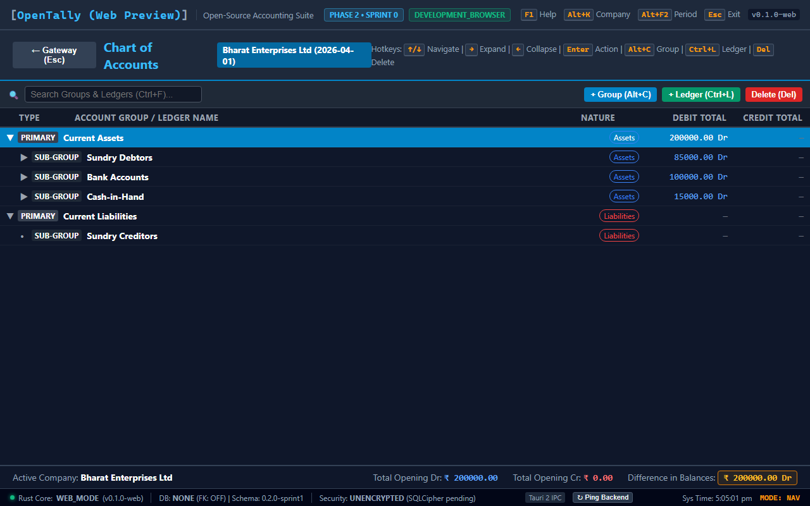
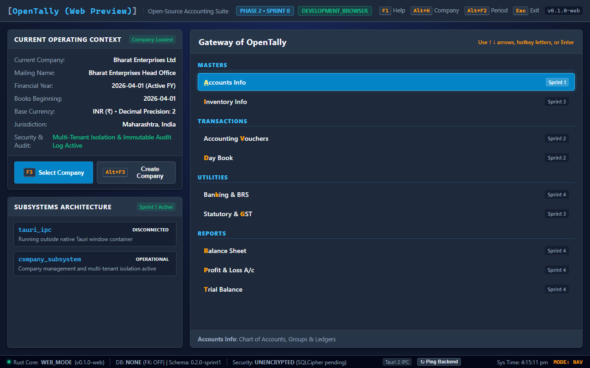
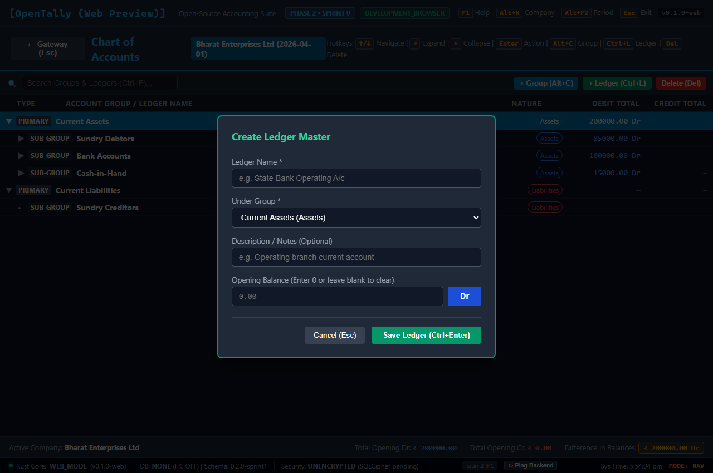

<div align="center">

# ⚡ OpenTally

**The Modern, High-Performance Open-Source Accounting Engine & Desktop Suite**

*Built with Tauri 2, Rust, SQLite WAL, and React 18 • Engineered for bit-exact financial precision, keyboard-first velocity, and clean-room interoperability with TallyPrime observable behaviors.*

---

[](#current-implementation-status)
[](LICENSE)
[](https://www.rust-lang.org/)
[](https://v2.tauri.app/)
[](https://react.dev/)
[](https://www.sqlite.org/)
[-22c55e?style=for-the-badge&logo=githubactions&logoColor=white)](#testing--verification)

<p align="center">
  <a href="#quickstart--development-guide">🚀 <b>Quickstart</b></a> •
  <a href="#visual-showcase">📸 <b>Screenshots</b></a> •
  <a href="#key-features">✨ <b>Features</b></a> •
  <a href="#architecture--clean-room-methodology">🏛️ <b>Architecture</b></a> •
  <a href="#keyboard-shortcuts-reference">⌨️ <b>Hotkeys</b></a> •
  <a href="#project-roadmap">🗺️ <b>Roadmap</b></a> •
  <a href="#contributing">🤝 <b>Contributing</b></a>
</p>

</div>

---

## 📸 Visual Showcase

<div align="center">

### Chart of Accounts & Real-Time Double-Entry Equilibrium
*Hierarchical account group tree, multi-level balance rollups, reserved system ledgers, and live Debit/Credit balance equilibrium verification.*



</div>

<br/>

<div align="center">

| Company Selection & Management Dashboard | Ledger Master Creation & Precision Math |
| :---: | :---: |
|  |  |
| *Multi-company isolation, statutory financial year boundaries, leap-year validation, and soft-archival.* | *Exact decimal precision, account group selection, opening balance validation, and Dr/Cr direction.* |

</div>

---

## ✨ Key Features

<table>
  <tr>
    <td width="50%">
      <h3>⚡ Native Desktop Velocity</h3>
      <p>Sub-millisecond query execution, instantaneous startup, and negligible memory footprint powered by compiled <b>Rust</b> and <b>Tauri 2</b>. No heavy browser runtimes or bloated Electron containers.</p>
    </td>
    <td width="50%">
      <h3>🎯 Bit-Exact Decimal Precision</h3>
      <p>All monetary calculations are performed with 128-bit fixed-point decimal arithmetic via <code>rust_decimal</code>. Floating-point representation (<code>f32</code>/<code>f64</code>) is strictly banned across all ledger pipelines.</p>
    </td>
  </tr>
  <tr>
    <td width="50%">
      <h3>⌨️ Keyboard-First Ergonomics</h3>
      <p>Engineered for high-volume accountants and data-entry operators. Full keyboard workflow with traditional hotkeys (<code>F4</code>–<code>F9</code>, <code>Alt+F5</code>/<code>F6</code>, <code>F2</code>, <code>Enter</code>, <code>Esc</code>) to fly through vouchers without touching the mouse.</p>
    </td>
    <td width="50%">
      <h3>⚖️ Double-Entry Equilibrium Assurance</h3>
      <p>Continuous mathematical equilibrium assertion. Real-time balance rollup verifies $\sum \text{Debit} == \sum \text{Credit}$ across all 29 predefined statutory account groups and custom child hierarchies.</p>
    </td>
  </tr>
  <tr>
    <td width="50%">
      <h3>🛡️ Clean-Room Legal Hygiene</h3>
      <p>Net-new, independent implementation authored solely from observable behavioral research and accounting specifications. Zero proprietary binaries, <code>.tsf</code> data files, raw TDL source, or decompiled code.</p>
    </td>
    <td width="50%">
      <h3>🔒 Local-First & 100% Offline</h3>
      <p>Your financial records remain entirely on your machine. Embedded SQLite operating in Write-Ahead Logging (<code>WAL</code>) mode with atomic write transactions (<code>BEGIN IMMEDIATE</code>) ensures crash resilience and total privacy.</p>
    </td>
  </tr>
</table>

---

## 🏛️ Architecture & Clean-Room Methodology

OpenTally employs a strict **Clean-Room Engineering** methodology strictly partitioning behavioral research from independent implementation:

```
OpenTally/
├── 01-clean-room-specs/   <─── DIRTY ROOM (Specification & Behavioral Research Domain)
└── 02-open-tally/          <─── CLEAN ROOM (Independent Implementation & Testing Domain)
```



```mermaid
flowchart TD
    subgraph DIRTY_ROOM["01-clean-room-specs/ (Dirty Room)"]
        A["Observable Behavioral Research"] --> B["Wire Protocol & Packet Captures"]
        B --> C["Formal Data Contracts & Formulas"]
        C --> D["Evidence Schemas & UNKNOWNS.md"]
    end

    DIRTY_ROOM -->|"Written Specifications Only (No Code/Binaries)"| CLEAN_ROOM

    subgraph CLEAN_ROOM["02-open-tally/ (Clean Room)"]
        subgraph UI["Desktop GUI Layer (React 18 + TS)"]
            E["Keyboard Controller & Hotkeys"]
            F["Gateway, CoA Tree & Modals"]
            G["Live Equilibrium Indicator"]
        end

        UI <-->|"Tauri 2 IPC Bridge (11 Commands)"| CORE

        subgraph CORE["Core Accounting Engine (Rust)"]
            H["Fixed-Point Math (rust_decimal)"]
            I["Multi-Company Isolation & Calendar Validation"]
            J["29 Predefined Groups & Trigger Guards"]
            K["Programmatic Migration Runner"]
        end

        CORE <-->|"Prepared Statements (sqlx)"| DB

        subgraph DB["Transactional Storage (SQLite WAL)"]
            L["Strict Foreign Keys (ON DELETE RESTRICT)"]
            M["Composite Candidate Keys & Triggers"]
            N["Immutable Audit Trail (audit_log)"]
        end
    end

    style DIRTY_ROOM fill:#fef2f2,stroke:#ef4444,stroke-width:2px;
    style CLEAN_ROOM fill:#f0fdf4,stroke:#22c55e,stroke-width:2px;
    style UI fill:#eff6ff,stroke:#3b82f6;
    style CORE fill:#fff7ed,stroke:#f97316;
    style DB fill:#f8fafc,stroke:#64748b;
```

### Absolute Governance Guardrails
1. **Dirty Room (`01-clean-room-specs/`)**: Protocol analysis, observable behavioral documentation, and specification authoring. Reverse engineering tooling is restricted strictly to authorized research producing documentation.
2. **Clean Room (`02-open-tally/`)**: Net-new, independent software implementation authored strictly from written specifications. Proprietary executable binaries, proprietary database files (`.tsf`), raw TDL source code, extracted graphics, and decompiled code are **strictly prohibited**.

---

## 📁 Repository Tour

```text
OpenTally/
├── assets/                                  # Project badges, screenshots, and visual assets
│   └── screenshots/                        # High-resolution desktop UI captures
├── 01-clean-room-specs/                    # Specification Domain (Dirty Room)
│   └── tallyprime/                         # Wire formats, voucher matrices, and behavioral specs
│       ├── accounting/                     # Ledger hierarchies and Chart of Accounts specifications
│       ├── evidence/                       # Observable evidence schemas (YAML)
│       ├── interoperability/               # HTTP/XML port 9000 communication catalog
│       ├── inventory/                      # Stock items, units, and valuation specifications
│       ├── taxation/                       # Indian GST, TDS, and TCS computation rules
│       ├── vouchers/                       # Voucher types, numbering schemes, and posting rules
│       └── UNKNOWNS.md                     # Structured protocol ambiguity tracking ledger
├── 02-open-tally/                          # Implementation Domain (Clean Room)
│   ├── docs/                               # Architecture Decision Records (ADRs) & Technical Designs
│   │   ├── ADR-001-embedded-database-selection.md     # SQLite WAL embedded database selection
│   │   ├── OPENTALLY_SPRINT1_FINAL_COMPLETION_REPORT.md # Sprint 1 completion documentation
│   │   ├── OPENTALLY_SPRINT2_VOUCHER_ENGINE_TECHNICAL_DESIGN.md # Voucher engine specification (v2.9.4)
│   │   └── README.md                       # Architecture document index
│   ├── frontend/                           # Desktop User Interface (TypeScript / React 18 / Vite)
│   │   ├── src/
│   │   │   ├── components/                 # Chart of Accounts, Company creation, Modals, Status bars
│   │   │   ├── hooks/                      # Keyboard navigation and hotkey listeners
│   │   │   ├── services/                   # Tauri IPC bridge wrappers
│   │   │   ├── types/                      # Domain data contracts and Discriminated Unions
│   │   │   ├── App.tsx                     # Top-level application shell
│   │   │   └── main.tsx                    # React DOM entry point
│   │   ├── package.json
│   │   └── vite.config.ts
│   └── src-tauri/                          # Core Accounting Engine (Rust / Tauri 2)
│       ├── src/
│       │   ├── accounting/                 # Chart of Accounts, 29 groups, 2 reserved ledgers, validation
│       │   ├── app/                        # Application state container
│       │   ├── commands/                   # 11 Tauri IPC command handlers
│       │   ├── company/                    # Company management, FY dates, validation
│       │   ├── config/                     # Configuration and paths
│       │   ├── database/                   # SQLite connection pool, WAL mode, programmatic migrations
│       │   ├── errors/                     # Structured typed error definitions (OpenTallyError)
│       │   ├── logging/                    # Tracing diagnostics
│       │   ├── lib.rs                      # Tauri runtime initialization & IPC registry
│       │   └── main.rs                     # Desktop executable entry point
│       ├── Cargo.toml
│       └── tauri.conf.json
├── OpenTally_Phase1_Complete_Research_Package/ # Phase 1 research documentation & knowledge base
├── scratch/                                # Standalone verification test scripts for design validation
├── AGENTS.md                               # Multi-agent clean-room orchestration rules
├── CONTRIBUTING.md                         # Contributor guidelines and clean-room policy
├── LICENSE                                 # MIT License
├── README.md                               # This file
├── SECURITY.md                             # Security policy and vulnerability disclosure
└── Skill.md                                # Tooling guidelines
```

---

## ⌨️ Keyboard Shortcuts Reference

OpenTally replicates standard accounting ergonomics:

| Hotkey | Action | Scope | Description |
|:---:|:---|:---:|:---|
| <kbd>F2</kbd> | **Change Date** | Global | Change active working transaction date |
| <kbd>F3</kbd> | **Select Company** | Global | Switch active company workspace |
| <kbd>Alt</kbd> + <kbd>F3</kbd> | **Company Menu** | Global | Open Company Creation / Alteration modal |
| <kbd>F4</kbd> | **Contra Voucher** | Voucher Entry | Cash ↔ Bank fund transfers |
| <kbd>F5</kbd> | **Payment Voucher** | Voucher Entry | Money paid out (Cash / Bank) |
| <kbd>F6</kbd> | **Receipt Voucher** | Voucher Entry | Money received (Cash / Bank) |
| <kbd>F7</kbd> | **Journal Voucher** | Voucher Entry | General double-entry adjustment entries |
| <kbd>F8</kbd> | **Sales Voucher** | Voucher Entry | Commercial sales invoices |
| <kbd>F9</kbd> | **Purchase Voucher** | Voucher Entry | Commercial purchase invoices |
| <kbd>Alt</kbd> + <kbd>F5</kbd> | **Debit Note** | Voucher Entry | Purchase returns / supplier debits |
| <kbd>Alt</kbd> + <kbd>F6</kbd> | **Credit Note** | Voucher Entry | Sales returns / customer credits |
| <kbd>F10</kbd> | **Other Vouchers** | Voucher Entry | Command palette for all 24 voucher types |
| <kbd>Tab</kbd> / <kbd>Enter</kbd> | **Next Field** | Forms & Grids | Smooth keyboard field traversal |
| <kbd>Esc</kbd> | **Back / Cancel** | Navigation | Return to previous menu or close active modal |
| <kbd>Ctrl</kbd> + <kbd>Enter</kbd> | **Commit / Post** | Voucher Entry | Validate equilibrium and commit transaction |

---

## 📊 Current Implementation Status

```
[████████████████████████████████████████] Phase 1: Research & Specifications (100%)
[████████████████████████████████████████] Sprint 1: Company & Chart of Accounts (100%)
[████████████████████░░░░░░░░░░░░░░░░░░░░] Sprint 2: Voucher Management & Engine (Design Ready)
[░░░░░░░░░░░░░░░░░░░░░░░░░░░░░░░░░░░░░░░░] Sprint 3: Financial Reporting (Scheduled)
```

### ✅ Phase 1: Behavioral Research & Specifications (Complete)
- 10 research domains analyzed and documented in `01-clean-room-specs/`.
- 10 structured evidence manifests compiled in `01-clean-room-specs/tallyprime/evidence/`.
- Port 9000 XML wire-protocol catalog authored for request/response interoperability.

### ✅ Sprint 1: Company Management & Chart of Accounts (Complete & Verified)
- **Multi-Company Management**: Full CRUD lifecycle, active company persistence across desktop restarts, statutory Indian FY date validation (`04-01`), leap-year handling (Feb 29), and soft-archival (`is_archived = 1`).
- **Standard Chart of Accounts**:
  - 29 standard predefined account groups automatically seeded upon company creation.
  - 2 reserved system ledgers (`Cash` under `Cash-in-Hand`, `Profit & Loss A/c` under system group) protected by database triggers.
  - Recursive tree rollup with circular parent-child loop detection.
  - Multi-company boundary isolation enforced via composite foreign keys.
- **Opening Balances**: Exact decimal normalization with `rust_decimal`, scale validation against `currency_decimal_places`, and real-time double-entry equilibrium rollup.
- **IPC Interface**: 11 registered, verified Tauri IPC commands connecting React to Rust.

### 📐 Sprint 2: Voucher Management & Posting Engine (Technical Design v2.9.4 Approved)
- Full technical specification in `02-open-tally/docs/OPENTALLY_SPRINT2_VOUCHER_ENGINE_TECHNICAL_DESIGN.md`.
- Normalized numbering series master (`voucher_number_series`) with immutable reset frequencies (`yearly`, `monthly`, `daily`, `never`).
- Effective-dated numbering configurations (`voucher_number_configs`) with dynamic periodic tokens (`{YY-YY}`, `{YYYY-MM}`, etc.).
- Complete 13-step atomic voucher reversal pipeline under predefined `Reversing Journal` (`vt_reversing_journal`) with dedicated `REV` series.
- 18-column voucher header schema with SQLite triggers blocking direct mutation of posted transactions.
- Reconciled 12-step canonical `audit_log` migration script.
- 153 proposed test scenarios documented.

---

## 🚀 Quickstart & Development Guide

### Prerequisites
- **Rust**: Version 1.80+ or 1.99+ (`rustup default stable`)
- **Node.js**: Version 20 LTS or newer (`node -v`)
- **C++ Build Tools**: Visual Studio Build Tools with C++ on Windows (required for Tauri and SQLite compilation)

### 1. Clone the Repository
```bash
git clone -b feature/phase1 https://github.com/Sanvith6/OpenTally.git
cd OpenTally
```

### 2. Install Frontend Dependencies & Verify
```bash
cd 02-open-tally/frontend
npm install
npm test            # Run 12 Vitest frontend tests
npm run build       # Verify production web bundle compilation
cd ../..
```

### 3. Build & Test Rust Core
```bash
cd 02-open-tally/src-tauri
cargo test          # Run 52 Rust backend unit and integration tests
cargo clippy        # Check strict linter rules
cd ../..
```

### 4. Launch Desktop Application
```bash
cd 02-open-tally/src-tauri
cargo run
```
*Alternatively, for hot module reload during frontend UI development:*
```bash
cd 02-open-tally/frontend
npm run tauri dev
```

---

## 🧪 Testing & Verification

OpenTally maintains a strict **Test-Driven Development (TDD)** discipline targeting 80%+ code coverage:

```bash
# 1. Run all Rust core unit and integration tests (52 tests)
cargo test --manifest-path 02-open-tally/src-tauri/Cargo.toml

# 2. Run all frontend component tests (12 tests)
npm --prefix 02-open-tally/frontend test -- --run

# 3. Verify Sprint 2 Technical Design schema & invariant checks (19 checks)
python scratch/verify_v294.py

# 4. Verify isolated SQLite schema and trigger behavior
python scratch/test_v294_schema_and_config.py
```

### Test Suite Breakdown

| Test Suite | Tests | Status | Scope |
|:---|:---:|:---:|:---|
| **Rust Backend Tests** | 52 | **PASSED** | Multi-company isolation, calendar validation, recursive tree rollups, trigger guards, migration rollback. |
| **Frontend Vitest Tests** | 12 | **PASSED** | Chart of Accounts hierarchy, keyboard traversal, modal forms, equilibrium bar. |
| **Document Invariants** | 19 | **PASSED** | Static schema integrity, DDL candidate keys, composite foreign keys, trigger definitions. |
| **Total Automated Tests** | **83** | **100% PASS** | Zero regressions across all tiers. |

---

## 🗺️ Project Roadmap

```mermaid
gantt
    title OpenTally Development Roadmap
    dateFormat  YYYY-MM-DD
    section Phase 1 & Foundation
    Phase 1: Behavioral Research & Specs :done, 2026-10-01, 2026-10-25
    Sprint 0: Desktop Foundation (Tauri 2 + SQLite) :done, 2026-10-26, 2026-10-31
    Sprint 1: Company & Chart of Accounts :done, 2026-11-01, 2026-11-01
    section Phase 2: Core Accounting
    Sprint 2: Voucher Engine & Posting Pipeline :active, 2026-11-02, 2026-11-15
    Sprint 3: Financial Statements & Reports :2026-11-16, 2026-11-30
    section Phase 3: Commercial & Interop
    Sprint 4: Inventory, Stock & Godowns :2026-12-01, 2026-12-20
    Sprint 5: Indian Taxation (GST e-Invoicing) :2026-12-21, 2027-01-15
    Sprint 6: Port 9000 HTTP/XML Listener & TDL :2027-01-16, 2027-02-10
```

---

## 🤝 Contributing

We actively welcome contributions from software engineers, UI/UX designers, and accounting professionals!

Please review our [**CONTRIBUTING.md**](CONTRIBUTING.md) guide before opening pull requests.

### Clean-Room Engineering Pledge
To preserve independent copyright hygiene:
- **Never submit decompiled code, proprietary binary dumps, `.tsf` data files, or proprietary TDL code.**
- All clean-room implementation code must be authored independently from functional behavioral specifications or standard double-entry accounting principles (ICAI / MCA / GAAP).

---

## 🔒 Security & Vulnerability Reporting

Security and financial data privacy are fundamental to OpenTally.

Please report security issues responsibly via **[GitHub Private Vulnerability Reporting](https://github.com/Sanvith6/OpenTally/security/advisories/new)** or by emailing `sanvitjs68@gmail.com`. Do not report security vulnerabilities through public GitHub issues. See [**SECURITY.md**](SECURITY.md) for full details.

---

## ⚖️ License & Trademark Notice

### License
OpenTally is free and open-source software distributed under the terms of the **[MIT License](LICENSE)**.

### Trademark Notice
OpenTally is an independent open-source project and is not affiliated, endorsed, or sponsored by Tally Solutions Pvt. Ltd. "Tally" and "TallyPrime" are registered trademarks of Tally Solutions Pvt. Ltd. Observable behaviors, wire formats, and public accounting interfaces referenced in this project are analyzed strictly under clean-room engineering principles for the sole purpose of software interoperability.

---

<div align="center">
  <sub>Crafted with precision for the open-source accounting community.</sub>
</div>
